# Translation of The Golden Book of Chemistry 

---
## Page 1

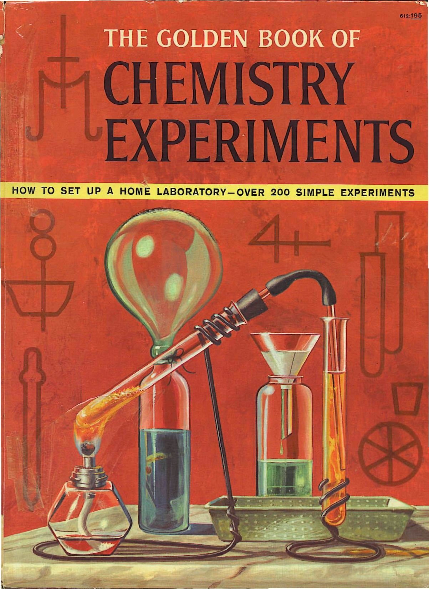

DAS GOLDENE

---
## Page 2

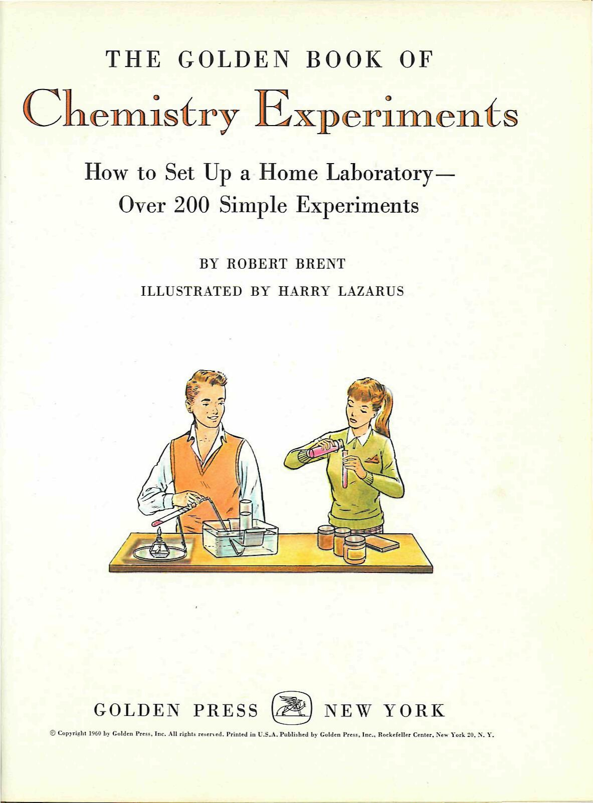

DAS GOLDENE BUCH
Wie man ein Heimlabor einrichtet –
Über 200 einfache Experimente
VON ROBERT BRENT
ILLUSTRIERT VON HARRY LAZARUS
GOLDEN PRESS
NEW YORK
I Copyright 1960 by Golden Press, Inc. Alle Rechte vorbehalten. Gedruckt in den USA. Veröffentlicht von Golden Press, Inc., Rockefeller Center, New York 20, N. Y.

---
## Page 3

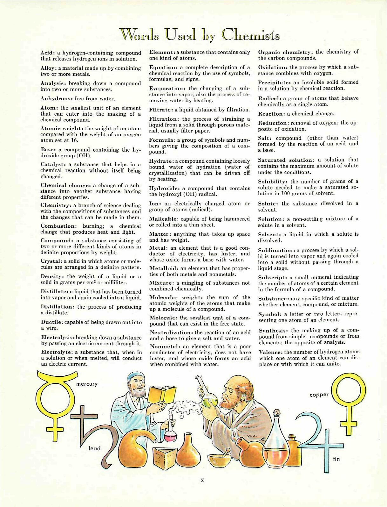

Säuren: eine wasserstoffhaltige Verbindung, die Wasserstoffionen in Lösung abgibt.
Legierung: ein Material, das durch die Kombination von zwei oder mehr Metallen hergestellt wird.
Analyse: Zersetzung einer Verbindung in zwei oder mehr Substanzen.
Wasserfrei: frei von Wasser.
Atom: die kleinste Einheit eines Elements, die an der Bildung einer chemischen Verbindung beteiligt sein kann.
Atomgewicht: das Gewicht eines Atoms im Vergleich zum Gewicht eines Sauerstoffatoms, das auf 16 gesetzt ist.
Base: eine Verbindung, die die Hydroxylgruppe (OH) enthält.
Katalysator: eine Substanz, die bei einer chemischen Reaktion hilft, ohne selbst verändert zu werden.
Chemische Veränderung: die Umwandlung einer Substanz in eine andere Substanz mit anderen Eigenschaften.
Chemie: ein Zweig der Wissenschaft, der sich mit der Zusammensetzung von Substanzen und den darin stattfindenden Veränderungen befasst.
Verbrennung: Brennen; eine chemische Veränderung, die Wärme und Licht erzeugt.
Verbindung: eine Substanz, die aus zwei oder mehr verschiedenen Arten von Atomen in bestimmten Gewichtsanteilen besteht.
Kristall: ein Feststoff, bei dem Atome oder Moleküle in einem bestimmten Muster angeordnet sind.
Dichte: das Gewicht einer Flüssigkeit oder eines Feststoffs in Gramm pro cm³ oder Milliliter.
Destillat: eine Flüssigkeit, die in Dampf umgewandelt und wieder zu einer Flüssigkeit gekühlt wurde.
Destillation: der Prozess der Herstellung eines Destillats.
Duktilität: die Fähigkeit, zu einem Draht gezogen zu werden.
Elektrolyse: Zersetzung einer Substanz durch Einleiten eines elektrischen Stroms.
Elektrolyt: eine Substanz, die in Lösung oder geschmolzen einen elektrischen Strom leitet.
Element: eine Substanz, die nur eine Art von Atomen enthält.
Gleichung: eine vollständige Beschreibung einer chemischen Reaktion mithilfe von Symbolen, Formeln und Zeichen.
Verdampfung: die Umwandlung einer Substanz in Dampf; auch der Prozess der Wasserentfernung durch Erhitzen.
Filtrat: eine durch Filtration erhaltene Flüssigkeit.
Filtration: der Prozess des Abtrennens einer Flüssigkeit von einem Feststoff durch ein poröses Material, normalerweise Filterpapier.
Formel: eine Gruppe von Symbolen und Zahlen, die die Zusammensetzung einer Verbindung angeben.
Hydrat: eine Verbindung, die locker gebundenes Hydratationswasser (Kristallwasser) enthält, das durch Erhitzen entfernt werden kann.
Hydroxid: eine Verbindung, die den Hydroxyl (OH)-Radikal enthält.
Ion: ein elektrisch geladenes Atom oder eine Gruppe von Atomen (Radikal).
Malleabilität: die Fähigkeit, zu einer dünnen Platte gehämmert oder gerollt zu werden.
Materie: alles, was Raum einnimmt und Gewicht hat.
Metall: ein Element, das ein guter Stromleiter ist, Glanz hat und dessen Oxid mit Wasser eine Base bildet.
Metalloid: ein Element, das Eigenschaften von Metallen und Nichtmetallen aufweist.
Gemisch: eine Vermischung von Substanzen, die nicht chemisch verbunden sind.
Molekulargewicht: die Summe der Atomgewichte der Atome, aus denen ein Molekül einer Verbindung besteht.
Molekül: die kleinste Einheit einer Verbindung, die im freien Zustand existieren kann.
Neutralisation: die Reaktion einer Säure und einer Base, die ein Salz und Wasser ergibt.
Nichtmetall: ein Element, das ein schlechter Stromleiter ist, keinen Glanz hat und dessen Oxid bei Verbindung mit Wasser eine Säure bildet.
Organische Chemie: die Chemie der Kohlenstoffverbindungen.
Oxidation: der Prozess, bei dem eine Substanz mit Sauerstoff reagiert.
Niederschlag: ein unlöslicher Feststoff, der sich bei einer chemischen Reaktion in einer Lösung bildet.
Radikal: eine Gruppe von Atomen, die sich chemisch wie ein einzelnes Atom verhalten.
Reaktion: eine chemische Veränderung.
Reduktion: Entfernung von Sauerstoff; das Gegenteil von Oxidation.
Salz: eine Verbindung (außer Wasser), die durch die Reaktion einer Säure und einer Base gebildet wird.
Gesättigte Lösung: eine Lösung, die unter den gegebenen Bedingungen die maximale Menge an gelöstem Stoff enthält.
Löslichkeit: die Anzahl der Gramm eines gelösten Stoffes, die benötigt werden, um in 100 Gramm Lösungsmittel eine gesättigte Lösung herzustellen.
Gelöster Stoff: die in einem Lösungsmittel gelöste Substanz.
Lösung: ein nicht absetzendes Gemisch eines gelösten Stoffes in einem Lösungsmittel.
Lösungsmittel: eine Flüssigkeit, in der ein gelöster Stoff gelöst ist.
Sublimation: ein Prozess, bei dem ein Feststoff in Dampf umgewandelt und wieder zu einem Feststoff gekühlt wird, ohne eine flüssige Phase zu durchlaufen.
Index: eine kleine Ziffer, die die Anzahl der Atome eines bestimmten Elements in der Formel einer Verbindung angibt.
Substanz: jede spezifische Art von Materie, sei es Element, Verbindung oder Gemisch.
Symbol: ein Buchstabe oder zwei Buchstaben, die ein Atom eines Elements darstellen.
Synthese: die Bildung einer Verbindung aus einfacheren Verbindungen oder Elementen; das Gegenteil von Analyse.
Valenz: die Anzahl der Wasserstoffatome, die ein Atom eines Elements verdrängen oder mit denen es sich verbinden kann.

---
## Page 4

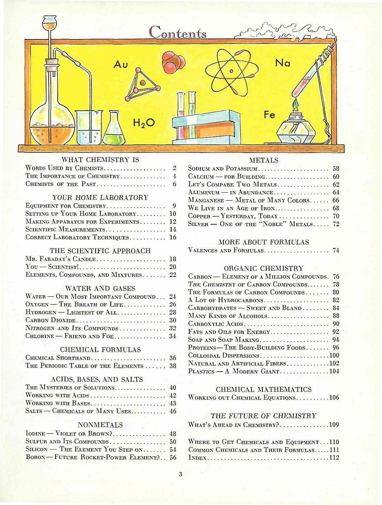

WAS CHEMIE IST
WÖRTER DER CHEMIKER
2
DIE BEDEUTUNG DER CHEMIE
4
CHEMIKER DER VERGANGENHEIT
6
IHR HEIMLABOR
GERÄTE FÜR DIE CHEMIE
9
EINRICHTUNG IHRES HEIMLABORS
10
ANLAGEN FÜR EXPERIMENTE HERSTELLEN
12
WISSENSCHAFTLICHE MESSUNGEN
14
KORREKTE LABORTECHNIKEN
16
DIE WISSENSCHAFTLICHE METHODE
HERR FARADAYS KERZE
18
SIE — WISSENSCHAFTLER!
20
ELEMENTE. VERBINDUNGEN UND MISCHUNGEN
22
WASSER UND GASE
WASSER — UNSERE WICHTIGSTE VERBINDUNG . . .
24
SAUERSTOFF — DER ATEM DES LEBENS
26
WASSERSTOFF — DER LEICHTESTE VON ALLEN
28
KOHLENDIOXID
30
STICKSTOFF UND SEINE VERBINDUNGEN
32
CHLOR — FREUND UND FEIND
34
CHEMISCHE FORMELN
CHEMISCHE KURZSCHRIFT
36
DAS PERIODENSYSTEM DER ELEMENTE
38
SÄUREN, BASEN UND SALZE
DIE RÄTSEL DER LÖSUNGEN
40
ARBEITEN MIT SÄUREN
42
ARBEITEN MIT BASEN
43
SALZE — CHEMIKALIE VON VIELEN NUTZEN
46
NICHTMETALLE
JOD — VIOLETT ODER BRAUN?
48
SCHWEFEL UND SEINE VERBINDUNGEN
50
SILIZIUM — DAS ELEMENT, AUF DAS SIE TRETEN
54
BOR — ZUKÜNFTIGES RAKETENANTRIEBS-ELEMENT? . .
56
METALLE
NATRIUM UND KALIUM
58
KALZIUM — ZUM BAUEN
60
VERGLEICHEN WIR ZWEI METALLE
62
ALUMINIUM — IM ÜBERFLUSS
64
MANGAN — METALL DER VIELEN FARBEN
66
WIR LEBEN IN EINEM EISENZEITALTER
68
KUPFER — GESTERN, HEUTE
70
SILBER — EINES DER „EDLEN" METALLE
72
MEHR ÜBER FORMELN
VALENZEN UND FORMELN
74
ORGANISCHE CHEMIE
KOHLENSTOFF — ELEMENT VON EINER MILLION VERBINDUNGEN.
76
DIE CHEMIE DER KOHLENSTOFFVERBINDUNGEN
78
DIE FORMELN DER KOHLENSTOFFVERBINDUNGEN
80
VIELE KOHLENWASSERSTOFFE
82
KOHLENHYDRATE — SÜSS UND GERICHTLOS
84
VIELE ARTEN VON ALKOHOLEN
88
CARBONSÄUREN
90
FETTE UND ÖLE FÜR ENERGIE
92
SEIFE UND SEIFENHERSTELLUNG
94
PROTEINE — DIE KÖRPERBAUENDE NAHRUNG
96
KOLYOIDALE DISPERSIONEN
100
NATÜRLICHE UND KÜNSTLICHE FASERN
102
KUNSTSTOFFE — EIN MODERNER GIGANT
104
CHEMISCHE
MATHEMATIK
ERARBEITEN VON CHEMISCHEN GLEICHUNGEN
106
DIE ZUKUNFT DER CHEMIE
WAS STEHT IN DER CHEMIE AN?
109
WO MAN CHEMIKALIE UND AUSRÜSTUNG BEKOMMT. . .110
GEMEINSAME CHEMIKALIE UND IHRE FORMELN
I l l
INDEX
112
3

---
## Page 5

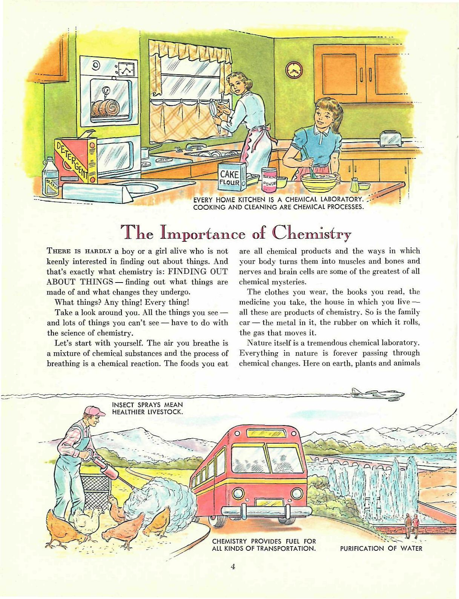

JEDES HAUSKÜCHEN IST EIN CHEMISCHES LABOR.
KOCHEN UND REINIGEN SIND CHEMISCHE PROZESSE.
Die Bedeutung der Chemie
ES GIBT KAUM einen Jungen oder ein Mädchen auf der Welt, der/die nicht
sehr daran interessiert ist, Dinge herauszufinden. Und
genau das ist Chemie: DINGE HERAUSFINDEN –
herausfinden, woraus Dinge bestehen und welche Veränderungen sie durchlaufen.
Welche Dinge? Jede Sache! Alles!
Schauen Sie sich um. All die Dinge, die Sie sehen –
und viele Dinge, die Sie nicht sehen können – haben mit
der Wissenschaft der Chemie zu tun.
Beginnen wir mit Ihnen selbst. Die Luft, die Sie atmen, ist
eine Mischung aus chemischen Substanzen und der Prozess des
Atmens ist eine chemische Reaktion. Die Lebensmittel, die Sie essen,
sind alles chemische Produkte und die Art und Weise, wie
Ihr Körper sie in Muskeln und Knochen und
Nerven und Gehirnzellen umwandelt, sind einige der größten aller
chemischen Rätsel.
Die Kleidung, die Sie tragen, die Bücher, die Sie lesen, die
Medikamente, die Sie einnehmen, das Haus, in dem Sie leben –
all das sind Produkte der Chemie. Das ist auch das Familienauto – das Metall darin, der Gummi, auf dem es rollt,
das Benzin, das es antreibt.
Die Natur selbst ist ein gewaltiges chemisches Labor.
Alles in der Natur durchläuft ständig
chemische Veränderungen. Hier auf der Erde, Pflanzen und Tiere
CHEMIE LIEFERT TREIBSTOFF FÜR
ALLE ARTEN DES TRANSPORTS.
WASSERREINIGUNG
4

---
## Page 6

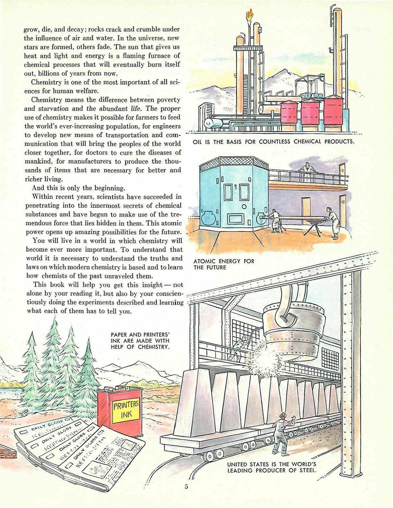

wachsen, sterben und verrotten; Felsen zerbrechen und zerfallen unter dem Einfluss von Luft und Wasser. Im Universum entstehen neue Sterne, andere verblassen. Die Sonne, die uns Wärme, Licht und Energie spendet, ist ein lodernder Ofen chemischer Prozesse, der sich schließlich selbst ausbrennen wird, Milliarden von Jahren von nun an. Chemie ist eine der wichtigsten Wissenschaften für das Wohlergehen des Menschen. Chemie bedeutet den Unterschied zwischen Armut und Hunger und einem Fülle-reichen Leben. Der richtige Einsatz der Chemie ermöglicht es Landwirten, die ständig wachsende Weltbevölkerung zu ernähren, Ingenieuren, neue Transport- und Kommunikationsmittel zu entwickeln, die die Völker der Welt näher zusammenbringen, Ärzten, die Krankheiten der Menschheit zu heilen, und Herstellern, Tausende von Produkten herzustellen, die für ein besseres und reicheres Leben notwendig sind. Und das ist erst der Anfang. In den letzten Jahren ist es Wissenschaftlern gelungen, in die innersten Geheimnisse chemischer Substanzen einzudringen und die gewaltige Kraft, die in ihnen verborgen liegt, zu nutzen. Diese Atomkraft eröffnet erstaunliche Möglichkeiten für die Zukunft. Sie werden in einer Welt leben, in der die Chemie immer wichtiger wird. Um diese Welt zu verstehen, ist es notwendig, die Wahrheiten und Gesetze zu verstehen, auf denen die moderne Chemie basiert, und zu lernen, wie Chemiker der Vergangenheit sie entschlüsselt haben. Dieses Buch wird Ihnen helfen, diese Einsicht zu gewinnen – nicht nur durch das Lesen, sondern auch durch das gewissenhafte Durchführen der beschriebenen Experimente und das Erlernen dessen, was jedes einzelne davon Ihnen zu sagen hat. ÖL IST DIE BASIS FÜR ZAHLREICHE CHEMISCHE PRODUKTE. ATOMENERGIE FÜR DIE ZUKUNFT DIE VEREINIGTEN STAATEN SIND DER WELTWEIT FÜHRENDE STAHLPRODUZENT.

---
## Page 7

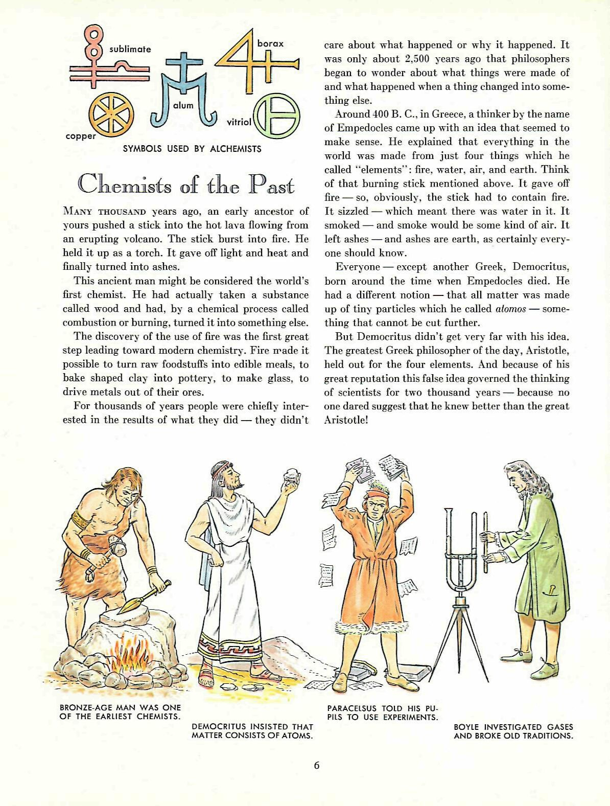

Kupfer
SYMBALE VON ALCHEMISTEN VERWENDET
Olieiiniisls von m e ir as£
VOR VIELEN TAUSEND Jahren stieß ein früher Vorfahre von Ihnen einen Stock in die heiße Lava eines ausbrechenden Vulkans. Der Stock ging in Flammen auf. Er hielt ihn als Fackel hoch. Er gab Licht und Wärme ab und verwandelte sich schließlich in Asche.
Dieser Urmensch könnte als der erste Chemiker der Welt angesehen werden. Er hatte eine Substanz namens Holz genommen und sie durch einen chemischen Prozess, der Verbrennung oder Brennen genannt wird, in etwas anderes verwandelt.
Die Entdeckung des Feuers war der erste große Schritt zur modernen Chemie. Feuer ermöglichte es, rohe Nahrungsmittel in essbare Mahlzeiten zu verwandeln, geformten Ton zu Keramik zu brennen, Glas herzustellen und Metalle aus ihren Erzen zu gewinnen.
Tausende von Jahren lang waren die Menschen hauptsächlich an den Ergebnissen ihres Tuns interessiert – es kümmerte sie nicht, was geschah oder warum es geschah. Erst vor etwa 2.500 Jahren begannen Philosophen zu hinterfragen, woraus die Dinge bestanden und was geschah, wenn sich eine Sache in etwas anderes verwandelte.
Um 400 v. Chr. in Griechenland kam ein Denker namens Empedokles auf eine Idee, die Sinn zu machen schien. Er erklärte, dass alles auf der Welt aus nur vier Dingen bestehe, die er „Elemente“ nannte: Feuer, Wasser, Luft und Erde. Denken Sie an diesen brennenden Stock, der oben erwähnt wurde. Er gab Feuer ab – also musste der Stock offensichtlich Feuer enthalten. Er zischte – das bedeutete, dass Wasser darin war. Er rauchte – und Rauch wäre eine Art Luft. Er hinterließ Asche – und Asche ist Erde, wie jeder sicherlich wissen sollte.
Jeder – außer einem anderen Griechen, Demokrit, der ungefähr zu der Zeit geboren wurde, als Empedokles starb. Er hatte eine andere Vorstellung – dass die gesamte Materie aus winzigen Teilchen besteht, die er Atomos nannte – etwas, das nicht weiter geschnitten werden kann.
Aber Demokrit kam mit seiner Idee nicht sehr weit. Der größte griechische Philosoph der damaligen Zeit, Aristoteles, hielt an den vier Elementen fest. Und aufgrund seines großen Ansehens beherrschte diese falsche Idee die Gedanken der Wissenschaftler zweitausend Jahre lang – denn niemand wagte es zu behaupten, er wisse es besser als der große Aristoteles!
DER MENSCH DER BRONZEZEIT WAR EINER
DER FRÜHESTEN CHEMIKER.
DEMOKRIT BESTAND DARAUF, DASS
MATERIE AUS ATOMEN BESTEHT.
PARACELSUS SAGTE SEINEN SCHÜ-
LERN, EXPERIMENTE ZU VERWEN-
DEN.
BOYLE UNTERSUCHTE GASE
UND BRICHT ALTE TRADITIONEN.
6

---
## Page 8

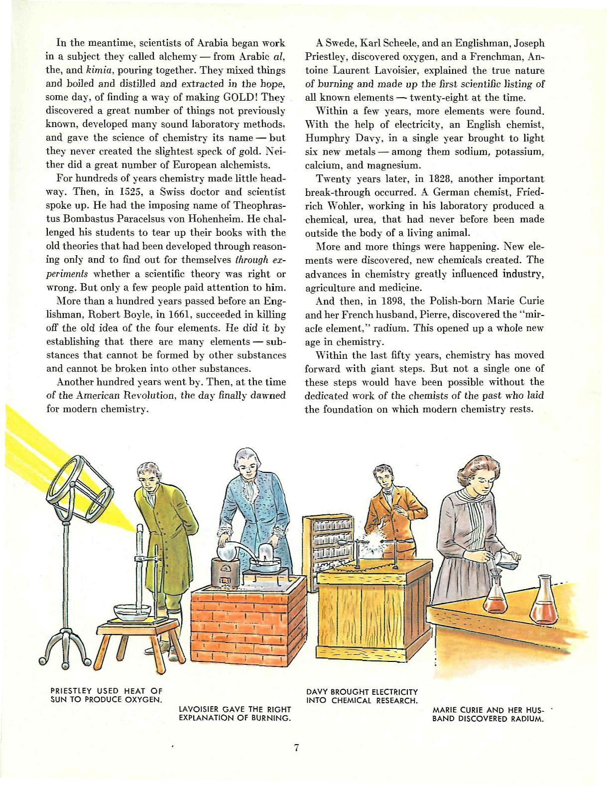

In der Zwischenzeit begannen arabische Wissenschaftler mit der Arbeit
an einem Thema, das sie Alchemie nannten – vom Arabischen al,
dem, und Kimiu, zusammen schütten. Sie mischten Dinge
und kochten, destillierten und extrahierten in der Hoffnung,
eines Tages einen Weg zu finden, GOLD herzustellen! Sie
entdeckten eine große Anzahl bisher unbekannter Dinge, entwickelten viele solide Labormethoden
und gaben der Chemie ihren Namen – aber
sie schufen nie den geringsten Goldpartikel. Auch
eine große Zahl europäischer Alchemisten taten dies nicht.
Jahrhundertelang machte die Chemie wenig Fortschritte. Dann, im Jahr 1525, sprach ein Schweizer Arzt und Wissenschaftler.
Er trug den imposanten Namen Theophras-
tus Bombastus Paracelsus von Hohenheim. Er forderte
seine Schüler auf, ihre Bücher mit den
alten Theorien, die nur durch Schlussfolgerungen entwickelt worden waren, zu zerreißen und selbst
durch Experimente herauszufinden, ob eine wissenschaftliche Theorie richtig oder falsch war. Aber nur wenige Leute beachteten ihn.
Über hundert Jahre vergingen, bis ein Engländer, Robert Boyle, im Jahr 1661 die alte Vorstellung von den vier Elementen zu Grabe trug.
Er tat dies, indem er feststellte, dass es viele Elemente gibt – Substanzen, die nicht aus anderen Substanzen gebildet und
nicht in andere Substanzen zerlegt werden können.
Weitere hundert Jahre vergingen. Dann, zur Zeit der amerikanischen Revolution, dämmerte endlich der Tag für die moderne Chemie.
Ein Schwede, Karl Scheele, und ein Engländer, Joseph Priestley, entdeckten Sauerstoff, und ein Franzose, Antoine Laurent Lavoisier, erklärte die wahre Natur
des Verbrennens und erstellte die erste wissenschaftliche Liste
aller bekannten Elemente – zu der Zeit achtundzwanzig.
Innerhalb weniger Jahre wurden weitere Elemente gefunden.
Mit Hilfe von Elektrizität brachte ein englischer Chemiker, Humphry Davy, in einem einzigen Jahr
sechs neue Metalle ans Licht – darunter Natrium, Kalium,
Calcium und Magnesium.
Zwanzig Jahre später, im Jahr 1828, ereignete sich ein weiterer wichtiger Durchbruch. Ein deutscher Chemiker, Friedrich Wöhler,
produzierte in seinem Labor eine Chemikalie, Harnstoff, die zuvor nie außerhalb des Körpers eines lebenden Tieres hergestellt worden war.
Immer mehr geschah. Neue Elemente wurden entdeckt, neue Chemikalien geschaffen. Die Fortschritte in der Chemie beeinflussten die Industrie, die Landwirtschaft und die Medizin stark.
Und dann, im Jahr 1898, entdeckten die in Polen geborene Marie Curie und ihr französischer Ehemann Pierre das „Wunder-
element“ Radium. Dies eröffnete ein ganz neues Zeitalter in der Chemie.
In den letzten fünfzig Jahren hat sich die Chemie mit Riesenschritten vorwärts entwickelt. Aber keiner dieser Schritte wäre ohne die
engagierte Arbeit der Chemiker der Vergangenheit möglich gewesen, die das Fundament gelegt haben, auf dem die moderne Chemie ruht.
PRIESTLEY NUTZTE SONNENWÄRME
UM SAUERSTOFF HERZUSTELLEN.
DAVY BRACHTE ELEKTRIZITÄT
IN DIE CHEMISCHE FORSCHUNG.
LAVOISIER GAB DIE RICHTIGE
ERKLÄRUNG FÜR DAS BRENNEN.
MARIE CURIE UND IHR EHE-
MANN ENTDECKTEN RADIUM.

---
## Page 9

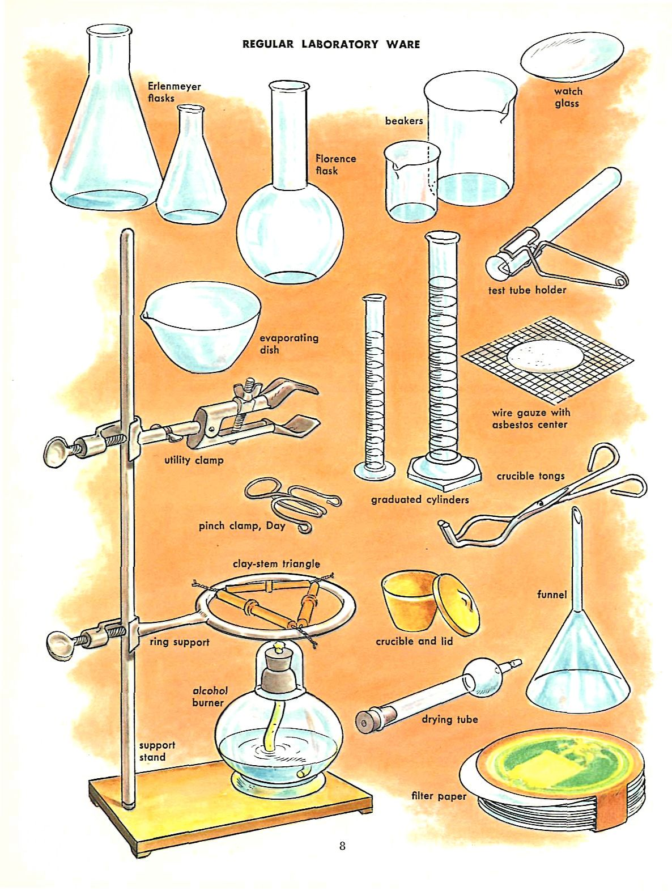

---
## Page 10

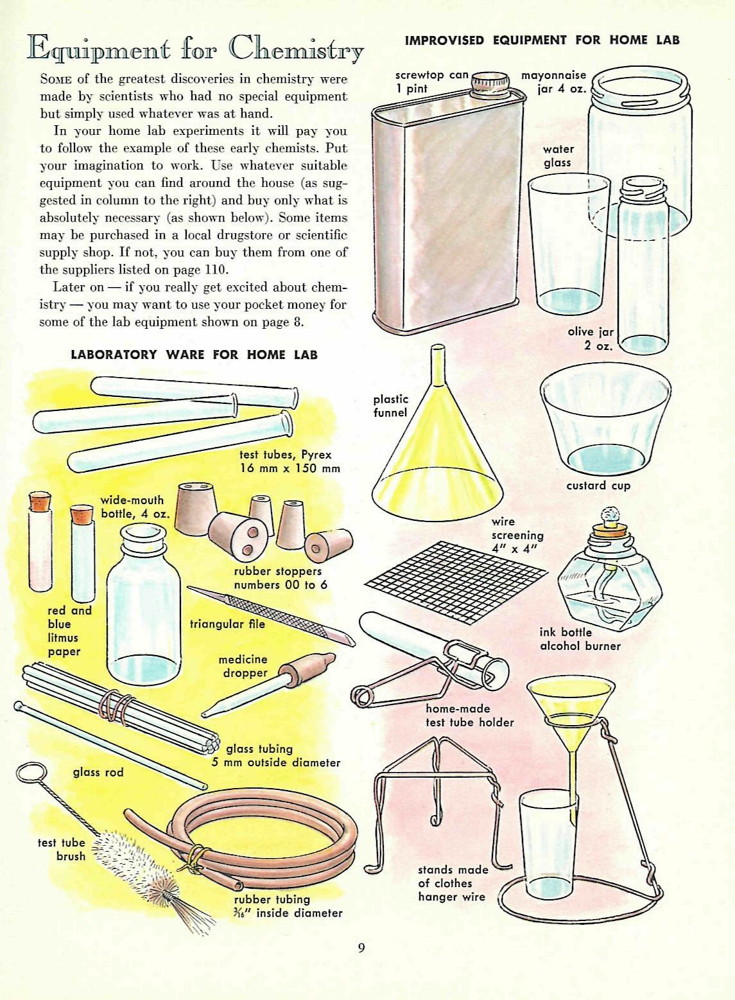

JJ/Gerätschaften für Chemie-Experimente
EINIGE der größten Entdeckungen in der Chemie wurden von Wissenschaftlern gemacht, die keine spezielle Ausrüstung hatten, sondern einfach das benutzten, was gerade zur Hand war.
Bei Ihren Experimenten im Heimlabor wird es sich für Sie lohnen, dem Beispiel dieser frühen Chemiker zu folgen. Setzen Sie Ihre Vorstellungskraft ein. Verwenden Sie, was immer Sie an geeigneter Ausrüstung im Haus finden können (wie in der Spalte rechts vorgeschlagen), und kaufen Sie nur, was absolut notwendig ist (wie unten gezeigt). Einige Artikel können in einer örtlichen Drogerie oder einem Fachgeschäft für wissenschaftliche Bedarfsartikel gekauft werden. Wenn nicht, können Sie sie bei einem der auf Seite 110 aufgeführten Lieferanten kaufen.
Später – wenn Sie sich wirklich für Chemie begeistern – möchten Sie vielleicht Ihr Taschengeld für einige der auf Seite 8 gezeigten Laborgeräte ausgeben.
LABOR-AUSSTATTUNG FÜR DAS HEIMLABOR
PROVISORISCHE AUSSTATTUNG FÜR DAS HEIMLABOR
Schraubdeckeldose
1 Pint

---
## Page 11

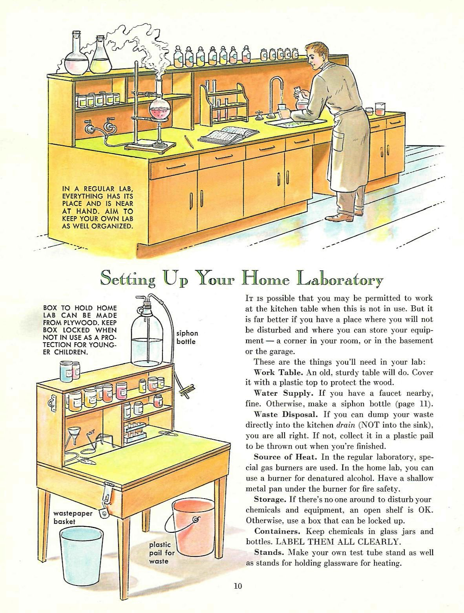

Es ist möglich, dass Sie am Küchentisch arbeiten dürfen, wenn dieser nicht benutzt wird. Aber es ist weitaus besser, wenn Sie einen Ort haben, an dem Sie ungestört sind und Ihre Ausrüstung lagern können – eine Ecke in Ihrem Zimmer, im Keller oder in der Garage.
Das brauchen Sie für Ihr Labor:
Arbeitstisch. Ein alter, stabiler Tisch tut es auch. Decken Sie ihn mit einer Kunststoffplatte ab, um das Holz zu schützen.
Wasserversorgung. Wenn Sie in der Nähe einen Wasserhahn haben, ist das gut. Andernfalls machen Sie eine Siphonflasche (Seite 11).
Abfallentsorgung. Wenn Sie Ihren Abfall direkt in den Küchenabfluss (nicht in die Spüle) schütten können, ist das in Ordnung. Wenn nicht, sammeln Sie ihn in einem Plastikeimer, den Sie nach Beendigung wegwerfen.
Wärmequelle. Im regulären Labor werden spezielle Gasbrenner verwendet. Im Heimlabor können Sie einen Brenner für denaturierten Alkohol verwenden. Stellen Sie eine flache Metallschale unter den Brenner zur Brandschutzsicherheit.
Aufbewahrung. Wenn niemand da ist, der Ihre Chemikalien und Geräte stört, ist ein offenes Regal in Ordnung. Andernfalls verwenden Sie eine abschließbare Kiste.
Behälter. Bewahren Sie Chemikalien in Glasbehältern und Flaschen auf. Beschriften Sie alle klar.
Ständer. Bauen Sie sich einen eigenen Reagenzglashalter sowie Ständer zum Halten von Glasgeräten zum Erhitzen.

---
## Page 12

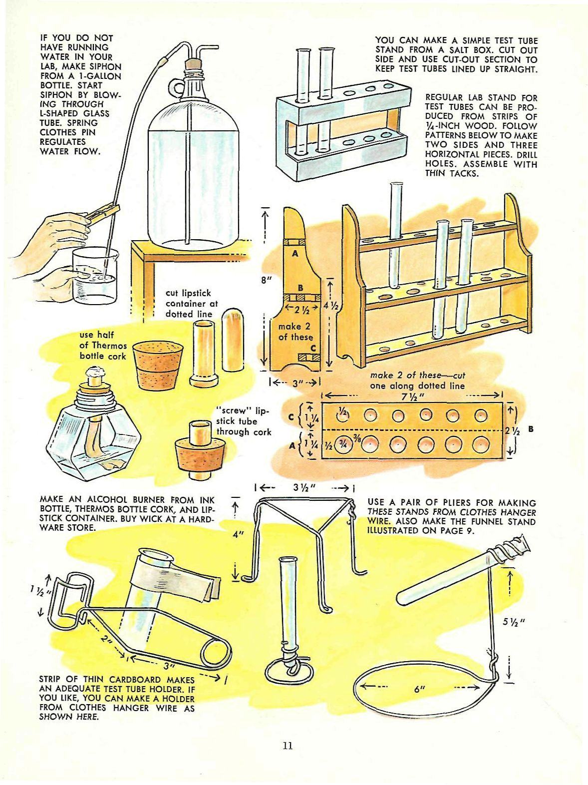

FALLS KEIN 
FLIESSENDES 
WASSER IN IHREM 
LABOR VORHANDEN IST, 
BAUEN SIE EINEN SIPHON 
AUS EINER 1-GALLONEN-FLASCHE. 
STARTEN SIE DEN SIPHON, 
INDIEM SIE DURCH EIN 
L-FÖRMIGES GLASROHR 
BLASEN. EINE KLAMMER 
REGULIERT DEN WASSERFLUSS. 
SIE KÖNNEN EINEN EINFACHEN REAGENZGLASSTÄNDER 
AUS EINER SALZSCHACHTEL BASTELN. SCHNEIDEN SIE 
DIE SEITE AUS UND VERWENDEN SIE DEN AUSGESCHNITTENEN 
TEIL, UM DIE REAGENZGLÄSER GERADE AUFZUREIHEN. 
EINEN REGULÄREN LABORSTÄNDER FÜR REAGENZGLÄSER 
KANN MAN AUS 0,6 CM BREITEN HOLZSTREIFEN HER-
STELLEN. BEFOLGEN SIE DIE UNTEN STEHENDEN SCHABLONEN, 
UM ZWEI SEITEN UND DREI HORIZONTALE TEILE HERZU-
STELLEN. BOHREN SIE LÖCHER. MONTieren SIE MIT 
DÜNNEN NÄGELN. 
Lippenstift- 
dose am 
gestrichelten 
Linie schneiden 
die Hälfte 
des Thermos- 
flaschen- 
korks 
verwenden 
& 
L— 3" —> 
davon 2 machen—eins an 
gestrichelten Linie schneiden 
7' /2 " 
Lippen- 
stiftrohr 
durch Kork 
schrauben 
<— 
3 ft" 
6 o o o o o 
*®%o o o o o 
2V2 
B 
J 
* 
— > l 
BAUEN SIE EINEN ALKOHOLBRENNER AUS EINER TIN-
TENFLASCHE, EINEM THERMOSFLASCHENKORKEN UND EINER 
LIPPENSTIFTDOSE. DOCHT IM EISENWARENLADEN KAUFEN. 
VERWENDEN SIE EINE ZANGE, UM DIESE STÄNDER AUS 
DRAHTKLEIDERBÜGELN HERZUSTELLEN. STELLEN SIE AUCH 
DEN TRICHTERSTÄNDER AUF SEITE 9 HER. 
EIN STREIFEN DICKE PINNENFOLIE IST EIN GEEIGNETER 
REAGENZGLASHALTER. SIE KÖNNEN, WENN SIE MÖCHTEN, 
EINEN HALTER AUS DRAHTKLEIDERBÜGELN HER-
STELLEN, WIE HIER GEZEIGT. 
11

---
## Page 13

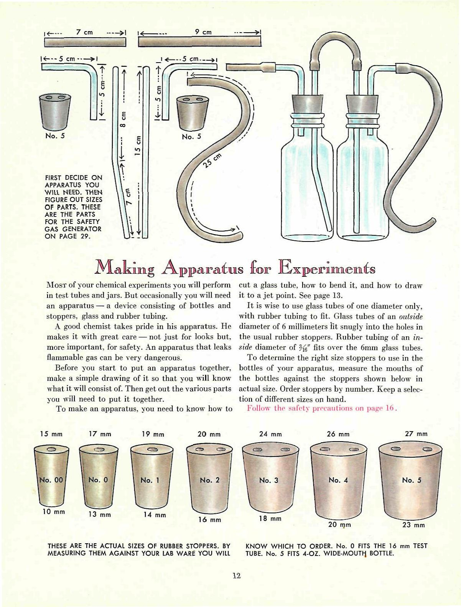

ZUERST ENTSCHEIDEN SIE WELCHE
GERÄTE SIE
BENÖTIGEN WERDEN. DANN
ERMITTELN SIE DIE GRÖSSEN
DER TEILE. DAS SIND DIE TEILE
FÜR DEN SICHERHEITS-
GASGENERATOR AUF SEITE 29.
Maki
:LIS tor Jhl/xperimeailts
DIE MEISTEN Ihrer chemischen Experimente werden Sie
ein Glasrohr schneiden, wie man es biegt und wie man
in Reagenzgläsern und Gläsern durchführen. Aber gelegentlich werden Sie
es zu einer Düsenspitze zieht. Siehe Seite 13.
ein Gerät benötigen – eine Vorrichtung bestehend aus Flaschen und
Es ist ratsam, Glasrohre nur eines Durchmessers zu verwenden.
Stopfen, Glas- und Gummirohren.
mit passenden Gummischläuchen. Glasrohre mit einem Außendurchmesser
Ein guter Chemiker ist stolz auf seine Geräte. Er
von 6 Millimetern passen fest in die Löcher der
fertigt sie mit großer Sorgfalt an – nicht nur für das Aussehen, sondern,
üblichen Gummistopfen. Gummischläuche mit einem Innendurchmesser
wichtiger noch, für die Sicherheit. Ein Gerät, das entzündliches
von Jfg" passen über die 6mm Glasrohre.
Gas austreten lässt, kann sehr gefährlich sein.
Um die richtige Größe der Stopfen für die Flaschen Ihrer Geräte zu ermitteln, messen Sie die Öffnungen der
Bevor Sie beginnen, ein Gerät zusammenzusetzen,
Flaschen gegen die nachfolgend gezeigten Stopfen in
machen Sie eine einfache Skizze davon, damit Sie wissen,
Originalgröße. Bestellen Sie Stopfen nach Nummer. Halten Sie eine Auswahl
woraus es bestehen wird. Holen Sie dann die verschiedenen Teile heraus,
verschiedener Größen bereit.
die Sie zum Zusammenbau benötigen.
Um ein Gerät herzustellen, müssen Sie wissen, wie man
Befolgen Sie die Sicherheitsvorkehrungen auf Seite 16.
15 mm
10 mm
17 mm
19 mr
20 mm
24 mm
16 mm
26 mm
20 mm
27 mm
23 mm
DAS SIND DIE ORIGINALGRÖSSEN DER GUMMISTOPFEN. DURCH
MESSEN SIE GEGEN IHR LABORGERÄT WISSEN SIE, WELCHE SIE BESTELLEN MÜSSEN. NR. 0 PASST IN DAS 16 MM REAGENZGLAS. NR. 5 PASST IN EINE 4-OZ. WEITMUNDFLASCHE.
12

---
## Page 14

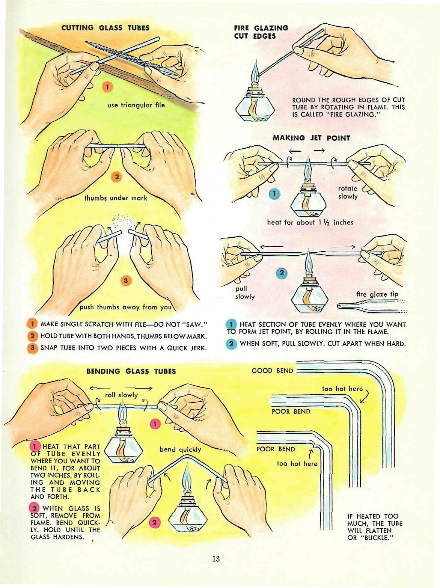

SCHNEIDEN VON GLASROHREN
FEUER
VERGLASEN
GESCHNITTENE KANTEN
^
EINEN EINZELNEN KRATZER MIT FEILE MACHEN – NICHT SÄGEN.
ROHR MIT BEIDEN HÄNDEN HALTEN. DAUMEN UNTER DER MARKIERUNG.
3
ROHR MIT EINEM SCHNELLEN RUCK IN ZWEI TEILE BRECHEN.
DIE RAUEN KANTEN DES GESCHNITTENEN ROHRS DURCH ROTIEREN IN DER FLAMME GLÄTTEN. DIES WIRD "FEUERVERGLASUNG" GENANNT.
HERSTELLEN EINES STRAHLSPITZENS
ERHITZEN FÜR UNGEFÄHR 1 1/2 ZOLL
DEN ABSCHNITT DES ROHRS, WO SIE DEN STRAHLSPITZEN FORMEN MÖCHTEN, DURCH GLEICHMÄSSIGES ERWÄRMEN, INDEM SIE IHN IN DER FLAMME ROLLEN.
2
WENN WEICH, LANGSAM ZIEHEN. TRENNEN, WENN HART.
BIEGEN VON GLASROHREN
ERWÄRMEN SIE DEN TEIL DES ROHRS, WO SIE IHN BIEGEN WOLLEN, GLEICHMÄSSIG FÜR ETWA ZWEI ZOLL, INDEM SIE DAS ROHR VOR UND ZURÜCK ROLLEN UND BEWEGEN.
WENN DAS GLAS WEICH IST, AUS DER FLAMME NEHMEN. SCHNELL BIEGEN. HALTEN, BIS DAS GLAS HÄRTET.
WENN ES ZU SEHR ERWÄRMT WIRD, WIRD DAS ROHR FLACH ODER KNICKT.
13

---
## Page 15

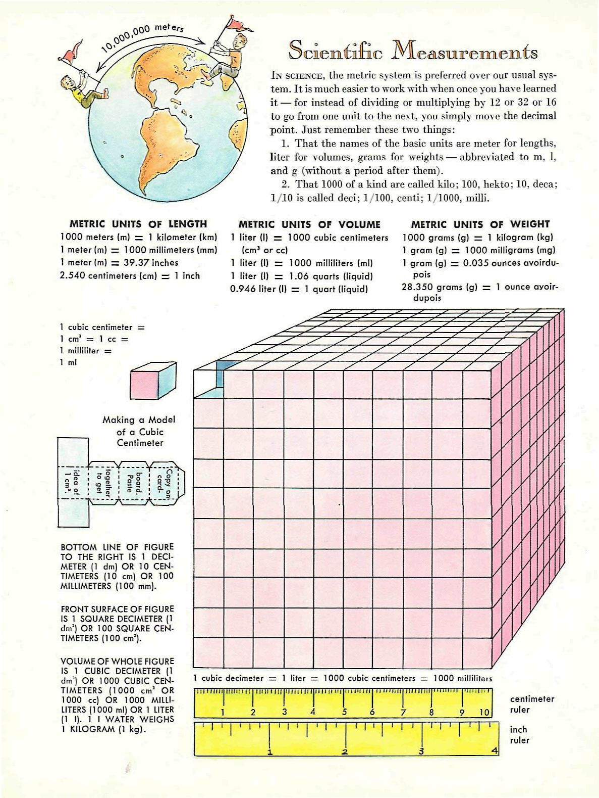

QOO-Einheiten
>wissenschaftliches JV1
entfesselt
I> WISSENSCHAFT wird das metrische System unserem üblichen System vorgezogen.
Es ist viel einfacher damit zu arbeiten, wenn man es einmal gelernt hat – denn anstatt durch 12, 32 oder 16 zu teilen oder zu multiplizieren, um von einer Einheit zur nächsten zu gelangen, verschiebt man einfach das Dezimalkomma. Denken Sie nur an diese beiden Dinge:
1. Dass die Namen der Grundeinheiten Meter für Längen,
Liter für Volumen und Gramm für Gewichte sind – abgekürzt als m, l und g (ohne Punkt danach).
2. Dass 1000 einer Art Kilo heißen; 100 Hekto; 10 Dezi; 1/10 Deci; 1/100 Zenti; 1/1000 Milli.
METRISCHE EINHEITEN DER
LÄNGE
1000 Meter (m) =
1 Kilometer (km)
1 Meter (m) = 1000 Millimeter (mm)
1 Meter (m) = 39,37 Zoll
2,540 Zentimeter (cm) S 1 Zoll
1 Kubikzentimeter =
I cm* = 1 cc =
1 Milliliter =
1 ml
Anfertigen eines Modells
eines Kubikzentimeters
BODENLINIE DER GRAFIK
RECHTS IST 1 DEZI-
METER (1 dm) ODER 10 ZENTI-
METER (10 cm) ODER 100
MILLIMETER (100 mm).
VORDERSEITE DER GRAFIK
IST 1 QUADRATDEZIMETER (1
dm1) ODER 100 QUADRATZENTI-
METER (100 cm1).
VOLUMEN DER GESAMTEN GRAFIK
IST 1 KUBIKDEZIMETER (1
dm3) ODER 1000 KUBIKZENTI-
METER (1000 cm' oder
1000 cc) ODER 1000 MILLI-
LITER (1000 ml) ODER 1 LITER
(1 l). 1 l Wasser wiegt
1 KILOGRAMM (1 kg).
METRISCHE EINHEITEN DES VOLUMENS
1 Liter (l) =
1000 Kubikzentimeter
(cm* oder cc)
1 Liter (l) =
1000 Milliliter (ml)
1 Liter (l) =
1,06 Quarts (flüssig)
0,946 Liter (l) =
1 Quart (flüssig)
METRISCHE EINHEITEN DES
GEWICHTS
1000 Gramm (g) = 1 Kilogramm (kg)
1 Gramm (g) =
1000 Milligramm (mg)
1 Gramm (g) 53 0,035 Unzen (Avoirdupois)
28,350 Gramm (g) =
1 Unze (Avoirdupois)
'
s'
/ '
y
y
-^—y—
^—?"
1Z. zzl
/
y
rz
zz.
y
y
, /
y ~zi
z
zrzzz^z
y
y
z
~z_
yz zz:
s s y
y zzz ,z_
z:
/
/
/
/
/
/
/
/
/
/
/
/
/
/
/
/
/
/
/
/
/
/
/
/
/
/
/
/
/
/
/
/
/
/
/
/ /
/
1 Kubikdezimeter =
1 Liter = 1000 Kubikzentimeter = 1000 Milliliter
ulllliiillllliliil ililiMliplMlllillllllllM, rrrnrrn
1
l l ' I I I , | | | I I M I I M I ' M M I . I I l i . .
[
I
3
4
5
6
7
8
9
10
' M l
' i 1
1 I 1 I 1
1 I ' I ' 1 1
1 i 1
Zentimeter
Lineal
Zoll
Lineal

---
## Page 16

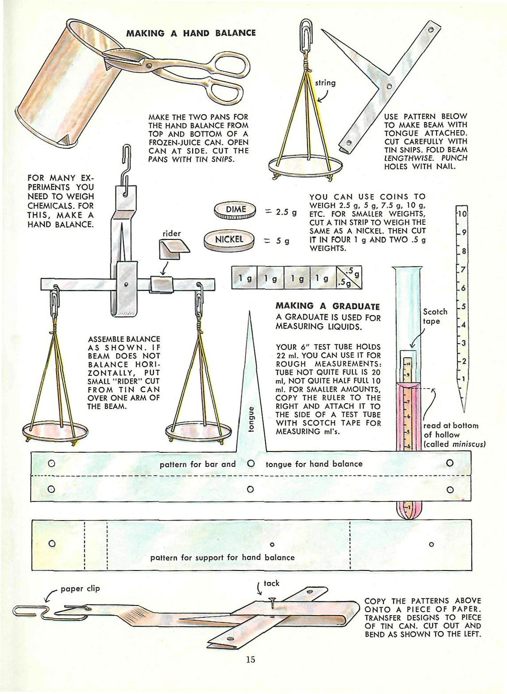

H E R S T E L L E N
E I N E R
H A N D W A G E

D I E Z W E I G E S C H A L E N
F Ü R
D I E H A N D W A G E B E S T E H E N
A U S D E M O B E R T E I L
U N D D E M U N T E R T E I L
E I N E S
G E F R O R E N E N J U S E - D O S E . D I E D O S E
S E I T L I C H Ö F F N E N .
D I E S C H A L E N M I T D E R
B L E C H S C H E R E A U S S C H N E I D E N .
F Ü R V I E L E E R -
P R O B E N D I R N I E N
D I E C H E M I K A L I E N
A B Z U W Ä G E N . D A Z U
E I N E
H A N D W A G E
H E R S T E L L E N .
)
W A G E Z U S A M M E N B A U E N
W I E A B G E B I L D E T . W E N N
D A S G E R Ü S T N I C H T
H O R I Z O N T A L G E G E N -
E I N A N D E R L I E G T ,
E I N E N K L E I N E N " S A U T E "
A U S B L E C H
Ü B E R E I N E N A R M D E S
G E R Ü S T S L E G E N .
D A S S T E R N - M U S T E R
U N T E N V E R W E N D E N ,
U M D A S G E R Ü S T M I T
A N G E L Ö T E T E M Z U N G E
H E R Z U S T E L L E N .
M I T D E R
B L E C H S C H E R E S O R G F Ä L T I G
A U S S C H N E I D E N . D A S
G E R Ü S T L Ä N G S F A L T E N .
L Ö C H E R M I T E I N E M N A G E L
E I N S T E C H E N .
- 2,5 g
- 5g
M U N Z E N K Ö N N E N Z U M
A B W Ä G E N V O N
2,5 g, 5 g, 7,5 g, 10 g U S W . V E R W E N D E T W E R D E N .
F Ü R K L E I N E R E G E W I C H T E ,
E I N E N B L E C H S T R E I F E N
A U S S C H N E I D E N , D E R
D A S G L E I C H E G E W I C H T W I E
E I N E N N I C K E L H A T . D A N N
I H N I N V I E R 1 g U N D Z W E I 0,5 g
G E W I C H T E T E I L E N .
1 g
1 g
1 g
1 g &
H E R S T E L L E N
E I N E S
M E S S Z Y L I N D E R S

E I N M E S S Z Y L I N D E R W I R D
Z U M M E S S E N V O N F L Ü S S I G K E I T E N
V E R W E N D E T .
D E I N 15 cm G R O S S E S G R Ö S S E S R Ö H R C H E N H Ä L T
22 ml. D U K A N N S D A S F Ü R
G R O B E
M E S S U N G E N
V E R W E N D E N :
E I N N I C H T G A N Z G E F Ü L L T E S
R Ö H R C H E N S T E H T F Ü R 20
ml, N I C H T G A N Z H A L B G E F Ü L L T 10
ml. F Ü R K L E I N E R E M E N G E N ,
K O P I E R E N S I E D I E R E C H T S
A B G E B I L D E T E R E G E L U N D B E F E S T I G E N S I E M I T
T A P E A N D E R S E I T E E I N E S
G R Ö S S E S R Ö H R C H E N S F Ü R S
M E S S E N V O N m l .
/
/
T A P E
10
. 9
.8
7
16
.5
-4
•3
-2
-l
A M U N T E R E N T E I L
D E S H O H L R A U M S
( H O H L K E H L E G E N A N N T )
L E S E N
O
M U S T E R F Ü R S T A B U N D
Z U N G E F Ü R H A N D W A G E
O
M U S T E R F Ü R S T Ü T Z E F Ü R H A N D W A G E
N A G E L
K O P I E R E N S I E D I E O B I G E N
M U S T E R A U F E I N S T Ü C K P A P I E R .
Ü B E R T R A G E N S I E D I E D E S I G N S A U F E I N S T Ü C K B L E C H .
A U S S C H N E I D E N U N D
B I E G E N , W I E L I N K S
A B G E B I L D E T .
15

---
## Page 17

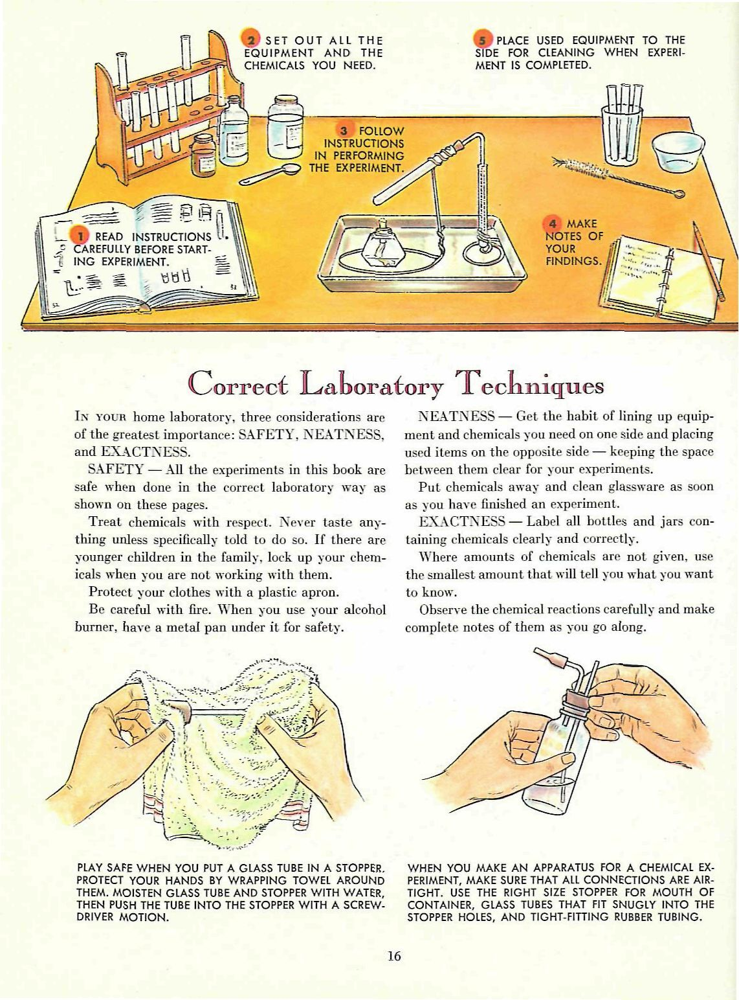

Richten Sie die benötigte Ausrüstung und die Chemikalien her.
3
BEFOLGEN SIE DIE ANWEISUNGEN
BEI DER DURCHFÜHRUNG
DES EXPERIMENTS.
t
STELLEN SIE GEBRAUCHTE GERÄTE ZUR
REINIGUNG BEREIT, WENN DAS EXPERIMENT
ABGESCHLOSSEN IST.
S « &
• 4
MACHEN SIE
NOTIZEN
IHRER
ERGEBNISSE
Korrekte Laborpraxis
IN Ihrem Labor zu Hause sind drei Überlegungen
von größter Bedeutung: SICHERHEIT, ORDENTLICHKEIT
und GENAUIGKEIT.
SICHERHEIT — Alle Experimente in diesem Buch sind
sicher, wenn sie auf die richtige Laborart ausgeführt
werden, wie auf diesen Seiten gezeigt.
Behandeln Sie Chemikalien mit Respekt. Schmecken
Sie niemals etwas, es sei denn, Sie werden ausdrücklich
dazu aufgefordert. Wenn es jüngere Kinder in der Familie
gibt, schließen Sie Ihre Chemikalien weg, wenn Sie nicht
damit arbeiten.
Schützen Sie Ihre Kleidung mit einer Plastikschürze.
Seien Sie vorsichtig mit Feuer. Wenn Sie Ihren Alkohol-
brenner benutzen, stellen Sie zu Ihrer Sicherheit eine
Metallschale darunter.
ORDENTLICHKEIT — Machen Sie es sich zur Gewohnheit,
die benötigte Ausrüstung und Chemikalien auf einer Seite
aufzustellen und gebrauchte Gegenstände auf der gegenüber-
liegenden Seite zu platzieren – halten Sie den Bereich dazwi-
schen für Ihre Experimente frei.
Räumen Sie Chemikalien weg und reinigen Sie Glaswaren,
sobald Sie ein Experiment beendet haben.
GENAUIGKEIT — Beschriften Sie alle Flaschen und Gläser,
die Chemikalien enthalten, deutlich und korrekt.
Wenn keine Mengen an Chemikalien angegeben sind, ver-
wenden Sie die kleinste Menge, die Ihnen das gewünschte
Ergebnis anzeigt.
Beobachten Sie die chemischen Reaktionen sorgfältig und
machen Sie währenddessen vollständige Notizen darüber.
•i-
,
J"..*' •*
_ /
SPIELEN SIE SICHER, WENN SIE EIN GLASROHR IN EINEN STOPFEN STECKEN.
SCHÜTZEN SIE IHRE HÄNDE, INDEM SIE EIN HANDTUCH DARUM WICKELN. BEFEUCHTEN SIE DAS GLASROHR UND DEN STOPFEN MIT WASSER UND DRÜCKEN SIE DANN DAS ROHR MIT EINER SCHRAUBENBEWEGUNGSART IN DEN STOPFEN.
WENN SIE EINE APPARATUR FÜR EIN CHEMISCHES EXPERIMENT BAUEN, STELLEN SIE SICHER, DASS ALLE VERBINDUNGEN LUFTDICHT SIND. VERWENDEN SIE DEN RICHTIGEN STOPFEN FÜR DIE ÖFFNUNG DES BEHÄLTERS, GLASROHRE, DIE ENG IN DIE STOPFENLÖCHER PASSEN, UND DICHT SITZENDE GUMMISCHLÄUCHE.
16

---
## Page 18

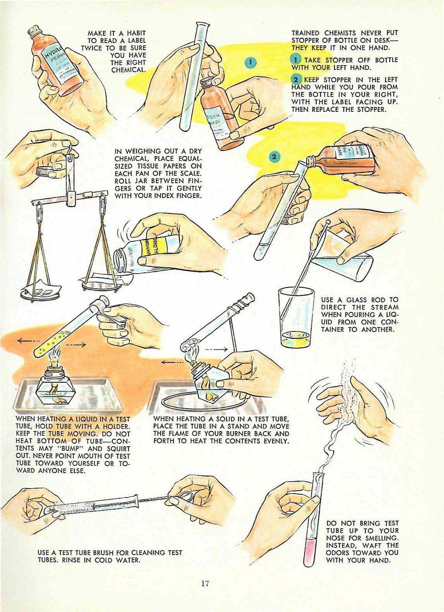

AUSGEBILDETE CHEMIKER STELLEN DEN STOPFEN EINER FLASCHE NIE AUF DEN TISCH — SIE HALTEN IHNEN IN EINER HAND.
1. NEHMEN SIE DEN STOPFEN MIT DER LINKEN HAND VON DER FLASCHE.
2. HALTEN SIE DEN STOPFEN IN DER LINKEN HAND, WÄHREND SIE MIT DER RECHTEN HAND AUS DER FLASCHE GIESSEN, DAFÜR SORGEN, DASS DAS ETIKETT NACH OBEN ZEIGT. SETZEN SIE DANN DEN STOPFEN WIEDER AUF.
BENUTZEN SIE EINEN GLASSTAB, UM DEN STRAHL ZU LENKEN, WENN SIE EINE FLÜSSIGKEIT VON EINEM GEFÄSS IN EIN ANDERES UMGIESSEN.
BEIM ERHITZEN EINER FLÜSSIGKEIT IN EINEM REAGENZGLAS, HALTEN SIE DAS GLAS MIT EINEM HALTEWERKZEUG. BEWEGEN SIE DAS GLAS. ERHITZEN SIE NICHT DEN BODEN DES GLASES — DER INHALT KANN "SPRITZEN" UND HERAUSSCHIESSEN. RICHTEN SIE NIEMALS DIE ÖFFNUNG DES REAGENZGLASES AUF SICH SELBST ODER AUF IRGENDJEMANDEN ANDEREN.
BEIM ERHITZEN EINES FESTEN STOFFES IN EINEM REAGENZGLAS, STELLEN SIE DAS GLAS IN EINEN STÄNDER UND BEWEGEN SIE DIE FLAMME IHRES BRENNERS VOR UND ZURÜCK, UM DEN INHALT G GLEICHMÄSSIG ZU ERHITZEN.
BENUTZEN SIE EINE REAGENZGLASBÜRSTE ZUM REINIGEN VON REAGENZGLÄSERN. MIT KALTEM WASSER AUSSPÜLEN.
BRINGEN SIE DAS REAGENZGLAS NICHT AN IHRE NASE ZUM RIECHEN. STATTDESSEN WEDELN SIE DIE GERÜCHE MIT DER HAND ZU SICH HIN.
17

---
## Page 19

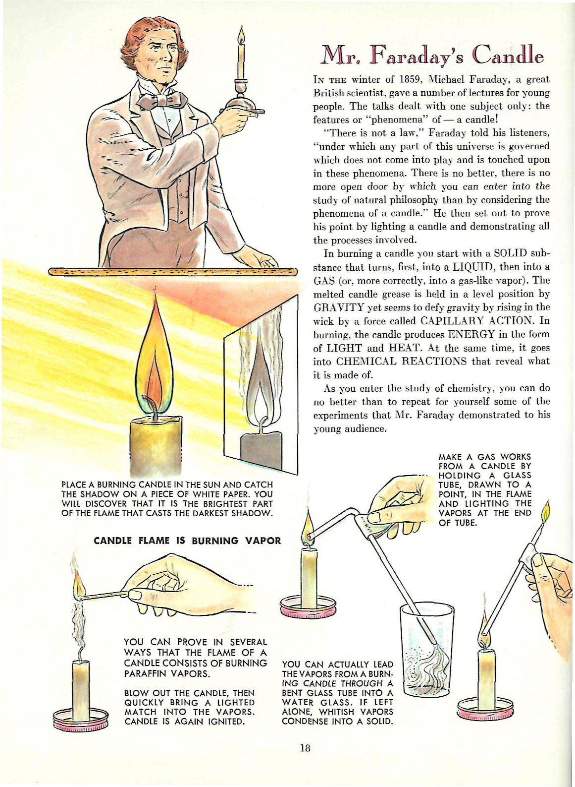

STELLEN SIE EINE BRENNENDE KERZE IN DIE SONNE UND FANGEN SIE
DEN SCHATTEN AUF EINEM BLATT WEISSEN PAPIER AUF. SIE
WERDEN ENTDECKEN, DASS DER HELLSTE TEIL
DER FLAMME DEN DUNKELSTEN SCHATTEN WIRFT.
KERZENFLAMME VERBRENNT
DAMPF
iVli\ Faradays Kerze
IM WINTER 1859 gab Michael Faraday, ein großer
britischer Wissenschaftler, eine Reihe von Vorträgen für junge
Leute. Die Vorträge befassten sich nur mit einem Thema: den
Eigenschaften oder "Phänomenen" – einer Kerze!
„Es gibt kein Gesetz“, sagte Faraday seinen Zuhörern.
„unter dem irgendein Teil dieses Universums regiert wird,
das nicht zum Tragen kommt und in diesen Phänomenen berührt wird. Es gibt keine bessere, es gibt keine
offenere Tür, durch die Sie in die
Studie der Naturphilosophie eintreten können, als die
Phänomene einer Kerze zu betrachten.“ Er machte sich dann
daran, seinen Punkt zu beweisen, indem er eine Kerze anzündete und alle
beteiligten Prozesse demonstrierte.
Beim Abbrennen einer Kerze beginnt man mit einem FESTEN Stoff,
der sich zuerst in eine FLÜSSIGE, dann in ein GAS (oder genauer gesagt in einen gasartigen Dampf)
verwandelt. Das
geschmolzene Kerzenfett wird durch
SCHWERKRAFT in einer waagerechten Position gehalten, scheint aber
trotzdem der Schwerkraft zu trotzen, indem es durch eine Kraft namens KAPILARWIRKUNG im Docht nach oben steigt. Beim
Verbrennen produziert die Kerze ENERGIE in Form von LICHT und WÄRME. Gleichzeitig finden
CHEMISCHE REAKTIONEN statt, die enthüllen, woraus sie
besteht.
Beim Eintritt in das Studium der Chemie können Sie nichts Besseres tun, als einige der Experimente, die Herr Faraday
vor seinem jungen Publikum demonstriert hat, selbst zu wiederholen.
BAUEN SIE AUS EINER KERZE EINE GASANLAGE,
INDIEM SIE EIN GLASROHR, DAS ZU EINER SPITZE GEZOGEN
IST, IN DIE FLAMME HALTEN UND DIE
DÄMPFE AM ENDE DES ROHRES ANZÜNDEN.
L
SIE KÖNNEN AUF VIELERLEI WEISE BEWEISEN, DASS DIE FLAMME EINER
KERZE AUS BRENNENDEN PARAFFINDÄMPFEN BESTEHT.
BLASEN SIE DIE KERZE AUS, UND HALTEN SIE DANN
SCHNELL EIN ANGEZÜNDETES STREICHHOLZ AN DIE DÄMPFE.
DIE KERZE WIRD WIEDER ENTZÜNDET.
SIE KÖNNEN DIE DÄMPFE EINER BRENNENDEN
KERZE TATSÄCHLICH DURCH EIN GEBOGENES GLASROHR IN EIN
WASSERGLAS LEITEN. WENN SIE ALLEINE GELASSEN WERDEN,
KONDENSIEREN DIE WEISSEN DÄMPFE ZU EINEM FESTSTOFF.
18

---
## Page 20

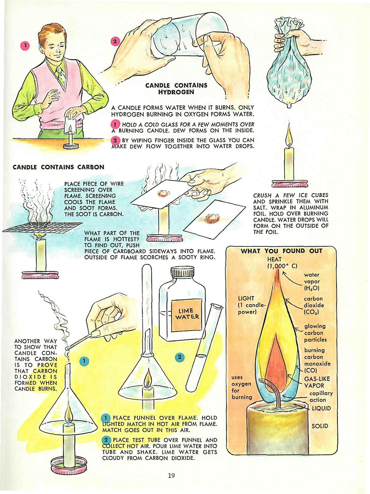

KERZE
EN THÄLT
WASSERSTOFF
Eine Kerze bildet beim Verbrennen Wasser. Nur
Wasserstoff, der in Sauerstoff verbrennt, bildet Wasser.
1) Halten Sie ein kaltes Glas für einige Augenblicke über
eine brennende Kerze. Es bildet sich innen Tau.
2) Indem Sie mit dem Finger über das Innere des Glases wischen, können Sie den Tau zu Wassertropfen fließen lassen.
KERZE EN THÄLT
KOHLENSTOFF
Legen Sie ein Stück Draht-
gitter über die
Flamme. Das Gitter
kühlt die Flamme
und es bildet sich Ruß.
Der Ruß ist Kohlenstoff.
WELCHER TEIL DER
FLAMME IST AM HEISSesten?
Um das herauszufinden, stecken
Sie ein Stück Karton seitlich in die Flamme.
Die Außenseite der Flamme versengt einen rußigen Ring.
Zerdrücken Sie ein paar Eiswürfel
und bestreuen Sie sie mit
Salz. Wickeln Sie sie in Aluminium-
folie. Halten Sie sie über die brennende
Kerze. An der Außenseite der
Folie bilden sich Wassertropfen.
Eine andere Methode
zu zeigen, dass
KERZE
KOHLENSTOFF EN THÄLT
ist zu
beweisen,
dass KOHLENSTOFF-
DIOXID
entsteht, wenn die
KERZE brennt.
1) Platzieren Sie einen Trichter über der Flamme. Halten
Sie ein angezündetes Streichholz in die heiße Luft aus der Flamme.
Das Streichholz geht in dieser Luft aus.
2) Platzieren Sie ein Reagenzglas über dem Trichter und
sammeln Sie die heiße Luft. Gießen Sie Kalkwasser in das
Röhrchen und schütteln Sie es. Das Kalkwasser wird
trüb durch Kohlenstoffdioxid.
WAS SIE HER-
AUSGEFUNDEN HABEN
HITZE
(1.000 °C)
wasser-
dampf
(H₂O)
kohlenstoff-
dioxid
(CO₂)
brennender
kohlenstoff-
monoxid
(CO)
GASARTIGER
DAMPF

---
## Page 21

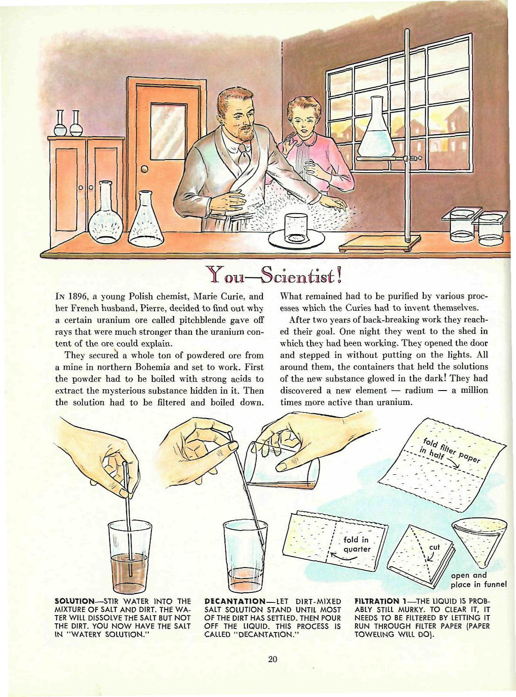

Sie – C
1896. Eine junge polnische Chemikerin, Marie Curie, und
ihr französischer Ehemann Pierre beschlossen herauszufinden, warum
ein bestimmtes Uranerz namens Pechblende Strahlen abgab, die viel stärker waren, als der Uran-
Gehalt des Erzes erklären konnte.
Sie besorgten sich eine ganze Tonne pulverisiertes Erz aus
einer Mine in Nordböhmen und machten sich an die Arbeit. Zuerst
musste das Pulver mit starken Säuren gekocht werden, um
die darin verborgene geheimnisvolle Substanz zu extrahieren. Dann
musste die Lösung gefiltert und eingekocht werden.
List I
>cieii
Was übrig blieb, musste durch verschiedene Verfahren gereinigt werden,
die die Curies sich selbst ausdenken mussten.
Nach zwei Jahren zermürbender Arbeit erreichten
sie ihr Ziel. Eines Nachts gingen sie in die Werkstatt, in der
sie gearbeitet hatten. Sie öffneten die Tür
und traten ein, ohne das Licht anzuschalten. Rings um sie herum
leuchteten die Behälter, die die Lösungen
der neuen Substanz enthielten, im Dunkeln! Sie hatten
ein neues Element entdeckt – Radium – eine Million Mal
aktiver als Uran.
LÖSUNG – RÜHREN SIE WASSER IN DIE
MISCHUNG AUS SALZ UND ERDE. DAS WAS-
SER LÖST DAS SALZ, ABER NICHT
DIE ERDE. SIE HABEN JETZT DAS SALZ
IN „WÄSSRIGER LÖSUNG“.
DEKANTATION – LASSEN SIE DIE
ERDHALTIGE SALZLÖSUNG STEHEN, BIS DER GROSSTEIL
DER ERDE GESUNKEN IST. GIESEN SIE DANN
DIE FLÜSSIGKEIT AB. DIESER VORGANG
WIRD „DEKANTATION“ GENANNT.
öffnen und
in Trichter geben
FILTRATION 1 – DIE FLÜSSIGKEIT IST
WAHRSCHEINLICH NOCH TRÜBE. UM SIE ZU KLÄREN,
MUSS SIE GEFILTERT WERDEN, INDEM MAN SIE
DURCH FILTERPAPIER (PAPIERTUCH TUT ES AUCH) LÄUFT.
20

---
## Page 22

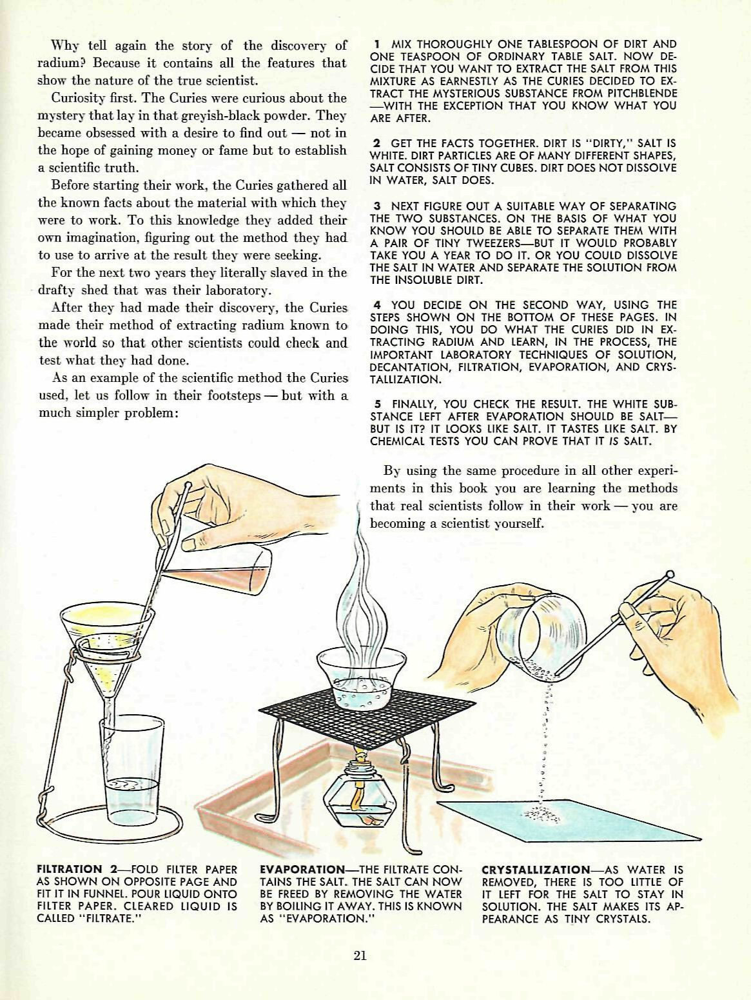

Warum die Geschichte der Entdeckung von Radium noch einmal erzählen? Weil sie alle Merkmale enthält, die die Natur des wahren Wissenschaftlers zeigen.
Zuerst Neugier. Die Curies waren neugierig auf das Geheimnis, das in diesem gräulich-schwarzen Pulver lag. Sie wurden besessen von dem Wunsch, es herauszufinden – nicht in der Hoffnung auf Geld oder Ruhm, sondern um eine wissenschaftliche Wahrheit zu begründen.
Bevor die Curies mit ihrer Arbeit begannen, sammelten sie alle bekannten Fakten über das Material, mit dem sie arbeiten sollten. Diesem Wissen fügten sie ihre eigene Vorstellungskraft hinzu und erarbeiteten die Methode, die sie anwenden mussten, um zu dem Ergebnis zu gelangen, das sie suchten.
Zwei Jahre lang schufteten sie buchstäblich in der zugigen Baracke, die ihr Labor war.
Nachdem sie ihre Entdeckung gemacht hatten, gaben die Curies der Welt ihre Methode zur Gewinnung von Radium bekannt, damit andere Wissenschaftler überprüfen und testen konnten, was sie getan hatten.
Als Beispiel für die wissenschaftliche Methode, die die Curies anwandten, wollen wir ihnen folgen – aber mit einem viel einfacheren Problem:
1
MISCHE GRÜNDLICH EINEN ESSLÖFFEL ERDE UND EINEN TEELÖFFEL GEWÖNLICHES SPEISESALZ. NUN BESCHLIESSE, DASS DU DAS SALZ AUS DIESER MISCHUNG GENAUS SO ERNSTHAFT GEWINNEN WILLST, WIE DIE CURIES BESCHLOSSEN, DIE MYSTERIÖSE SUBSTANZ AUS PECHBLENDE ZU GEWINNEN – MIT DER AUSNAHME, DASS DU WEISST, WAS DU SUCHST.
2
SAMMLE DIE FAKTEN. ERDE IST "SCHMUTZIG", SALZ IST WEISS. ERDEPARTIKEL HABEN VIELE VERSCHIEDENE FORMEN, SALZ BESTEHT AUS WINZIGEN WÜRFELN. ERDE LÖST SICH NICHT IN WASSER AUF, SALZ TUT DAS.
3
ÜBERLEGE NUN EINE GEEIGNETE METHODE, UM DIE BEIDEN SUBSTANZEN ZU TRENNEN. AUF DER GRUNDLAGE DEINES WISSENS SOLLTEST DU SIE MIT EINER KLEINEN PINZETTE TRENNEN KÖNNEN – ABER DAS WÜRDE DICH WAHRSCHEINLICH EIN JAHR DAUERN. ODER DU KÖNNTEST DAS SALZ IN WASSER AUFLÖSEN UND DIE LÖSUNG VON DER UNLÖSLICHEN ERDE TRENNEN.
4
DU ENTSCHEIDEST DICH FÜR DIE ZWEITE METHODE UND FOLGST DEN SCHRITTEN, DIE AUF DER UNTEREN SEITE DIESER SEITEN GEZEIGT SIND. DAMIT TUST DU, WAS DIE CURIES BEI DER GEWINNUNG VON RADIUM GETAN HABEN, UND LERNST DABEI DIE WICHTIGEN LABORTECHNIKEN LÖSEN, DEKANTIEREN, FILTRIEREN, VERDAMPFEN UND KRISTALLISIEREN.
5
PRÜFE SCHLIESSLICH DAS ERGEBNIS. DIE WEISSE SUBSTANZ, DIE NACH DER VERDAMPFUNG ÜBRIG BLEIBT, SOLLTE SALZ SEIN – ABER IST ES DAS? ES SIEHT AUS WIE SALZ. ES SCHMECKT WIE SALZ. MIT CHEMISCHEN TESTS KANNST DU BEWEISEN, DASS ES SALZ IST.
Indem du bei allen anderen Experimenten in diesem Buch das gleiche Verfahren anwendest, lernst du die Methoden, die echte Wissenschaftler bei ihrer Arbeit anwenden – du wirst selbst ein Wissenschaftler.
FILTRATION 2 – FALTE FILTERPAPIER WIE AUF DER GEGENÜBERLIEGENDEN SEITE GEZEIGT UND SETZE ES IN DEN TRICHTER EIN. GIESSE DIE FLÜSSIGKEIT AUF DAS FILTERPAPIER. DIE GEKLÄRTE FLÜSSIGKEIT WIRD "FILTRAT" GENANNT.
VERDAMPFUNG – DAS FILTRAT ENTHÄLT DAS SALZ. DAS SALZ KANN NUN GEWONNEN WERDEN, INDEM DAS WASSER DURCH KOCHEN ENTFERNT WIRD. DIES WIRD ALS "VERDAMPFUNG" BEZEICHNET.
KRISTALLISIERUNG – WENN WASSER ENTFERNT WIRD, BLEIBT ES SO WENIG ÜBRIG, DASS DAS SALZ NICHT IN LÖSUNG BLEIBEN KANN. DAS SALZ ERSCHEINT ALS WINZIGE KRISTALLE.
21

---
## Page 23

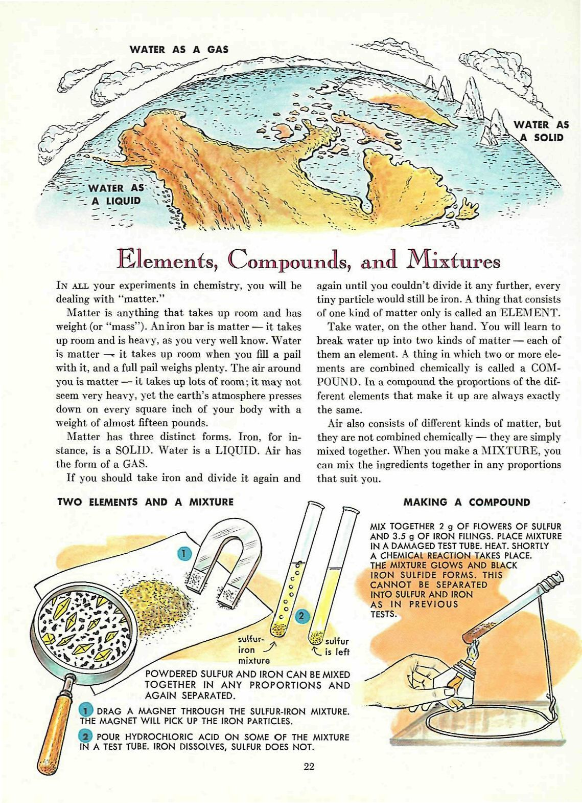

WASSER ALS GAS
Elemente, Verbindungen und Gemische
BEI ALLEN Ihren Experimenten in der Chemie werden Sie mit "Materie" zu tun haben.
Materie ist alles, was Raum einnimmt und Gewicht (oder Masse) hat. Ein Eisenstab ist Materie – er nimmt Raum ein und ist schwer, wie Sie sehr gut wissen. Wasser ist Materie – es nimmt Raum ein, wenn Sie einen Eimer damit füllen, und ein voller Eimer wiegt einiges. Die Luft um Sie herum ist Materie – sie nimmt viel Raum ein: Sie scheint vielleicht nicht sehr schwer zu sein, doch die Erdatmosphäre drückt mit fast sieben Kilogramm Gewicht auf jeden Quadratzentimeter Ihres Körpers.
Materie hat drei verschiedene Formen. Eisen zum Beispiel ist ein FESTSTOFF. Wasser ist eine FLÜSSIGKEIT. Luft hat die Form eines GASES.
Wenn Sie Eisen nehmen und es immer wieder teilen würden, bis Sie es nicht weiter teilen könnten, wäre jeder winzige Teil immer noch Eisen. Eine Sache, die nur aus einer Art von Materie besteht, nennt man ELEMENT.
Nehmen Sie hingegen Wasser. Sie werden lernen, Wasser in zwei Arten von Materie zu zerlegen – jede von ihnen ein Element. Eine Sache, in der zwei oder mehr Elemente chemisch verbunden sind, nennt man VERBINDUNG. In einer Verbindung sind die Anteile der verschiedenen Elemente, aus denen sie besteht, immer genau gleich.
Luft besteht ebenfalls aus verschiedenen Arten von Materie, aber sie sind nicht chemisch verbunden – sie sind einfach miteinander vermischt. Wenn Sie ein GEMISCH herstellen, können Sie die Zutaten in beliebigen Mengen mischen, wie es Ihnen beliebt.
HERSTELLUNG EINER VERBINDUNG
MISCHEN SIE 2 g SCHWEFELBLUMEN UND 3,5 g EISENSPÄNE. GEBEN SIE DAS GEMISCH IN EIN BESCHÄDIGTES REAGENZGLAS. ERHITZEN. KURZ DARAUF FINDET EINE CHEMISCHE REAKTION STATT.
DAS GEMISCH GLÜHT UND ES BILDET SICH SCHWARZES EISENSULFID. DIES
KANN NICHT
IN SCHWEFEL UND EISEN
GETRENNT WERDEN
WIE BEI VORHERIGEN
VERSUCHEN.
Schwel-
eisen
-7
gemisch
\£i>'schwel
•tL. zurückbleibt
PULVERISIERTER SCHWEFEL UND EISEN KÖNNEN IN BELIEBIGEN
MENGEN
ZUSAMMEN GEMISCHT
UND
WIEDER GETRENNT WERDEN.
ZIEHEN SIE EINEN MAGNETEN DURCH DAS SCHWEFEL-EISEN-GEMISCH.
DER MAGNET WIRD DIE EISENPARTIKEL AUFHEBEN.
(5) GEBEN SIE SALZSÄURE AUF ETWAS VON DEM GEMISCH
IN EIN REAGENZGLAS. EISEN LÖST SICH AUF, SCHWEFEL NICHT.
22

---
## Page 24

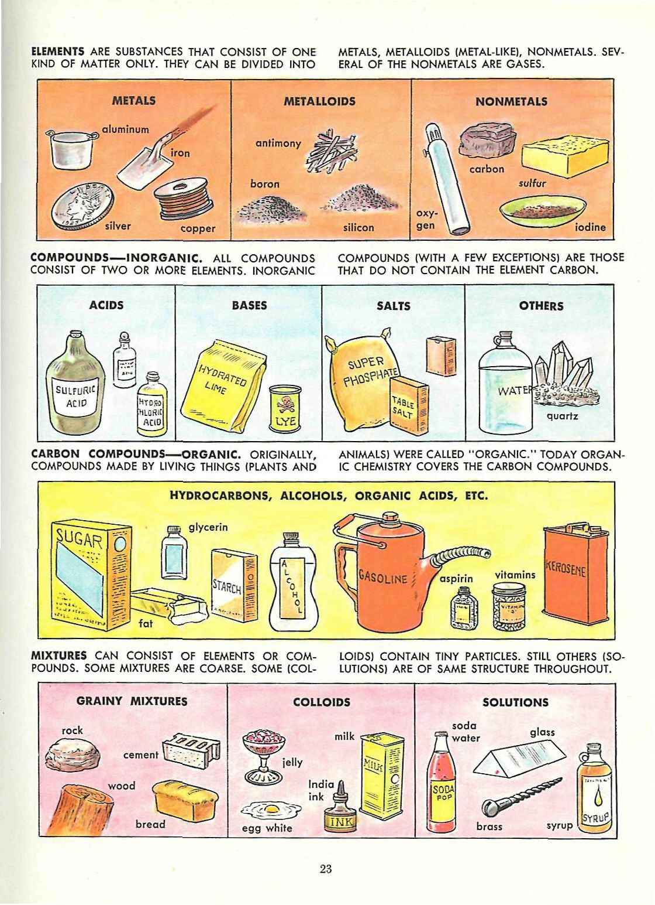

ELEMENTE SIND STOFFE, DIE AUS NUR EINER
METALLE, METALLOIDE (METALLÄHNLICH), NICHTMETALLE. SEV-
ART VON MATERIE BESTEHEN. SIE KÖNNEN UNTERTEILT WERDEN IN
ERAL NICHTMETALLE SIND GASE.
METALLE
Kupfer
METALLOIDE
Antimon
Bor
'~v.r4^s&-
• :
; f ^
NICHTMETALLE
Iod
VERBINDUNGEN — ANORGANISCH.
ALLE VERBINDUNGEN
VERBINDUNGEN (MIT WENIGEN AUSNAHMEN) SIND SOLCHE,
BESTEHEN AUS ZWEI ODER MEHREREN ELEMENTEN. ANORGANISCHE
DIE NICHT DAS ELEMENT KOHLENSTOFF ENTHALTEN.
SÄUREN
BASEN
SALZE
ANDERE
KOHLENSTOFFVERBINDUNGEN
ORGANISCH. URSPRÜNGLICH,
TIERE) WURDEN ALS "ORGANISCH" BEZEICHNET. HEUTE DECKT DIE ORGANISCHE
VERBINDUNGEN, DIE VON LEBENDEN WESEN (PFLANZEN UND
CHEMIE DIE KOHLENSTOFFVERBINDUNGEN AB.
KOHLENWASSERSTOFFE, ALKOHOLE, ORGANISCHE SÄUREN USW.
5^
VITAMINE ^ROSFJIE
GEMISCHE KÖNNEN AUS ELEMENTEN ODER VERBINDUNGEN
LOIDE) ENTHALTEN WINZIGE PARTIKEL. WIEDER ANDERE (SO-
BESTEHEN. EINIGE GEMISCHE SIND GROB. EINIGE (KOL-
LÖSUNGEN) HABEN ÜBERALL DIE GLEICHE STRUKTUR.
KÖRNIGE GEMISCHE
Gestein
KOL-LOIDE
LÖSUNGEN
Sirup
23

---
## Page 25

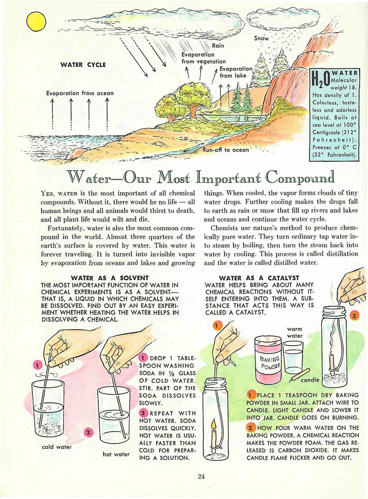

WASSER- 
KREISLAUF 
Verdunstung aus dem Ozean 
4. 
% 
| Regen 
Verdunstung 
aus Vegetation 
j VerdunstungA£&& 
f aus dem See 
£ g £ £ 
KsASliP5"'. 
WASSER 
Molekular- 
gewicht 18. 
Hat eine Dichte von 1. 
Farbloses, geschmack-
loses und geruchloses 
Flüssigkeit. Siedet auf 
Meereshöhe bei 100° 
Centigrade (212° 
Fahrenheit). 
Gefriert bei 0° C 
(32° Fahrenheit). 
Wasser—Unsere Wichtigste Verbindung 
JA, WASSER ist die wichtigste aller chemischen 
Verbindungen. Ohne sie gäbe es kein Leben – alle 
Menschen und alle Tiere würden vor Durst sterben, 
und alles Pflanzenleben würde welken und sterben. 
Glücklicherweise ist Wasser auch die häufigste Ver-
bindung der Welt. Fast drei Viertel der Erdober-
fläche sind mit Wasser bedeckt. Dieses Wasser ist 
ständig unterwegs. Es wird durch Verdunstung aus 
Ozeanen und Seen und wachsenden Dingen in unsicht-
baren Dampf verwandelt. Wenn der Dampf abkühlt, 
bildet er Wolken aus winzigen Wassertröpfchen. Wei-
teres Abkühlen lässt die Tropfen als Regen oder Schnee 
zur Erde fallen, die Flüsse, Seen und Ozeane füllen 
und den Wasserkreislauf fortsetzen. 
Chemiker nutzen die Methode der Natur, um chemisch 
reines Wasser herzustellen. Sie verwandeln gewöhnliches 
Leitungswasser durch Kochen in Dampf und verwandeln 
dann den Dampf durch Abkühlen wieder in Wasser. 
Dieser Prozess wird Destillation genannt und das Wasser 
wird destilliertes Wasser genannt. 
WASSER ALS 
LÖSUNGSMITTEL 
DIE WICHTIGSTE FUNKTION VON WASSER IN 
CHEMISCHEN EXPERIMENTEN IST DIE ALS LÖSUNGS-
MITTEL – DAS HEISST, EINE FLÜSSIGKEIT, IN DER 
CHEMIKALIEN GELÖST WERDEN KÖNNEN. FINDEN 
SIE MIT EINEM EINFACHEN EXPERIMENT HERAUS, 
OB DAS ERWÄRMEN DES WASSERS BEIM LÖSEN 
EINER CHEMIKALIE HILFT. 
kaltes Wasser 
heißes Wasser 
TROPFE 1 ESSLÖFFEL WASCH-
SODA IN 1/2 GLAS 
KALTES WASSER. 
UMRÜHREN. EIN TEIL DER 
SODA LÖST SICH 
LANGSAM. 
1.2 WIEDERHOLE 
MIT 
HEISSEM WASSER. SODA 
LÖST SICH SCHNELL. 
HEISSES WASSER IST IN DER 
REGEL SCHNELLER ALS 
KALTES ZUR ZUBEREI-
TUNG EINER LÖSUNG. 
1 
GEBEN SIE 1 TEELÖFFEL TROCKENES BACK-
PULVER IN EIN KLEINES GLAS. BEFESTIGEN SIE DRAHT AN 
KERZE. ZÜNDEN SIE DIE KERZE AN UND LASSEN SIE SIE IN DAS 
GLAS HINEIN. DIE KERZE BRENNT WEITER. 
2 
GIESSEN SIE JETZT WARMES WASSER AUF DAS 
BACKPULVER. EINE CHEMISCHE REAKTION LÄSST DAS 
PULVER AUFSCHÄUMEN. DAS FREIGESETZTE GAS IST 
KOHLENDIOXID. ES LÄSST DIE KERZENFLAMME FLACKERN 
UND ERSTICHT. 
WASSER ALS 
KATALYSATOR 
WASSER HILFT BEI VIELEN CHE-
MISCHEN REAKTIONEN, OHNE 
SELBST DARAN BETEILIGT ZU 
SEIN. EINE SUBSTANZ, DIE 
SICH SO VERHÄLT, WIRD 
KATALYSATOR GENANNT.

---
## Page 26

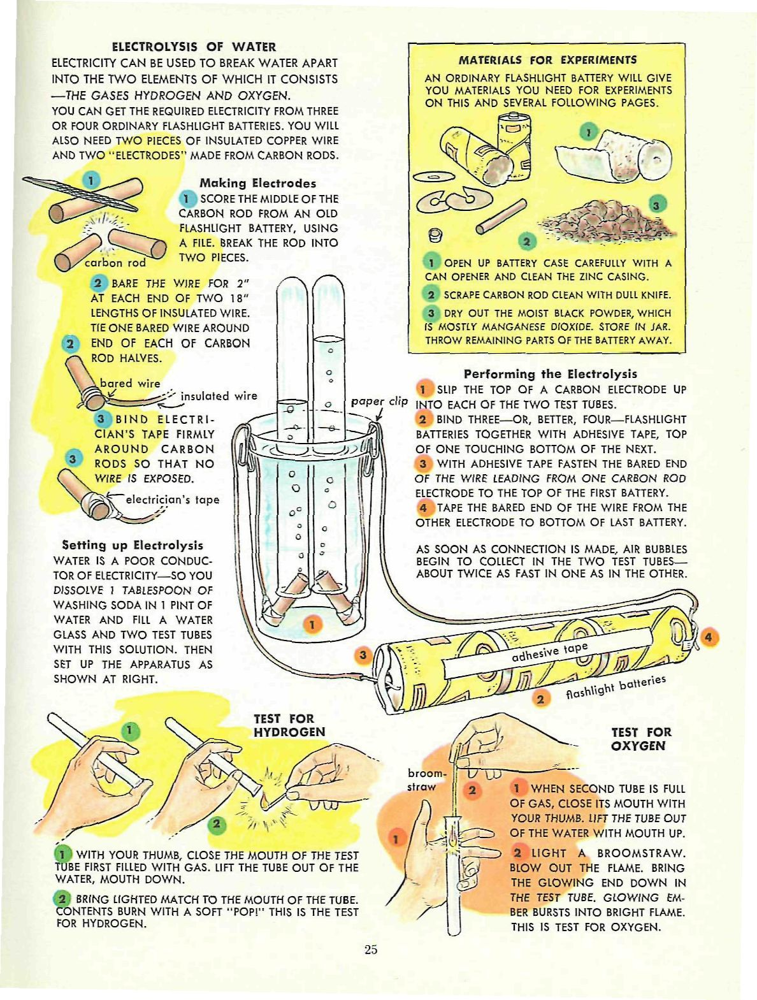

ELEKTROLYSE VON
WASSER
ELEKTRIZITÄT KANN VERWENDET WERDEN, UM WASSER IN DIE ZWEI ELEMENTE ZERZULEGEN, AUS DENEN ES BESTEHT – DIE GASE WASSERSTOFF UND SAUERSTOFF.
SIE KÖNNEN DEN BENÖTIGTEN STROM AUS DREI ODER VIER GEWÖHNLICHEN TASCHENLAMPENBATTERIEN GEWINNEN. SIE BENÖTIGEN AUSSERDEM ZWEI STÜCKE ISOLIERTE KUPFERDRAHT UND ZWEI "ELEKTRODEN" AUS KOHLESTÄBEN.
Herstellung von Elektroden
1
RITZEN SIE MIT EINER FEILE DIE MITTE DES KOHLESTABS EINER ALTEN TASCHENLAMPENBATTERIE EIN. BRECHEN SIE DEN STAB IN ZWEI TEILE.
kohlenstoffstab
2
2
ENTBLÖSSEN SIE DAS ENDE VON 2 ZOLL AN JEDEM ENDE VON ZWEI 18 ZOLL LANGEN ISOLIERTEN DRÄHTEN. BINDEN SIE EINEN ENTBLÖSSTEN DRAHT UM DAS ENDE JEDES KOHLENSTABHÄLFTE.
isoliert
3
BINDEN SIE MIT ELEKTRIKERBAND FEST UM DIE KOHLENSTÄBE, SO DASS KEIN DRAHT SICHTBAR IST.
*
kohlenstoffstäbe
-elektrische Klebeband
Aufbau der Elektrolyse
WASSER LEITET STROM SCHLECHT – DESHALB LÖSEN SIE 1 ESSLÖFFEL WASCHSODA IN 1 PINT WASSER AUF UND FÜLLEN SIE EIN WASSERGLAS UND ZWEI REAGENZGLÄSER MIT DIESER LÖSUNG. RICHTEN SIE DANN DIE APPARATUR WIE RECHTS GEZEIGT EIN.
r\
MATERIALIEN FÜR EXPERIMENTE
EINE GEWÖHNLICHE TASCHENLAMPENBATTERIE LIEFERT IHNEN DIE FÜR EXPERIMENTE AUF DIESER UND DEN FOLGENDEN SEITEN BENÖTIGTEN MATERIALIEN.
-::^$^p^k
1
ÖFFNEN SIE DAS BATTERIEGEHÄUSE VORSICHTIG MIT EINEM DOSENÖFFNER UND REINIGEN SIE DAS ZINKGEHÄUSE.
2
SCHABEN SIE DEN KOHLENSTAB MIT EINEM STUMPFER MESSER SAUBER.
3
TROCKNEN SIE DAS FEUCHTE SCHWARZE PULVER, DAS GRÖSSTENTEILS MANGANSDIOXID IST. IN EIN GLAS FÜLLEN.
WERFEN SIE DIE ÜBRIGEN TEILE DER BATTERIE WEG.
Durchführung der Elektrolyse
1
SCHIEBEN SIE DIE OBERSEITE EINER KOHLENELEKTRODE IN JEDES DER BEIDEN REAGENZGLÄSER.
2
BINDEN SIE DREI – ODER BESSER VIER – TASCHENLAMPENBATTERIEN MIT KLEBEBAND ZUSAMMEN, DIE OBERSEITE EINER BERÜHRT DIE UNTERSEITE DER NÄCHSTEN.
3
BEFESTIGEN SIE MIT KLEBEBAND DAS ENTBLÖSSTE ENDE DES DRAHTS, DER VON EINER KOHLENELEKTRODE ZUR OBERSEITE DER ERSTEN BATTERIE FÜHRT.
4
KLEBEN SIE DAS ENTBLÖSSTE ENDE DES DRAHTS VON DER ANDEREN ELEKTRODE AN DIE UNTERSEITE DER LETZTEN BATTERIE.
SOBALD DIE VERBINDUNG HERGESTELLT IST, BEGINNEN SICH IN DEN BEIDEN REAGENZGLÄSERN LUFTBLASEN ZU SAMMELN – ETWA DOPPELT SO SCHNELL IN DEM EINEN WIE IN DEM ANDEREN.
'/I y*\
' 1> SCHLIESSEN SIE MIT DEM DAUMEN DIE MÜNDUNG DES ZUERST MIT GAS GEFÜLLTEN REAGENZGLASES. HEBEN SIE DAS GLAS MIT DER MÜNDUNG NACH UNTEN AUS DEM WASSER.
2
BRINGEN SIE EIN ANGEZÜNDETES STREICHHOLZ AN DIE MÜNDUNG DES GLASES.
DER INHALT BRENNT MIT EINEM LEISEN "PLOPP!" DIES IST DER TEST AUF WASSERSTOFF.
TEST AUF
SAUERSTOFF
1
WENN DAS ZWEITE GLAS MIT GAS GEFÜLLT IST, SCHLIESSEN SIE SEINE MÜNDUNG MIT DEM DAUMEN. HEBEN SIE DAS GLAS MIT DER MÜNDUNG NACH OBEN AUS DEM WASSER.
2
ZÜNDEN SIE EINEN BESENSTIEL AN. BLASEN SIE DIE FLAMME AUS. BRINGEN SIE DAS GLÜHENDE ENDE IN DAS REAGENZGLAS. DER GLÜHENDE KOHLE BEGINNT MIT HELLER FLAMME ZU BRENNEN.
DIES IST DER TEST AUF SAUERSTOFF.

---
## Page 27

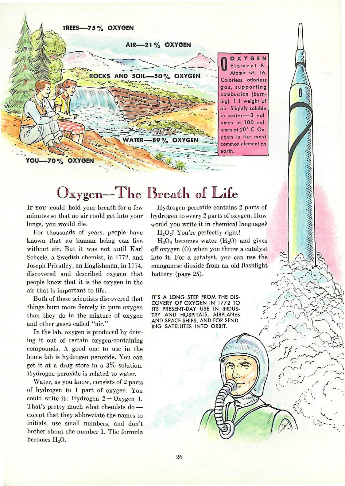

BÄUME
7 5 %
SAUERSTOFF
LUFT — 2 1 %
SAUERSTOFF
% ^f^CT
GEST EIN UND BODEN — 5 0 %
SAUERSTOFF
0
0 X Y G E N
Element
8.
Atomgewicht 16.
Farbloses, geruchloses
Gas, das die Verbrennung
unterstützt. 1,1-faches Gewicht der
Luft. Leicht löslich
in Wasser – 3 Vol.-
teile in 100 Vol.-
teilen bei 20 °C. Sauer-
stoff ist das häufigste
Element auf der Erde.
SIE — 7 0 %
SAUERSTOFF
Sauerstoff – Das
Wesentliche des Lebens
Wenn Sie Ihren Atem nur wenige
Minuten anhalten könnten, so dass keine
Luft in Ihre Lungen gelangen würde,
würden Sie sterben.
Seit Tausenden von Jahren wissen die
Menschen, dass kein Mensch ohne Luft
leben kann. Aber erst als Karl
Scheele, ein schwedischer Chemiker, 1772, und
Joseph Priestley, ein Engländer, 1774,
Sauerstoff entdeckten und beschrieben,
wussten die Menschen, dass der Sauerstoff in der
Luft für das Leben wichtig ist.
Beide Wissenschaftler entdeckten, dass
Dinge in reinem Sauerstoff heftiger brennen
als in der Mischung aus Sauerstoff
und anderen Gasen, die "Luft" genannt wird.
Im Labor wird Sauerstoff durch das Austreiben
aus bestimmten sauerstoffhaltigen Verbindungen
gewonnen. Eine gute Verbindung für das Heim-
Labor ist Wasserstoffperoxid. Sie erhalten es
in der Apotheke in einer 5%igen Lösung.
Wasserstoffperoxid ist mit Wasser verwandt.
Wasser besteht, wie Sie wissen, aus 2 Teilen
Wasserstoff zu 1 Teil Sauerstoff. Sie
könnten es schreiben: Wasserstoff 2 – Sauerstoff 1.
Das ist so ziemlich das, was Chemiker tun –
außer dass sie die Namen abkürzen,
kleine Zahlen verwenden und sich nicht
um die Zahl 1 kümmern. Die Formel
wird zu H₂O.
Wasserstoffperoxid enthält 2 Teile
Wasserstoff zu jeweils 2 Teilen Sauerstoff. Wie
würden Sie es in chemischer Sprache schreiben?
H₂O₂? Das ist genau richtig!
H₂O₂ wird zu Wasser (H₂O) und gibt
Sauerstoff (O) ab, wenn man einen Katalysator
hinzufügt. Als Katalysator können Sie
Mangandioxid aus einer alten Taschenlampenbatterie
verwenden (Seite 25).
ES IST EIN LANGER WEG VON DER ENT-
DECKUNG DES SAUERSTOFFS IM JAHR 1772 BIS
ZU SEINER HEUTIGEN VERWENDUNG IN INDU-
STRIE UND KRANKENHÄUSERN, FLUGZEUGEN
UND RAUMSCHIFFEN UND FÜR DAS STARTEN
VON SATELLITEN IN DEN ORBIT.
26

---
## Page 28

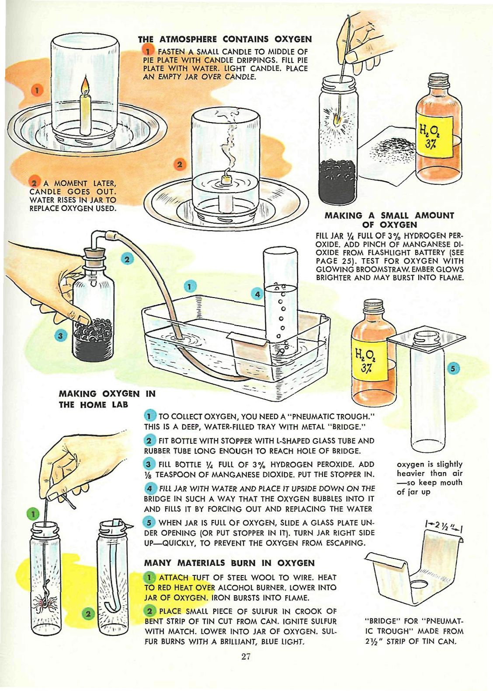

ATMOSPHÄRE ENTHÄLT
SAUERSTOFF
1
KERZE MIT KERZENWACHS IN DIE MITTE EINER
KUCHENFORM KLEBEN. KUCHENFORM MIT WASSER FÜLLEN. KERZE ANZÜNDEN.
LEEREN GLASBEHÄLTER ÜBER DIE KERZE STÜLPEN.
HERSTELLUNG
EINER KLEINEN
MENGE
SAUERSTOFF
GLASBEHÄLTER 1/3 VOLL MIT 3 % WASSERSTOFFPEROXID FÜLLEN.
BESTÄUBUNG MIT MANGAN-
DIOXID AUS EINER TASCHENLAMPEN-
BATTERIE HINZUFÜGEN (SIEHE SEITE 25). MIT GLÜHENDER
BROTSTAUPPETESTEN. GLÜHWURZEL GLÜHT
HELLER AUF UND KANN IN FLAMMEN AUFGEHEN.
HERSTELLUNG
VON SAUERSTOFF
DAS HEIMLABOR
1. UM SAUERSTOFF ZU SAMMELN, BRAUCHEN SIE EINE "PNEUMATISCHE WANNEN".
DIESE IST EIN TIEFGESCHWÄMMTER, WASSERGEFÜLLTER TROG MIT EINEM METALL-"BRÜCKEN".
2
FLASCHE MIT STOPFEN MIT L-FÖRMIGEM GLASROHR UND
GUMMISCHLAUCH AUSSTATTEN, DER LANG GENUG IST, UM DAS LOCH DER BRÜCKE ZU ERREICHEN.
3
FLASCHE 1/3 VOLL MIT 3 % WASSERSTOFFPEROXID FÜLLEN.
1/2 TEELÖFFEL MANGAN-DIOXID HINZUFÜGEN. STOPFEN AUFSTECKEN.
4
GLASBEHÄLTER MIT WASSER FÜLLEN UND ÜBER KOPF AUF DIE
BRÜCKE STELLEN, SO DASS DER SAUERSTOFF HINEINBLUBBERT UND IHN FÜLLT, INDEM ER DAS WASSER VERDRÄNGT UND ERSETZT.
5
WENN DER GLASBEHÄLTER VOLL MIT SAUERSTOFF IST, EINE GLASPLATTE
UNTER DIE ÖFFNUNG SCHIEBEN (ODER STOPFEN HINEINSETZEN). GLASBEHÄLTER SCHNELL HOCHREISSEN, DAMIT DER SAUERSTOFF NICHT ENWEICHT.
VIELE
MATERIALIEN BRENNEN IN
SAUERSTOFF
1
EISENWOLLE-BÜSCHEL AN DRAHT BEFESTIGEN. ÜBER ALKOHOLBRENNER ROT GLÜHEND ERHITZEN. IN
GLASBEHÄLTER MIT SAUERSTOFF TAUCHEN. EISEN GEHT IN FLAMMEN AUF.
2
KLEINES SCHWEFELSTÜCK IN DIE KRÜMMUNG EINER
GEBOGENEN ZINNSTRIPPE AUS EINER DOSE PLATZIEREN. SCHWEFEL MIT STREICHHOLZ ANZÜNDEN. IN GLASBEHÄLTER MIT SAUERSTOFF TAUCHEN. SCHWEFEL BRENNT MIT BRILLANT BLAUER FLAMME.
SAUERSTOFF IST ETWAS
SCHWERER ALS LUFT
— MÜNDUNG DES GLASBEHÄLTERS NACH OBEN HALTEN
"BRÜCKE" FÜR "PNEUMATISCHE
WANNEN" AUS EINER
2,5 CM BREITEN BLECH-
DOSE
27

---
## Page 29

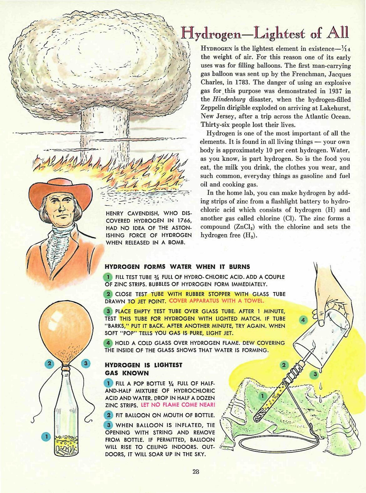

^ - 
~z 
J i '» A 
i Stf^ffl 
HENRY CAVENDISH, DER WASSERSTOFF 1766 ENTSCHLÜSSELT, 
HATTE KEINE AHNUNG VON DER ERSTAUN-
LICHEN KRAFT VON WASSERSTOFF, 
WENN ER IN EINER BOMBE FREIGESETZT WIRD. 
WASSERSTOFF – DAS LEICHTESTE ALLER ELEMENTE 
WASSERSTOFF ist das leichteste Element, das es gibt – ein Zwölftel des Gewichts von Luft. Aus diesem Grund wurde es frühzeitig zum Befüllen von Ballons verwendet. Der erste bemannte Gasballon wurde 1783 vom Franzosen Jacques Charles gestartet. Die Gefahr, ein explosives Gas zu diesem Zweck zu verwenden, zeigte sich 1937 bei der Hindenburg-Katastrophe, als das mit Wasserstoff gefüllte Zeppelindirigible bei der Ankunft in Lakehurst, New Jersey, nach einer Atlantiküberquerung explodierte. Sechsunddreißig Menschen kamen ums Leben. 
Wasserstoff ist eines der wichtigsten aller Elemente. Er ist in allen Lebewesen vorhanden – Ihr eigener Körper besteht zu etwa 10 Prozent aus Wasserstoff. Wasser, wie Sie wissen, besteht teilweise aus Wasserstoff. So auch die Nahrung, die Sie essen, die Milch, die Sie trinken, die Kleidung, die Sie tragen, und alltägliche Dinge wie Benzin und Heizöl und Kochgas. 
Im Heimlabor können Sie Wasserstoff herstellen, indem Sie Zinkstreifen aus einer Taschenlampenbatterie zu Salzsäure geben, die aus Wasserstoff (H) und einem anderen Gas namens Chlor (Cl) besteht. Das Zink bildet eine Verbindung (ZnCl2) mit dem Chlor und setzt den Wasserstoff frei (Hj). 
WASSERSTOFF BILDET WASSER BEIM BRENNEN 
1 FÜLLEN SIE EIN REAGENZGLAS ZU 2/3 MIT SALZSÄURE. GEBEN SIE EIN PAAR ZINKSTREIFEN HINZU. SOFORT BILDEN SICH WASSERSTOFFBLASEN. 
2 VERSCHLIESSEN SIE DAS REAGENZGLAS MIT EINEM GUMMISTOPFEN MIT GLASROHR, DAS ZU EINER DÜSE AUSGEZOGEN IST. DECKEN SIE DIE APPARATUR MIT EINEM HANDTUCH AB. 
3 STELLEN SIE EIN LEERES REAGENZGLAS ÜBER DAS GLASROHR. NACH 1 MINUTE PRÜFEN SIE DIESES GLAS MIT EINEM ANGEZÜNDETEN STREICHHOLZ AUF WASSERSTOFF. WENN DAS GLAS MIT EINEM "BARKEN" REAGIERT, STELLEN SIE ES ZURÜCK. NACH WEITERER MINUTE VERSUCHEN SIE ES NOCHMAL. WENN EIN LEISES "POP" IHNEN SAGT, DASS DAS GAS REIN IST, ZÜNDEN SIE DIE DÜSE AN. 
4 HALTEN SIE EIN KALTES GLAS ÜBER DIE WASSERSTOFFFLAMME. DER TAU, DER DIE INNENSEITE DES GLASES BEDECKT, ZEIGT, DASS WASSER ENTSTEHT. 
WASSERSTOFF IST DAS LEICHTESTE 
BEKANNTE GAS 
1 FÜLLEN SIE EINE SPRUDELFLASCHE ZU 1/4 MIT EINER HALB-UND-HALB-MISCHUNG AUS SALZSÄURE UND WASSER. GEBEN SIE EIN HALBES DOZEND ZINKSTREIFEN HINZU. KEINE FLAMME IN DIE NÄHE BRINGEN! 
2 BEFESTIGEN SIE EINEN BALLON AM FLASCHENHALSWURZ. 
3 WENN DER BALLON AUFGEBLASEN IST, BINDEN SIE DIE ÖFFNUNG MIT EINEM FADEN ZU UND NEHMEN SIE IHN VON DER FLASCHE AB. WENN ES ERHOBEN WIRD, WIRD DER BALLON DRINNEN AN DIE DECKE STEIGEN. DRAUSSEN WIRD ER IN DEN HIMMEL AUFSTEIGEN. 
28

---
## Page 30

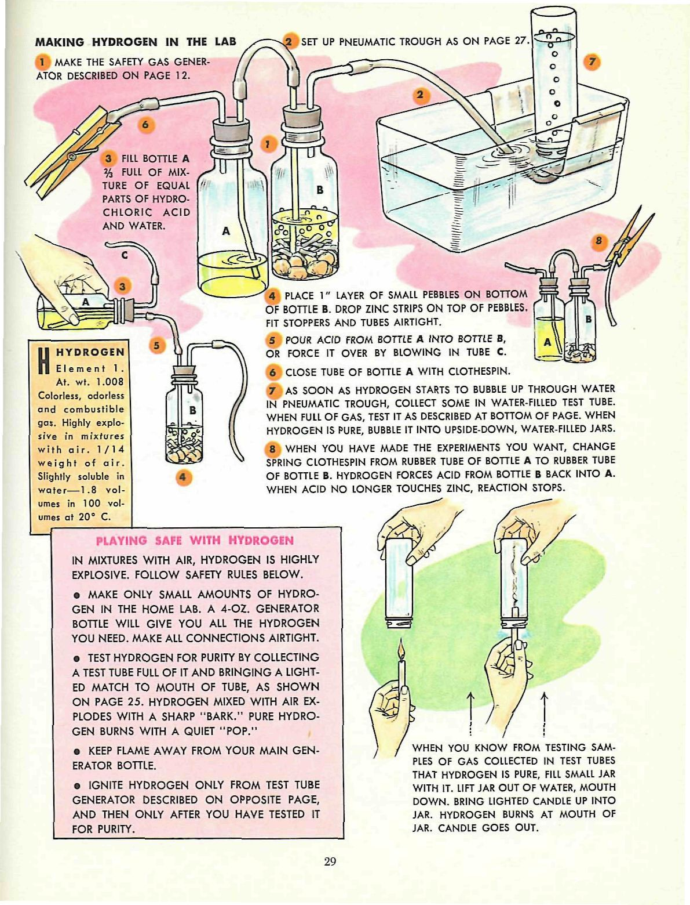

HERSTELLUNG VON
WASSERSTOFF
1
BAUEN SIE DEN SICHERHEITSGASERZEUGER, DER AUF SEITE 12 BESCHRIEBEN IST.
H
WASSERSTOFF
Element
1.
Atomgewicht. 1,008
Farbloses, geruchloses
und brennbares
Gas. Hoch explosiv
in Mischungen
mit Luft.
1/14
Gewicht
von
Luft.
Schwer löslich in
Wasser – 1,8
Volumina in 100 Volumina
bei 20 °C.
6
VERSCHLIESSEN SIE DAS ROHR DER FLASCHE A MIT EINER WÄSCHEKLAMMER.
7
SOBALD WASSERSTOFF DURCH WASSER IN DER PNEUMATISCHEN Wanne BLUBBERT, SAMMELN SIE ETWAS IN EINEM MIT WASSER GEFÜLLTEN REAGENZGLAS.
WENN VOLL MIT GAS, TESTEN SIE ES, WIE AM ENDE DER SEITE BESCHRIEBEN. WENN
WASSERSTOFF REIN IST, LEITEN SIE IHN ES IN UMGEKEHRTE, MIT WASSER GEFÜLLTE GLÄSER.
8
WENN SIE DIE GEWÜNSCHTEN EXPERIMENTE DURCHGEFÜHRT HABEN, WECHSELN SIE
DIE FEDERWÄSCHEKLAMMER VOM GUMMIROHR DER FLASCHE A ZUM GUMMIROHR
DER FLASCHE B. WASSERSTOFF DRÜCKT DIE SÄURE VON FLASCHE B ZURÜCK IN A.
WENN DIE SÄURE KEINEN ZINK MEHR BERÜHRT, HÖRT DIE REAKTION AUF.
SICHERHEIT MIT
WASSERSTOFF
IN MISCHUNGEN MIT LUFT IST WASSERSTOFF HOCH EXPLOSIV. BEFOLGEN SIE DIE SICHERHEITSREGELN UNTEN.
•
STELLEN SIE IM HEIMLABOR NUR KLEINE MENGEN WASSERSTOFF HER. EIN 4-OZ. GASERZEUGERFLASCHE GIBT IHNEN GENUG WASSERSTOFF. ALLE VERBINDUNGEN LUFTDICHT MACHEN.
•
TESTEN SIE WASSERSTOFF AUF REINHEIT, INDEM SIE EIN REAGENZGLAS VOLL MIT WASSERSTOFF FÜLLEN UND EIN ANGEZÜNDETES STREICHHOLZ AN DEN MÜNDUNG DES ROHRES HALTEN, WIE AUF SEITE 25 GEZEIGT. WASSERSTOFF, DER MIT LUFT VERMISCHT IST, EXPLODIERT MIT EINEM SCHARFEN "BELLEN". REINER WASSERSTOFF VERBRENNT MIT EINEM LEISEN "PLOPPEN".
•
HALTEN SIE FLAMMEN VON IHRER HAUPTZERZEUGERFLASCHE FERN.
•
ZÜNDEN SIE WASSERSTOFF NUR AUS DEM REAGENZGLAS-ERZEUGER, DER AUF DER GEGENÜBERLIEGENDEN SEITE BESCHRIEBEN IST, UND NUR, NACHDEM SIE IHN AUF REINHEIT GETESTET HABEN.
WENN SIE DURCH TESTEN VON GASPROBEN, DIE IN REAGENZGLÄSERN GESAMMELT WURDEN, WISSEN, DASS DER WASSERSTOFF REIN IST, FÜLLEN SIE EIN KLEINES GLAS DAMIT. HEBEN SIE DAS GLAS AUS DEM WASSER, MÜNDUNG NACH UNTEN. HALTEN SIE EINE ANGEZÜNDETE KERZE IN DAS GLAS. WASSERSTOFF VERBRENNT AM MÜNDUNG DES GLASES. DIE KERZE ERLISCHT.
29

---
## Page 31

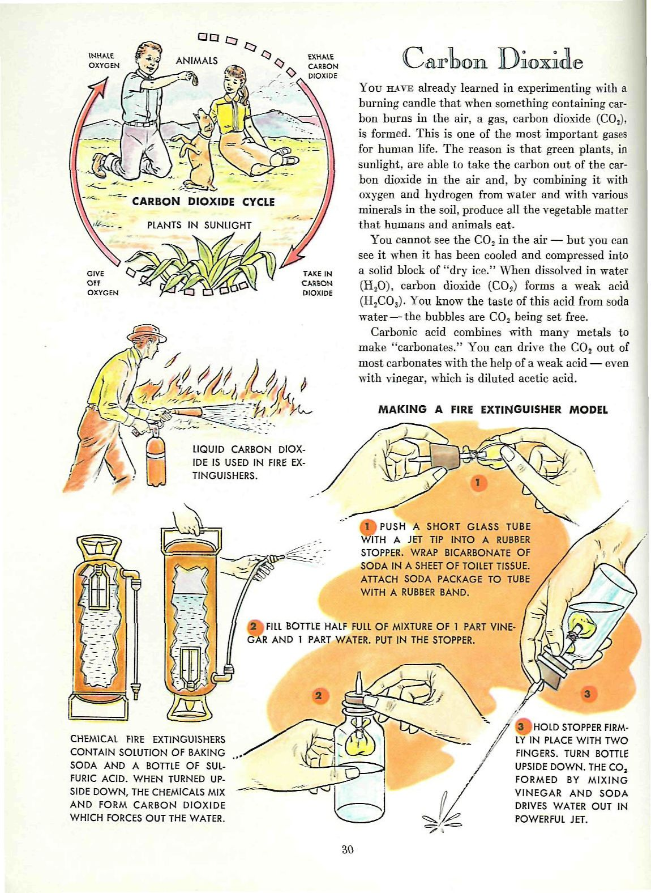

• D 0
.
FEUERLÖSCHER
V
KOHLENSTOFF
V.
DIOXID
rr-
GIBT
AB
SAUERSTOFF
NIMMT AUF
KOHLENSTOFF
DIOXID
FLÜSSIGES KOHLENSTOFFDIOXID
WIRD IN FEUERLÖSCHERN
VERWENDET.
4
Kohlendioxid
Sie haben bereits durch Experimente mit einer
brennenden Kerze gelernt, dass beim Verbrennen von kohlenstoffhaltigen Stoffen in der Luft ein Gas, Kohlendioxid (CO2),
entsteht. Dies ist eines der wichtigsten Gase
für das menschliche Leben. Der Grund dafür ist, dass grüne Pflanzen im
Sonnenlicht in der Lage sind, den Kohlenstoff aus dem Kohlendioxid
in der Luft zu entziehen und ihn durch Kombination mit Sauerstoff und Wasserstoff aus Wasser und mit verschiedenen
Mineralien im Boden herzustellen, um die gesamte Pflanzenmasse zu produzieren, die Menschen und Tiere essen.
Sie können das CO2 in der Luft nicht sehen – aber Sie können es sehen, wenn es abgekühlt und zu einem
festen Block aus "Trockeneis" komprimiert wurde. Wenn Kohlendioxid (CO2) in Wasser (H2O) gelöst wird, bildet es eine schwache Säure
(H2CO3). Den Geschmack dieser Säure kennen Sie von Sodawasser – die Bläschen sind freigesetztes CO2.
Kohlensäure verbindet sich mit vielen Metallen zu "Carbonaten". Sie können das CO2 aus den meisten Carbonaten
mit Hilfe einer schwachen Säure austreiben – sogar mit Essig, der verdünnte Essigsäure ist.
HERSTELLUNG
EINES FEUERLÖSCHER-
MODELLS
1. Drücken Sie ein kurzes Glasrohr mit
einer Düsenspitze in einen Gummistopfen. Wickeln Sie Natriumbicarbonat
in ein Stück Toilettenpapier.
Befestigen Sie das Sodapaket mit einem Gummiband am Rohr.
2. Füllen Sie die Flasche zur Hälfte mit einer Mischung aus 1 Teil Essig
und 1 Teil Wasser. Setzen Sie den Stopfen ein.
CHEMISCHE FEUERLÖSCHER
ENTHALTEN EINE LÖSUNG VON BACKSODA
UND EINE FLASCHE SCHWE-
FELSÄURE. WENN SIE UMGE-
DREHT WERDEN, MISCHEN SICH DIE CHEMIKALIEN UND ES BILDET SICH KOHLENDIOXID,
DAS DAS WASSER HERAUSDRÜNGT.
3. Halten Sie den Stopfen mit zwei
Fingern fest. Drehen Sie die Flasche
auf den Kopf. Das CO2, das durch
die Mischung von
Essig und Soda entsteht,
treibt das Wasser in einem
starken Strahl heraus.
30

---
## Page 32

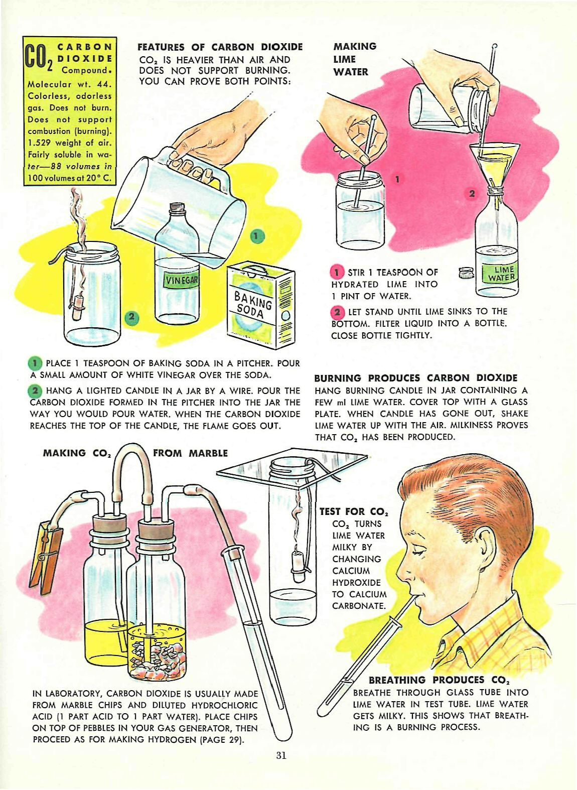

K A R B O N
D I O X I D
Verbindung •
Molekulargewicht. 44.
Farbloses, geruchloses
Gas. Brennt nicht.
Unterstützt
keine
Verbrennung (Brennen).
1,529 Gewicht von Luft.
Ziemlich gut löslich in Wa-
sser – 88 Volumenteile in
100 Volumenteilen bei 20° C.
EIGENSCHAFTEN VON KARBON-
DIOXID
K O , IST SCHWERER ALS LUFT UND
UNTERSTÜTZT KEIN BRENNEN.
BEIDES KANN NACHGEWIESEN WERDEN:
HERSTELLUNG VON
KALKWASSER
1. GEBEN SIE 1 TEELÖFFEL BACKPULVER IN EINE KANNE. GIEßEN SIE
EINE KLEINE MENGE WEISSEN ESSIG ÜBER DAS PULVER.
HÄNGEN SIE EINE ANGEZÜNDETE KERZE MIT DRAHT IN EIN GLAS. GIEßEN SIE DAS
IM KANNE ENTSENDE KARBON DIOXID IN DAS GLAS, SO
WIE SIE WASSER GIEßEN WÜRDEN. WENN DAS KARBON DIOXID
OBEN AN DER KERZE ANKOMMT, ERLISCHT DIE FLAMME.
HERSTELLUNG VON
K O ,
• RÜHREN SIE 1 TEELÖFFEL
GELÖSCHTEN KALKS
IN
1 PINT WASSER EIN.
(2) LASSEN SIE ES STEHEN, BIS SICH DER KALK AM BODEN ABSETZT. FILTRIEREN SIE DIE FLÜSSIGKEIT IN EINE FLASCHE.
FLASCHE FEST VERSCHLIESSEN.
BRENNEN ERZEUGT KARBON
DIOXID
HÄNGEN SIE EINE BRENNENDE KERZE IN EIN GLAS, DAS
WENIGE ML KALKWASSER ENTHÄLT. DECKEN SIE DIE ÖFFNUNG MIT EINER GLASPLATTE AB. WENN DIE KERZE ERLOSCHEN IST, SCHÜTTELN SIE
DAS KALKWASSER MIT DER LUFT. DIE MILCHIGE TRÜBUNG BEWEIST, DASS K O , ENTSTANDEN IST.
IM LABOR WIRD KARBON DIOXID GEWÖHNLICH AUS MARMORSTÜCKEN UND VERDÜNNTER SALZSÄURE (1 TEIL SÄURE AUF 1 TEIL WASSER) HERGESTELLT. GEBEN SIE DIE STÜCKCHEN
OBEN AUF DIE KIESELSTEINE IN IHREN GASERZEUGER, UND FAHREN SIE DANN WIE BEI DER HERSTELLUNG VON WASSERSTOFF (SEITE 29) FORT.
ATMEN ERZEUGT
K O ,
ATMEN SIE DURCH EIN GLASROHR IN
KALKWASSER IN EIN REAGENZGLAS. DAS KALKWASSER
WIRD MILCHIG. DIES ZEIGT, DASS DAS ATMEN
EIN BRENNPROZESS IST.
31

---
## Page 33

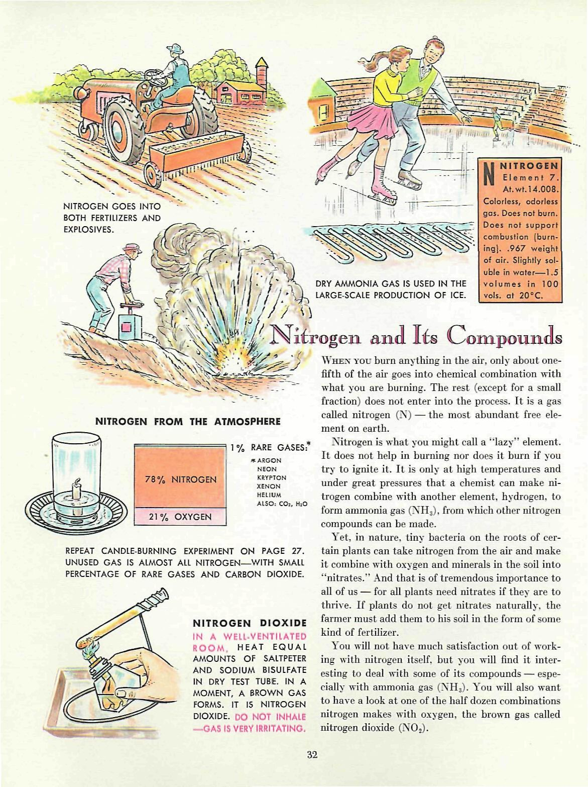

WENN Sie etwas in der Luft verbrennen, geht nur etwa ein Fünftel der Luft eine chemische Verbindung mit dem Brennenden ein. Der Rest (bis auf einen kleinen Bruchteil) nimmt nicht am Prozess teil. Es ist ein Gas namens Stickstoff (N) – das häufigste freie Element auf der Erde.
Stickstoff ist, was man als „faules“ Element bezeichnen könnte. Er hilft beim Brennen nicht und brennt auch nicht, wenn man versucht, ihn zu entzünden. Nur bei hohen Temperaturen und großem Druck kann ein Chemiker Stickstoff mit einem anderen Element, Wasserstoff, zu Ammoniakgas (XH3) verbinden, woraus andere Stickstoffverbindungen hergestellt werden können.
Doch in der Natur können winzige Bakterien an den Wurzeln bestimmter Pflanzen Stickstoff aus der Luft aufnehmen und ihn mit Sauerstoff und Mineralien im Boden zu „Nitraten“ verbinden. Und das ist für uns alle von enormer Bedeutung – denn alle Pflanzen brauchen Nitrate, um gut zu gedeihen. Wenn Pflanzen nicht auf natürliche Weise Nitrate erhalten, muss der Bauer sie in Form von Dünger zum Boden hinzufügen.
Sie werden mit dem Stickstoff selbst nicht viel Freude haben, aber Sie werden es interessant finden, sich mit einigen seiner Verbindungen zu beschäftigen – insbesondere mit Ammoniakgas (XHj). Sie werden auch einen Blick auf eine der halben Dutzend Verbindungen werfen wollen, die Stickstoff mit Sauerstoff eingeht, das braune Gas namens Stickstoffdioxid (NOj).

STICKSTOFF
AUS DER ATMOSPHÄRE
7 8 % STICKSTOFF
21 % SAUERSTOFF
% EDELGASE:
• ARGON
NEON
KRYPTON
XENON
HELIUM
AUCH: CO2. H:0
WIEDERHOLEN SIE DAS KERZEN-VERBRENNUNGSEXPERIMENT AUF SEITE 27.
UNVERBRAUCHTES GAS IST FAST NUR STICKSTOFF – MIT KLEINEM
PROZENTSATZ AN EDELGASEN UND KOHLENDIOXID.

STICKSTOFFDIOXID
IN EINEM
GUT BELÜFTETEN
RAUM.
ERHITZE
GLEICHE
MENGEN AN SALPETER
UND NATRIUMBISULFAT
IN TROCKENER REAGENZGLAS. IN EINEM
MOMENT BILDET SICH EIN BRAUNES GAS.
ES IST STICKSTOFFDIOXID. NICHT EINATMEN
– GAS IST SEHR REIZEND.
32

---
## Page 34

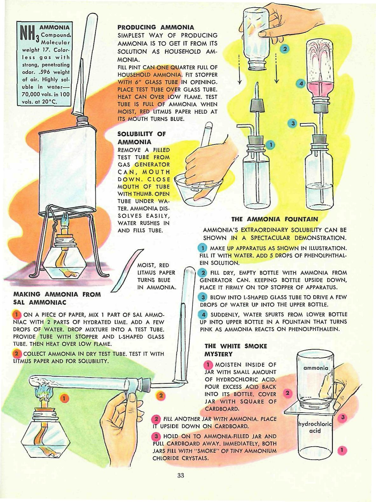

AMMONIAK
• Verbindung.
Molekulargewicht 17. Farbloses Gas mit starkem, stechendem Geruch. Gewicht 0,596 des Luftgewichts. Hoch löslich in Wasser – 70.000 Volumenteile in 100 Volumenteilen bei 20°C.

AMMONIAK HERSTELLEN
DER EINFACHSTE WEG, AMMONIAK HERZUSTELLEN, IST, IHN AUS SEINER LÖSUNG ALS HAUSHALTSAMMONIAK ZU GEWINNEN.
FÜLLEN SIE EINE PINTDOSE ZU EINEM VIERTEL MIT HAUSHALTSAMMONIAK. SETZEN SIE EINEN STOPFEN MIT EINEM 6 ZOLL GLASROHR IN DIE ÖFFNUNG. PLATZIEREN SIE EIN REAGENZGLAS ÜBER DEM GLASROHR. ERHITZEN SIE DIE DOSE BEI NIEDRIGER FLAMME. DAS REAGENZGLAS IST VOLL AMMONIAK, WENN FEUCHTES, ROTES LAKMUSAPAPIER AN SEINER MÜNDUNG BLAU WIRD.

LÖSLICHKEIT VON AMMONIAK
ENTFERNEN SIE EIN GEFÜLLTES REAGENZGLAS AUS DEM GASERZEUGERKANISTER, MÜNDUNG NACH UNTEN. SCHLIESSEN SIE DIE MÜNDUNG DES ROHRS MIT DEM DAUMEN. ÖFFNEN SIE DAS ROHR UNTER WASSER. AMMONIAK LÖST SICH LEICHT, WASSER STRÖMT HINEIN UND FÜLLT DAS ROHR.

DIE AMMONIAK-BRUNNEN
AMMONIAK AUS SAL AMMONIAK HERSTELLEN
FEUCHTES, ROTES LAKMUSAPAPIER WIRD IN AMMONIAK BLAU.
GEBEN SIE AUF EIN STÜCK PAPIER 1 TEIL SAL AMMONIAK MIT 2 TEILEN HYDRATLÖSCHKALK. GEBEN SIE EINIGE TROPFEN WASSER HINZU. GEBEN SIE DIE MISCHUNG IN EIN REAGENZGLAS. VERSEHEN SIE DAS ROHR MIT EINEM STOPFEN UND EINEM L-FÖRMIGEN GLASROHR. ERHITZEN SIE DANN BEI NIEDRIGER FLAMME.
SAMMELN SIE AMMONIAK IN EINEM TROCKENEN REAGENZGLAS. PRÜFEN SIE ES MIT LAKMUSAPAPIER UND AUF LÖSLICHKEIT.

DIE AUSSERGEWÖHNLICHE LÖSLICHKEIT VON AMMONIAK KANN IN EINER SPEKTAKULÄREN DEMONSTRATION GEZEIGT WERDEN.
1) RICHTEN SIE DAS GERÄT WIE IN DER ABBILDUNG GEZEIGT EIN. FÜLLEN SIE ES MIT WASSER. GEBEN SIE 5 TROPFEN PHENOLPHTHALEINLÖSUNG HINZU.
2) FÜLLEN SIE EINE TROCKENE, LEERE FLASCHE MIT AMMONIAK AUS DEM ERZEUGERKANISTER. HALTEN SIE DIE FLASCHE AUF DEM KOPF UND PLATZIEREN SIE SIE FEST AUF DEM OBEREN STOPFEN DES GERÄTS.
3) BLASEN SIE IN DAS L-FÖRMIGE GLASROHR, UM EINIGE TROPFEN WASSER IN DIE OBERE FLASCHE ZU TREIBEN.
4) PLÖTZLICH SPRÜTZT WASSER AUS DER UNTEREN FLASCHE IN DIE OBERE FLASCHE ALS BRUNNEN, DER ROSA WIRD, DA AMMONIAK MIT PHENOLPHTHALEIN REAGIERT.

DER WEISSE RAUCH MYSTERIUM
1) BEFEUCHTEN SIE DIE INNENSEITE DES GLASES MIT EINER KLEINEN MENGE SALZSÄURE. GIESEN SIE ÜBERSCHÜSSIGE SÄURE ZURÜCK IN IHRE FLASCHE. DECKEN SIE DAS GLAS MIT EINEM QUADRAT PAPPKARTON AB.
2) FÜLLEN SIE EIN WEITERES GLAS MIT AMMONIAK. PLATZIEREN SIE ES AUF DEM KOPF AUF DEM KARTON.
3) HALTEN SIE DAS AMMONIAKGEFÜLLTE GLAS FEST UND ZIEHEN SIE DEN KARTON WEG. SOFORT FÜLLEN SICH BEIDE GLÄSER MIT "RAUCH" AUS WINZIGEN AMMONIUMCHLORIDKRISTALLEN.

---
## Page 35

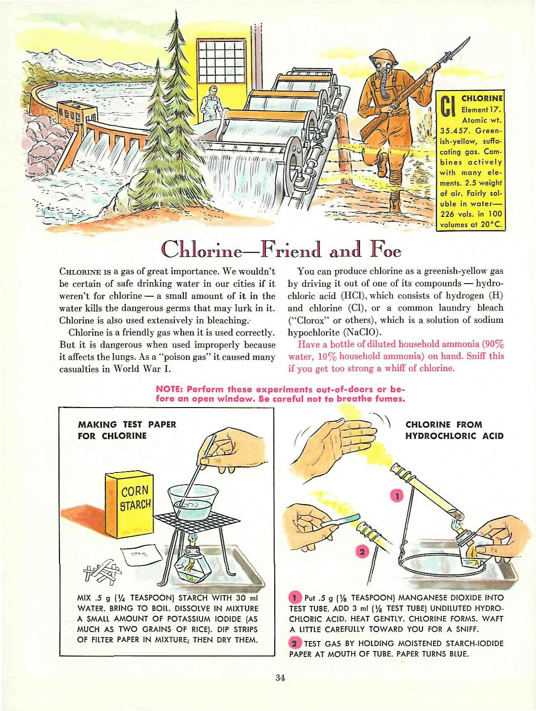

- — ^ l
-^-r-i
A l
CHLOR
Element 17.
Atomgewicht
35,457. Grün-
lich-gelbes, erstickendes
Gas. Kombiniert
aktiv
mit vielen Ele-
menten. 2,5 mal
so schwer wie Luft. Ziemlich löslich
in Wasser —
226 Volumina in 100
Volumina bei 20 °C.
CL1 orine - F rieixGL a n
oe
CHLOR IST ein Gas von großer Bedeutung. Wir wären
nicht sicher vor sicherem Trinkwasser in unseren Städten, wenn
es nicht Chlor gäbe – eine kleine Menge davon im
Wasser tötet die gefährlichen Keime, die darin lauern könnten.
Chlor wird auch ausgiebig zum Bleichen verwendet.
Chlor ist ein freundliches Gas, wenn es richtig angewendet wird.
Aber es ist gefährlich, wenn es falsch angewendet wird, weil
es die Lungen angreift. Als "Giftgas" verursachte es viele
Opfer im Ersten Weltkrieg.
Sie können Chlor als grünlich-gelbes Gas erzeugen, indem Sie
es aus einer seiner Verbindungen treiben – Salzsäure
(IICI), die aus Wasserstoff (H)
und Chlor (Cl) besteht, oder ein gewöhnliches Haushalts-Bleichmittel
("Clorox" oder andere), das eine Lösung von Natriumhypochlorit ist (NaCIO).
Halten Sie eine Flasche verdünnten Haushaltsammoniaks (90 %
Wasser, 10 % Haushaltsammoniak) bereit. Riechen Sie daran, wenn
Sie einen zu starken Chlorgeruch einatmen.
HINWEIS: Führen Sie diese Experimente im Freien oder vor
einem offenen Fenster durch. Achten Sie darauf, die Dämpfe nicht einzuatmen.
TESTPAPIER HERSTELLEN
FÜR CHLOR
MISCHEN SIE 0,5 G (1/2 TEELÖFFEL) STÄRKE MIT 30 ML
WASSER. ZUM KOCHEN BRINGEN. LÖSEN SIE IN DER MISCHUNG
EINE KLEINE MENGE KALIUMIODID AUF (SO
VIEL WIE ZWEI REISKÖRNER). TAUCHEN SIE STREIFEN
FILTERPAPIER IN DIE MISCHUNG; DANN TROCKNEN SIE SIE.
^
CHLOR AUS
SALZSÄURE
1
Geben Sie 0,5 g (1/2 TEELÖFFEL) MANGANDIOXID IN
REAGENZGLAS. GIBEN SIE 3 ML (1/8 REAGENZGLAS) UNVERDÜNNTE SALZ-
SÄURE HINZU. GENTIL ERHITZEN. CHLOR BILDET SICH. WEDELN
SIE VORSICHTIG EINEN KLEINEN TEIL NACH IHNEN ZUM RIECHEN.
^ ) TESTEN SIE DAS GAS, INDEM SIE FEUCHTES STÄRKE-IODID-
PAPIER AN DEN MUND DES ROHRS HALTEN. DAS PAPIER WIRD BLAU.
34

---
## Page 36

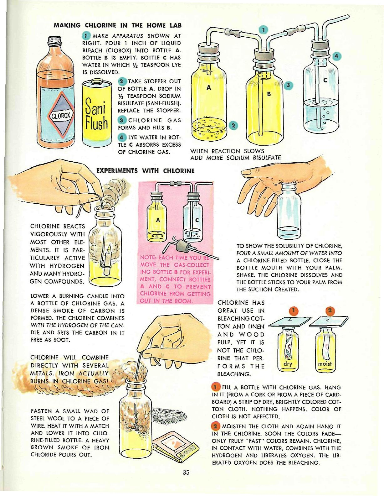

HERSTELLUNG
VON
CHLOR IN DER HEIMLABOR
1
BAUEN SIE DIE RECHTS GEZEIGTE APPARATUR AUF. GEBEN SIE 1 ZOLL FLÜSSIGES BLEICHMITTEL (CLOROX) IN FLASCHE A.
FLASCHE B IST LEER. FLASCHE C ENTHÄLT WASSER, IN DEM ½ TEELÖFFEL LAUGE
GELÖST IST.
2
NEHMEN SIE DEN STOPFEN AUS FLASCHE A. GEBEN SIE
½ TEELÖFFEL NATRIUMBISULFIT (SANI-FLUSH) HINEIN.
SETZEN SIE DEN STOPFEN WIEDER EIN.
3
CHL OR G AS
ENTSTEHT UND FÜLLT B.
4
DIE LAUGENFLÜSSIGKEIT IN FLASCHE C ABSORBIERT ÜBERSCHÜSSIGES
CHL OR GAS.
(?**
WENN DIE REAKTION NACHLÄSST
MEHR NATRIUMBISULFIT ZUFÜGEN
MIT
CHLOR
CHLOR REAGIERT
STARK MIT
DEN MEISTEN ANDEREN ELEMENTEN. ES IST BESONDERS
REAKTIV
MIT
WASSERSTOFF
UND VIELEN WASSERSTOFFVERBINDUNGEN.
FÜHREN SIE EINE BRENNENDE KERZE IN
EINE FLASCHE MIT CHL OR GAS. ES BILDET SICH EIN
DICHTER RAUCH VON KOHLENSTOFF. DAS CHLOR REAGIERT
MIT DEM WASSERSTOFF DER KERZE UND SETZT DEN KOHLENSTOFF DARIN
ALS RUß FREI.
CHLOR BINDET SICH
DIREKT MIT
MEHREREN
METALLEN. EISEN
BRENNT TATSÄCHLICH IN CHL OR GAS! ••'
%^^^£^
BEFESTIGEN SIE EIN KLEINES BÜNDEL STAHLWOLLEN
AN EINEM DRAHTSTÜCK. ERHITZEN SIE ES MIT EINEM STREICHHOLZ
UND FÜHREN SIE ES IN DIE MIT CHL OR GEFÜLLTE FLASCHE. EIN SCHWERER
BRAUNER RAUCH VON EISENCHLORID ENTSTEHT.
HINWEIS: JEDES MAL, WENN SIE DIE GASAUFFANGLICHE FLASCHE B FÜR EIN EXPERIMENT
BEWEGEN, VERBINDEN SIE DIE FLASCHEN A UND C, UM ZU VERHINDERN,
DASS CHL OR IN DEN RAUM ENTRINGT.
UM DIE LÖSLICHKEIT VON CHLOR ZU ZEIGEN,
GEBEN SIE EINE KLEINE MENGE WASSER IN
EINE MIT CHL OR GEFÜLLTE FLASCHE. DECKEN SIE DIE
FLASCHENÖFFNUNG MIT IHRER HANDFLÄCHE AB.
SCHÜTTELN SIE. DAS CHLOR LÖST SICH AUF UND
DIE FLASCHE BLEIBT DURCH DEN ERZEUGTEN UNTERDRUCK AN IHRER HANDFLÄCHE HAFTEN.
CHLOR HABT
GROSSE ANWENDUNGEN BEIM
BLEICHEN VON BAUMWOLLE UND LEINEN
UND
HOLZSTOFF. DOCH ES IST NICHT DAS CHL OR, DAS DIE
BLEICHWIRKUNG AUSÜBT.
tiy,/^~J
70s /vS
FEUCHT
FÜLLEN SIE EINE FLASCHE MIT CHL OR GAS. HÄNGEN SIE
DORTHINEIN (AN EINEM KORKEN ODER EINEM STÜCK PAPPE) EINEN STREIFEN TROCKENEN, BUNTER BAUMWOLLSTOFF. ES PASSIERT NICHTS. DIE FARBE DES
STOFFES BLEIBT UNVERÄNDERT.
( a j BEFEUCHTEN SIE DEN STOFF UND HÄNGEN SIE IHN WIEDER
INS CHL OR. BALD VERBLASSEN DIE FARBEN – NUR WIRKLICH "FARBECHTE" FARBEN BLEIBEN ÜBRIG. CHLOR REAGIERT IN KONTAKT MIT WASSER MIT DEM
WASSERSTOFF UND GIBT SAUERSTOFF FREI. DER FREIGESETZTE SAUERSTOFF VERURSACHT DIE BLEICHWIRKUNG.
35

---
## Page 37

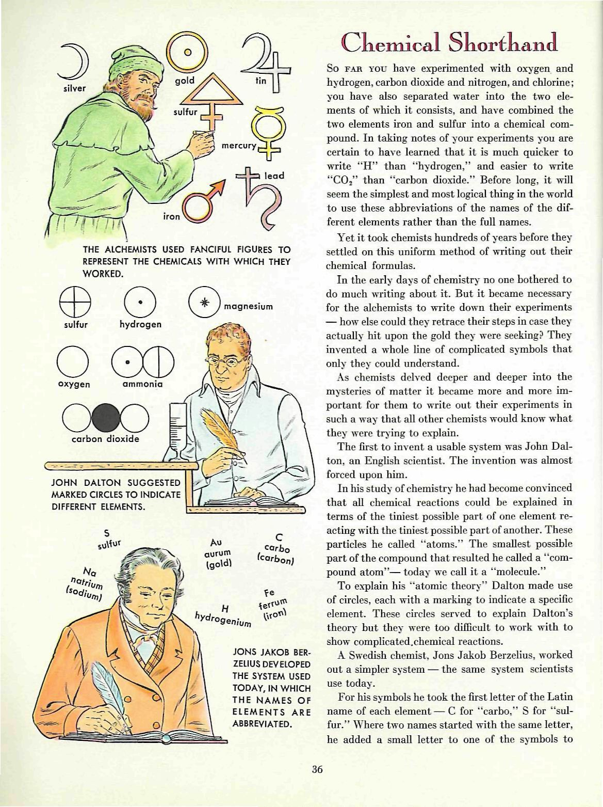

DIE ALCHEMISTEN VERWENDETEN FANTASIEVOLLE SYMBOLE, UM DIE CHEMIKALIEN DARZUSTELLEN, MIT DENEN SIE ARBEITETEN.
magnesium
schwefel
wasserstoff
0m.
sauerstoff
ammoniak
kohlendioxid
JOHN DALTON SCHLUG MARKIERTE KREISE VOR, UM UNTERSCHIEDLICHE ELEMENTE ANZUDEUTEN.
c
cart 0
lc°rb0n)
fe
.
fit0*1'
°er.;Uni
JONS JAKOB BER-
ZELIUS ENTWICKELTE
DAS HEUTE VERWENDETE SYSTEM, IN DEM
DIE NAMEN DER
ELEMENTE ABGEKÜRZT WERDEN.
Bisher haben Sie mit Sauerstoff und
Wasserstoff, Kohlendioxid und Stickstoff sowie Chlor experimentiert;
Sie haben auch Wasser in die beiden Elemente zerlegt, aus denen es besteht, und die beiden Elemente Eisen und Schwefel zu einer chemischen Verbindung kombiniert. Bei der Protokollierung Ihrer Experimente sind Sie
sicher, dass Sie gelernt haben, dass es viel schneller ist,
"H" statt "Wasserstoff" zu schreiben, und einfacher,
"COj" statt "Kohlendioxid" zu schreiben. Schon bald wird es
Ihnen am einfachsten und logischsten erscheinen,
diese Abkürzungen der Namen der verschiedenen
Elemente anstelle der vollständigen Namen zu verwenden.
Doch es dauerte Hunderte von Jahren, bis sich die Chemiker auf diese einheitliche Methode zur Niederschreibung ihrer chemischen Formeln einigten.
In den frühen Tagen der Chemie machte sich niemand die Mühe, viel darüber zu schreiben. Aber für die Alchemisten wurde es notwendig, ihre Experimente aufzuzeichnen – wie sonst hätten sie ihre Schritte nachverfolgen können, falls sie doch noch auf das von ihnen gesuchte Gold gestoßen wären? Sie erfanden eine ganze Reihe komplizierter Symbole, die nur sie verstehen konnten.
Als die Chemiker tiefer und tiefer in die
Geheimnisse der Materie eindrangen, wurde es für sie immer wichtiger, ihre Experimente so aufzuzeichnen,
dass alle anderen Chemiker wüssten, was sie zu erklären versuchten.
Der erste, der ein brauchbares System erfand, war John Dal-
ton, ein englischer Wissenschaftler. Die Erfindung wurde ihm fast aufgezwungen.
In seinem Chemiestudium war er zu der Überzeugung gelangt, dass alle chemischen Reaktionen durch die kleinsten möglichen Teile eines Elements, die mit den kleinsten möglichen Teilen eines anderen reagieren, erklärt werden könnten. Diese Teilchen nannte er "Atome". Den kleinsten möglichen Teil der daraus resultierenden Verbindung nannte er "Verbindungsatom" – heute nennen wir es "Molekül".
Um seine "Atomtheorie" zu erklären, verwendete Dalton Kreise, die jeweils eine Markierung trugen, um ein bestimmtes Element anzuzeigen. Diese Kreise dienten dazu, Daltons Theorie zu erklären, aber sie waren zu schwierig zu handhaben, um komplizierte chemische Reaktionen zu veranschaulichen.
Ein schwedischer Chemiker, Jöns Jakob Berzelius, entwickelte ein einfacheres System – dasselbe System, das Wissenschaftler heute verwenden.
Als Symbole nahm er den ersten Buchstaben des lateinischen Namens jedes Elements – C für "carbo", S für "sulfur". Wenn zwei Namen mit demselben Buchstaben begannen, fügte er einem der Symbole einen Kleinbuchstaben hinzu, um

---
## Page 38

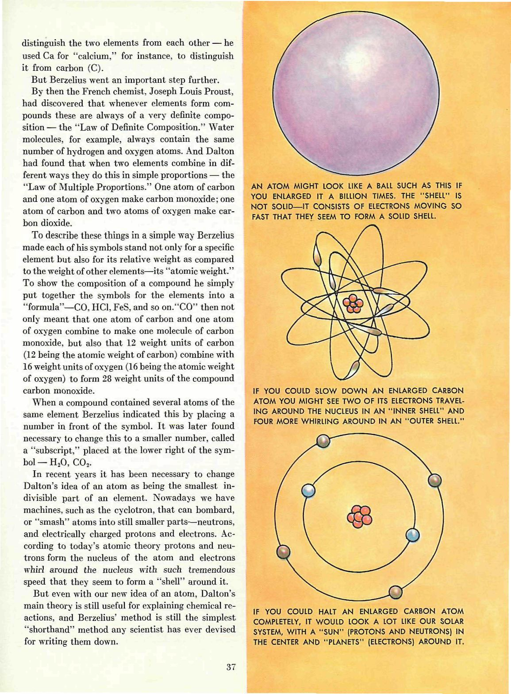

die beiden Elemente voneinander zu unterscheiden – er verwendete beispielsweise Ca für "Calcium", um es von Kohlenstoff (C) zu unterscheiden.
Aber Berzelius ging einen wichtigen Schritt weiter.
Zu dieser Zeit hatte der französische Chemiker Joseph Louis Proust entdeckt, dass Elemente, wenn sie Verbindungen bilden, immer eine sehr bestimmte Zusammensetzung haben – das „Gesetz der konstanten Proportionen“. Wassermoleküle beispielsweise enthalten immer die gleiche Anzahl von Wasserstoff- und Sauerstoffatomen. Und Dalton hatte herausgefunden, dass, wenn sich zwei Elemente auf unterschiedliche Weise verbinden, sie dies in einfachen Verhältnissen tun – das „Gesetz der multiplen Proportionen“. Ein Atom Kohlenstoff und ein Atom Sauerstoff ergeben Kohlenmonoxid; ein Atom Kohlenstoff und zwei Atome Sauerstoff ergeben Kohlendioxid.
Um diese Dinge einfach zu beschreiben, ließ Berzelius jedes seiner Symbole nicht nur für ein bestimmtes Element stehen, sondern auch für sein relatives Gewicht im Vergleich zum Gewicht anderer Elemente – sein „Atomgewicht“. Um die Zusammensetzung einer Verbindung zu zeigen, setzte er einfach die Symbole der Elemente zu einer „Formel“ zusammen – CO. HCl, FeS und so weiter. „CO“ bedeutete dann nicht nur, dass sich ein Kohlenstoffatom und ein Sauerstoffatom zu einem Molekül Kohlenmonoxid verbinden, sondern auch, dass sich 12 Gewichtseinheiten Kohlenstoff (12 ist das Atomgewicht von Kohlenstoff) mit 16 Gewichtseinheiten Sauerstoff (16 ist das Atomgewicht von Sauerstoff) verbinden, um 28 Gewichtseinheiten der Verbindung Kohlenmonoxid zu bilden.
Wenn eine Verbindung mehrere Atome desselben Elements enthielt, gab Berzelius dies an, indem er eine Zahl vor das Symbol setzte. Später erwies es sich als notwendig, dies in eine kleinere Zahl zu ändern, einen sogenannten „Index“, der rechts unten am Symbol platziert wird – H₂O, CO₂.
In den letzten Jahren war es notwendig, Daltons Vorstellung vom Atom als kleinstem, unteilbarem Teil eines Elements zu ändern. Heutzutage verfügen wir über Maschinen, wie den Zyklotron, die Atome in noch kleinere Teile zerlegen können – Neutronen und elektrisch geladene Protonen und Elektronen. Nach heutiger Atomtheorie bilden Protonen und Neutronen den Kern des Atoms, und Elektronen wirbeln mit einer so gewaltigen Geschwindigkeit um den Kern, dass sie eine „Schale“ darum zu bilden scheinen.
Aber selbst mit unserer neuen Vorstellung vom Atom ist Daltons Haupttheorie zur Erklärung chemischer Reaktionen immer noch nützlich, und Berzelius‘ Methode ist immer noch die einfachste „Kurzschrift“, die jemals ein Wissenschaftler zur Aufzeichnung entwickelt hat.
37
EIN ATOM KÖNNTE WIE EIN BALL AUSSEHEN, WENN MAN ES EINE MILLIARDE MAL VERGRÖSSERT. DIE „SCHALE“ IST NICHT FEST – SIE BESTEHT AUS SO SCHNELL BEWEGLICHEN ELEKTRONEN, DASS SIE EINE FESTE SCHALE ZU BIELDEN SCHEINEN.
WENN MAN EIN VERGRÖSSERTES KOHLENSTOFFATOM VERLANGSAMEN KÖNNTE, KÖNNTE MAN SEHEN, WIE ZWEI SEINER ELEKTRONEN IN EINER „INNEREN SCHALE“ UM DEN KERN KREISEN UND VIER WEITERE IN EINER „ÄUSSEREN SCHALE“ UMHERWIRBELN.
WENN MAN EIN VERGRÖSSERTES KOHLENSTOFFATOM VOLLSTÄNDIG ANHALTEN KÖNNTE, WÜRDE ES UNSEREM SONNENSYSTEM ÄHNLICH SEHEN, MIT EINER „SONNE“ (PROTONEN UND NEUTRONEN) IM ZENTRUM UND „PLANETEN“ (ELEKTRONEN) DARUM HERUM.

---
## Page 39

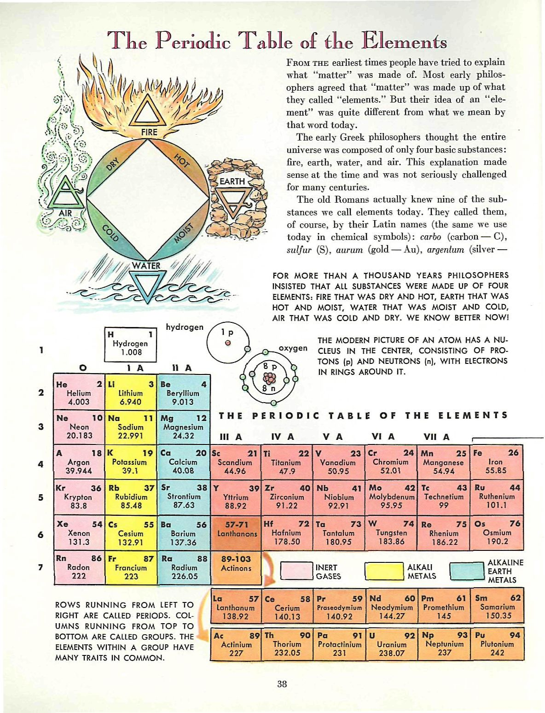

Jr enodic 1« aoie o I flie EI ements 
h 
'•'! 
\< l \ 
• - 
V / A \ 
fi V'<SfySU'/ 
1 
; ^ 
J E E , ^ 
I A 
Wasserstoff
II A 
He 
2 
Helium 
4.003 
Ne 
10 
Neon 
20.183 
Li 
3 
Lithium 
6.940 
No 
11 
Natrium
22.991 
Be 
4 
Beryllium
9.013 
Mg 
12 
Magnesium
24.32 
T H E 
III 
A 
Seit jeher haben die Menschen versucht zu erklären, woraus „Materie“ besteht. Die meisten frühen Philosophen waren sich einig, dass „Materie“ aus dem besteht, was sie „Elemente“ nannten. Aber ihre Vorstellung von einem „Element“ unterschied sich stark von dem, was wir heute unter diesem Wort verstehen. 
Die frühen griechischen Philosophen glaubten, das gesamte Universum bestehe aus nur vier Grundsubstanzen: Feuer, Erde, Wasser und Luft. Diese Erklärung war damals sinnvoll und wurde viele Jahrhunderte lang nicht ernsthaft angezweifelt. 
Die alten Römer kannten tatsächlich neun der Substanzen, die wir heute Elemente nennen. Sie nannten sie natürlich bei ihren lateinischen Namen (die gleichen, die wir heute in chemischen Symbolen verwenden): carbo (Kohlenstoff – C), Schwefel (S), aurum (Gold – Au), argentum (Silber – 
SEIT MEHR ALS TAUSEND JAHREN BESTANDEN PHILOSOPHEN DARAUF, DASS ALLE SUBSTANZEN AUS VIER ELEMENTEN BESTÄNDEN: FEUER, DAS TROCKEN UND HEISS WAR, ERDE, DIE HEISS UND FEUCHT WAR, WASSER, DAS FEUCHT UND KALT WAR, LUFT, DIE KALT UND TROCKEN WAR. DAS WISSEN WIR JETZT BESSER! 
DAS MODERNE BILD EINES ATOMS HAT EINEN KERN IM ZENTRUM, BESTEHEND AUS PROTONEN (p) UND NEUTRONEN (n), MIT ELEKTRONEN IN RINGEN DARUM HERUM. 
P E R I O D I S C H E S 
T A B E L L E 
D E R 
E L E M E N T E 
IV A 
V 
A 
V I A 
V I I A 
, 
A 
18 
Argon 
39.944 
K 
19 
Kalium
39.1 
Ca 
2 0 
Calcium
40.08 
Se 
21 
Scandium
44.96 
Ti 
22 
Titan 
47.9 
V 
23 
Vanadium
50.95 
24 
Cr 
Chrom 
52.01 
Mn 
25 
Mangan
54.94 
Fe 
26 
Eisen
55.85 
Kr 
36 
Krypton
83.8 
Rb 
37 
Rubidium
85.48 
Sr 
38 
Strontium
87.63 
Y 
39 
Yttrium
88.92 
Zr 
Zirkon 
91.22 
40 Nb 
41 
Niob
92.91 
Mo 
42 
Molybdän
95.95 
Tc 
43 
Technetium
99 
Ro 
44 
Rhodium
101.1 
Xe 
54 
Xenon
131.3 
Cs 
55 
Cäsium
132.91 
Ba 
56 
Barium
137.36 
57-71 
Lanthanide
Hf 
72 
Hafnium
178.50 
Ta 
73 
Tantal
180.95 
W 
74 
Wolfram
183.86 
Re 
75 
Rhenium
186.22 
Os 
76 
Osmium
190.2 
Rn 
86 
Radon
222 
Fr 
87 
Francium
223 
Ra 
88 
Radium
226.05 
89-103 
Actinide
EDEL-
GASE
ALKALI-
METALLE
ERD-
ALKALIMETALLE
DIE REIHE N VON LINKS NACH RECHTS WERDEN ALS PERIODEN BEZEICHNET. SPALTEN VON OBEN NACH UNTEN WERDEN ALS GRUPPEN BEZEICHNET. DIE ELEMENTE INNERHALB EINER GRUPPE HABEN VIELE GEMEINSAME EIGENSCHAFTEN. 
La 
57 
Lanthan 
138.92 
Ce 
58 
Cer 
140.13 
Pr 
59 
Praseodym
140.92 
f Id 
60 
Neodym
144.27 
Pm 
61 
Promethium
145 
Sm 
62 
Samarium
150.35 
Ac 
89 
Actinium
227 
Th 
90 
Thorium
232.05 
Pa 
91 
Protaktinium
231 
U 
92 
Uran 
238.07 
Np 
93 
Neptunium
237 
Pu 
94 
Plutonium
242 
38

---
## Page 40

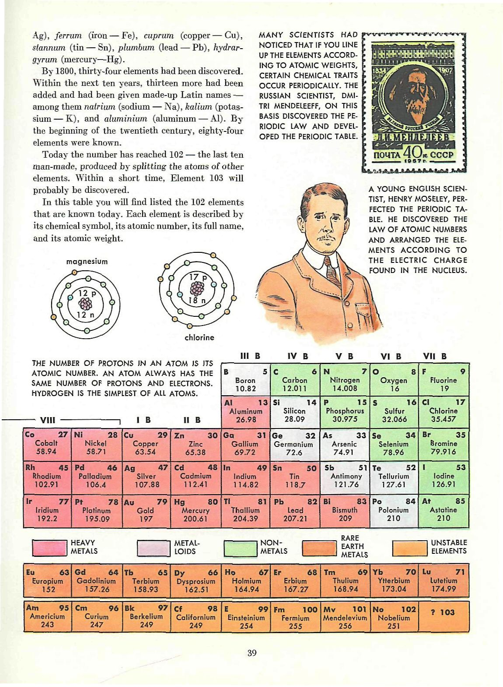

Ag), Eisen
(Eisen — Fe), Kupfer
(Kupfer — Cu),
Zinn (Zinn — Sn), Blei (Blei — Pb), Quecksilber
(Quecksilber — Hg).
Bis 1800 waren vierunddreißig Elemente entdeckt worden.
Im Laufe der nächsten zehn Jahre wurden dreizehn weitere hinzugefügt und erhielten ausgedachte lateinische Namen –
darunter Natrium (Natrium — Na), Kalium (Kalium — K) und Aluminium
(Aluminium — Al). Bis
zum Beginn des zwanzigsten Jahrhunderts waren vierundachtzig Elemente bekannt.
Heute hat die Zahl 102 erreicht – die letzten zehn
künstlich hergestellt, indem die Atome anderer Elemente gespalten wurden. Innerhalb kurzer Zeit wird Element 103
wahrscheinlich entdeckt werden.
In dieser Tabelle finden Sie die 102 heute bekannten Elemente. Jedes Element wird durch sein chemisches Symbol, seine Ordnungszahl, seinen vollständigen Namen und sein Atomgewicht beschrieben.
Magnesium
VIELE
WISSENSCHAFTLER
HATEN
BE MER KT, DASS, WENN MAN DIE ELEMENTE NACH
ATOMGEWICHTEN ORDNET,
BESTIMMTE CHEMISCHE EIGENSCHAFTEN PERIODISCH AUFTRETEN. DER
RUSSISCHE WISSENSCHAFTLER DMI-
TRI MENDELEJEW ENTSCHLÜSSELTE AUF DIESER
GRUNDLAGE DAS PERIODISCHE GESETZ UND ENTWICKELTE
DIE PERIODISCHE TABELLE.
nOUTA HKJ*. CCCP
. ^ _ _ _
1 0 5 7 r
—=.
EIN JUNGER ENGLISCHER WISSEN-
SCHAFTLER, HENRY MOSELEY,
VERVOLLKOMMNETE DIE PERIODISCHE TA-
BELLE. ER ENTSCHLÜSSELTE DIE
GESETZ DES ATOMGEWICHTES UND ORDNETE DIE ELEMENTE
NACH DER ELEKTRISCHEN
LADUNG,
DIE IM KERN VORHANDEN IST.
Chlor
DIE ANZAHL DER PROTONEN IN EINEM ATOM IST SEINE
ATOMNUMMER. EIN ATOM HAT IMMER DIE
GLEICHE ANZAHL VON PROTONEN UND ELEKTRONEN.
WASSERSTOFF IST DAS EINFACHSTE ALLER ATOME.
VIII
1
I B
II B
III B
IV B
V
B
V I B
V I I B
Bor
10,82
Al
13
Aluminium
26,98
Kohlenstoff
12,011
Si
14
Silizium
28,09
N
7
Stickstoff
14,008
P
15
Phosphor
30,975
O
8
Sauerstoff
16
16
Schwefel
32,066
F
9
Fluor
19
Cl
17
Chlor
35,457
| Co
2 7
Kobalt
58,94
Ni
28
Nickel
58,71
Cu
29
Kupfer
63,54
Zn
30
Zink
65,38
Ga
31
Gallium
69,72
Ge
32
Germanium
72,6
As
33
Arsen
74,91
Se
34
Selen
78,96
Br
35
Brom
79,916
| Rh
45
Rhodium
102,91
Pel
46
Palladium
106,4
Ag
47
Silber
107,88
Cd
48
Cadmium
112,41
In
49
Indium
114,82
Sn
50
Zinn
118,7
Sb
51
Antimon
121,76
Te
52
Tellur
127,61
I
53
Iod
126,91
I Ir
77
Iridium
192,2
Pr
78
Platin
195,09
Au
7 9
Gold
197
Hg
80
Quecksilber
200,61
Tl
81
Thallium
204,39
Pb
82
Blei
207,21
Bi
83
Bismut
209
Po
84
Polonium
210
At
85
Astat
210
SCHWERE
METALLE
METALLOIDE
NICHT-
METALLE
SELTENE
ERDMETALLE
INSTABILE
ELEMENTE
| Eu
63
Europium
152
Gd
64
Gadolinium
157,26
Tb
65
Terbium
158,93
Dy
66
Dysprosium
162,51
Ho
67
Holmium
164,94
Er
68
Erbium
167,27
Tm
69
Thulium
168,94
Yb
70
Ytterbium
173,04
Lu
71
Lutetium
174,99
Am
95
Americium
243
Cm
96
Curium
247
Bk
97
Berkelium
249
Cf
98
Californium
249
E
99
Einsteinium
254
Fm
100
Fermium
255
M v
101
Mendelevium
256
No
102
Nobelium
251
? 103
39

---
## Page 41

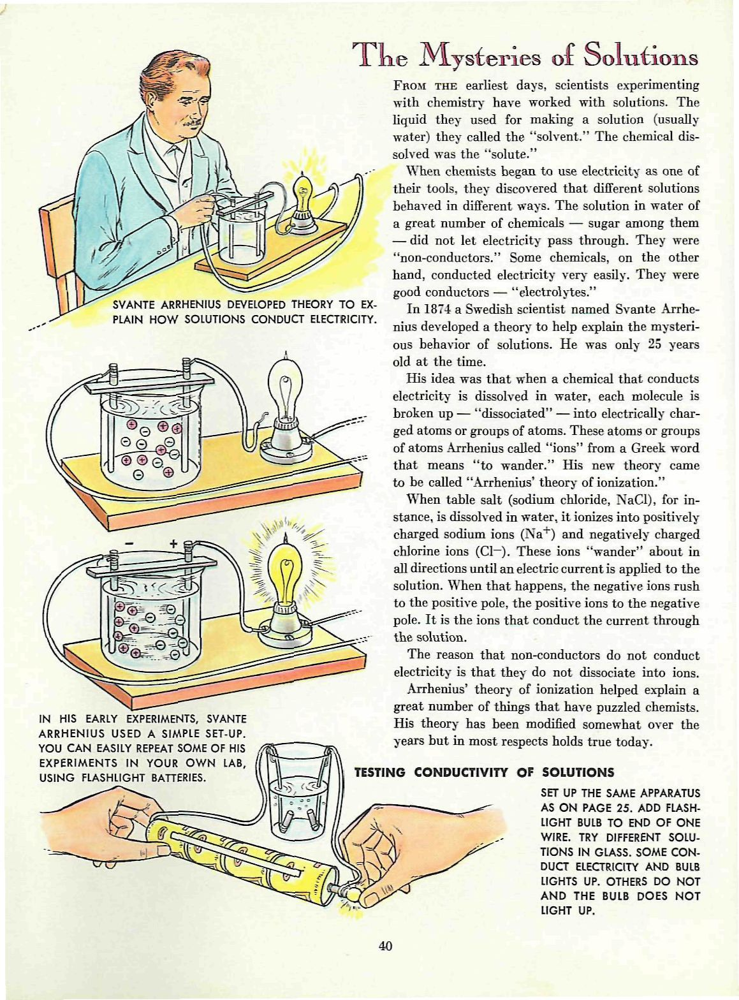

Die Mysterien der Lösungen
SVANTE ARRHENIUS ENTWICKELTE EINE THEORIE, UM ZU ERKLÄREN, WIE LÖSUNGEN ELEKTRIZITÄT LEITEN.
IN SEINEN FRÜHEN EXPERIMENTEN VERWENDETE SVANTE
ARRHENIUS EINE EINFACHE APPARATUR.
 SIE KÖNNEN EINIGE SEINER
EXPERIMENTE LEICHT IN IHREM EIGENEN LABOR WIEDERHOLEN,
UNTER VERWENDUNG VON TASCHENLAMPENBATTERIEN.
SEIT JEHER HABEN WISSENSCHAFTLER, DIE MIT CHEMIE EXPERIMENTIERTEN,
MIT LÖSUNGEN GEARBEITET. DIE
FLÜSSIGKEIT, DIE SIE ZUR HERSTELLUNG EINER LÖSUNG VERWENDETEN (NORMALERWEISE WASSER), NANNTEN SIE DAS "LÖSUNGSMITTEL". DIE DARIN
GELÖSTE CHEMIKALIE WAR DER "STOFF".
ALS CHEMIEWISSENSCHAFTLER BEGONNEN, ELEKTRIZITÄT ALS EINES
IHRER WERKZEUGE ZU VERWENDEN, ENTSCHIEDEN SIE, DASS VERSCHIEDENE LÖSUNGEN
UNTERSCHIEDLICHE VERHALTEN ZEIGTEN. DIE LÖSUNG IN WASSER VON
VIELE CHEMIKALIEN – ZUCKER EINGESCHLOSSEN – LIEß KEINE ELEKTRIZITÄT DURCH. SIE WAREN
"NICHTLEITER". EINIGE CHEMIKALIEN HINGEGEN LEITETEN ELEKTRIZITÄT SEHR LEICHT. SIE WAREN
GUTE LEITER – "ELEKTROLYTE".
IM JAHR 1874 ENTWICKELTE EIN SCHWEDISCHER WISSENSCHAFTLER NAMENS SVANTE ARRHENIUS
EINE THEORIE, UM DAS MYSTERIÖSE VERHALTEN VON LÖSUNGEN ZU ERKLÄREN.
ER WAR DAMALS NUR 25 JAHRE ALT.
SEINE IDEE WAR, DASS, WENN EINE CHEMIKALIE, DIE ELEKTRIZITÄT LEITET,
IN WASSER GELÖST WIRD, JEDES MOLEKÜL AUFGEBROCHEN WIRD – "DISSOZIERT" – IN ELEKTRISCH GELADENE
ATOMEN ODER ATOMGRUPPEN. DIESE ATOME ODER ATOMGRUPPEN
NANNT ARRHENIUS "IONEN" AUS EINEM GRIECHISCHEN WORT, DAS "WANDERN" BEDEUTET. SEINE NEUE THEORIE KAM
ALS "ARRHENIUS-THEORIE DER IONISIERUNG" BEKANNT ZU SEIN.
WENN TAFELSALZ (NATRIUMCHLORID, NACL) ZUM BEISPIEL
IN WASSER GELÖST WIRD, DISSOZIERT ES IN POSITIV GELADENE NATRIUMIONEN (NA+) UND NEGATIV GELADENE
CHLORIDIONEN (CL—). DIESE IONEN "WANDERN" IN
ALLE RICHTUNGEN, BIS EIN ELEKTRISCHER STROM AN DIE LÖSUNG ANGELEGT WIRD.
WENN DAS PASSIERT, EILEN DIE NEGATIVEN IONEN ZUM POSITIVEN POL, DIE POSITIVEN IONEN ZUM NEGATIVEN POL. ES SIND DIE IONEN, DIE DEN STROM DURCH
DIE LÖSUNG LEITEN.
DER GRUND, WARUM NICHTLEITER KEINE ELEKTRIZITÄT LEITEN,
IST, DASS SIE SICH NICHT IN IONEN DISSOZIIEREN.
DIE ARRHENIUS-THEORIE DER IONISIERUNG HALF, VIELE DINGE ZU ERKLÄREN,
DIE CHEMIEWISSENSCHAFTLER RÄTSELTEN.
SEINE THEORIE WURDE IM LAUFE DER JAHRE ETWAS MODIFIZIERT, HÄLT ABER IN DEN MEISTEN BELANGEN HEUTE NOCH STAND.
PRÜFUNG DER LEITFÄHIGKEIT VON LÖSUNGEN
BAUEN SIE DIE GLEICHE APPARATUR AUF
WIE AUF SEITE 25. BESSER SIE EINE TASCHEN-
LAMPENBIRNE AN DAS ENDE EINES
DRAHTES AN. VERSUCHEN SIE VERSCHIEDENE LÖSUNGEN IN GLÄSERN. EINIGE LEITEN
STROM UND DIE BIRNE LEUCHTET AUF. ANDERE NICHT UND DIE BIRNE LEUCHTET NICHT AUF.
40

---
## Page 42

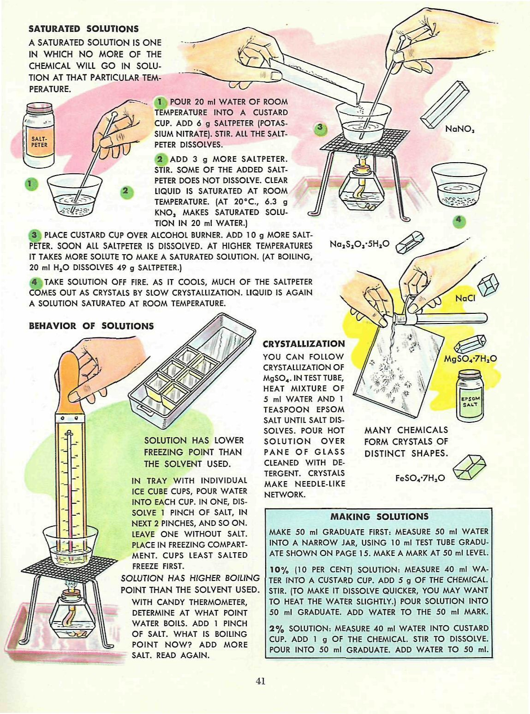

GESÄTTIGTE
LÖSUNGEN
EINE GESÄTTIGTE LÖSUNG IST EINE,
IN DER SICH KEIN WEITERER
CHEMIKALIEN BEI DIESER BESONDEREN TEMPERA-
TUR MEHR LÖST.
1
GEBEN SIE 20 ML RAUMTEMPERIERTES WASSER IN EINE TASSENFORMIGE SCHALE. GEBEN SIE 6 G SALTPETER (KALIUMNITRAT) HINZU. RÜHREN. DER GESAMTE SALTPETER LÖST SICH AUF.
2
GEBEN SIE 3 G SALTPETER MEHR HINZU.
RÜHREN. EIN TEIL DES ZUGESETZTEN SALTPETERS LÖST SICH NICHT AUF. DIE KLARER
FLÜSSIGKEIT IST BEI RAUMTEMPERATUR GESÄTTIGT. (BEI 20 ° C LÖSEN SICH 6,3 G
KNO, IN 20 ML WASSER UND BILDEN EINE GESÄTTIGTE LÖSUNG.)
3
STELLEN SIE DIE TASSENFORMIGE SCHALE ÜBER EINEN ALKOHOLBRENNER. GEBEN SIE 10 G MEHR SALTPETER HINZU. BALD IST DER GESAMTE SALTPETER GELÖST. BEI HÖHEREN TEMPERATUREN
BRAUCHT MAN MEHR LÖSUNGS-
MITTEL, UM EINE GESÄTTIGTE LÖSUNG HERZUSTELLEN. (BEIM KOCHEN
LÖSEN SICH IN 20 ML H₂O 49 G SALTPETER.)
4
NEHMEN SIE DIE LÖSUNG VOM FEUER. BEIM ABKÜHLEN
KOMMT VIEL SALTPETER ALS KRISTALLE DURCH LANGSAME KRISTALLISATION AUS. DIE FLÜSSIGKEIT IST WIEDER
EINE BEI RAUMTEMPERATUR GESÄTTIGTE LÖSUNG.
Na,S 2O a-5H 20
VERHALTEN VON
LÖSUNGEN
EINE LÖSUNG HAT EINEN NIEDRIGEREN
GEFRIERPUNKT ALS DAS VERWENDETE LÖSUNGS-
MITTEL.
IN EINER SCHALE MIT EINZELNEN
EISWÜRFELFORMEN, GIESSEN SIE WASSER
IN JEDE FORM. IN EINE GEBEN SIE EINE
PR VISE SALZ, IN DIE NÄCHSTE 2 PR VYSEN UND SO WEITER.
LASSEN SIE EINE OHNE SALZ.
STELLEN SIE SIE IN DAS GEFRIERFACH. DIE AM WENIGSTEN GESALZENEN FORMUNGEN
GEFRIEREN ZUERST EIN.
EINE LÖSUNG HAT EINEN HÖHEREN SIEDEPUNKT
ALS DAS VERWENDETE LÖSUNGS-
MITTEL.
BESTIMMEN SIE MIT EINEM BONBON-THERMO-
METER BEI WELCHER TEMPERATUR
WASSER KOCHT. GEBEN SIE 1 PR VISE SALZ HINZU. WAS IST DER SIEDEPUNKT
JETZT?
GEBEN SIE MEHR
SALZ HINZU. LESEN SIE NOCHMAL AB.
KRISTALLISATION
SIE KÖNNEN DIE
KRISTALLISATION VON
MgSO, VERFOLGEN. IN EINEM REAGENZGLAS,
ERHITZEN SIE EINE MISCHUNG AUS
5 ML WASSER UND 1
TEELÖFFEL BITTERSALZ, BIS SICH DAS SALZ
AUFLÖST. GIESSEN SIE DIE HEISSE
LÖSUNG AUF EINE SAUBERE GLAS-
SCHEIBE, DIE MIT SPÜLMITTEL GE-
REINIGT WURDE. KRISTALLE BILDEN
EIN NADELFÖRMIGES
NETZWERK.
VIELE
CHEMIKALIEN
BILDEN KRISTALLE MIT UNTERSCHIEDLICHEN FORMUNGEN.
FeS04-7H20
HERSTELLUNG VON
LÖSUNGEN
ERSTELLEN SIE ZUERST EINE 50 ML MESS-
VORRICHTUNG: MESSEN SIE 50 ML WASSER
IN EIN SCHMALES GLAS, UNTER VERWENDUNG DER 10 ML MESSVORRICHTUNG
AUS SEITE 15. MACHEN SIE EINE MARKIERUNG BEI DER 50 ML MARKIERUNG.
10% (10 PROZENT) LÖSUNG: MESSEN SIE 40 ML WAS-
SER IN EINE TASSENFORMIGE SCHALE. GEBEN SIE 5 G DER CHEMIKALIE HINZU.
RÜHREN. (UM DAS AUFLÖSEN ZU BESCHLEUNIGEN, KÖNNEN SIE DAS WASSER LEICHT ERWÄRMEN.) GIESSEN SIE DIE LÖSUNG IN DIE
50 ML MESSVORRICHTUNG. GIB WASSER BIS ZUR 50 ML MARKIERUNG.
2% LÖSUNG: MESSEN SIE 40 ML WASSER IN EINE TASSENFORMIGE SCHALE. GEBEN SIE 1 G DER CHEMIKALIE HINZU. RÜHREN, BIS ES SICH AUFLÖST.
GIESSEN SIE IN DIE 50 ML MESSVORRICHTUNG. GIB WASSER BIS ZUR 50 ML MARKIERUNG.
41

---
## Page 43

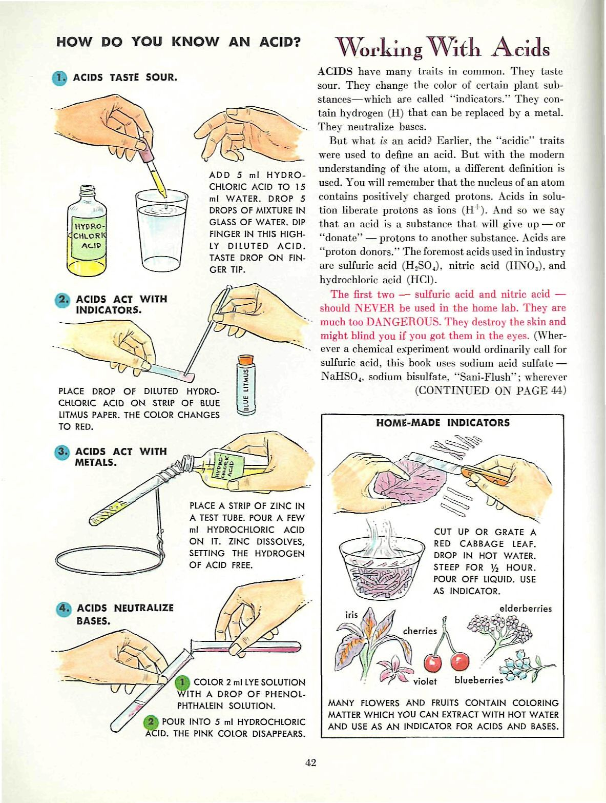

WIE ERKENNT MAN EINE SÄURE?
SÄUREN SCHMECKEN SAUER.
GEBEN SIE 5 ml SALZ-
SÄURE ZU 15
ml WASSER. GEBEN SIE 5
TROPFEN DER MISCHUNG IN
EIN GLAS WASSER. TAUCHEN
SIE DEN FINGER IN DIESE HOCH-
VERDÜNNTE
SÄURE.
KOSTEN SIE DEN TROPFEN AUF DER
FINGERSPITZE.
2. SÄUREN REAGIEREN MIT
INDIKATOREN.
GEBEN SIE EINEN TROPFEN VERDÜNNTER
SALZ-
SÄURE AUF EIN STÜCKBLAU-
NES LAKMUS-
PAPIER. DIE FARBE ÄNDERT SICH
ZU ROT.
3. SÄUREN REAGIEREN MIT
METALLEN.
GEBEN SIE EIN ZINKSTÜCK IN
EIN REAGENZGLAS. GIESEN SIE EIN PAAR
ml SALZ-
SÄURE
DARAUF. ZINK LÖST SICH AUF,
WODURCH DER WASSERSTOFF
DER SÄURE FREIGESETZT WIRD.
4. SÄUREN
NEUTRALISIEREN
BASEN.
FÄRBEN SIE 2 ml LAUGE-
LÖSUNG MIT EINEM TROPFEN
PHENOLPHTHALEIN-
LÖSUNG.
(2"; GIESEN SIE IN 5 ml SALZ-
SÄURE. DIE ROSAFARBENE FARBE VERSCHWINDET.
Wkiiii
l Säuren
SÄUREN HABEN VIELE GEMEINSAME EIGENSCHAFTEN. SIE SCHMECKEN
SAUER. SIE VERÄNDERN DIE FARBE BESTIMMTER PFLANZENSTOFFE —
DIE MAN "INDIKATOREN" NENNT. SIE ENTHALTEN WASSERSTOFF (II), DER DURCH EIN METALL ERSETZT WERDEN KANN.
SIE NEUTRALISIEREN BASEN.
ABER WAS IST EINE SÄURE? FRÜHER WURDEN DIE "SAUREN" EIGENSCHAFTEN
VERWENDET, UM EINE SÄURE ZU DEFINIEREN. MIT DEM MODERNEN
VERSTÄNDNIS DES ATOMS WIRD JEDOCH EINE ANDERE DEFINITION
VERWENDET. SIE ERINNERN SICH, DASS DER KERN EINES ATOMS
POSITIV GELADENE PROTONEN ENTHÄLT. SÄUREN IN LÖSUN-
GEN GEBEN PROTONEN ALS IONEN (H~) FREI. UND SO SAGEN WIR,
DASS EINE SÄURE EINE SUBSTANZ IST, DIE PROTONEN AN EINE ANDERE SUBSTANZ ABGIBT — ODER "SPENDET". SÄUREN SIND
"PROTONENSPENDER". DIE WICHTIGSTEN SÄUREN, DIE IN DER INDUSTRIE VERWENDET WERDEN,
SIND SCHWEFEL-
SÄURE (H2S04), SALPETER-
SÄURE (HN03) UND SALZ-
SÄURE (HC1).
DIE BEIDEN ERSTEN — SCHWEFEL-
SÄURE UND SALPETER-
SÄURE — DÜRFEN NIEMALS IM HEIMLABOR VERWENDET WERDEN. SIE SIND
VIEL ZU GEFÄHRLICH. SIE ZERSTÖREN DIE HAUT UND KÖNNEN SIE BLIND MACHEN, WENN SIE IHNEN IN DIE AUGEN GERATEN. WENN
EIN CHEMISCHES EXPERIMENT NORMALERWEISE SCHWEFEL-
SÄURE ERFORDERN WÜRDE, VERWENDET DIESES BUCH NATRIUMHYDROGENSULFAT —
NaHS04, NATRIUMBISULFAT. "SANI-FLUSH": ÜBERALL, WO
(FORTSETZUNG AUF SEITE 44)
HAUSGEMACHTE
INDIKATOREN
ROTEN
KOHL-
BLATT
ZERSCHNEIDEN ODER REIBEN.
IN HEISSES WASSER GEBEN.
1/4
STUNDE ZIEHEN LASSEN.
FLÜSSIGKEIT ABGIESSEN. ALS
INDIKATOR VERWENDEN.
r ^ -
violett
blaubeeren^-1 " v
VIELE BLUMEN UND FRÜCHTE ENTHALTEN FARBSTOFFE, DIE MAN MIT HEISSEM WASSER EXTRAHIEREN UND ALS INDIKATOR FÜR SÄUREN UND BASEN VERWENDEN KANN.
42

---
## Page 44

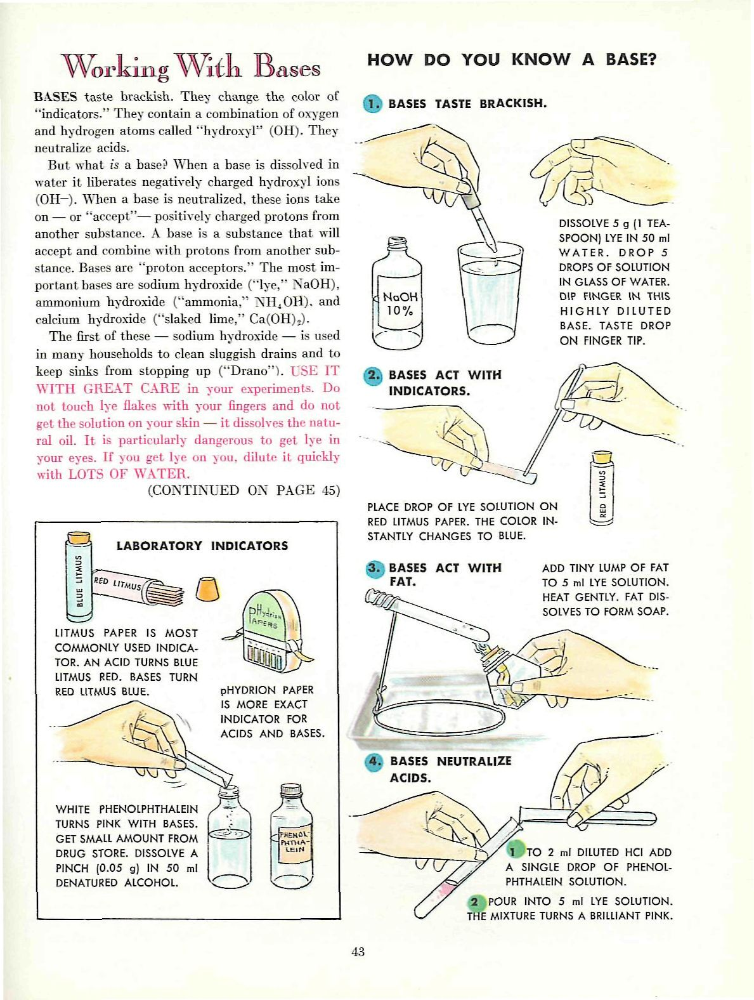

LAUGEN schmecken seifig. Sie verändern die Farbe von "Indikatoren". Sie enthalten eine Kombination aus Sauerstoff- und Wasserstoffatomen namens "Hydroxyl!" (OH). Sie neutralisieren Säuren.
Aber was ist eine Lauge? Wenn eine Lauge in Wasser gelöst wird, setzt sie negativ geladene Hydroxylionen (OH—) frei. Wenn eine Lauge neutralisiert wird, nehmen diese Ionen positiv geladene Protonen von einer anderen Substanz auf – oder "akzeptieren" sie. Eine Lauge ist eine Substanz, die Protonen von einer anderen Substanz aufnimmt und sich damit verbindet. Laugen sind "Protonenakzeptoren". Die wichtigsten Laugen sind Natriumhydroxid ("Lauge", NaOH), Ammoniumhydroxid ("Ammoniak", NIL OH) und Calciumhydroxid ("gelöschter Kalk", Ca(OH).).
Die erste davon – Natriumhydroxid – wird in vielen Haushalten verwendet, um träge Abflüsse zu reinigen und Verstopfungen in Waschbecken zu vermeiden ("Drano"). VERWENDEN SIE ES MIT GRÖSSTER VORSICHT in Ihren Experimenten. Berühren Sie Laugeflocken nicht mit den Fingern und lassen Sie die Lösung nicht auf Ihre Haut gelangen – sie löst das natürliche Öl auf. Es ist besonders gefährlich, Lauge in die Augen zu bekommen. Wenn Lauge auf Sie gelangt, spülen Sie sie schnell mit VIEL WASSER aus.
(FORTSETZUNG AUF SEITE 45)
LABOR-INDIKATOREN
RITMUS-PAPIER IST DER GEMEINSAMSTE INDIKATOR. EINE SÄURE FÄRBTE BLAUES LITMUS ROT. LAUGEN FÄRBEN ROTES LITMUS BLAU.
PHYDRION-PAPIER IST EIN GENAUERER INDIKATOR FÜR SÄUREN UND LAUGEN.
WEISS
PHENOLPHTHALEIN WIRD BEI LAUGEN ROSA.
BESORGEN SIE SICH EINE KLEINE MENGE AUS DER DROGERIE. LÖSEN SIE EINE PRRISE (0,05 g) IN 50 ml DENATURIERTEM ALKOHOL AUF.
WOHER WEISST MAN EINE LAUGE?
LAUGEN SCHMECKEN SEIFIG. LÖSEN SIE 5 G (1 TEELÖFFEL) LAUGE IN 50 ML WASSER AUF.
GEBEN SIE 5 TROPFEN DER LÖSUNG IN EIN GLAS WASSER.
TAUCHE SIE DEN FINGER IN DIESE HOCH VERDÜNNTE LAUGE. KOSTEN SIE EINEN TROPFEN AN DER FINGERSPITZE.
GEBEN SIE EINEN TROPFEN DER LAUGE-LÖSUNG AUF ROTES LITMUS-PAPIER. DIE FARBE VERÄNDERT SICH SOFORT ZU BLAU.
LAUGEN REAGIEREN MIT FETT.
GEBEN SIE EINEN WINZIGEN FETTKLOß ZU 5 ML LAUGE-LÖSUNG.
ERHITZEN SIE SANFT. DAS FETT LÖST SICH AUF UND BILDET SEIFE.
LAUGEN NEUTRALISIEREN SÄUREN.
GEBEN SIE 1-2 ML VERDÜNNTE HCI, EINEN EINZIGEN TROPFEN PHENOLPHTHALEIN-LÖSUNG HINZU.
GIESSEN SIE DIESE IN 5 ML LAUGE-LÖSUNG.
DIE MISCHUNG WIRD BRILLANT ROSA.
43

---
## Page 45

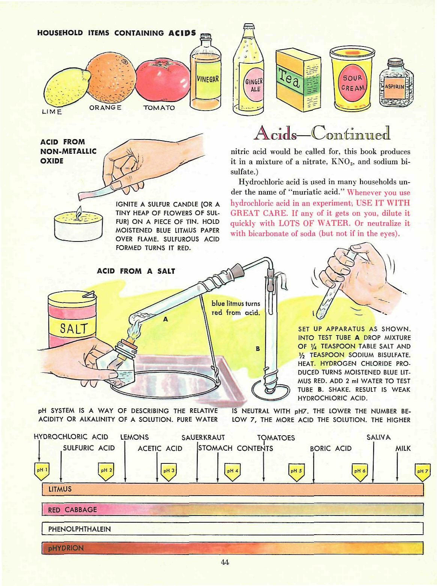

HAUSHALTS-
GEGENSTÄNDE MIT 
SÄUREN 
KALK 
SÄURE 
VON 
NICHTMETALLISCHEM 
OXID 
ZÜNDEN SIE EINE SCHWEFELKERZE (ODER EINEN 
WINZIGEN HAUFEN BLUMEN VON SCHWEFEL) AUF EINEM ZINNSTÜCK. HALTEN 
SIE BEFEUCHTETES BLAUES LAKMUS-
PAPIER ÜBER DIE FLAMME. DIE ENTSTEHENDE SCHWEFLIGE SÄURE 
FÄRBT ES ROT. 
SÄURE AUS EINEM SALZ 
Säuren – Fortsetzung 
Salzsäure wird in vielen Haushalten unter 
dem Namen „Salzsäure“ verwendet. Wann immer Sie 
Salzsäure in einem Experiment verwenden, GE-
BRAUCHEN SIE SIE MIT GRÖSSER VORSICHT. Wenn etwas davon auf Sie gelangt, ver-
dünnen Sie es sofort mit VIEL WASSER. Oder neutralisieren Sie es mit Natrium-
hydrogencarbonat (aber nicht, wenn es in die Augen gelangt). 
DAS PH-SYSTEM IST EINE ART, DIE RELATIVE 
SÄURE- ODER BASIZITÄT EINER LÖSUNG BESZUREIBEN. REINES WASSER 
RICHTEN SIE DIE APPARATUR WIE ABGEBILDET EIN. 
IN REAGENZGLAS A TRÖPFCHEN-
MISCHUNG 
AUF DEM TISCH 
NATRIUMBISULFAT. 
ERHITZEN. DER PRODUZIERTE WASSERSTOFFCHLORID GAS 
FÄRBT BEFEUCHTETES BLAUES LAKMUS ROT. GIB 2 ML WASSER IN REA-
GENZGLAS B. SCHÜTTELN. DAS ERGEBNIS IST EINE SCHWACHE 
SALZSÄURE. 
IST NEUTRAL MIT PH 7. JE NIEDRIGER DIE ZAHL UNTER 7, DESTO SAURER 
IST DIE LÖSUNG. JE HÖHER DIE ZAHL ÜBER 7, DESTO ALKALISCHER IST SIE. 
SALZSÄURE 
SCHWEFEL-
SÄURE 
ZITRONEN 
SAUERKRAUT 
ESSIG-
SÄURE 
UMJ 
LHTJ 
TOMATEN 
MAGENINHALT 
SPEICHEL 
BORAX-
SÄURE 
IpH 5J 
IpH 6J 
MILCH 
LAKMUS 
ROTKRAUT 
PHENOLPHTHALEIN 
PH-HYDRION 
44

---
## Page 46

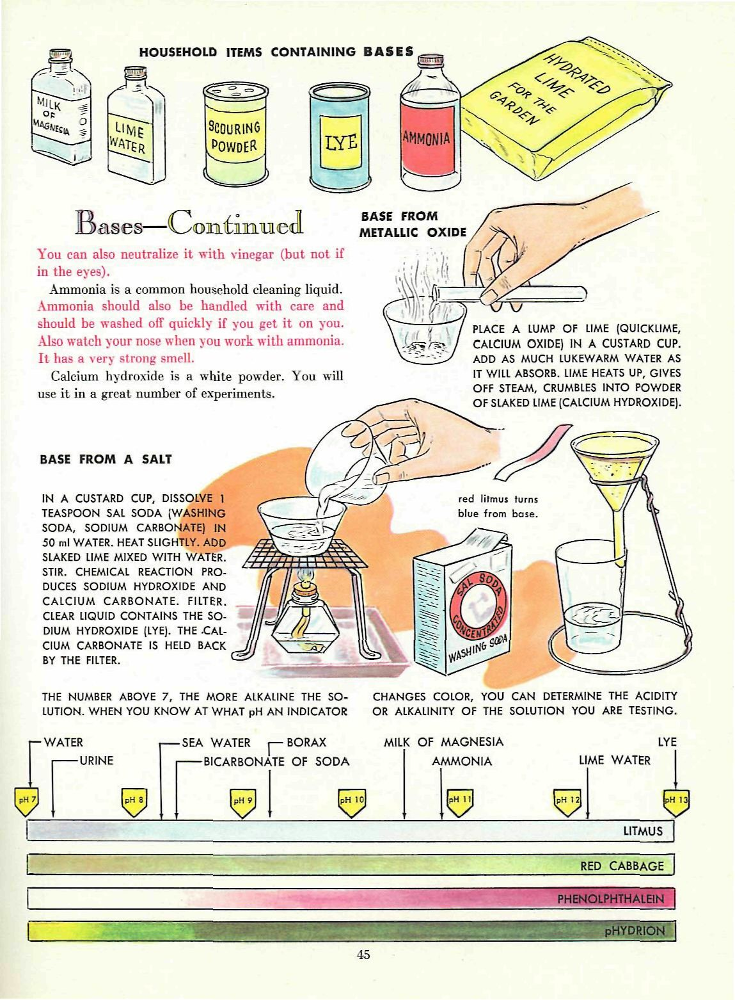

HAUSHALTS- 
ARTIKEL DIE 
BASEN 
ENTHALTEN 
LAUGE 
BASE AUS 
METALLISCHEM 
OXID 
GEBEN SIE EIN STÜCK KALK (BRANNTKALK, 
KALZIUMOXID) IN EINE SOßENSCHALE. 
Geben Sie so viel lauwarmes Wasser hinzu, wie 
er aufnehmen kann. Der Kalk erhitzt sich, gibt 
Dampf ab und zerfällt zu Pulver aus GELÖSCHTEM 
KALK (KALZIUMHYDROXID). 
SCHEUER- 
PULVER 
Cz2 
ases—v^oniinmieci 
Sie können ihn auch mit Essig neutralisieren (aber nicht, wenn 
er in die Augen gelangt ist). 
Ammoniak ist eine übliche Haushaltsreinigungslösung. 
Ammoniak sollte ebenfalls mit Vorsicht gehandhabt werden und 
sollte schnell abgewaschen werden, wenn es auf Sie gelangt. 
Passen Sie auch auf Ihre Nase auf, wenn Sie mit Ammoniak arbeiten. 
Es hat einen sehr starken Geruch. 
Kalziumhydroxid ist ein weißes Pulver. Sie werden 
es in einer großen Anzahl von Experimenten verwenden. 
BASE AUS EINEM 
SALZ 
LÖSEN SIE IN EINER SOßENSCHALE 1 
TEELÖFFEL SALZNATRON (WASCH- 
NATRON, NATRIUMCARBONAT) IN 
50 ml WASSER AUF. LEICHT ERHITZEN. GE- 
LÖSCHTEN KALK MIT WASSER VERMISCHT HINZUGEBEN. 
UMRÜHREN. CHEMISCHE REAKTION ERZEUGT 
NATRIUMHYDROXID UND 
KALZIUMCARBONAT. FILTRIEREN. 
DIE KLAR FLÜSSIGE SUBSTANZ ENTHÄLT DAS NATRIUM- 
HYDROXID (LAUGE). DAS KALZIUM- 
CARBONAT WIRD VOM FILTER ZURÜCKGEHALTEN. 
DIE ZAHL ÜBER 7 ZEIGT DEN ALKALISCHEN CHARAKTER DER LÖ- 
VERÄNDERT DIE FARBE, KÖNNEN SIE DEN SÄUREGEHALT 
SUNG AN. WENN SIE WISSEN, BEI WELCHEM pH-WERT EIN INDIKATOR 
ODER DIE ALKALINITÄT DER ZU TESTENDEN LÖSUNG BESTIMMEN. 
r- WASSER 
-URIN 
9 
^d 
-MEERWASSER r 
BORAX 
-NATRIUMBICARBONAT 
MAGNESIA MILCH 
AMMONIAK 
U'oJ 
U 
I i | 
LAUGE 
KALKWASSER 
LITMUS 
ROTKOHL 
PHENOLPHTHALEIN 
45

---
## Page 47

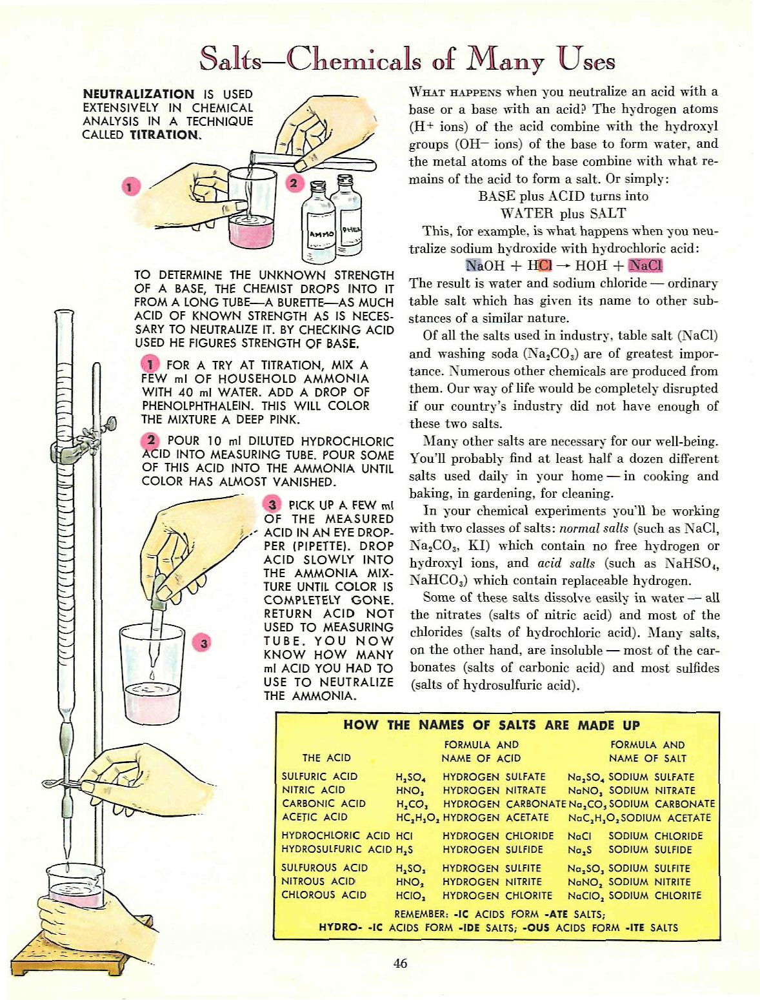

NEUTRALISATION WIRD IN DER CHEMISCHEN ANALYTIK IN DER TECHNIK DER TITRATION AUSGIEBIG EINGESETZT.
UM DIE UNBEKANNTE KONZENTRATION EINER BASE ZU BESTIMMEN, GIBT DER CHEMIKER AUS EINER LANGEN RÖHRE – EINER BÜRETTE – SO VIEL SÄURE BEKANNTER KONZENTRATION HINZU, WIE ZUR NEUTRALISATION NOTWENDIG IST. DURCH DIE ÜBERPRÜFUNG DER VERBRAUCHTEN SÄURE ERMITTELT ER DIE KONZENTRATION DER BASE.
FÜHREN SIE EINEN TITRATIONSVERSUCH DURCH, INDEM SIE EINIGE ML HAUSHALTSAMMONIAK MIT 40 ML WASSER MISCHEN. GEBEN SIE EINEN TROPFEN PHENOLPHTHALEIN HINZU. DIES FÄRBT DIE MISCHUNG TIEFROSA.
GIESSEN SIE 10 ML VERDÜNNTE SALZSÄURE IN EIN MESSROHR. GIESSEN SIE ETWAS VON DIESER SÄURE IN DEN AMMONIAK, BIS DIE FARBE FAST VERSCHWUNDEN IST.
NEHMEN SIE EINIGE ML DER ABGEMESSENEN SÄURE MIT EINER AUGENTROPFENPIPETTE AUF. TROPFEN SIE DIE SÄURE LANGSAM IN DIE AMMONIAKMISCHUNG, BIS DIE FARBE VOLLSTÄNDIG VERSCHWUNDEN IST.
GEBEN SIE NICHT VERBRAUCHTE SÄURE IN DAS MESSROHR ZURÜCK. SIE WISSEN NUN, WIE VIELE ML SÄURE SIE ZUR NEUTRALISATION DES AMMONIAKS BENÖTIGT HABEN.
WAS PASSIERT, WENN SIE EINE SÄURE MIT EINER BASE ODER EINE BASE MIT EINER SÄURE NEUTRALISIEREN? DIE WASSERSTOFFATOME (H+ IONEN) DER SÄURE VERBINDEN SICH MIT DEN HYDROXYLGRUPPEN (OH- IONEN) DER BASE ZU WASSER, UND DIE METALLATOME DER BASE VERBINDEN SICH MIT DEM REST DER SÄURE ZU EINEM SALZ. ODER EINFACH:
BASE PLUS SÄURE WIRD ZU
WASSER PLUS SALZ
DIES IST ZUM BEISPIEL, WAS PASSIERT, WENN SIE NATRIUMHYDROXID MIT SALZSÄURE NEUTRALISIEREN:
NaOH + HCl — HOH + NaCl.
DAS ERGEBNIS IST WASSER UND NATRIUMCHLORID – GEWÖNLICHES SPEISESALZ, DAS ANDEREN SUBSTANZEN ÄHNLICHER NATUR SEINEN NAMEN GEGEBEN HAT.
VON ALLEN IN DER INDUSTRIE VERWENDETEN SALZEN SIND SPEISESALZ (NaCl) UND WASCHSODA (Na2CO3) VON GRÖSSTER BEDEUTUNG. ZAHLREICHE ANDERE CHEMIKALIEN WERDEN DARAUS HERGESTELLT. UNSER LEBENSSTIL WÄRE VOLLSTÄNDIG GESTÖRT, WENN UNSERE INDUSTRIE NICHT GENUG VON DIESEN BEIDEN SALZEN HÄTTE.
VIELE ANDERE SALZE SIND FÜR UNSER WOHLERGEHEN NOTWENDIG.
SIE WERDEN WAHRSCHEINLICH MINDESTENS EIN HALBES DUTZEND VERSCHIEDENER SALZE FINDEN, DIE TÄGLICH IN IHREM HAUSHALT VERWENDET WERDEN – BEIM KOCHEN UND BACKEN, IM GARTEN, BEIM REINIGEN.
IN IHREN CHEMISCHEN EXPERIMENTEN WERDEN SIE MIT ZWEI SALZKLASSEN ARBEITEN: NORMSALZE (WIE NaCl, Na2CO3, KI), DIE KEINE FREIEN WASSERSTOFF- ODER HYDROXYLIONEN ENTHALTEN, UND SAURE SALZE (WIE NaHSO4, NaHCO3), DIE AUSTAUSCHBAREN WASSERSTOFF ENTHALTEN.
EINIGE DIESER SALZE LÖSEN SICH LEICHT IN WASSER – ALLE NITRATE (SALZE DER SALPETERSÄURE) UND DIE MEISTEN CHLORIDE (SALZE DER SALZSÄURE). VIELE SALZE SIND DAGEGEN UNLÖSLICH – DIE MEISTEN KARBONATE (SALZE DER KOHLENSÄURE) UND DIE MEISTEN SULFIDE (SALZE DER SCHWEFELWASSERSTOFFSÄURE).
DIE NAMEN VON SALZEN WERDEN GEBILDEt
SCHWEFELSÄURE
SALPETERSÄURE
KOHLENSÄURE
ESSIGSÄURE
SALZSÄURE
SCHWEFELWASSERSTOFFSÄURE
SCHWEFLIGE SÄURE
SALPETRIGE SÄURE
CHLORIGE SÄURE
SCHWEFELWASSERSTOFF-
FORMEL UND
NAME DER SÄURE
WASSERSTOFFSULFAT
WASSERSTOFFNITRAT
FORMEL UND
NAME DES SALZES
Na2SO4 NATRIUMSULFAT
NaNO3 NATRIUMNITRAT
WASSERSTOFFKARBONAT Na2CO3 NATRIUMKARBONAT
WASSERSTOFFACETAT
WASSERSTOFFCHLORID
WASSERSTOFFSULFID
WASSERSTOFFSULFIT
WASSERSTOFFNITRIT
WASSERSTOFFCHLORIT
NaC2H3O2 NATRIUMACETAT
NaCl NATRIUMCHLORID
Na2S NATRIUMLSULFID
Na2SO3 NATRIUMLSULFIT
NaNO2 NATRIUMNITRIT
NaClO3 NATRIUMCHLORIT
DENKEN SIE DARAN: -SÄUREN BILDEN -AT-SALZE;
SÄUREN BILDEN -ID-SALZE; -IGE SÄUREN BILDEN -IT-SALZE
46

---
## Page 48

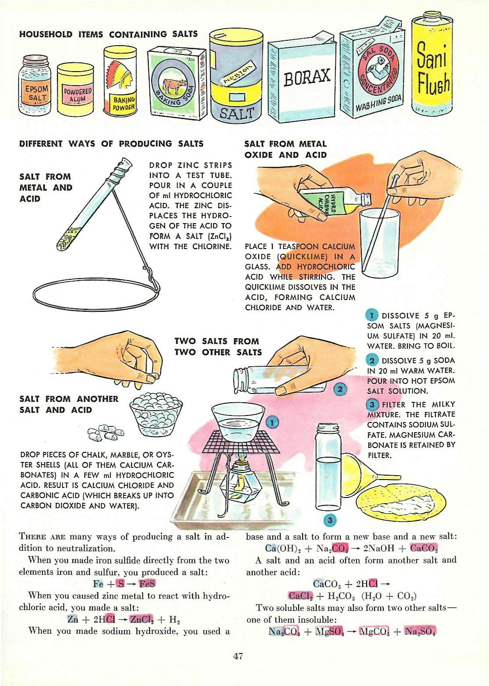

HAUSHALTSARTIKEL MIT SALZEN
VERSCHIEDENE WEGE ZUR HERSTELLUNG VON SALZEN
SALZ AUS METALL UND SÄURE
SALZ AUS METALLOXID UND SÄURE
GEBEN SIE ZINKSTREIFEN IN EIN REAGENZGLAS.
GIESSEN SIE EIN PAAR ML SALZSÄURE HINEIN. DAS ZINK VERDRÄNGT DEN WASSERSTOFF DER SÄURE UND BILDET MIT DEM CHLOR EIN SALZ (ZnCI₂).
GEBEN SIE 1 TEELÖFFEL CALCIUMOXID (BRANNTKALK) IN EIN GLAS. GIBT MAN SALZSÄURE UNTER RÜHREN HINZU. DER BRANNTKALK LÖST SICH IN DER SÄURE UND BILDET CALCIUMCHLORID UND WASSER.
ZWEI SALZE AUS ZWEI ANDEREN SALZEN
SALZ AUS EINEM ANDEREN SALZ UND SÄURE
GEBEN SIE STÜCKE VON KREIDE, MARMOR ODER MUSCHELN (ALLE CALCIUMCARBONATE) IN EIN PAAR ML SALZSÄURE. DAS ERGEBNIS SIND CALCIUMCHLORID UND KOHLENSÄURE (DIE SICH IN KOHLENDIOXID UND WASSER ZERSETZT).
ES GIBT VIELE WEGE, EIN SALZ NEBEN DER NEUTRALISATION HERZUSTELLEN.
Als Sie Eisensulfid direkt aus den beiden Elementen Eisen und Schwefel herstellten, haben Sie ein Salz hergestellt:
Fe + S → FeS
Als Sie Zinkmetall mit Salzsäure reagieren ließen, haben Sie ein Salz hergestellt:
Zn + 2HCl → ZnCl₂ + H₂
Als Sie Natriumhydroxid herstellten, verwendeten Sie eine
1
LÖSEN SIE 5 G BITTERSALZ (MAGNESIUMSULFAT) IN 20 ML AUF. ERHITZEN SIE ZUM KOCHEN.
2
LÖSEN SIE 5 G NATRON IN 20 ML WARMEM WASSER AUF. GIESSEN SIE IN DIE HEISSE BITTERSALLÖSUNG.
5
Filtrieren Sie die milchige Mischung. Das Filtrat enthält Natriumsulfat. Magnesiumcarbonat wird vom Filter zurückgehalten.
Base und ein Salz zur Bildung einer neuen Base und eines neuen Salzes:
Ca(OH)₂ + Na₂CO₃ → 2NaOH + CaCO₃
Ein Salz und eine Säure bilden oft ein anderes Salz und eine andere Säure:
CaCO₃ + 2HCl → CaCl₂ + H₂CO₃ (H₂O + CO₂)
Zwei lösliche Salze können auch zwei andere Salze bilden – eines davon unlöslich:
Na₂CO₃ + MgSO₄ → MgCO₃ + Na₂SO₄
47

---
## Page 49

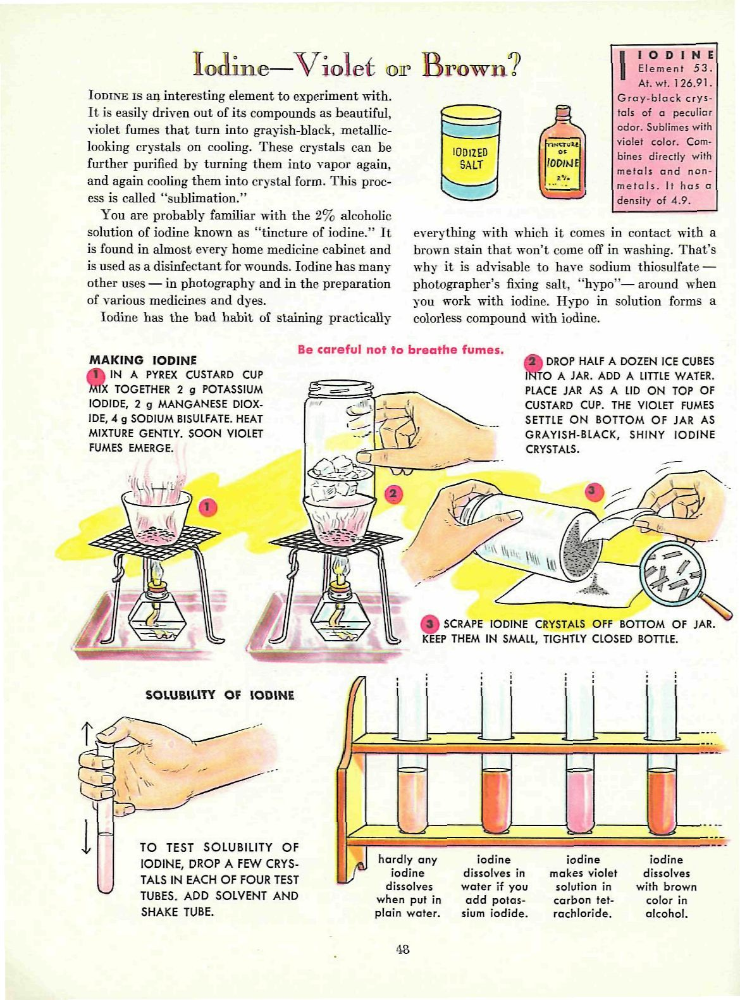

JOD – ein interessantes Element zum Experimentieren.
Es lässt sich leicht aus seinen Verbindungen als schöne,
violette Dämpfe austreiben, die beim Abkühlen zu grau-schwarzen, metallisch aussehenden Kristallen werden. Diese Kristalle können weiter gereinigt werden, indem man sie wiederholt verdampft und abkühlt. Dieser Vorgang wird "Sublimation" genannt.
Sie kennen wahrscheinlich die 2%ige alkoholische Jodlösung, bekannt als "Jod Tinktur". Sie findet sich in fast jedem Hausapotheken-Schrank und wird als Desinfektionsmittel für Wunden verwendet. Jod hat viele weitere Verwendungszwecke – in der Fotografie und bei der Herstellung verschiedener Medikamente und Farbstoffe.
Jod hat die unangenehme Angewohnheit, praktisch alles, womit es in Berührung kommt, mit einem braunen Fleck zu verfärben, der sich nicht abwaschen lässt. Deshalb ist es ratsam, Natriumthiosulfat – Fotografensalz, "Hypo" – griffbereit zu haben, wenn Sie mit Jod arbeiten. Hypo bildet in Lösung eine farblose Verbindung mit Jod.

JOD HERSTELLEN IN EINER PYREX-SCHÜSSEL
MISCHEN SIE ZUSAMMEN 2 g KALIUMIODID, 2 g MANGANDIOXID, 4 g NATRIUMBISULFAT. ERWÄRMEN SIE DIE MISCHUNG LEICHT. BALD ENTSTEHEN VIOLETTE DÄMPFE.
Achten Sie darauf, die Dämpfe nicht einzuatmen.
GEBEN SIE EINEN HALBEN DOZEND EISWÜRFEL IN EIN GLAS. GEBEN SIE EIN WENIG WASSER HINZU. STELLEN SIE DAS GLAS ALS DECKEL AUF DIE SCHÜSSEL. DIE VIOLETTEN DÄMPFE SETZEN SICH AM BODEN DES GLASES ALS GRAU-SCHWARZE, GLÄNZENDE JODKRISTALLE AB.

UM DIE LÖSLICHKEIT VON JOD ZU TESTEN, GEBEN SIE EIN PAAR KRISTALLE IN JEDE VON VIER REAGENZGLÄSERN. GEBEN SIE LÖSUNGSMITTEL HINZU UND SCHÜTTELN SIE DAS GLAS.
löst sich kaum
Jod löst sich in Wasser, wenn Sie Kaliumiodid hinzufügen.
Jod bildet eine violette Lösung in Tetrachlorkohlenstoff.
Jod löst sich mit brauner Farbe in Alkohol.

---
## Page 50

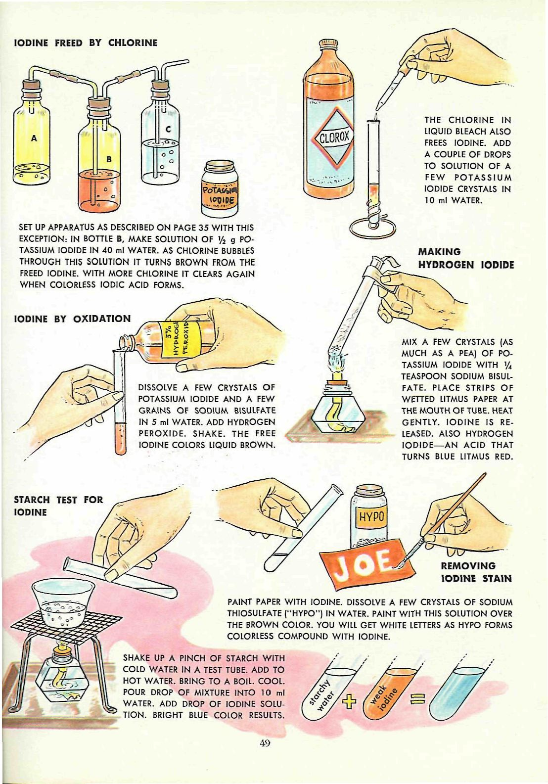

CHLOR UND JOD
tCTJlOg
APPARATUR WIE AUF SEITE 35 BESCHRIEBEN AUFBAUEN MIT AUSNAHME VON: IN FLASCHE B LÖSEN SIE 1/2 G KALIUMIODID IN 40 ML WASSER AUF. WENN CHLOR BLUBBERT, WIRD DIESE LÖSUNG DURCH DAS FREIGESETZTE JOD BRAUN. BEI WEITEREM CHLOR KLÄRT SICH DIE LÖSUNG WIEDER, DA SICH FARB-
LOSE JODSÄURE BILDET.
JOD DURCH
OXIDATION
LÖSEN SIE EIN PAAR KRISTALLE
KALIUMIODID UND EIN PAAR
KRÖMEL NATRIUMBISULFAT
IN 5 ML WASSER AUF. GEBEN SIE WASSER-
STOFFPEROXID HINZU. SCHÜTTELN. DAS FREIE
JOD FÄRBT DIE FLÜSSIGKEIT BRAUN.
DAS CHLOR
IN
FLÜSSIGEN BLEICHMITTELN
SETZT AUCH JOD FREI. GIB EIN
PAAR TROPFEN
ZU EINER LÖSUNG VON EIN PAAR
KRISTALLEN KALIUMIODID IN
10 ML WASSER.
HERSTELLUNG VON
HYDROGENIODID
MISCHEN SIE EIN PAAR KRISTALLE (SO VIEL WIE ERBSENGROSS)
KALIUMIODID MIT 1/2 TEELÖFFEL NATRIUMBISUL-
FAT. LEGEN SIE STREIFEN VON
Befeuchtetem LITHUS-PAPIER AM
ROHRMÜNDUNG AN. GENTLICH ERHITZEN. JOD WIRD FREI.
AUCH WASSERSTOFFIODID – EINE SÄURE, DIE
BLAUES LITHMUS ROT FÄRBt.
STÄRKE-TEST
JOD
ENTFERNUNG
VON JOD-
FLECKEN
MALEN SIE PAPIER MIT JOD. LÖSEN SIE EIN PAAR KRISTALLE NATRIUM-
THIOSULFAT ("HYPO") IN WASSER AUF. MALEN SIE MIT DIESER LÖSUNG ÜBER
DIE BRAUNE FARBE. SIE ERHALTEN WEISSE BUCHSTABEN, DA HYPO EINE
FARB-
LOSE VERBINDUNG MIT JOD BILDET.
SCHÜTTELN SIE EINE PRISE STÄRKE MIT
KALTEM WASSER IN EINEM REAGENZGLAS AUF. ZU
HEISSEM WASSER GEBEN. ZUM KOCHEN BRINGEN. ABKÜHLEN.
GEBEN SIE EINEN TROPFEN DER MISCHUNG IN 10 ML
WASSER. GEBEN SIE EINEN TROPFEN DER JODLÖ-
SUNG HINZU. ES ENTSTEHT EINE LEUCHTEND BLAUE FARBE.
49

---
## Page 51

DER GROSSTEIL UNSERES SCHWE-
FELS WIRD GEWONNEN,
INDEM ER DURCH
EIN VERFAHREN, DAS
HERMAN
FRASCH ERFUNDEN HAT,
IN GESCHMOLZENEM ZUSTAND
AUS DEM BODEN GEFÖRDERT WIRD.
S
S C H W E F E L
Element 16.
Atom-
gew .:
32,066. Dichte:
2,07. Gelbe Kristal-
le. Unlöslich in
Wasser. Schmilzt bei
119° C. Siedet bei
444° C. Brennt in
Luft mit blauer Flamme.
ÜBERHITZTES
WASSER WIRD UNTER
DIE ERDE GELEITET UND
SCHMILZT DEN SCHWE-
FEL. KOMPRIMIERTE
LUFT DRÜCKT DEN SCHWE-
FEL AN DIE OBER-
FLÄCHE. HIER WIRD ER
IN GROSSEN HOLZ-
BEHÄLTERN ABGE-
KÜHLT.
ZUSAMMENSETZUNGEN
Früher wurde Schwefel „Brimstone"
(„brennender Stein" – von einem alten Wort, brennen, zu
brennen) genannt. Als er mit einer blauen Flamme und einem erstickenden Geruch brannte, waren die Menschen sicher, dass der Teufel
selbst in der Nähe war.
Bis vor relativ kurzer Zeit kam der meiste Schwefel von der
vulkanischen italienischen Insel Sizilien. Aber heute produziert Amerika den größten Teil des weltweiten Schwefels. Vor etwa hundert Jahren wurden große Vorkommen in Louisiana,
einige hundert Fuß unter der Erde, gefunden. Das Problem,
es zu fördern, wurde 1894 auf sehr clevere Weise gelöst
von einem jungen deutschen Auswanderer, Herman Frasch. Er
leitete überhitztes Wasser unter die Erde, um den Schwefel zu schmelzen, und drückte dann den geschmolzenen Schwefel mit Druckluft an die Spitze.
Schwefel selbst wird für viele Zwecke verwendet. Durch ein
Verfahren namens „Vulkanisation" verwandelt es klebrigen, gummiartigen Rohkautschuk in elastischen Kautschuk, der für Autoreifen und andere Gummiprodukte verwendbar ist. Schwefel kommt auch in Dingen wie Streichhölzern und Schießpulver sowie in medizinischen Präparaten vor.
Aber der weitaus größte Einsatz von Schwefel ist die Herstellung von Schwefelsäure (TLSOj). Diese Säure fließt in die
(FORTSETZUNG AUF SEITE 52)
Stockschwefel
L - - 0 ^ ° ,-,C
t~>
o
Schwefelkerze
Schwefelblüte
SCHWEFEL KANN MEISTENS IN DREI VERSCHIEDENEN FORMEN GEKAUFT WERDEN: ALS STOCKSCHWEFEL, SCHWEFELKERZEN UND ALS PULVER (SCHWEFELBLÜTE). UNTER DEM MIKROSKOP ERWEIST SICH SCHWEFELPULVER ALS RHEMBISCHE KRISTALLE.
50

---
## Page 52

SCHMELZENDER SCHWEFEL
HERSTELLUNG VON MONOKLINEN SCHWEFELKRISTALLEN
WENN SIE SCHWEFEL SCHMELZEN, DURCHLÄUFT ER VIER STADIEN:
1. ZUERST SCHMILZT ER ZU EINER WÄSSRIGEN, STROHFARBENEN FLÜSSIGKEIT.
2. DANN WIRD ER LANGSAM FLIESEND, KARAMELLBRAUN.
3. ER WIRD FAST FEST.
4. ER WIRD WIEDER FLÜSSIG UND KOCHT MIT GELBEM DAMPF.
ERHITZE 1/2 REAGENZGLAS MIT BLÜHENDEM SCHWEFEL, BIS ER HELLFARBIG GESCH MOLZEN IST.
GIESSEN SIE DEN GESCH MOLZENEN SCHWEFEL IN EINEN TROCKENEN FILTER. SOBALD SICH OBEN EINE KRUSTE BILDET, ÖFFNEN SIE DAS FILTERPAPIER.
SIE WERDEN SEHEN, DASS SICH KLEINE NADELFÖRMIGE KRISTALLE GEBILDET HABEN.
1
FERTIGEN SIE EINE FORM AUS EINER NICKELMÜNZE AN, INDEM SIE EINEN RAND AUS KLEBEBAND UM IHRE KANTE KLEBEN.
2
FÜLLEN SIE EIN REAGENZGLAS ZU 1/3 MIT BLÜHENDEM SCHWEFEL. SCHMELZEN SIE LANGSAM HOCH ÜBER DER FLAMME. GIESEN SIE IN DIE FORM. NACH DEM ABKÜHLEN HABEN SIE EINEN PERFEKTEN ABGUSS.
PLASTISCHER SCHWEFEL
1
SCHMELZEN SIE 1/2 REAGENZGLAS MIT PULVERISIERTEM SCHWEFEL. ERHITZE WEITER. BALD FLIESST ER NICHT MEHR.
SIE KÖNNEN DAS REAGENZGLAS UM DREHEN, OHNE DASS ETWAS HERAUSKOMMT.
2
ERHITZE DEN VERDICHTETEN SCHWEFEL WEITER, BIS ER WIEDER LEICHT FLIESST. GIESSE DANN DIE DUNKELE FLÜSSIGKEIT IN KALTES WASSER. SIE VERWANDELT SICH IN EINE PLASTISCHE MASSE.
INNERHALB WENIGER TAGE WIRD DIESER WIEDER ZU GELBEM SCHWEFEL.
GEFÄLLTER SCHWEFEL
LÖSE EINIGE KRISTALLE HYPOS (NATRIUMTHIOSULFAT) IN 1/2 REAGENZGLAS WASSER AUF. GIB 1 TROPFEN SALZSÄURE. BALD WIRD DIE FLÜSSIGKEIT MILCHIG DURCH AUSSERGEWÖHNLICH FEINE SCHWEFELPARTIKEL.
51

---
## Page 53

SCHWEFEL-
DIOXID 
ZUM 
BLEICHEN 
Vermeiden Sie das Einatmen der Dämpfe. 
1 
DRAHT AN KLEINE FLASCHENKAPPE BEFESTIGEN. FLASCHENKAPPE 
HALB VOLL MIT SCHWEFELPULVER FÜLLEN. SCHWEFEL ANZÜNDEN. 
2 BRENNENDEN SCHWEFEL IN EIN GLAS GEBEN. GLAS FÜLLT SICH MIT DÄMPFEN 
VON SCHWEFELDIÓXID. NACH EINIGEN MOMENTEN DAS GLAS MIT GLASPLATTE 
ABDECKEN, UM DEN SCHWEFEL ZU LÖSCHEN. 
3 GLASPLATTE ANHEBEN. APFelschALEN UND FEUCHTE, HELL- 
FARBIGE BLUMEN IN DAS GLAS GEBEN. WIEDER MIT GLASPLATTE 
ABDECKEN. NACH KURZER ZEIT SIND DIE FARBEN GEBLICKT. 
HERSTELLUNG 
VON SCHWEFLIGER 
SÄURE 
SCHWEFEL IN FLASCHENKAPPE ANZÜNDEN. BRENNENDEN 
SCHWEFEL IN GLAS GEBEN. 
WENN DAS GLAS VOLL VON DÄMPFEN IST, SCHWEFEL 
ENTFERNEN. EINIGE ML WASSER HINZUFÜGEN. SCHÜTTELN. 
WIE S02 SICH IN WASSER LÖST, BILDET ES EINE SCHWACHE SÄURE— 
SCHWEFLIGE SÄURE, H₂SO₃. MIT BLAUPAPIER AUF SÄURE TESTEN. 
SCHWEFEL-
DIOXID 
AUS 
EINEM 
SALZ 
'/2 TEELÖFFEL HYPO (SO-
DIUM-THIOSUL-
FAT) IN 40 ML WAS-
SER LÖSEN. EINIGE ML SALZ-
SÄURE HINZUFÜGEN. SCHWEFEL-
DIOXID UND SCHWEFEL-
NIEDERSCHLAG ENTSTEHEN. 
SCHWEFEL-
, 
DIOXID 
L Verbindung. 
Molekulargewicht 64. 
Farbloses Gas mit 
erstickendem Geruch. 
Brennt nicht und unter-
stützt keine Verbren-
nung. 2,2 mal schwerer 
als Luft. Hochlöslich 
in Wasser – 3,937 
Volumina in 100 Volumina 
bei 20 °C. 
Herstellung – direkt oder indirekt – fast jeden heute von uns verwendeten hergestellten Artikels. Es wird bei der Raffination von Benzin, bei der Herstellung von Stahl und Papier, Fasern und Filmen, Kunststoffen und Sprengstoffen sowie Tausenden anderer Chemikalien verwendet. 
Schwefeldioxid – Der erste Schritt bei der Herstellung von Schwefelsäure aus Schwefel ist das Verbrennen des Schwefels. 
Beim Verbrennen an der Luft nimmt jedes Schwefelatom zwei Sauerstoffatome auf, um ein Molekül Schwefeldioxidgas (SO₂) zu bilden. 
Durch ein spezielles, kompliziertes Verfahren kann Schwefeldioxid gezwungen werden, ein weiteres Sauerstoffatom aufzunehmen und Schwefeltrioxid (SO₃) zu bilden. Mit Wasser ergibt dies Schwefelsäure: 
H₂O + SO₃ – H₂SO₄ 
Schwefelwasserstoff – Viele Schwefelverbindungen haben unangenehme, durchdringende Gerüche. Einige dieser Verbindungen haben sehr komplexe Moleküle – stellen Sie sich nur einen Skunk vor, der eine Chemikalie mit dieser Formel produziert: 
CH₃CH₂CH₂CH₂SH! Der Geruch von faulen Eiern hingegen stammt von der einfachen Verbindung Schwefelwasserstoff (H₂S). 
Schwefelwasserstoff wird in der chemischen Analyse verwendet, um festzustellen, welche Metalle in einer bestimmten Substanz enthalten sind. Es verbindet sich mit Metallen zu Salzen (Sulfide), die sich durch ihre Farben und ihre Reaktionen mit Säuren und anderen Chemikalien voneinander unterscheiden lassen. 
52

---
## Page 54

HINWEIS: Führen Sie diese Experimente im Freien oder vor einem offenen Fenster durch. Achten Sie darauf, keine Dämpfe einzuatmen.
m
HYDROGEN-
SULFID-
VERBINDUNG. Molekular-
Gew. 34. Farblose-
Gas mit Geruch von-
faulen Eiern. Verbrennt-
mit blauer Flamme-
zu SO2. 1,17-
Gewicht von Luft. Ziemlich-
in Wasser löslich-
—258 Vol.-in 100-
Vol. bei 20° C.
WASSERSTOFF-
SULFID-
IST EIN WICHTIGES LABOR-
WERKZEUG FÜR CHEMISCHE-
ANALYSE.
WASSERSTOFF-
SULFID-
HAT GERUCH VON-
FAULEN EIER.
••V TRÖPFCHEN IN EIN TROCKENES REAGENZGLAS ¼-
TEELÖFFEL PULVERISIERTER SCHWEFEL UND EIN-
ERBSENSOßGROẞER WACHSKLUMPEN. APPARATUR WIE GEZEIGT AUFBAUEN.
(a) LÖSUNG IM REAGENZGLAS VON-
CHEMIKALIEN, DIE SIE ANALYSIEREN MÖCHTEN.
BLEIGLASROHR IN DIE LÖSUNG EINFÜHREN.
(3) REAGENZGLAS MIT SCHWEFELGEMISCH ERHITZEN. WASSERSTOFF-
SULFID BLUBBERT-
IN TESTLÖSUNG. WENN DIESE-
SALZ EINES SCHWERMETALLS ENTHÄLT, BILDET SICH EIN NIEDERSCHLAG.
WASSERSTOFF-
SULFID AUS FES-
EISENSULFID HERSTELLEN WIE BESCHRIEBEN-
AUF SEITE 22. REAGENZGLAS ZERBRECHEN-
(IN EINER PAPIERTÜTE). FES ZERMAHLEN-
MIT EINEM HAMMER. KLEINE STÜCKE IN-
EIN ANDERES REAGENZGLAS GEBEN. DURCH ZUGABE-
VON SALZSÄURE ERZEUGEN SIE H2S.
EXPERIMENTE-
MIT-
H2S-
2-
NACH EINIGEN MOMENTEN-
ZÜNDEN SIE H2S AN DER DÜSENSPITZE. ES-
BRENNT MIT SO2-GERUCH.
1-
V-
STOPFEN MIT GLASROHR-
MIT DÜSENSPITZE IN REAGENZGLAS EINFÜGEN-
IN DEM SIE H2S HERSTELLEN. EIN SILBER-
MÜNZE BEFEUCHTEN. HALTEN SIE SIE IN H2S-STROM-
DER AUS DER DÜSE STRÖMT. SIE SCHWARZ-
VON SILBERSULFID.
3-
EIN KALTES GLASPLATTE IN-
H2S-FLAMME HALTEN. WEGEN UNVOLLSTÄNDIGER-
VERBRENNUNG WIRD SCHWEFEL FREI-
GESETZT. SIE KÖNNEN TATSÄCHLICH-
MIT DER H2S-FLAMME ZEICHNEN.
DIE FARBE DES SULFIDS, DAS SICH BILDET, WENN SIE H2S-
IN EINE LÖSUNG MIT EINEM SCHWERMETALL-
SALZ LEITEN-
HILFT IHNEN ZU SAGEN, WELCHES METALL IM SALZ VORHANDEN IST.
1-
NA2S-
\
J-
'~~\-
FES-
V-
/-
;—RJ-
CDS-
1-
CUS-
SB2S3-
ZNS-
O O-
MNS-
53-

---
## Page 55

ZEMENT HERSTELLEN
GLAS AUSROLLEN
EIN *
SILIZIUM
\ \
Element 14.
Atomgew. :
28,09. Dichte:
2,4. Dunkelgraue,
metallisch aussehende Kristalle
oder bräunliches
Pulver. Brennt in
Sauerstoff.
Macht
etwa 27% der
Erdkruste aus.
SILIZIUM (vom lateinischen silex, Feuerstein) ist nach Sauerstoff das zweithäufigste Element der Erde.
Ob Sie auf Sand oder Lehm, Gestein oder Zement gehen, fast die Hälfte dessen, worauf Sie treten, ist Silizium.
Silizium kommt in der Natur in Verbindung mit Sauerstoff (meistens das Dioxid, SiO2) und in verschiedenen Silikaten (Salze verschiedener Kieselsäuren) vor.
Mit wenigen Ausnahmen sind Siliziumverbindungen in Wasser unlöslich. Und das ist gut für uns alle. Das Glas unserer Fenster und die Gläser, aus denen wir trinken, sind Silikate. Ebenso die Glasuren auf unseren Tassen und die Emaille auf unseren Badewannen. Die meiste
^ f 'GESTEINE—30 % SILIZIUM
Glas und viele Glasuren werden durch Verschmelzen von Sand (SiO2), Kalkstein und Soda hergestellt.
Die Silikate von Natrium und Kalium lösen sich in Wasser. Eine konzentrierte Lösung von Natriumsilikat (Na2SiO3) wird in Baumärkten unter dem Namen Wasserglas verkauft. Es wird als Klebstoff, zum Feuerschutz von Holz und zur Konservierung von Eiern verwendet.
In den letzten Jahren haben Chemiker eine ganze Reihe neuer Siliziumverbindungen entwickelt, die Silikone genannt werden.
Einige von ihnen sind ölig. Einige sehen aus wie Knete ("Silly Putty"). Andere sind gummiartig. Papier und Stoff können durch Behandlung mit geeigneten Silikonen wasserabweisend gemacht werden.
SAND—40 % SILIZIUM
MINERALIEN UND EDELSTEINE
VIELE SIND SILIZIUMOXIDE ODER SILIKATE.
achat
54

---
## Page 56

HERSTELLUNG
VON
KIESELSÄURE
?
IN EINEM GLAS 20 ml WASSERGLAS MIT 20 ml WASSER VERDÜNNEN.
IN EINEM ANDEREN 10 ml SALZSÄURE UND 10 ml WASSER MISCHEN.
3
DIE BEIDEN MISCHUNGEN AUF EINMAL IN EIN DRITTES GLAS GIESSEN.
4, ! EINEN LÖFFEL AUFRECHT IN DIE MISCHUNG STELLEN, DIE SICH FAST UNMITTEL-
BAR IN GELEE ("GEL") VERWANDELT, SO FEST, DASS DER LÖFFEL VON SELBST STEHT UND MAN DAS GLAS AUF DEN KOPF STELLEN KANN.
ETWAS VOM GEL AUF EINEN METALL-
DECKEL GEBEN. ERWÄRMEN. DIE KIESELSÄURE (HjSiO,)
GIBT WASSER (H,0) AB UND VERWANDELT SICH
IN EIN GRAU-WEISSES PULVER AUS
SILIZIUMDIOXID (SiO,).
SCHWÄCHE
DER
KIESELSÄURE
HERSTELLUNG
VON
WASSER-
GLAS
KIESELSÄURE IST SO SCHWACH, DASS KOHLENSÄURE
(H,CO,) SIE AUS WASSER-
GLAS VERDRÄNGT. DIE CO, HERSTELLEN, INDEM MAN SALZ-
SÄURE ÜBER MARMORSTÜCKE GIESSEN.
HERSTELLUNG
VON
SILIKATEN
WASSERGLAS
1
5 ml
(Na,SiO,) MIT 5 ml WASSER VERDÜNNEN.
2
EINEN KLEINEN KRISTALL VON
*
KUPFERVITRIOL IN WASSER AUFLÖSEN.
1
IN EIN REAGENZGLAS 1 g DES HERGESTELLTEN SILIZIUM-
DIOXIDS, 2 g NATRONLAUGE (NaOH) UND 5 ml
WASSER GEBEN. VORSICHTIG ERWÄRMEN, REAGENZGLAS BEWEGEN.
2
NACH DEM FILTRIEREN HAT MAN EINE KLAR
AUSSEHENDE LÖSUNG VON NATRIUMSILIKAT (Na,SiO,).
^ 7 ~
3
EINIGE TROPFEN ZU DEM
WASSERGLAS GEBEN, UM EINEN NIEDER-
SCHLAG VON KUPFERSILIKAT ZU ERHALTEN.
EIN SILIZIUM-
"DSCHUNGEL"
IN EINEM LITERGLAS EINE ÜBER
EIN-Zoll DICKES
LAGER SAND GEBEN. DARAUF EINE
MISCHUNG AUS GLEICHEN TEILEN WASSER-
GLAS UND WASSER GIESSEN. AN EINEN ORT
STELLEN, WO ES NICHT GESTÖRT WIRD.
KRISTALLE VON VERSCHIEDENEN SALZEN,
DIE MAN VIELLEICHT HAT, HINEINGEBEN: EISENVITRIOL,
KUPFERVITRIOL, ALAUN, BITTERSALZ. DIE
KRISTALLE SENDEN "SPROSSE" HERVOR. IN
WENIGEN STUNDEN IST DER SILIKAT-"DSCHUNGEL"
VOLLSTÄNDIG "GEWACHSEN".
OD

---
## Page 57

/^>--_ 
^d 
y&? 
- V 
y 
y 
^_^" 
- — 
-
Q 
B O R O N 
| J Element 
5 
Atomares 
Gew. 
10,82. Dichte: 
2,54. Gelbliche 
braune Kristalle oder 
grünlich-braunes 
Pulver. Verbrennt 
beim Erhitzen in 
Sauerstoff 
mit 
grüner Flamme. 
'<QiP<QjllL i—Zukunft 
oc 
Vor weniger als hundert Jahren wurde ein Mineral namens 
Borax, das das Element Bor enthält, aus dem Death Valley in Kalifornien von Zwanzig-Maultier-Zügen abtransportiert — die wohl langsamste Transportmethode, die man sich vorstellen kann. 
Eines Tages könnte Boron in Raketentreibstoffen für Raketen eingesetzt werden — die schnellste Transportform, die man sich vorstellen kann. Boron hat die Fähigkeit (ebenso wie Kohlenstoff), sich auf verschiedene Weise mit Wasserstoff zu verbinden. Wenn diese Borane oder Borwasserstoffe verbrennen, entwickeln sie eine gewaltige Menge Energie. 
Boron kann als hartes, bräunlich-schwarzes Pulver isoliert werden. Seine Kohlenstoffverbindung, Borkarbid (B,C), ist fast so hart wie Diamant. 
Aber Sie sind wahrscheinlich besser vertraut mit Boron im BORAX-PERLEN-TEST IN DER CHEMISCHEN ANALYSE 
BLASEBALG HERSTELLEN DURCH HITZE 
GRÖSSE 
I Q 
IN DER SPITZE 
DER FLAMME, DIE 
STÄRKSTE HITZE 
OXIDIERT METALL 
IN DER PRÜFPROBE. OXID VER-
FÄRBT DIE PERLE. 
f* 
<\ 
BESTIMMTE METALLOXIDE, GESCHMOLZEN ZU EINER "PERLE" 
AUS GESCHMOLZENEM BORAX, ERZEUGEN UNTERSCHIEDLICHE FARBEN, 
ANHAND DEREN DIE METALLE ERKANNT WERDEN KÖNNEN. 
UM DEN TEST DURCHZUFÜHREN, DIE DRAHTSCHLEIFE ERHITZEN. DIE HEISSE SCHLEIFE IN BORAX TAUCHEN. ERHITZEN, BIS SICH EINE PERLE BILDET. DIE PERLE MIT DER ZU PRÜFENDEN CHEMIE BERÜHREN. DIE CHEMIE IN DER SEHR HEISSEN FLAMME, DIE MIT HILFE EINES BLÄSEBALGS ERZEUGT WIRD, OXIDIEREN. 
DIE FARBE DER PERLE, HEISS UND ABGEKÜHLT, STUDIEREN. 
heiß 
EISEN 
O 
KUPFER 
O 
NICKEL 
O 
kalt 
heiß 
kalt 
O 
MANGAN 
O 
O 
O 
o 
COBALT 
CHROM 
O 
O 
O 
O

---
## Page 58

durch zwei seiner Verbindungen, die in fast jedem Haushalt vorkommen: Borsäure (H3BO3), die als mildes Antiseptikum verwendet wird, und Borax (Natriumtetraborat, Na2B4O7·10H2O), das zur Reinigung und als Wasserenthärter dient.
Borax hat außerhalb des Hauses eine große Anzahl von Anwendungen. Es wird zum Löten, zur Herstellung bestimmter Seifenarten und zur Herstellung anderer Borverbindungen verwendet.
Die Glasindustrie verwendet große Mengen Borax zur Herstellung von Bor-Aluminium-Silikatglas. Sie kennen diese Art von Glas unter seinem Handelsnamen Pyrex. Küchenutensilien und Laborgeräte aus Pyrexglas haben gegenüber gewöhnlichem Glas den großen Vorteil, dass sie direkt auf das Feuer gestellt werden können und nicht so leicht zerbrechen, wenn sie plötzlichen Hitze- oder Kälteeinwirkungen ausgesetzt sind.

HERSTELLUNG VON BORSÄURE
IN EINER OFENFORM 3 TEELÖFFEL BORAX MIT 15 ML WASSER AUFLÖSEN.
ZUM KOCHEN BRINGEN. RÜHREN, BIS DER BORAX GELÖST IST.
FÜGEN SIE 4 ML SALZSÄURE ZUR HEISSEN BORAXLÖSUNG HINZU. UM-
RÜHREN. VOM FEUER NEHMEN.
BORSÄURE KRISTALLISIERT AUS, WENN DIE LÖSUNG ABKÜHLT.
INHALT DER OFENFORM DURCH EIN FILTER GIESSEN. WENN DIE FLÜSSIG-
KEIT DURCHGELAUFEN IST, DIE IM FILTER VERBLEIBENDE BORSÄURE
MIT EINER KLEINEN MENGE KALTEM WASSER ABWASCHEN, UM AUCH
DEN DABEI ENTSTANDENEN NACL ZU ENTFERNEN.
FILTER AUSBREITEN, DAMIT DIE BORSÄUREKRISTALLE TROCKNEN. NUR FÜR EXPERIMENTE VERWENDEN.

TESTEN AUF BORSÄURE
EINEN TEELÖFFEL BORSÄURE IN EINE OFENFORM GEBEN. 2 ML DENATURIERTEN ALKOHOL HINZUGEBEN.
ANZÜNDEN. MIT GLASSTAB RÜHREN.
BORSÄURE GIBT GRÜNE RANDEN AN DIE FLAMMEN.
GELBES KURKUMA-INDIKATORPAPIER WIRD BEI BORSÄURE BRAUN. DIE GELBE FARBSTOFF IN TAFEL-SENF IST KURKUMA.
UM TESTPAPIER HERZUSTELLEN, PAPIERTUCHSTREIFEN IN SENF TAUCHEN.
SENF ABWASCHEN. STREIFEN TROCKNEN.

HERSTELLUNG VON BOROXID
BORSÄURE IN EINEM ALTEN TEELÖFFEL ERHITZEN. SIE GIBT WASSER AB UND VERWANDELT SICH IN EINE SIRUPÖSE MASSE AUS GESCHMOLZENEM BOROXID (B2O3), DAS SIE MIT EINEM GLASSTAB IN FADEN ZIEHEN KÖNNEN.
57

---
## Page 59

SSS— 
„SALARY" STAMMT VON SALARIUM 
— DEN LOHNEN, DIE AN 
RÖMISCHE SOLDATEN IN FORM VON SALZ 
BEZAHLT WURDEN. 
I J 
NATRIUM 
l\ld Element • 
Atomgewicht: 
22,991. 
Dichte: 
0,97. (Englisch: So- 
dium) Silberweißes 
Metall, mit Messer schneidbar. Oxidiert 
an der Luft. Reagiert heftig mit 
Wasser. Verbrennt mit 
gelber Flamme. 
KRISTALLISATION 
VON SALZ DURCH 
VERDAMPFUNG 
LÖSE 19 g TAFEL-
SALZ (NaCI) IN 50 ml HEISSEM 
WASSER AUF. KOCHE DIE LÖSUNG, 
RÜHRE MIT EINEM GLASROHR MIT 
VERSCHLOSSENEM OBEREN ENDE (UM 
SPITZEN ZU VERMEIDEN), BIS DIE 
HÄLFTE DES WASSERS VERDAMPFT IST. 
DAS SALZ BILDET FEINE KRISTALLE. 
Oodium und. Jr von assium 
Die Salze von Natrium und Kalium werden 
seit Tausenden von Jahren zur Herstellung von 
Seife und Glas und für eine Vielzahl anderer 
Zwecke verwendet. 
Natriumchlorid (NaCl) ist das gebräuchlichste 
Natriumsalz – es ist die Chemikalie, die das 
Meerwasser „salzig“ macht. Pflanzen, die im 
Meer wachsen, nehmen so viel Natrium auf, dass 
die Menschen an den Küsten der Welt früher 
getrockneten Seetang verbrannten, um „Soda 
(Natriumcarbonat, Na₂CO₃) zu gewinnen. 
Pflanzen im Landesinneren hingegen nehmen 
Kalium aus dem Boden auf. Menschen im 
Landesinneren kochten Holzasche in großen 
Töpfen aus, um „Pottasche“ (Kaliumcarbonat, 
K₂CO₃) zu erhalten. 
Im Jahr 1807 gelang es dem britischen 
Wissenschaftler Humphry Davy, die Metalle zu 
isolieren, die in diesen Salzen vorkommen. Sie 
erwiesen sich als wachsweich und silbern. Er 
nannte sie Natrium (von Soda) und Kalium 
(von Pottasche). Dies sind immer noch ihre 
englischen Namen. In chemischen Formeln 
werden sie jedoch als Natrium (Na) und Kalium 
(K) bezeichnet – Abkürzungen der arabischen 
Namen der Asche: Nairun und al qili (Alkali). 
HERSTELLUNG 
VON SAUREM SALZ AUS NORMALEM 
SALZ 
2 
GIEßE DIE KLARFLÜSSIGKEIT IN EINE GROSSE 
KUCHENFORM. STELLE SIE IN EIN SONNIGES 
FENSTER, DAMIT DAS WASSER LANGSAM 
VERDAMPFT. DIE ENTSTEHENDEN KRIS-
TALLE WERDEN VIEL GRÖSSER SEIN. 
HERSTELLUNG 
VON NORMALEM 
SALZ AUS 
SAUREM SALZ 
NATRIUMSULFAT WIRD DURCH 
ERHITZEN VON NATRIUMBISULFAT 
MIT NATRIUMCHLORID HERGESTELLT. 
ERHITZE IN EINEM REAGENZGLAS EINE 
MISCHUNG AUS 2 g NATRIUMBISULFAT 
MIT 1 g TAFEL-
SALZ (NaCI). 
CHLORWASSERSTOFF 
WIRD FREIGESETZT UND 
NATRIUMSULFAT BILDET SICH: 
NaHSO₄ + NaCl -> 
HCl + Na₂SO₄ 
DAS SAURE CARBONAT (NAHCO₃) WIRD 
HERGESTELLT, INDEM CO₂ IN DAS NOR-
MALE CARBONAT (NA₂CO₃) GELEITET WIRD. 
1 
HERSTELLEN SIE EINE GESÄTTIGTE LÖ-
SUNG, INDEM SIE 3 TEELÖFFEL WASCH-
SODA IN 30 ml KÜHLEN, ABER NICHT 
KALTEM, WASSER SCHÜTTELN. FILTRIEREN 
SIE SIE. 
2 
RICHTEN SIE DIE APPARATUR ZUR 
HERSTELLUNG VON CO₂ WIE AUF SEITE 
31 GEZEIGT EIN. LEITEN SIE CO₂ 10 
MINUTEN LANG IN DIE SODALÖSUNG. 
STELLEN SIE SIE DANN BEISEITE. 
KURZ DARAUF ERSCHEINEN NAHCO₃-
KRISTALLE. 
58

---
## Page 60

PIONIERFRAUEN STELLTEN POTTASCHE AUS HOLZASCHE HER.
K
IC A I. I U M
Element
19.
Atom-
gew.:
39.100.
Dichte:
0.87. (Deutsch: Kalium) Silber-
weißer Metall, so weich
dass er mit einem Messer geschnitten werden kann. Oxidiert an der Luft. Reagiert mit Wasser. Brennt mit violetter Flamme.
Erhitze einen Teelöffel Salpeter am Boden eines Reagenzglases, bis er schmilzt. Gib einen erbsengroßen Klumpen Schwefel in das Röhrchen. Er brennt mit brillanter blauer Flamme. Mache dasselbe Experiment mit dem Kopf eines Streichholzes, einem Kohlestück.
Wenn du Kaliumnitrat erhitzt, gibt es Sauerstoff ab und wird zu Kaliumnitrit:
2KNO, -> 2KNO, + O₂
HERSTELLUNG VON POTTASCHE
1) Rühre mehrere Teelöffel frische Holzassche mit warmem Wasser auf. Schwimme die Holzreste ab.
2) Filtere die Mischung aus Asche und Wasser. Fange das Filtrat in einer Puddingform auf. Verdampfe den größten Teil des Wassers. Kühle es dann ab, damit sich K₂CO₃ kristallisiert.
FLAMMENFARBENPRÜFUNG FÜR NATRIUM UND KALIUM
Die Verbindungen bestimmter Metalle verleihen einer Flamme deutliche Farben. Tauche einen Nichromdraht in HCl, um ihn zu reinigen. Erhitze ihn. Tauche dann die Öse in die Verbindung und halte sie in die Flamme.
Natriumverbindungen verleihen der Flamme eine hellgelb-rote Farbe. Kaliumverbindungen ergeben eine violette Flamme.
Um die violette Farbe von Kalium in einer Mischung mit Na zu sehen, verwende blaues Glas, um das Gelb von Na abzuschirmen.
59

---
## Page 61

• ~ \ — - ' ^
A
KALZIUM
Element 20
Atomgewicht:
40,08
Dichte:
1,54
Silbrig-weißes Metall mit hellem Glanz. Reagiert mit
feuchter Luft und Wasser
zur Bildung von Hydroxid.
Beim Erhitzen brennt es mit hellem Licht.
KALZIUM.
"DIE WEISSEN KLIPPEN VON DOVER" BESTEHEN AUS FAST
REINEM KALZIUMKARBONAT IN FORM VON KREIDE.
STALAKTITEN UND STALAGMITEN SIND
UNTERIRDISCHE ABLAGERUNGEN VON CaCO3.
STEHEN SIE GERADE. SIE können das, weil Ihre
Knochen Kalzium enthalten. Sagen Sie einem Maurer, er soll ein
Ziegelhaus bauen. Er kann es mit Mörtel, der Kalzium enthält, tun. Sagen Sie einem Baumeister, er soll ein Denkmal bauen.
Er wird es aus Marmor machen – wieder Kalzium. Sagen Sie
einer Henne: "Leg ein Ei." Sie kann das tun, wenn sie
genügend Kalzium in ihrem Futter erhält, um die Schale zu bilden.
Kalziumkarbonat (CaCO3) ist der Ausgangspunkt
für die meisten Kalziumverbindungen – und auch für andere Chemikalien.
Es kommt in der Natur in Klippen und Gebirgen in
Form von Kreide, Kalkstein und Marmor vor. Und es bildet die Schalen von Muscheln und
Miesmuscheln und Milliarden winziger Meeresbewohner.
Kalziumkarbonat ist in Wasser fast unlöslich.
Aber wenn das Wasser Kohlendioxid enthält, löst sich ein Teil
als Kalziumbikarbonat (Ca(HCO3)2).
Dies erklärt die Formationen in unseren berühmten Kalksteinhöhlen.
Regenwasser mit Kohlendioxid versickerte
durch den Boden und löste eine kleine Menge
Kalkstein. Beim Fallen von der Höhlendecke und
Trocknen gaben die Tropfen H2O und CO2 ab und hinterließen
CaCO3. Die winzigen Ablagerungen von fallenden Tropfen
über Tausende von Jahren schufen die Stalaktiten,
die von der Höhlendecke hängen, und die Stalagmiten,
die vom Boden aufsteigen.
Ein weit verbreitetes Mineral namens Gips ist das Sulfat
von Kalzium. Dabei ist jedes Molekül Sulfat an zwei Moleküle Wasser gebunden (CaSO4·2H2O).
Wenn Gips erhitzt wird, verliert er drei Viertel seines Wassers und wird zu Stuckgips (2CaSO4·H2O).
Wenn man Stuckgips und Wasser mischt, nimmt er wieder die volle Menge Wasser auf und verhärtet zu einem Hydrat, ähnlich dem ursprünglichen Gips.
Der Name Kalzium wurde dem Metall in Kalkstein von seinem Entdecker Humphry Davy gegeben. Er kommt von "calx", dem alten lateinischen Namen für Kalk.
WENN KALKSTEIN IN ÖFEN ERHITZT WIRD,
VERLIERT ER KOHLENDIOXID UND WIRD
ZU BRANDKALK – KALZIUMOXID.
WENN WASSER ZU BRÖCKEN VON BRANDKALK (CaO) GEGEBEN WIRD,
ZERBRÖCKELN SIE ZU EINEM WEISSEN PULVER AUS GELÖSCHTEM ODER
HYDRIERTEM KALK (Ca(OH)2). (SIEHE AUCH SEITE 45.)

---
## Page 62

HÄRTETEST VON WASSER
TESTLÖSUNG HERSTELLEN, INDEM 1 g SEIFENFLOCKEN IN 20 ml DENATURIERTEM ALKOHOL AUFLÖSEN. FILTRIEREN.
EINE SCHLANKE FLASCHE ZUR HÄLFTE MIT ZU TESTENDEM WASSER FÜLLEN. 10 TROPFEN SEIFENLÖSUNG HINZUGEBEN. DIE FLASCHENMÜNDUNG VERSCHLIESSEN. KRÄFTIG SCHÜTTELN. SCHAUMMENGE PRÜFEN.
WEICHES LEITUNGSWASSER ERGIBT EINE MITTLERE SCHAUMMENGE.
HARTES LEITUNGSWASSER ERGIBT SEHR WENIG SCHAUM.
MIT WASCH-SODA ERWEICHTES HARTES WASSER ERGIBT SCHAUM.
DESTILLIERTES WASSER ERGIBT GROSSE SCHAUMMENGE.
HERSTELLUNG VON "HARTEM" WASSER
GASGENERATOR AUFSEHEN, WIE AUF SEITE ZEIGT. FLASCHE A ENTHÄLT SALZSÄURE. IN FLASCHE B MARMORSTÜCKE AUF KIESELSTEINE LEGEN. SÄURE AUF MARMORSTÜCKE GIESSEN, UM CO₂ ZU ERZEUGEN. KOHLENDIOXID IN KALKWASSER LEITEN. ES TRÜBT SICH DURCH BILDUNG VON CaCO₃. KOHLENDIOXID WEITER IN TRÜBE LÖSUNG LEITEN. TRÜBUNG VERSCHWINDET. UNLÖSLICHES CaCO₃ WURDE IN LÖSLICHES Ca(HCO₃)₂ UMGWANDELT. DAS IST DIE SUBSTANZ, DIE DIE MEISTEN HARTEN WASSER "HART" MACHT.
PRECIPITIERTES CALCIUMCARBONAT
WENN MARMORSTÜCKE IN SÄURE IN FLASCHE B IM OBIGEN EXPERIMENT GELÖST WURDEN, LÖSUNG IN CUSTARD-BECHER GIESSEN. ERHITZEN.
WENN HEISS, LÖSUNG AUS 2 TEELÖFFELN WASCH-SODA IN 50 ml WASSER HINZUGEBEN. SIE ERHALTEN EINEN SCHWEREN WEISSEN NIEDERSCHLAG VON CALCIUMCARBONAT.
IM WISSENSCHAFTLICHEN LABOR MÜSSEN ALLE VERUNREINIGUNGEN (CALCIUMCARBONAT UND SULFAT UND ANDERE) AUS DEM ALS LÖSUNGSMITTEL ZU VERWENDENDEN WASSER ENTFERNT WERDEN. DIES GESCHIEHT DURCH VERDAMPFUNG DES WASSER UND KONDENSATION DES DAMPFES. SIE KÖNNEN EINEN DESTILLATIONSAPPARAT AUS ZWEI PFUND-GROSSEN DOSEN HERSTELLEN.
GIESSEN MIT PARIS-GIPS
PARIS-GIPS (2CaSO₄·H₂O) WIRD BEI POLIZEIARBEITEN ZUR HERSTELLUNG VON ABDRÜCKEN VERWENDET. GIPS MIT WASSER MISCHEN, BIS ER DIE KONSISTENZ VON MITTELSTARKER SAHNE HAT. IN ABDRUCK GIESSEN. EINE STUNDE RUHEN LASSEN.

---
## Page 63

MAGNESIUMBAND ca. 5 CM LANG MIT EINER ZANGE FESTHALTEN. ANZÜNDEN. ES BRENNT MIT HELLWEIẞER FLAMME. ASCHE (MgO) MIT WASSER VERMISCHEN. MISCHUNG MIT ROTEM LAKMUSSPAPIER PRÜFEN.
ZINKSPÄNORTESTREIFEN ABSCHNEIDEN. IN FLAMME HALTEN. ER BRENNT MIT BLÄULICH-GRÜNER FLAMME ZU ZINKOXID. ZnO IST HEISS GELB, KALT WEISS.
VERGLEICH VON Mg UND Zn
EIN BLICK AUF DAS PERIODENSYSTEM DER ELEMENTE AUF SEITE 38-39. IN SPALTE IIA FINDEN SIE DAS METALL MAGNESIUM, IN SPALTE IIB DAS METALL ZINK. DIE TATSACHE, DASS DIE BEIDEN FAMILIEN, IN DENEN SIE VORKOMMEN, BEIDE DIE RÖMISCHE ZIFFER II HABEN, WÜRDE AUF IHRE VERWANDTSCHAFT HINWEISEN. DIE TATSACHE, DASS SIE SICH IN SEPARATEN "UNTERGRUPPEN" BEFINDEN, WÜRDE JEDOCH AUF UNTERSCHIEDE IN BESTIMMTEN BEZIEHUNGEN HINWEISEN. DAS IST GENAU DER FALL.
IN IHREN VERBINDUNGEN SIND SIE SEHR ÄHNLICH. EIN ATOM VERBINDET SICH MIT EINEM SAUERSTOFFATOM, UM DAS OXID (MgO UND ZnO) ZU BILDEN, UND EIN ATOM ERSETZT ZWEI WASSERSTOFFATOME BEI DER BILDUNG EINES SALZES (Z. B. MGCL2 UND ZNCL2). ABER BEI EINIGEN IHRER REAKTIONEN VERHALTEN SIE SICH NICHT GLEICHMASSIG – DAS WERDEN SIE SEHEN.
VOR DEM ZWEITEN WELTKRIEG HATTE MAGNESIUM WENIG VERWENDUNG – HAUPTSÄCHLICH IN DER BLITZFOTOGRAFIE, DA ES MIT BLENDEND WEISSEM LICHT BRENNT. DAS METALL WURDE JEDOCH WICHTIG, ALS LEICHTFLUGZEUGE GEBRAUCHT WURDEN – MIT ANDEREN METALLEN ZUSAMMEN GESCHMOLZEN BILDET ES EINE "LEGIERUNG"
REAKTION MIT SÄUREN
KUPFERDRAHT
BEIDE METALLE REAGIEREN MIT SCHWACHEN SÄUREN, AUCH MIT ESSIG – MG MIT KALTEM ESSIG, ZN MIT HEISSEM.
GIESSE LÖSUNG VON 1 G NATRIUMBISSULFAT IN 10 ML WASSER AUF MG UND ZN. MG REAGIERT SCHNELL, ZN LANGSAM.
JETZT ZINK MIT EINEM KUPFERDRAHT BERÜHREN. DIE REAKTION BESCHLEUNIGT SICH DURCH ELEKTRISCHE VORGÄNGE.
4 G KUPFERSULFAT IN 40 ML WASSER AUFLÖSEN. DIE HÄLFTE DER LÖSUNG ÜBER MAGNESIUMSTREIFEN GIESSEN, DIE ANDERE HÄLFTE ÜBER ZINKSPÄNE.
KUPFER WIRD VERDRÄNGT UND MG UND ZN GEHEN IN LÖSUNG. WENN GENUG METALL VERWENDET WIRD, VERSCHWINDET DIE BLAUE FARBE. MGSO4 UND ZNSO4 SIND FARBLOS.

---
## Page 64

M A G N E -
ium
Element 12.
Atomgewicht: 24,32. Dichte: 1,75. Silberweißes Metall.
Duktil, formbar.
Reagiert mit kochendem Wasser. Verbrennt an der Luft mit sehr hellem, weißem Licht.
Element 30.
Atomgewicht:
65,38. Dichte:
7,1. Bläulich-weißes
Metall. Duktil und
formbar. Destilliert
beim Erhitzen bis
zum Siedepunkt. Kann
in bläulicher Flamme
brennen.
das leicht, aber sehr stark ist. Einige Magnesiumverbindungen werden in der Medizin verwendet: Milch von Magnesia (Mg (OH) 2) und Bittersalz (MgS04-7H20).
Zink wird seit jeher verwendet, um Eimer und Rohre aus Eisen zu beschichten, um sie vor Rost zu schützen – „galvanisiertes Eisen". Zink ist auch Teil vieler Legierungen (Deutsches Silber und Messing) und ist wichtig für die Herstellung von Trockenbatterien.

HERSTELLUNG DER KARBONATE

HERSTELLUNG DER HYDROXIDE

1
LÖSUNGSMITTEL NATRIUMHYDROXID ZU LÖSUNG
VON MAGNESIUMSULFAT GEBEN. WEISSES Mg(OH)2 BILDET SICH.
2
KLEINE MENGE NaOH-LÖSUNG ZU VERDÜNNTER KREMPNERFLÜSSIGKEIT (ZnCI2) GEBEN. ES BILDET SICH Zn(OH)2. MEHR NaOH GEBEN. DER NIEDERSCHLAG LÖST SICH UNTER BILDUNG VON NATRIUMZINKAT (Na2Zn 0 2).
3
AMMONIAK (AMMONIUMHYDROXID) ZU MAGNESIUMSULFAT-LÖSUNG GEBEN. WIEDER BILDET SICH Mg(OH)2.
4
KLEINE MENGE AMMONIAK ZU VERDÜNNTER KREMPNERFLÜSSIGKEIT GEBEN. ES BILDET SICH Zn(OH)2. MEHR GEBEN. DAS Zn(OH)2 LÖST SICH UNTER BILDUNG EINER VERBINDUNG MIT NH,.

Zn UND Mg
MIT H2S

1
2 g BITTERSALZ (MAGNESIUMSULFAT, MgSO„-7H20) IN 20 ml WASSER LÖSEN.
2
AUS DEM EISENWARENLADEN EINE KLEINE FLASCHE "KREMPNERFLÜSSIGKEIT" HOLEN. DIES IST EINE STARKE LÖSUNG VON ZINKCHLORID. 5 ml DER FLÜSSIGKEIT MIT 15 ml WASSER VERDÜNNEN.
3
LÖSUNG VON 5 g WASCHLIMMER (NATRIUMKARBONAT) IN 50 ml WASSER HERSTELLEN. ETWAS VON DIESER LÖSUNG ZU DEN ANDEREN BEIDEN GEBEN.
IN BEIDEN GLÄSERN ERHALTEN SIE EINEN SCHWEREN WEISSEN NIEDERSCHLAG. IM Mg-GLAS IST DIES NORMALES MAGNESIUMKARBONAT (MgCO,). IM Zn-GLAS WIRD C0 2 FREIGESETZT UND ES BILDET SICH BASISCHES ZINKKARBONAT (Zn(OH)2,ZnC03).

HYDROGENSULFID-APPARATUR AUF SEITE 53 AUFBAUEN.
WASSERSTOFFSULFID (H2S) IN VERDÜNNTE KREMPNERFLÜSSIGKEIT LEITEN
. R a j . ES BILDET SICH EIN WEISSER NIEDERSCHLAG VON ZnS.
3 i H2S IN BITTERSALZ-LÖSUNG (MgS04) LEITEN. AUCH HIER BILDET SICH EIN WEISSER NIEDERSCHLAG. ABER NICHT VON MAGNESIUMSULFID. DIES REAGIERT MIT DEM WASSER UND BILDET Mg(OH)2.
63

---
## Page 65

H. C. ØRSTED AUS DÄNEMARK ENTDECKTE 1825 ALUMINIUM. CHARLES HALL AUS DEN VEREINIGTEN STAATEN FAND 1886 EINEN BILLIGEN WEG, ES HERZUSTELLEN.
• ALUMINIUM
AI Element 13.
Atomgewicht: 26,98. Dichte: 2,70. Silberweißes Metall; duktil, schmiedbar, lässt sich hochglanzpolieren. Amphoter. Verbrennt in Sauerstoff mit weißer Flamme.
Es ist fast unvorstellbar, unsere Welt ohne Aluminium. Fast überall, wo man hinsieht, findet man Gegenstände aus diesem silberweißen Metall – von den Töpfen in der Küche bis zu den Flugzeugen, die über uns fliegen. Obwohl Aluminium das häufigste Metall auf der Erde ist, hatte es niemand vor 1825 gesehen, als ein dänischer Wissenschaftler, Hans Christian Ørsted, es aus Aluminiumchlorid (AlCl3) isolierte. Jahrelang war Aluminium so teuer, dass es in einer Klasse mit Gold und Silber betrachtet wurde. Die massive Aluminiumkappe, die 1884 auf der Spitze des Washington Monuments angebracht wurde, wurde zuerst öffentlich ausgestellt, damit jeder eine solche große Seltenheit bestaunen konnte.

ZWEI WACHSENDE ALUMINIUMKRISTALLE
STELLEN SIE EINE KLEINE MENGE ALUMINIUMPULVER HER, INDEM SIE ES VON EINEM ALTEN ALUMINIUMTOPF ABFEILEN. STREUEN SIE ES IN EINE FLAMME, UM FUNKEN VON BRENNENDEM ALUMINIUM ZU ERZEUGEN.

AUFLÖSEN VON ALUMINIUM
SCHNEIDEN SIE ALUMINIUM IN KLEINE STREIFEN. GEBEN SIE SIE IN ETWAS VERDÜNNTE SALZSÄURE. WASSERSTOFF WIRD FREIGESETZT; ALUMINIUMCHLORID BILDET SICH.
7.) GEBEN SIE STREIFEN VON ALUMINIUMFOLIE IN EINE 10%IGE NaOH-LÖSUNG. WASSERSTOFF WIRD FREIGESETZT UND NATRIUMALUMINAT (NaAlO2) BILDET SICH.

ERHITZEN SIE WASSER, BIS ES ETWAS WÄRMER ALS LAUWARM IST. RÜHREN SIE SO VIEL KALIUMALAUN ODER AMMONIUMALAUN EIN, BIS SICH NICHTS MEHR AUFLÖST. GIEßEN SIE DIE FLÜSSIGKEIT VOM UNGELÖSTEN ALAUN AB. STELLEN SIE SIE ZUM ABKÜHLEN BEISEITE.
2
WENN SICH KRISTALLE GEBILDET HABEN, SUCHEN SIE DIE GRÖSSTEN HERAUS. GEBEN SIE SO VIEL MEHR ALAUN ZUR LÖSUNG, WIE DEN KRISTALLEN ENTSPRICHT, DIE SIE ENTFERNT HABEN. ERHITZEN SIE GENTIL WIEDER, BIS SICH ALLES AUFGELÖST HAT. ABKÜHLEN LASSEN.
3
GIEßEN SIE DIE ABGEKÜHLTE LÖSUNG IN EIN SCHMALES GLAS. BINDEN SIE EINEN FADEN AN DEN GRÖSSTEN KRISTALL, DEN SIE HERAUSGESUCHT HABEN. HÄNGEN SIE DIESEN IN DER LÖSUNG AN EINEM BLEISTIFT AUF. STELLEN SIE IHN AN EINEN RUHIGEN ORT. LASSEN SIE DEN KRISTALL EINE WOCHE ODER LÄNGER WACHSEN.
64

---
## Page 66

AUTO 
RAHMEN 
Jahre später erfand der 22-jährige amerikanische Chemiker Charles 
Martin Hall eine Methode, Aluminium 
billig aus Aluminiumoxid (AU03) herzustellen. Seitdem 
ist Aluminium eines der beliebtesten Metalle – hauptsächlich wegen seines geringen Gewichts. 
Das Mineral Bauxit (A1H02, A1(0H) j) ist unsere Haupt- 
quelle für Aluminium. Aluminium kommt aber auch in der Natur als Oxid und in vielen komplexen Silikaten vor. Ton 
zum Beispiel ist ein Aluminiumsilikat. 
Zwei Dinge an Aluminium werden Sie als Chemiker interessieren. Erstens ist Aluminium ein „amphoteres“ 
Element, was bedeutet, dass es nicht nur eine 
Base (A1(0H)S), sondern auch eine Säure (HA10,) bilden kann. Zweitens hat Aluminiumsulfat (Al2(SO()3) die Fähigkeit, sich mit Kaliumsulfat (K2S04) und Ammoniumsulfat ((NHj)2SO,) zu schönen kubischen Kristallen von Doppelsalzen, den „Alaunen“, zu verbinden – KA1 (SOJj-12HjO und NH,A1(S0,),-12H20. 
HERSTELLUNG VON ALUMINIUMHYDROXID 
KLÄRUNG 
WASSER 
MIT 
ALUN 
\yA TEELÖFFEL) ALUN IN 
10 ml WASSER. GEBEN SIE EINE KLEINE MENGE 10% NaOH- 
LÖSUNG HINZU. SIE ERHALTEN GELEEARTIGES ALUMINIUM- 
HYDROXID. DIES LÖST SICH IN MEHREREM NaOH AUF UND BILDET NATRIUMALUMINAT. 
2 
AMMONIAK, DER ZU EINER ALUNLÖSUNG GEGEBEN WIRD, 
LIEFERT ALUMINIUMHYDROXID. DIESES LÖST SICH JEDOCH NICHT IN MEHR AMMONIAK AUF. 
1 
GIESSEN SIE WASSER IN EIN PINT-GLAS UND RÜHREN SIE 1 ESS- 
LÖFFEL ERDE AUS DEM GARTEN ODER AUS EINEM BLUMENTOPF EIN. 
2 
IN EINEM ANDEREN GLAS, MACHEN SIE EINE ÄHNLICHE MISCHUNG. LÖSEN SIE DARIN ¼ TEELÖFFEL ALUN AUF. GEBEN SIE 1 TEELÖFFEL AMMONIAK HINZU. SCHMUTZ 
SETZT SICH IN DIESEM GLAS SCHNELLER AB ALS IM ERSTEN GLAS. 
ALUN UND SODA 
1 
ZU ¼ TEELÖFFEL ALUN IN 20 ml 
WASSER, GEBEN SIE ¼ TEELÖFFEL SODA IN 20 
ml WASSER. ES SOLLTE EIN KARBONAT NIEDERSCHLAGEN – ABER IST ES DAS? 
2 
FILTRIEREN SIE DEN NIEDERSCHLAG. WASCHEN SIE IHN WIEDERHOLT, INDEM SIE WASSER DARAUF SPRÜHEN. 
3 
NACH DEM WASCHEN GEBEN SIE DEN NIEDERSCHLAG 
IN EIN REAGENZGLAS. GEBEN SIE SALZSÄURE HINZU. ES BILDET SICH KEIN CO,. DIES IST KEIN KARBONAT. ALUMINIUM HAT KEIN KARBONAT. ALUN MACHT MIT SODA ALUMINIUMHYDROXID.

---
## Page 67

MANGAN
DIOXID
ZU
MANGAN
SULFAT
MANGAN
SULFAT
ZU
MANGAN
HYDROXID
1
IN EINER PYREX-SCHÜSSEL MISCHEN SIE 2 G MANGANSDIOXID, 6 G NATRIUMBISULFAT UND 10 ML WASSER. ERWÄRMEN SIE DIE MISCHUNG LEICHT. SIE WIRD KRÄFTIG BLUBBERN, DA SAUERSTOFF FREIGESETZT WIRD.
2
NACH EINIGEN MINUTEN 30 ML WASSER HINZUFÜGEN. FILTRIEREN. DAS FILTRAT ENTHÄLT MANGANSULFAT (MNSO4) UND NATRIUMSULFAT.
3
GIESEN SIE IN DIE HÄLFTE DER HERGESTELLTEN MANGANSULFATLÖSUNG BIS KEIN WEITERER NIEDERSCHLAG MEHR ENTSTEHT EINE 10%IGE LÖSUNG VON NaOH. WEISSES MN(OH)2 OXIDIERT ZU BRAUNEM MNO(OH).
Mangan
METALLISCHES MANGAN hat für sich allein keine Verwendung. Aber geben Sie bis zu 15 Prozent davon zu Stahl, und das Ergebnis ist eine Legierung – "Manganstahl" –, die so hart ist, dass sie für Maschinenteile geeignet ist, die starker Beanspruchung ausgesetzt sind.
Das gebräuchlichste Erz, aus dem Mangan gewonnen wird, trägt den Namen "Pyrolusit". Dies ist nichts anderes als Ihr alter Freund Mangan-Dioxid (MnO2), den Sie in Ihrer Taschenlampenbatterie gefunden und bereits in vielen Ihrer chemischen Experimente verwendet haben.
Die Verbindungen von Mangan gibt es in fast jeder Farbe, die Sie sich vorstellen können: schwarz und braun, weiß und pink und rot, violett und grün. Bei der Arbeit mit diesen Verbindungen können Ihre Finger und Glasgeräte braun werden. Sie können diesen Fleck leicht mit verdünnter Salzsäure entfernen. Spülen Sie anschließend gründlich mit Wasser nach.
EXPERIMENTE MIT KALIUMPERMANGANAT
KMNO4 VERMITTELT IHNEN EINE VORSTELLUNG VON DER KLEINHEIT DES MOLEKÜLS.
(1) LÖSEN SIE 0,5 G KALIUMPERMANGANAT IN 50 ML WASSER AUF. DAS ERGIBT EINE LÖSUNG VON 1:100 ODER 1/100.
(2) VERDÜNNEN SIE 5 ML DIESER LÖSUNG MIT 45 ML WASSER. SIE HABEN NUN EINE LÖSUNG VON 1:1.000 ODER 1/1.000.
3
WIEDER 5 ML AUF 45 ML WASSER FÜR LÖSUNG 1/10.000.
4
WIEDER 5 ML AUF 45 ML WASSER FÜR LÖSUNG 1/100.000.
5
WIEDER 5 ML AUF 45 ML WASSER FÜR LÖSUNG 1/1.000.000.
DIE FARBE, DIE SIE IMMER NOCH SEHEN, WIRD DURCH DIE ANWESENHEIT VON MEHR ALS 600.000.000.000.000.000 MOLEKÜLEN KMnO4 VERURSACHT.
REDUZIEREN
KMNO4
PLATZIEREN SIE EINIGE KRISTALLEN
VON KALIUMPERMANGANAT
AM BODEN EINES REAGENZGLASES. GIESEN SIE EINIGE
TROPFEN
SALZSAURE
AUF
SIE. DAS KMNO4 WIRD
REDUZIERT (DAS HEISST, ES
GIBT SAUERSTOFF AB). ES
OXIDIERT
HCL UND
SETZT CHLOR FREI.

---
## Page 68

DIE EXPERIMENTE AM 
OBEREN RAND DIESER SEITEN ZEIGEN, 
WIE ES MÖGLICH IST, VON 
EINEM 
STOFF 
ZU EINEM ANDEREN 
ZU GELANGEN. 
MANGANSULFAT ZU 
MANGANCARBONAT 
MANGANCHLORID ZU 
MANGANSULFID 
MANGANCARBONAT 
ZU 
MANGANCHLORID 
IN DIE ZWEITE HÄLFTE DER 
LÖSUNG GIEßEN, LÖSUNG VON 
1 g NATRIUMCARBONAT IN 10 
ml WASSER GIEßEN. WEIßER NIEDERSCHLAG 
IST MnCO,. 
Mn? 
MANGA N 
Element 25. 
Atomgewicht: 54,94. 
Dichte: 7,44. Sil-
ber-graues 
Metall 
mit rötlichem Stich. 
Reagiert mit Wasser. 
Seine Verbindungen mit 
Sauerstoff reichen von 
Basen bis zu Säuren. 
5 
MANGANCARBONAT 
ABSETZEN LASSEN. FLÜSSIGKEIT VOM NIEDER-
SCHLAG ABGIEßEN. SALZSÄURE TRÖPFCHENWEISE 
ZUGEBEN, BIS ES SICH AUFGELÖST HAT. ERGEBNIS 
IST MANGANCHLORID (MnCl2). 
• m m 
6 
APPARATUR ZUR HERSTELLUNG VON 
WASSERSTOFFSULFID AUFBAUEN (SIEHE SEITE 53). LÖ-
SUNG VON MnCl, IN REAGENZGLAS GIEßEN. 
Verdünnen, falls nötig. H2S hineinleiten. 
MAN BEKOMMT MANGANSULFID. 
--r^y-
EINIGE KRISTALLE VON 
KALIUMPERMANGANAT IN 
WASSER AUFLÖSEN. 
WINZIGE 
MENGE NATRIUMBISULFIT 
ZUGEBEN (UM DIE LÖSUNG SAUER ZU MA-
CHEN). KLEINE MENGE WASSERSTOFF-
PEROXID (H2O2) HINEINGIEßEN. FARBE 
VERSCHWINDET UND 
SAUERSTOFF WIRD FREI. 
1 
1 g NATRIUMHYDROXID IN 50 ml WASSER AUFLÖSEN. 
EINEN KRISTALL KALIUMPERMANGANAT ZUGEBEN, UM 
DER LÖSUNG EINE HELLROTE FARBE ZU GEBEN. 
2 
DIE ROTE LÖSUNG IN EINEN FILTER GIEßEN. DEN 
FILTRAT BEOBACHTEN. ER IST GRÜN STATT ROT. DAS 
DURCHFILTERPAPIER GELANGT HAT, HAT KMnO« ZU 
KALIUMMANGANAT (K2Mn04) REDUZIERT. 
rr; 
V 
J 
1 
EINEN KLEINEN KRISTALL EISENSULFAT 
(FERROUS SULFATE, FeSO.) IN EIN HALBES REA-
GENZGLAS VOLL WASSER AUFLÖSEN. 
EIN PAAR KMn04 KRISTALLE IN EIN HALBES 
REAGENZGLAS WASSER AUFLÖSEN. 
3 
PERMANGANAT ZU EISENSALZ GIEßEN. 
GRÜNES FERROUS SULFATE WIRD ZU 
BRAUNEM FERRICSULFATE (Fe2(S04)j) OXIDIERT. 
67

---
## Page 69

I
R
O
N
Element 26.
Atomgewicht:
5 5. 8 5. Dichte:
7,86. Grau-weiße
Metall. Duktil und
Formbar. Reagiert
mit den meisten Säuren,
Wasserstoff freisetzend.
Reagiert an feuchter Luft
zu Rost.
^.ge ox In
ZWEI
ARTEN VON EISEN
VERBINDUNGEN
EISEN BILDET ZWEI ARTEN VON VERBINDUNGEN. IN FERROUSEN
SALZEN HAT JEDES EISENATOM ZWEI WASSERSTOFF-
ATOMEN ERSETZT. IN FERRISCHEN SALZEN HAT JEDES EISENATOM
DREI WASSERSTOFF-ATOMEN ERSETZT. GRÜNE FERROSE
SALZE OXIDIEREN LEICHT ZU ROT-BRAUNEN FERRISCHEN SALZEN.
ROSTEN VON
EISEN
BEFEUCHTEN SIE EINEN WATTETRÄGER AUS FEINER STAHLWOLLE
MIT ESSIG (UM DIE
REAKTION ZU BESCHLEUNIGEN). KEILEN SIE IHN AM BODEN EINES
GLASES EIN. STÜLPEN SIE DAS GLAS IN EINE
TUTENPFANNE MIT WASSER. IN
WENIGEN TAGEN HAT SICH DAS WASSER
IM GLAS ERHÖHT. EISEN HAT MIT SAUERSTOFF
UND FEUCHTIGKEIT REAGIERT, UM
ROST ZU BILDEN—(FejOjl.vJHjO.
EISENMETALL hat die besondere Eigenschaft, magnetisch zu sein – das heißt, von einer Kraft namens Magnetismus angezogen und beeinflusst zu werden. Wenn Sie durch Ihr Haus gehen und verschiedene Dinge mit einem Magneten berühren, würden Sie überrascht sein, wie viele davon Eisen enthalten. Sie würden in der Größe von Ihrem Auto in der Garage und dem Kühlschrank und Herd in der Küche bis zu den Nägeln in den Wänden und den Nadeln und Stecknadeln in der Nähkästchen Ihrer Mutter reichen.
Sobald Sie nach draußen treten und sich umsehen, werden Sie noch mehr erstaunt sein. Wolkenkratzer und
HERSTELLUNG
EINES
FERRISCHEN SALZES
HERSTELLUNG
EINES
FERROSEN SALZES
(j
GIESEN SIE SALZSÄURE ÜBER STAHLWOLLE. WASSERSTOFF WIRD FREIGESETZT, WÄHREND DIE STAHLWOLLE SICH AUFLÖST. FIL-
TRIEREN SIE DIE LÖSUNG.
2
DER HELLGRÜNE FIL-
TRAT ENTHÄLT FERRO-
CHLORID (FeCI2).
TESTEN VON EISENEN SALZEN
' 1) In einem Reagenzglas eine Ferrichloridlösung mit Wasser verdünnen.
2: In einem anderen die Ferrosichloridlösung mit Wasser verdünnen.
RICHTEN SIE EINE APPARATUR ZUR HERSTELLUNG VON CHLOR (SIEHE SEITE 35) EIN. IN FLASCHE B GIEßEN SIE DIE GERADE HERGESTELLTE FERROSICHLORIDLÖSUNG. DAS CHLOR VERWANDELT DAS GRÜNE FERROCHLORID (FeCI,) IN EIN BRAUNES FERRICHLORID (FeCU.
3
ZU JEDEM GEBEN SIE EIN PAAR TROPFEN
EINER LÖSUNG VON ½ TEELÖFFEL
KALIUMFERROCYANID IN
50 ml WASSER. DAS FERRISCHE SALZ BILDET
EINEN TIEFBLAUEN NIEDERSCHLAG VON
PREUSSISCH BLAU. DAS FERROSE SALZ BILDET
EINEN HELLBLAUEN NIEDERSCHLAG.
68

---
## Page 70

Brücken, Eisenbahnen und Schiffe, Maschinen aller Art – all dies ist auf Eisen (in Form von Stahl) angewiesen.
Wir haben das Glück, in Amerika nicht nur große Mengen Eisenerz, sondern auch große Mengen Kohle zur Verfügung zu haben, aus der der Koks für die Eisenproduktion gewonnen wird.
Das Eisen wird in riesigen Hochöfen aus seinem Erz (meist Fe2O3) ausgetrieben. Jeder Ofen kann auf einmal bis zu 1.000 Tonnen Eisen aus 2.000 Tonnen Erz, 1.000 Tonnen Koks und 500 Tonnen Kalkstein herstellen.
Ein Strom heißer Luft wird durch die Mischung geblasen. Der Koks verbrennt unter großer Hitze zu Kohlendioxid. Dies bildet mit weiterem Koks Kohlenmonoxid, und dieses wiederum reduziert das Eisenoxid zu metallischem Eisen. In chemischer Sprache geschieht Folgendes:
C + Oj —- CO: plus Wärme
CO, + C — 2CO
Fe2O3 + 3CO - 2 Fe + 3C02
Gleichzeitig verbindet sich der Kalkstein mit verschiedenen Verunreinigungen zu einer glasartigen Verbindung namens "Schlacke". Diese wird entfernt, wenn das weißglühende Eisen in Formen gegossen und zu Barren von "Roheisen" abgekühlt wird.
Roheisen ist spröde, da es fast 5 Prozent Kohlenstoff enthält. Um es in Stahl zu verwandeln, muss der Kohlenstoff so lange ausbrennen, bis nur noch 0,5 bis 1,5 Prozent übrig sind. Dies geschieht entweder im Bessemer-Verfahren (benannt nach dem Engländer Henry Bessemer) oder im Siemens-Martin-Verfahren. Der fertige Stahl wird zu "Blöcken" gegossen und zu Produktionsstätten im ganzen Land verschifft.
In chemischen Experimenten ist die am häufigsten verwendete Eisenverbindung das Eisensulfat (Eisensulfat, FeS04-7ri20) – auch "grünes Vitriol" und "Kupfervitriol" genannt. Lassen Sie sich von letzterem Namen nicht täuschen – er hat nichts mit Kupfer zu tun, sondern stammt von einem alten französischen Wort, conperose.
VON FERROSALZ ZU FERRISCHEN EISENHYDROXYDEN UND CARBONAT
1: LÖSEN SIE 1/4 TEELÖFFEL EISENSULFAT IN 50 ML WASSER. GEBEN SIE EIN PAAR KRISTALLE NATRIUMBISULFIT HINZU, UM DIE LÖSUNG SAUER ZU HALTEN.
2 GEBEN SIE WASSERSTOFFPEROXIDLÖSUNG HINZU. DIE HELLGRÜNE EISENSULFATLÖSUNG WIRD ROTBRAUN. H20, HAT FeSO, ZU EISENSULFAT (Fe2(SO«)3) OXIDIERT.
1 ZU EINER PORTION VON 1/4 TEELÖFFEL EISENSULFAT IN 50 ML WASSER GEBEN SIE NATRIUMHYDROXYDLÖSUNG HINZU. REINES EISENHYDROXYD IST WEISS. WEGEN VERUNREINIGUNGEN ERHALTEN SIE EINEN DUNKLGRÜNEN NIEDERSCHLAG VON Fe(OH)2, DER BALD ZU BRAUNEM EISENHYDROXYD OXIDIERT.
2 GEBEN SIE ZU EINEM ANDEREN TEIL DER EISENSULFATLÖSUNG NATRIUMCARBONATLÖSUNG HINZU. REINES CARBONAT OHNE SAUERSTOFF IST WEISS – ABER SIE ERHALTEN EINEN MATTEN, WEISS-GRÜNLICHEN NIEDERSCHLAG VON EISENCARBONAT, DER SCHLIESSLICH ZU EISENHYDROXYD WIRD.
G9

---
## Page 71

DIE GRIECHISCHEN UND TROJANISCHEN KRIEGER, DIE VOR DEN TOREN TROJAS KÄMPFTEN, BENUTZTEN SCHWERTER UND SCHILDE AUS BRONZE – EINER LEGIERUNG, DIE AUS KUPFER UND ZINN BESTEHT.
Kupfer – Gestern, Heute
KUPFER IST EINES DER WENIGEN METALLE, DIE IN DER NATUR REIN VORKOMMEN. DESHALB WURDE ES SCHON LANGE VOR HISTORISCHEN ZEITEN FÜR WAFFEN UND GEBRAUCHSGEGENSTÄNDE VERWENDET. DAS HAUPTPROBLEM WAR SEINE WEICHHEIT. DIES WURDE BEHOBEN, ALS EIN FRÜHER KUPPERSCHMIED ENTDECKTE, DASS KUPFER UND ZINN (DIE EBENFALLS IN DER NATUR REIN VORKOMMEN) GESCHMOLZEN EINE LEGIERUNG BILDETEN, DIE VIEL HÄRTER WAR ALS JEDES DER BEIDEN METALLE. DIESE LEGIERUNG GAB MEHR ALS ZWEITAUSEND JAHREN DER MENSCHLICHEN GESCHICHTE IHREN NAMEN – DIE ZEIT, DIE ALS "BRONZEZEIT" BEZEICHNET WIRD.
ZAHLREICHE WAFFEN AUS DER BRONZEZEIT WURDEN IN GRIECHENLAND GEFUNDEN. ALS SIE AUS DEM BODEN GEGRABEN WURDEN, WAREN SIE MIT EINEM GRÜNEN "ROST" BEDECKT. DIESE ABLAGERUNG WURDE GRÜNSPAN GENANNT – WÖRTLICH "GRÜN VON GRIECHENLAND" (AUS DEM ALTFRANZÖSISCHEN, VERT DE GRECE). SIE BESTEHT AUS BASISCHEM KUPFERCARBONAT – DER GLEICHEN VERBINDUNG, DIE SIE AUF EINER BRONZESTATUE ODER EINER MIT KUPFER VERKLEIDETEN KIRCHENSPIEZE SEHEN WERDEN, DIE WIND UND WETTER AUSGESETZT IST.
KUPFER WURDE VOR WENIGER ALS HUNDERT JAHREN BESONDERS WERTVOLL, ALS EINE ZUFRIDENSTELLENDE METHODE ZUR ERZEUGUNG EINES STETIGEN ELEKTRIZITÄTSFLUSSES ERFUNDEN WURDE.
NACH SILBER IST KUPFER DER BESTE LEITER FÜR ELEKTRIZITÄT. HEUTE IST DIE WICHTIGSTE VERWENDUNG FÜR KUPFER ELEKTRISCHE ZWECKE. ES DIENT DAZU, DEN STROM VON DEM ORT, AN DEM ER ERZEUGT WIRD, ZU DEM ORT ZU LEITEN, AN DEM ER VERWENDET WERDEN SOLL (OBWOHL IN DEN LETZTEN JAHREN ALUMINIUM SEINEN PLATZ BEI HOCHSPANNUNGSLEITUNGEN EINGENOMMEN HAT). SIE FINDEN KUPFER IN DER VERKABELUNG IHRES EIGENEN HAUSES UND IN JEDEM ELEKTRISCHEN GERÄT, DAS SIE VERWENDEN.
KUPFER BILDET ZWEI ARTEN VON SALZEN. BEI KUPFER(I)-SALZEN HAT EIN KUPFERATOM EIN WASSERSTOFFATOM ERSETZT; BEI KUPFER(II)-SALZEN HAT EIN KUPFERATOM ZWEI WASSERSTOFFATOME ERSETZT. KUPFER(I)-SALZE (WIE KUPFER(I)-CHLORID, CUCL) SIND FARBLOS, WÄHREND KUPFER(II)-SALZE (WIE KUPFER(II)-SULFAT, CUSO4·5H2O) LEUCHTEND BLAU SIND.
DIE WICHTIGSTE VERWENDUNG
VON KUPFER HEUTE IST FÜR DIE ELEKTROINSTALLATION.

---
## Page 72

HERSTELLUNG 
VON 
KUPFER- 
VERBINDUNGEN 
LÖSE 10 g KUPFER- 
SULFAT IN 100 
ml WASSER AUF. GIESSE 10 
ml IN JEDEN DER 
VIER REAGENZGLÄSER. 
VON 
KUPFER- 
II- 
SALZ ZU 
KUPFER- 
I-SALZ 
1 
10% 
NATRIUM- 
HYDROXID-LÖSUNG 
FÄLLT 
SCHMUTZIG-BLAU- 
ES KUPFER-II-HY- 
DROXID 
(Cu(OH)2) AUS. 
2 
MIT 
AMMONIAK 
ERHÄLTST DU 
EBENFALLS 
Cu(OH)2, DAS SICH 
ABER IN MEHR AM- 
MONIAK UNTER DEUT- 
LICHER BLAUER FARBE 
LÖST. 
3 
NATRIUM- 
KARBONAT-LÖSUNG 
ERGIBT EINEN 
BLAU-GRÜNEN 
NIEDERSCHLAG VON 
KUPFER-II-KAR- 
BONAT. 
4 
MIT 
SCHWEFEL- 
WASSERSTOFF 
ENTSTEHT EIN 
BRÄUNLICH-SCHWARZER 
NIEDERSCHLAG VON 
KUPFER-II-SULFID. 
1 
LASS KUPFER-II-HY- 
DROXID (IM VER- 
SUCH OBEN AUF DER 
SEITE) SICH ABSETZEN. GIESSE 
DANN DIE FLÜSSIGKEIT AB. GIB 
SOVIEL SALZSÄURE ZU, BIS 
ALLES GELÖST IST. GIB KLEINE STÜCKE 
KUPFERDRAHT HINZU. ERHITZE 
BIS ZUM SIEDEN. 
£ 
^ 
p 
KUPFER 
| j [ J Element 29. 
Atomgewicht: 
63,54. Dichte: 
8,97. Weiches Metall 
von rötlicher Farbe. 
Lässt sich leicht zu 
Blechen walzen und 
zu Drähten ziehen. 
Ist nach Silber der 
beste elektrische 
Leiter. 
2 
GIESSE EINIGE TROPFEN DER HEISSEN LÖSUNG 
IN VIEL WASSER. 
DU ERHÄLTST EINEN WEISSEN NIEDER- 
SCHLAG. ALS DU KUPFER-II-HYDROXID IN HCI 
GELÖST HAST, HAST DU KUPFER-II-CHLO- 
RID HERGESTELLT, DAS IN WASSER LÖSLICH 
IST. DURCH BEHANDLUNG MIT METALLISCHEM 
KUPFER HAST DU KUPFER-I-CHLORID ER- 
HALTEN, DAS IN WASSER UNLÖSLICH IST. 
KUPFER-SULFAT 
IN 
DER 
CHEMISCHEN 
ANALYSE 
WASSERFREIES (ANHY- 
DRISCHES) KUPFER- 
SULFAT ZEIGT AN, 
OB WASSER IN EINER 
ZU PRÜFENDEN FLÜSSIG- 
KEIT VORHANDEN IST. 
KjJZERSTÖSSE EINIGE 
KUPFER-SULFAT- 
KRISTALLE. ERHITZE 
UNTER RÜHREN, BIS SIE 
SICH IN EIN WEISSES 
PULVER VERWANDELT HA- 
BEN. 
2 
SCHÜTTEL EIN WENIG ANHY- 
DRISCHES KUPFER-SULFAT MIT KOHLEN- 
STOFFTETRACHLORID. ES PASSIERT NICHTS. 
H 
GIB EINEN TROPFEN WASSER HINZU. 
SCHÜTTEL. ES BILDEN SICH BLAUE KRISTALL- 
EN. 
ERSATZ VON KUPFER DURCH EISEN 
: 1 ) GIB MEHRERE SAUBERE NÄGEL IN EINE 
KUPFER-SULFAT-LÖSUNG. LASS SIE EINE 
HALBE STUNDE LIEGEN. 
(2) DIE NÄGEL SIND JETZT MIT ME- 
TALLISCHEM KUPFER BEDECKT UND DIE LÖSUNG 
ENTHÄLT EISEN-SULFAT. 
METALLE KÖNNEN IN EINER ERSETZUNGS- 
REIHE ANGEORDNET WERDEN. JEDES METALL 
IN DER REIHE WIRD EIN ANDERES METALL 
DARUNTER AUS TREIBEN UND SEINEN PLATZ 
IM SALZ EINNEHMEN. 
ERSATZ- 
REIHE 
KALIUM 
NATRIUM 
CALCIUM 
MAGNESIUM 
ALUMINIUM 
ZINK 
CHROM 
EISEN 
NICKEL 
ZINN 
BLEI 
KUPFER 
QUECKSILBER 
SILBER 
PLATIN 
GOLD 
71

---
## Page 73

SILBER IST FORMBAR –
DAS HEISST, ES KANN
ZU JEDER GEWÜNSCHTEN
FORM GEHÄMMERT WERDEN.
SILBERSCHMIEDEKUNST
IST EINE URALT KUNST.
Silber – Eines der "Edlen" Metalle
SILBER
Element 47.
Atomgewicht:
107,880. Dichte:
10,54. Weiches, weißes
Metall mit hellem
Glanz. Leicht zu
verarbeiten und
zu Draht zu ziehen.
Bester Leiter für Elektrizität.
7 ANGELAUFENES SILBER
SILBER ANLäUFT, WENN ES
SCHWEFEL AUSGESETZT WIRD. GEBEN SIE WENIGE
KRISTALLE NATRIUMTHIOSULFAT
( "HYPO" ) AUF EINE SILBERMÜNZE. ERHITZEN
BIS DAS HYPO SCHMILZT. ABWASCHEN. HYPO
HAT EINEN FLECK AUS BRAUN-SCHWARZEM
SILBERSULfid HINTERLASSEN.
SILBER – WIE KUPFER und Gold – kommt in der Natur
frei vor und war daher dem Menschen lange bekannt,
bevor er lernte, Metalle aus ihren Erzen zu gewinnen.
Reines Silber hat einen Nachteil – es ist fast so
weich wie Kupfer. Deshalb wird das meiste Silber mit
Kupfer legiert, um es härter zu machen. Sterling-Silber – eine berühmte
Legierung für Schmuck – enthält 7,5 Teile Kupfer auf
92,5 Teile Silber. Nur ?io der amerikanischen Silbermünzen
ist Silber – der Rest ist Kupfer.
Wenn Sie eine Momentaufnahme machen, sind Sie in
eine Reihe komplizierter chemischer Prozesse
verwickelt – die alle mit Silber zu tun haben. Es ist schwer
zu glauben, dass die Schwarz- und Grautöne, die Sie sehen,
wenn Sie eine Fotografie betrachten, verschiedene Konzentrationen
von metallischem Silber sind.
ANLAUF VOM SILBER ENTFERNEN
BODEN EINER PUDDINGSCHALE MIT ALUMINIUM
FOLIE AUSKLEIDEN. ANGELAUFENE MÜNZE AUF DIE FOLIE LEGEN. SCHALE
HALB VOLL WASSER GIESEN. ¼ TEELÖFFEL NATRIUMCARBONAT
ZUGEBEN. SANFT KOCHEN. DER ANLAUF VERSCHWINDET.
SIE KÖNNEN DIESE METHODE ZUR REINIGUNG VON SILBERGESCHIRR
VERWENDEN. ZU REINIGENDES SILBER IN ALUMINIUMSCHALE LEGEN.
WASSER UND SODA ZUGEBEN. ZUM KOCHEN BRINGEN. DAS SILBER
WIRD WIEDER GLÄNZEND.
SILBER
VERBINDUNGEN
BESORGEN SIE SICH 5 G SILBERNITRAT IN IHRER LOKALEN
DROGERIE. AUFLÖSEN IN 50 ML WASSER.
•J--
1 BIS 5 ML SILBERNITRAT (AgNO₃) LÖSUNG,
NATRIUMHYDROXID LÖSUNG ZUGEBEN. SIE ERHALTEN EINEN
DUNKELBRAUNEN NIEDERSCHLAG – NICHT VON HYDROXID,
SONDERN VON SILBEROXID.
2 BIS 5 ML AgNO₃ LÖSUNG, AMMONIAK ZUGEBEN.
DER NIEDERSCHLAG VON SILBEROXID LÖST SICH AUF, WENN
SIE MEHR AMMONIAK ZUGEBEN.
3 BIS 5 ML AgNO₃ LÖSUNG, SPEISESALZ
(NACL) LÖSUNG ZUGEBEN. KÄSEARTIGER NIEDERSCHLAG IST
SILBERCHLORID (AGCL).
4
ZU EINEM TEIL DES AGCL NIEDERSCHLAGS, AMMONIAK ZUGEBEN.
SILBERCHLORID LÖST SICH AUF.
5 ZU EINEM WEITEREN TEIL VON AGCL, NATRIUM
THIOSULFAT LÖSUNG ZUGEBEN. AGCL LÖST SICH AUF.
6 RESTLICHES AGCL IN DIE SONNE LEGEN. ES WIRD
VIOLETT VON METALLISCHEM SILBER.
72

---
## Page 74

Bei der Herstellung eines fotografischen Films trägt der Hersteller eine Gelatineemulsion, die Silberbromid (AgBr) enthält, auf eine transparente Zelluloseacetatfolie auf. Wenn das Silberbromid Licht ausgesetzt wird, gibt ein gewisser Teil davon metallisches Silber ab (AgBr —> Ag + Br). Mehr von diesem Silber wird im Entwicklungsprozess hervorgebracht. Nach der vollständigen Entwicklung wird der Film in ein Fixierbad gelegt, das alles unbelichtete Silberbromid entfernt. Nach dem Spülen und Trocknen haben Sie ein fotografisches Negativ, bei dem die von Ihnen fotografierten weißen Teile schwarz und die schwarzen Teile weiß erscheinen.
Um ein natürlich aussehendes Bild zu erhalten, legen Sie das Negativ auf ein Stück Fotopapier und führen den gleichen Vorgang wie oben durch: Belichten, Entwickeln, Fixieren, Spülen und Trocknen.
MEHR ALS
150
TONNEN SILBER WERDEN
JÄHRLICH
BEI DER HERSTELLUNG VON FILMEN FÜR
DIE FILME VERWENDET.
FOTOGRAFIE BEINHALTET EINE GANZE
REIHE CHEMISCHER
PROZESSE.
FOTOGRAFIEREN
OHNE EINE
KAMERA
2
FIXIEREN SIE DEN BLATTDruck IN EINER LÖSUNG VON 10 g HYPO IN 100 ml
WASSER. NACH FÜNF MINUTEN,
IN FLIESSENDEM WASSER SPÜLEN.
7
t
BESORGEN SIE SICH VON EINEM KOMMERZIELLEN FOTOGRAFEN
BÖGEN VON "ABZUGSPAPIER", EIN LANGSAM
FOTOGRAFISCHES PAPIER. IM SCHATTEN, LEGEN SIE DAS BLATT
AUF EIN STÜCK SPERRHOLZ, EMPFINDLICHE SEITE NACH OBEN. DARAUF,
LEGEN SIE EIN BLATT UND EINE GLASPLATTE.
HALTEN SIE MIT FEDERKLAMMER IST POSITION.
SONNE AUSSETZEN, BIS DAS PAPIER SCHWARZ-VIOLETT IST.
3
TROCKNEN SIE DEN DRUCK
AN DER LUFT AUF
ZEITUNGSPAPIER.
NACHDEM ES TROCKEN IST, GLÄTTEN SIE DEN DRUCK
IN EINEM BUCH.
73

---
## Page 75

VERWENDEN SIE DIE SCHABLONEN AUF DER LINKEN SEITE, UM MEHRERE KREISE AUS BASTELPappe IN VERSCHIEDENEN FARBEN AUSZUSCHNEIDEN.
ZEICHNEN SIE JEDEN DER OBEN GEZEIGTEN KREISE AUF KAR-TON. STECHEN SIE DIE WIE ANGEGEBENEN LÖCHER. VERWENDEN SIE DIESE ALS SCHABLONEN ZUM AUSSCHNEIDEN VON KREISEN AUS BASTELPAPPE.
STECHEN SIE DIE LÖCHER, DIE DIE VALENZEN ANZEIGEN.
Valenzen und Formeln
Wie Sie in dem Text die chemischen Formeln studiert haben, werden Sie bemerkt haben, dass ein Atom Wasserstoff sich mit einem Atom Chlor (HO) verbindet, zwei Wasserstoffatome mit einem Atom Sauerstoff (H20) und drei Wasserstoffatome mit einem Atom Stickstoff (NH3).
Die Fähigkeit eines Atoms, andere Atome zu binden, wird als Valenz bezeichnet (vom lateinischen valentia, Stärke).
Kein Atom hat eine geringere Valenz als das Wasserstoffatom, daher verwenden wir Wasserstoff als Ausgangspunkt und geben ihm eine Valenz von 1. Zwei Wasserstoffatome verbinden sich mit einem Sauerstoffatom – das gibt Sauerstoff eine Valenz von 2. Stickstoff hat eine Valenz von 3. Zwei Sauerstoffatome verbinden sich mit einem Kohlenstoffatom, um CO2 zu bilden. Kohlenstoff hat eine Valenz von 4.
Die Tabelle auf Seite 75 zeigt einige der gängigen
DIESE DIAGRAMME ZEIGEN, WAS PASSIERT, WENN SIE KOHLENSTOFF VERBRENNEN UND AUF CO2 TESTEN. EIN KOHLENSTOFFATOM (MIT VIER POSITIVEN VALENZEN) VERBINDET SICH MIT ZWEI SAUERSTOFFATOMEN (JEDES MIT ZWEI NEGATIVEN VALENZEN) ZU EINEM MOLEKÜL CO2 (DER NACH OBEN ZEIGENDE PFEIL ZEIGT AN, DASS ES SICH UM EIN GAS HANDELT). EIN MOLEKÜL KOHLENDIOXID VERBINDET SICH MIT EINEM MOLEKÜL CALCIUMHYDROXID, UM EIN MOLEKÜL CALCIUMCARBONAT (DER NACH UNTEN ZEIGENDE PFEIL ZEIGT AN, DASS ES SICH UM EINEN NIEDERSCHLAG HANDELT) UND EIN MOLEKÜL WASSER ZU BILDEN.
74

---
## Page 76

SETZEN SIE BRASS-CLIPS IN LÖCHER, DIE POSITIVE VALENZEN ZEIGEN. HALTEN SIE SIE MIT KLEBEBAND FEST. SCHREIBEN SIE DIE NAMEN DER ELEMENTE MIT CRAYONS.

EINIGE GEMEINSAME VALENZEN

Positive Valenzen

Element | Valenz | Kreis
------- | -------- | --------
He | +1 | A
Ag | +1 | A
Al | +3 | C
B | +3 | C
C | +4 | C
Ca | +2 | B
Cu | +1, +2 | B
Fe | +2, +3 | B
H | +1 | A
K | +1 | A
Mg | +2 | B
Mn | +2 | B
Na | +1 | A
S | +4, +6 | C
Si | +4 | C
NH4 | +1 | A

Negative Valenzen

Element | Valenz | Kreis
------- | -------- | --------
Cl | -1 | A
I | -1 | A
N | -3 | B
O | -2 | B
S | -2 | C
CO3 | -2 | B
NO3 | -1 | A
OH | -1 | A
SO4 | -2 | B
SO3 | -2 | B

Valenzen für die Zusammensetzung von Formeln. Die meisten Elemente sind Elemente, aber einige davon sind „Radikale“ – das heißt, Gruppen von Atomen, die bei chemischen Reaktionen zusammenhalten, wie das Ammoniumradikal (XH,) das sich wie ein Metall verhält, und das Sulfatradikal (S04), das zur Herstellung von Salzen verwendet wird.

Beachten Sie, dass einige Valenzen Pluszeichen (+) und andere Minuszeichen (—) haben. Wenn Sie die Formel einer Verbindung aufstellen, muss die Anzahl der Pluszeichen und der Minuszeichen gleich sein. Wasserstoff mit einer positiven Valenz (H+') und Sauerstoff mit zwei negativen Valenzen (0-) würden nicht zusammenpassen – Sie benötigen H, um sich mit 0 zu verbinden. Ebenso benötigt C mit +1 (C+"f'i"i-) zwei 0 mit jeweils -2 (0—), um sich auszugleichen.

Um ein klares Verständnis von chemischen Formeln zu bekommen, erstellen Sie sich einen Satz von Atommodellen wie auf diesen Seiten gezeigt. Mit diesen Modellen können Sie herausfinden, wie Verbindungen aufgebaut sind und was in den verschiedenen chemischen Reaktionen passiert, die Sie in Ihren Experimenten auslösen werden.

75

SCHWEFEL HAT MEHRERE VALENZEN. ER HAT EINE VALENZ VON -2 IN H2S, VON +4 IN SO3 UND VON +6 IN SO4 UND IN SCHWEFELSAURE (H2SO4). BEIM HERSTELLEN DES KREISES FÜR SCHWEFEL KÖNNEN SIE DIESE VALENZEN MIT ZWEI LEEREN LÖCHERN UND SECHS MESSINGKLIPS DARSTELLEN. ANSTATT EINEN SCHWEFELKREIS UND VIER SAUERSTOFFKREISE ZU VERWENDEN, UM EIN SULFAT ANZUDEUTEN, KÖNNEN SIE EINEN EINZELNEN KREIS HERSTELLEN, DER FÜR DAS SULFATRADIKAL (S04) MIT ZWEI NEGATIVEN VALENZEN STEHT.

---
## Page 77

EINE LANDSCHAFT IM KARBONZEITALTER, VOR ETWA DREIHUNDERT MILLIONEN JAHREN.
Kohlenstoff – eine Substanz von einer Million Verbindungen
Für die alten Römer bedeutete Kohlenstoff Kohle – ein schwarzer Stein, der brennen würde. Für den modernen Chemiker ist Kohlenstoff ein Element, das in allen Lebewesen – Pflanzen und Tieren – und in vielen toten Dingen vorkommt. Er ist verborgen im weißesten Zucker, in der rötlichsten Rose und im grünsten Apfel, in Hunderttausenden von Verbindungen, die von der Natur produziert wurden, und in vielen Tausenden mehr, die im Labor hergestellt wurden.
Der Ruß einer rauchenden Kerze ist fast reiner Kohlenstoff. Ebenso ist es der Graphit, der die "Mine" Ihres Bleistifts bildet, und der Diamant im Schaufenster des Juweliers. Die Kohle, die wir als Brennstoff verwenden, enthält 80 bis 90 Prozent Kohlenstoff – die restlichen 10 bis 20 Prozent bestehen aus verschiedenen Substanzen, aus denen eine große Anzahl wichtiger und wertvoller chemischer Verbindungen hergestellt wird.
Die gesamte Kohle, die wir heute tief unter der Erde abbauen, besteht aus den Überresten von Pflanzen, die vor etwa dreihundert Millionen Jahren wuchsen – riesige Baumfarne, gigantische Keulenmoose und Schachtelhalme. Sie gediehen im heißen, feuchten Klima, starben und fielen zu Boden. Im Laufe der Zeitalter wurden sie von anderen abgestorbenen Bäumen und von Schicht um Schicht Schlamm bedeckt. Schließlich verwandelten Druck und Hitze sie in Kohle.
DRUCK UND HITZE VERWANDELTEN BÄUME UND ANDERE PFLANZEN IN DIE KOHLE, DIE WIR HEUTE VERWENDEN.

---
## Page 78

C
C A R B O N
Element
6.
Atom-
gewicht 12.011. Kommt in der Natur als Diamant
(Dichte 3,52), als
Graphit (Dichte
2,25) und als Kohle vor.
Diamant verbrennt in
Sauerstoff, Kohle in Luft.
DREI FORMEN VON
KOHLENSTOFF
GRAPHIT IST EINE WEICHE FORM VON
KOHLENSTOFF. ES FÜHLT SICH RUTSCHIG AN.
rau
diamant
graph
zünden
Verwendung von Graphit
Steinkohle
"•»*•—-_H£T>
ANTHRAZIT WIRD AUCH STEINKOHLE GENANNT. BITUMINÖSE KOHLE IST WEICHE KOHLE. BRAUNKOHLE IST BRAUNE KOHLE.
GRAPHIT IST EINE WEICHE FORM VON KOHLENSTOFF. ES FÜHLT SICH RUTSCHIG AN. DIAMANT IST DIE HÄRTESTE BEKANNTE SUBSTANZ.
TROCKENE
VERGASUNG
BEI DER REGULÄREN VERGASUNG (SIEHE SEITE 61) WIRD EIN
CHEMIKALIE GEREINIGT. BEI TROCKENER ODER
TROCKENER VERGASUNG WIRD DIE SUBSTANZ
IN MEHRERE VERSCHIEDENE CHEMIKALIEN ZERLEGT.
Zur trockenen Vergasung von Kohle, zerstoßen Sie ein Stück
Steinkohle zu Pulver.
für
trockene Vergasung
von
Holz, schnitzen Sie einen Zweig in
Späne oder verwenden Sie Holz
Streihölzer ohne Köpfe.
^ ^ S
1 • FÜLLEN SIE DAS REAGENZGLAS 1/2 VOLL MIT GROB GERIEBENER STEINKOHLE (ODER
HOLZSPÄNE). LEGEN SIE EINE KLEINE BAUMWOLLWOLLE AN DEN MUND DES REAGENZGLASES.
VERSCHLIESSEN SIE DEN MUND DES ROHRES MIT EINEM STOPFEN MIT EINEM L-FÖRMIGEN GLASROHR, DAS ZU EINEM
STRAHL GEZOGEN IST. LEGEN SIE DAS ROHR HORIZONTAL IN EINEN HALTER. ERHITZEN SIE DIE KOHLE (ODER DAS HOLZ).
** NACH EINER WEILE ENTWICKELN SICH DICKE DÄMPFE. SIE KÖNNEN AM STRAHL ENTGEZÜNDET WERDEN.
DIE BAUMWOLLWOLLE VERFÄRBT SICH DURCH TEER, DER SICH NACH DER VERGASUNG ABSETZT.
:
KOHLENSTOFF
ZUCKER
I. HÖREN SIE AUF ZU ERHITZEN. ENTFERNEN SIE DEN STOPFEN. BRINGEN SIE BEFEUCHTETES LITHMUS-PAPIER ZUM
MUND DES ROHRES. WENN SIE KOHLE VERGAST HABEN, WIRD ROTES LITHMUS DURCH AM-
MONIAK (A) BLAU. WENN SIE HOLZ VERGAST HABEN, WIRD BLAUES LITHMUS DURCH ESSIGSÄURE
(B) ROT. KOHLE IST ZU KOKS GEWORDEN, HOLZ IST ZU HOLZKOHLE GEWORDEN.
SIE KÖNNEN DIE ANWESENHEIT VON
KOHLENSTOFF IN DER NAHRUNG, DIE SIE ESSEN, BEWEISEN
DURCH ERHITZUNG KLEINER PROBEN VON
KÄSE, BROT, FLEISCH, ZUCKER.
STELLEN SIE SICHER, DASS SIE DIES IM FREIEN TUN,
UM ZU VERHINDERN, DASS EXPERIMENTE
DAS GANZE HAUS VERSTINKEN.
ERHITZEN SIE 1 TEELÖFFEL ROHRZUCKER IN EINER PORZELLAN-TASSE. ZUERST SCHMILZT DER ZUCKER. DANN WIRD ER BRAUN
- ER "KARAMELLISIERT". ALS NÄCHSTES GIBT ER DICKE
DÄMPFE AB, DIE ENTGEZÜNDET WERDEN KÖNNEN. ZULETZT BLEIBT EINE REINE
FORM VON KOHLE ÜBRIG.
REIBEN SIE EINEN ZUCKERWÜRFEL
MIT ZIGARETTENASCHE
(UM ALS KATALYSATOR ZU DIENEN).
ENTZÜNDEN. TAUCHEN SIE EIN REAGENZGLAS
IN KALKWASSER. HALTEN SIE
ES ÜBER DEN BRENNENDEN ZUCKER.
FILM AUS CALCIUMCAR-
BONAT ZEIGT CO₂,
IN
DER FLAMME – BEWEIST,
DASS ZUCKER KOHLENSTOFF ENTHÄLT.
77

---
## Page 79

Man glaubte einst, dass organische Verbindungen nur von lebenden Organismen hergestellt werden könnten.
Die Chemiker von vor etwa zweihundert Jahren teilten alle Verbindungen sehr ordentlich in zwei Gruppen ein – organisch und anorganisch. Die organischen Verbindungen waren diejenigen, die von lebenden Organismen – also Pflanzen und Tieren – hergestellt wurden. Die anorganischen Verbindungen bestanden aus toten Dingen – Felsen und Mineralien, Wasser und verschiedenen Gasen. Keine organische Verbindung, so beharrten diese Chemiker, könne jemals künstlich hergestellt werden – sie benötige die Kraft, die wir „Leben“ nennen, für ihre Entstehung.
Und dann, im Jahr 1828, störte ein deutscher Chemiker, Friedrich Wöhler, diese Idee vollständig.
In seinem Labor hatte Wöhler Ammoniumsulfat ((NH4)2SO4) und Kaliumcyanat (KCNO) gemischt und erwartete, Ammoniumcyanat zu erhalten. Nach dem Eindampfen analysierte er die von ihm hergestellte Verbindung. Zu seiner Verblüffung stellte er fest, dass es gar kein Ammoniumcyanat war, sondern Harnstoff – eine Verbindung, die in den Nieren lebender Tiere, einschließlich des Menschen, vorkommt. Die Atome des Ammoniumcyanatmoleküls hatten sich zu einem Harnstoffmolekül umgelagert. NH4 CNO war zu (NH2)2CO geworden.
1828 gelang Friedrich Wöhler die künstliche Herstellung einer organischen Verbindung in seinem Labor.
Nur wenige Jahre später wurde eine weitere organische Verbindung – Essigsäure – künstlich hergestellt. Und dann ging die Post ab. Immer mehr Produkte des pflanzlichen und tierischen Lebens wurden im Labor zusammengesetzt – synthetisiert. Und als ob das nicht genug wäre, begannen Chemiker, organische Verbindungen herzustellen, die gar nicht in der Natur vorkamen.
Es wurde klar, dass die alte Bedeutung der organischen Chemie nicht mehr richtig war. Und so wurde die Definition geändert. Heute wird die organische Chemie als „die Chemie der Kohlenstoffverbindungen“ definiert. Diese Definition ist fast, aber nicht zu 100 Prozent korrekt. Die metallischen Carbonate zum Beispiel gelten immer noch als anorganische Verbindungen, und Kohlendioxid und Kohlensäure werden sowohl als organisch als auch als anorganisch angesehen.
Es mag Ihnen seltsam erscheinen, dass sich ein ganzer Zweig der Chemie mit den Verbindungen eines einzigen Elements befasst. Aber es wird Sie überhaupt nicht überraschen, wenn Sie anfangen, mit einigen der fast 1.000.000 Kohlenstoffverbindungen zu experimentieren.

---
## Page 80

KOHLENWASSERSTOFFE ENTHALTEN NUR ZWEI ELEMENTE:
WENIGE ATOME IN IHREN MOLEKÜLEN SIND GASE.
KOHLENSTOFF UND WASSERSTOFF. KOHLENWASSERSTOFFE MIT
ANDERE MIT VIELEN ATOMEN SIND FLÜSSIG UND FEST.
ALKOHOLE KÖNNEN ALS KOHLENWASSERSTOFFE BETRACHTET WERDEN,
KOHLENHYDRATE SIND IN VIELEN UNSERER WERTVOLLSTEN
IN DENEN EIN WASSERSTOFFATOM DURCH OH ERSETZT WIRD.
NAHRUNGSMITTELN ALS STÄRKE UND ZUCKER.
ESTER IN DER ORGANISCHEN CHEMIE KÖNNEN MIT SALZEN
SIND DIE WICHTIGSTEN ESTER. DAS SIND DIE
IN DER ANORGANISCHEN CHEMIE VERGLICHEN WERDEN. FETTE UND ÖLE
"SALZE" VON GLYCERIN UND FETTSÄUREN.
CARBONSÄUREN WERDEN NACH DER CARBOXYLGRUPPE—COOH—BENANNT, DIE IN IHREN FORMELN VORKOMMT.
PROTEINE SIND KOMPLEXE VERBINDUNGEN, DIE KOHLENSTOFF, WASSERSTOFF, SAUERSTOFF, STICKSTOFF ENTHALTEN.
VIELE ANDERE KOHLENSTOFFVERBINDUNGEN—ZUSÄTZLICH ZU DEN OBEN AUFGELISTETEN HAUPTGRUPPEN GIBT ES ZAHLREICHE WEITERE KOHLENSTOFFVERBINDUNGEN.
VIELE HABEN SEHR KOMPLIZIERTE FORMELN.
79

---
## Page 81

H
H
Methan, CH4
Ethan, CjH 6
"
Ethen, C2H4
Acetylen, C 2H,
Die Formeln
Wie ist es MÖGLICH, dass Kohlenstoff so viele ver-
schiedene Verbindungen von solch gewaltiger Vielfalt bilden kann? Das war im letzten Jahrhundert eine der großen Fragen der Chemiker.
Es war leicht genug, Kohlendioxid zu erklären. Kohlenstoff hat eine Wertigkeit von 4, Sauerstoff von 2 – die Formel musste CO2 sein. Es war auch leicht genug, das Molekül des einfachen Kohlenwasserstoffs Methan (CH4) zu erklären. Aber wie erklärt man Verbindungen, die aus zwei Kohlenstoffatomen und sechs Wasserstoffatomen (C2H6, Ethan), oder zwei Kohlenstoffatomen und vier Wasserstoffatomen (C2H4, Ethen), oder zwei Kohlenstoffatomen und nur zwei Wasserstoffatomen (C2H2, Acetylen) bestehen?
Ein deutscher Chemiker und Professor, Friedrich August
Kekule, fand die Lösung. Die Antwort war ganz einfach:
Während sich die Atome der meisten Elemente gemäß ihrer Wertigkeiten an die Atome anderer Elemente "anhängen", "hängen" sich die Kohlenstoffatome auch aneinander. Um das zu verstehen, schreiben Sie Kohlenstoffatome
Kohlenstoffverbindungen
mit vier Linien, um die Valenzbindungen anzuzeigen, aber ordnen Sie die Linien auf diese drei verschiedenen Arten an:
Hängen Sie sie dann paarweise auf diese drei verschiedenen Arten zusammen:
=
C - C = = C = C =
- C E C -
Fügen Sie nun an jede der freien Bindungen ein Wasserstoffatom an – und da haben Sie die Formeln für die drei Kohlenwasserstoffe – Ethan (C2H6), Ethen (C2H4) und Acetylen (C2H2):
H X
/ H
H - C - C - H
I I \ r _ r / H
I I - ^ - ^ H
I I — C = C - H
B/
NH
Bisher alles gut. Aber es gab immer noch viele Formeln von Kohlenstoffverbindungen, die sich in dieser Anordnung nicht unterbringen ließen. C6H6 zum Beispiel – Benzol, ein wichtiger Kohlenwasserstoff, der durch Destillation von Kohle gewonnen wird.
Wieder war es Kekule, der die Erklärung lieferte. Diesmal kam sie ihm in einem Traum. Er hatte
80
KEKULES
BENZOLRING
H
\
/
H
AUGUST KEKULE KAM IM TRAUM AUF DIE
STRUKTUR DES BENZOLMOLEKÜLS. EINE SCHLANGE
SCHIEN SICH VOR SEINEN AUGEN IM KREIS ZU
WIRBELN. DURCH DIE ANORDNUNG DER SECHS KOHLEN-
STOFFATOMEN IM KREIS WAR DAS PROBLEM GELÖST.

---
## Page 82

IN EINEM KOHLENSTOFFATOM (A) RAGEN DIE VIER VALENZBINDUNGEN
VOM ZENTRUM (NUKLEUS) ZU DEN ECKEN EINES TETRAEDERS – EINER FIGUR AUS
VIER DREIECKEN. IN MODELLEN VON KOHLENSTOFFATOMEN
WERDEN VALENZBINDUNGEN DURCH STÄBE (B) DARGESTELLT.
ZWEI LABORMODELLEN,
DIE DAS METHANMOLEKÜL ZEIGEN.
FÜR SELBSTGEBAUTE MODELLE VON
KOHLENSTOFFATOMEN, BAUEN SIE
TETRAEDER AUS KARTON,
NACH DIESEM MUSTER.
FALTEN SIE AN GESTRICHELTER LINIE. KLEBEN SIE
MIT KLEBEBAND.
KLEINE KREISE
STELLEN
WASSERSTOFFATOMEN DAR
IHR EIGENES MODELL DES
METHANMOLEKÜLS.
Den ganzen Tag mit langen Reihen organischer Formeln arbeitete.
Am Abend döste er vor dem Feuer. In seinem Traum
verwandeltenn sich die Formeln in Schlangen, die sich wanden und
schlängelten – bis plötzlich eine der Schlangen
ihren eigenen Schwanz packte und sich in einem Ring wirbelte. Dieser Traum
gab Kekule den Hinweis: Die Kohlenstoffatome im Benzol
hängen in einem Ring zusammen, wobei jedes Atom drei seiner Bindungen nutzt, um sich an die benachbarten Atome zu hängen, wobei eine Bindung frei ist, um sich an ein Wasserstoffatom zu haken.
Ausgehend von diesen sehr einfachen Formeln können moderne
Wissenschaftler die kompliziertesten chemischen
Formeln ermitteln.
SIE KÖNNEN SICH DEN BENZOLRING
ALS SECHS AFFEN VORSTELLEN, DIE SICH
MIT EINER ODER ZWEI HÄNDEN AN-
EINANDER HÄNGEN UND IN IHREN FREIEN HÄNDEN
BANANEN HALTEN.
SO SIEHT DAS BENZOLMOLEKÜL AUS, WENN ES AUS
TEILEN ZUSAMMENGESETZT IST, DIE ZUR HERSTELLUNG
VON LABORMODELLEN ZU DEMONSTRATIONSZWECKEN VERWENDET WERDEN.
SO SIEHT DAS BENZOLMOLEKÜL AUS, WENN SIE ES AUS
SELBSTGEBAUTEN KOHLENSTOFFATOMEN
ZUSAMMENBAUEN. SIE KÖNNEN ES MIT
KLEBEBAND TUN.
81

---
## Page 83

DAS ERSTE ERFOLGREICHE ÖL-
BOHRLOCH, TITUSVILLE, PA., 1859.
^ - ^ brHrd
BRENNSTOFFGAS
FRAKTIONIERUNG
VON ÖL
DIE ERSTE AUFGABE
DER ÖLRAFFINERIE
IST ES, DAS ÖL
IN DIE TEILE
(ODER FRAKTIONEN)
AUFZUTEILEN, AUS
DENEN ES BESTEHT.
DIES GESCHIEHT IN
HOHEN TÜRMEN.
DAS ÖL WIRD ERWÄRMT.
DIE DÄMPFE STEIGEN
IM TURM AUF.
DIE LEICHTESTEN FRAK-
TIONEN – GAS UND
BENZIN – GELANGEN
NACH OBEN, GEFOLGT
VON KEROSIN,
BRENNÖL, SCHMIER-
ÖLEN, WACHS, ASPHALT.
C-:UOE
on
*_:"
HUNDERT JAHRE NACH DEM ERSTEN ÖLBOLLOCH IN PENNSYLVANIA
SIND ÖLFELDER IN MEHREREN STAATEN ZU FINDEN.
A L o t or JuLyolrocarDons
DAS FAMILIENAUTO hält an der Tankstelle.
„Volltanken!“ Der Tankwart füllt eine Mischung aus Hexan, Heptan, Oktan und Nonan in den Benzintank. „Ölstand prüfen, mein Herr?“ In den Motor kommt eine weitere Kohlenwasserstoffmischung – möglicherweise in der Größenordnung von CjoH,5-C2iHj.-Cj2H,6. Und so starten Sie – auf Kohlenwasserstoffreifen. Ja, Benzin, Motoröl und Gummi sind alles Kohlenwasserstoffe – Verbindungen, die nur Wasserstoff und Kohlenstoff enthalten.
Eine große Anzahl von Kohlenwasserstoffen stammt aus Erdöl (Rohöl). Kohle und Erdgas liefern einige andere. Viele weitere werden von der Natur produziert – Naturkautschuk, Terpentin, Kampfer, um nur einige zu nennen. Selbst die rote Farbe von Tomaten und das Gelb von Karotten sind Kohlenwasserstoffe.
Eines der bemerkenswerten Dinge an Kohlenwasserstoffen ist, dass es möglich ist, einige von denen mit kleinen Molekülen zu anderen mit größeren zu kombinieren (wie bei der Herstellung von Synthesekautschuk) und andere mit großen Molekülen zu zerlegen (wie wenn ein Schweröl zu Benzin „gecrackt“ wird). Aber das ist erst der Anfang. Durch den Ersatz eines oder mehrerer Wasserstoffatome durch Hydroxylgruppen (OH) oder Carboxylgruppen (COOH) oder Chloratome (Cl) ist es beispielsweise möglich, kompliziertere Verbindungen aufzubauen – die dann immer weiter aufgebaut werden können. Und genau das tun Chemiker heute – sie liefern uns Medikamente und Farbstoffe, Kunststoffe und Sprengstoffe und unzählige andere Dinge.
82

---
## Page 84

1
SCHLAGEN SIE KOHLENSTOFFREICHES STEINKOHLENSTÜCKE ZU EINEM GROBEN PULVER. FÜLLEN SIE DEN TRICHTER DAMIT. STELLEN SIE DEN TRICHTER IN EIN GROSSES GLASGEFÄSS.
2
DREHEN SIE DAS GLASGEFÄSS UM. FÜLLEN SIE DAS GLASGEFÄSS MIT WASSER. PLATZIEREN SIE EIN MIT WASSER GEFÜLLTES REAGENZGLAS ÜBER DEM TRICHTER. NACH EINIGEN TAGEN IST DAS REAGENZGLAS MIT METHAN GEFÜLLT.
IM LABOR WIRD METHAN HERGESTELLT, INDEM WASSERFREIES NATRIUMACETAT MIT "SODALIME" ERHITZT WIRD.
ZUR HERSTELLUNG VON NATRIUMACETAT FISCHEN SIE EINE KÜSTARD-SCHALE MIT ESSIG, BIS KEIN CO2 MEHR ENTWICKELT WIRD. VERDAMPFEN SIE DIE MISCHUNG BEI NIEDRIGER WÄRME, UM WEISSES NATRIUMACETAT ALS PULVER ZU ERHALTEN.
MISCHEN SIE 5 G NATRIUMACETAT (CH.COONa), 5 G NATRIUMHYDROXID UND 5 G CALCIUMOXID. GEBEN SIE ES IN EIN REAGENZGLAS. RICHTEN SIE DIE APPARATUR ZUR GASABSCHEIDUNG WIE UNTEN GEZEIGT EIN. ERHITZEN SIE, UM METHAN ZU ERZEUGEN:
CH,COONa + NaOH - » CH„ + Na2COa
NAPHTALIN
C l t H ,
NAPHTALIN WIRD ZUR HERSTELLUNG VON MOTTENKUGELN VERWENDET.
NAPHTALIN KANN DURCH SUBLIMATION GEREINIGT WERDEN.
UM DIES ZU DEMONSTRIEREN, ZERKLEINERN SIE EIN PAAR MOTTEKUGELN. ERHITZEN SIE SIE IN EINER KÜSTARD-SCHALE. ZUERST SCHMELZEN SIE, DANN ENTWICKELN SIE DAMPF. PLATZIEREN SIE EIN MIT EISWASSER GEFÜLLTES GLASGEFÄSS ÜBER DER SCHALE. NAPHTALIN SETZT SICH UNTEN IN BLATTFÖRMIGEN KRISTALLEN AB.
CRACKING
ÖL
GIESSEN SIE EIN PAAR ML HAUSHALTSÖL IN EIN REAGENZGLAS. PLATZIEREN SIE EIN WATTETEIL AUS STAHLWOLLE IN DER NÄHE DER MÜNDUNG DES ROHRES. VERSCHLIESSEN SIE ES MIT EINEM STOPFEN, DER EINEN GLASROHR MIT STRAHLSPITZE HAT.
ERHITZEN SIE DIE STAHLWOLLE. EIN WENIG SPÄTER AUCH DAS ÖL ERHITZEN.
DAS ÖL WIRD IN GAS GEKRAKT, DAS BEIM ENTZÜNDEN BRENNT.
GIESSEN SIE EIN WENIG TERPENTIN IN EINE
FLASCHENDECKEL. PLATZIEREN SIE EIN KLEINES DOCHT DARIN.
F j ) PLATZIEREN SIE DEN DECKEL AUF EIN STÜCK PAPIER.
ENTZÜNDEN SIE DAS TERPENTIN. ES BRENNT UNVOLLSTÄNDIG UND ENTWICKELT EINEN SCHWARZEN KOHLENSTOFFRAUCH, DEN SIE IN EINEM GLASGEFÄSS SAMMELN KÖNNEN.
83

---
## Page 85

ZUCKER
EIN GROSSER TEIL DES ZUCKERS, DEN WIR VERWENDEN, WIRD DURCH DAS VERDAMPFEN VON ZUCKERRÜBEN- UND ZUCKERROHRSÄFTEN HERGESTELLT. ZUCKER AUS AHORN?
ZUCKER IST EINGEKOCHTER SAFT VON ZUCKERAHORNBÄUMEN.
Kohlenhydrate—Süß und geschmacklos
NORMALERWEISE meinen wir mit „Hydraten" Chemikalien, die Wasser enthalten. Wenn wir jedoch von Kohlenhydraten sprechen, meinen wir organische Verbindungen aus Kohlenstoff, Wasserstoff und Sauerstoff, bei denen das Verhältnis von Wasserstoff zu Sauerstoff dasselbe ist wie bei Wasser (H2O) – das heißt, doppelt so viel Wasserstoff wie Sauerstoff. Und so finden wir Kohlenhydrate mit 22 Atomen Wasserstoff und 11 Atomen Sauerstoff pro 12 Atomen Kohlenstoff (C12H22O11), oder 12 Wasserstoff und 6 Sauerstoff pro 6 Kohlenstoff (C6H12O6), oder 10 und 5 pro 6 Kohlenstoffatomen (C6H10O5).
Pflanzen produzieren Kohlenhydrate durch einen bemerkenswerten Prozess namens Photosynthese – „Dinge mit Hilfe von Licht zusammenfügen". Wenn grüne Blätter Sonnenlicht ausgesetzt werden, verbinden sie das Chlorophyll in ihnen mit dem Wasserstoff aus Wasser und Kohlendioxid aus der Luft und setzen dabei Sauerstoff frei – auf folgender Linie:
6H2O + 6CO2 + Sonnenlicht → C6H12O6 + 6O2
Kohlenhydrate sind für uns alle von immenser Bedeutung. Sie machen einen großen Teil unserer Nahrung in Form von Zuckern und Stärken aus. Ein weiteres Kohlenhydrat namens Zellulose hilft uns, uns zu kleiden (Baumwolle, Leinen) und uns zu schützen (Holz).
ZUCKER – Der meiste unserer Zucker stammt aus Zuckerrüben oder Zuckerrohr. Der Saft wird ausgepresst, geklärt, gefiltert und verdampft. Das Ergebnis sind reine, weiße Kristalle eines Zuckers mit dem chemischen Namen Saccharose (C12H22O11).
Ein anderer Zucker namens Glukose (C6H12O6) findet sich in reifen Früchten, oft zusammen mit einem weiteren Zucker mit derselben Formel namens Fruktose (C6H12O6). Diese beiden Zucker können im Labor hergestellt werden, indem man die kompliziertere Saccharose mit einer Säure behandelt. Die Saccharose nimmt Wasser auf und spaltet sich in Glukose und Fruktose durch einen Prozess namens Inversion:
C12H22O11 + H2O → C6H12O6 + C6H12O6
(Saccharose) (Wasser) (Glukose) (Fruktose)
(FORTSETZUNG AUF SEITE 86)
84

---
## Page 86

TEST AUF
GLUKOSE
ES IST DER
ZUCKERTEST
EIN DEUTSCHER WISSENSCHAFTLER, HERMAN FEHLING, HAT DEN TEST
AUF GLUKOSE ERFUNDEN, DER SEINEN NAMEN TRÄGT. FÜR DIESEN TEST WERDEN ZWEI
LÖSUNGEN BENÖTIGT. SIE WERDEN KURZ VOR GEBRAUCH GEMISCHT.
FEHLING A. 5 g KUPFERVITRIOL IN 70 ml WASSER AUFLÖSEN.
.2. FEHLING B. 7 g NATRIUMHYDROXID IN 70 ml WASSER AUFLÖSEN.
IN DIESER LÖSUNG 25 g ROCHELLE-SALZ (NATRIUM-KALIUMTARTRAT) AUS DER LOKALEN APOTHEKE AUFLÖSEN.
EINE MISCHUNG AUS
2 ml FEHLING A UND
2 ml FEHLING B IN
EINEM REAGENZGLAS ERHITZEN. EINIGE TROPFEN DER ZU TESTENDEN
LÖSUNG HINZUGEBEN.
ERNEUT ERHITZEN. ROTER NIEDERSCHLAG VON KUPFEROXID (Cu₂O) ZEIGT
AN, DASS GLUKOSE VORHANDEN IST.
TESTEN SIE ROHRZUCKER MIT FEHLING. SIE ERHALTEN KEINEN ROTEN NIEDERSCHLAG. ROHRZUCKER IST NICHT
GLUKOSE, SONDERN EIN ANDERER ZUCKER NAMENS SUCROSE.
VERWENDEN SIE DEN FEHLING-TEST, UM HERAUSZUFINDEN, OB UNTERSCHIEDLICHE SÜSS
SCHMECKENDEN LEBENSMITTEL GLUKOSEZUCKER ENTHALTEN: MAISSIRUP,
AHORNSIRUP, MELASSE, HONIG. PROBIEREN SIE AUCH SÄFTE VON
VERSCHIEDENEN FRÜCHTEN: PRUNEN, ORANGEN, ZITRONEN, BEEREN.
MEHRERE ENTHALTEN GLUKOSE UND ERGEBEN EINEN ROTEN NIEDERSCHLAG.
MILCHZUCKER (LACTOSE) ERGIBT CU₂O NIEDERSCHLAG.
1 g ROHRZUCKER IN 10 ml WASSER IN EINEM
REAGENZGLAS AUFLÖSEN. 10 TROPFEN SALZSÄURE HINZUGEBEN.
EINIGE MINUTEN SANFT ERHITZEN, OHNE ZU KOCHEN.
FEHLING-LÖSUNG IN EINEM ANDEREN REAGENZGLAS ERHITZEN.
EINIGE ml ZUCKERLÖSUNG HINZUGEBEN. ERNEUT ERHITZEN. SIE
ERHALTEN ROTEN NIEDERSCHLAG. GLUKOSE WURDE GEBIL DET.
ZUCKER MACHEN
BONBON
ES IST EINFACH, LUTSCHER ZU MACHEN.
BEI NIEDRIGER HITZE UND UNTER RÜHREN
1/2 TASSE ZUCKER IN
2 ESSLÖFFEL WASSER UND 2 TA-
BELLEICHTEN SIRUP AUFLÖSEN. DANN
WEITER ERHITZEN, OHNE ZU RÜHREN, BIS EINE IN KALTES WASSER GETROPFTE PROBE EINE BRÜCHIGE
SPITZE BILDET. LÖFFELWEISE AUF EIN BLATT GEFETTETE ALUFOLIE GEBEN.
EINEN STOCK IN JEDEN KLEKS STECKEN. ENTFERNEN, WENN KALT.
FÜHREN SIE DIESES EXPERIMENT
IN DER KÜCHE DURCH.

---
## Page 87

v^ar boKyclraf es—v^ontiiine
STÄRKE — Stärke ist in den meisten Pflanzenteilen vorhanden. Es ist ein Kohlenhydrat mit sehr großen Molekülen.
Betrachten Sie seine Formel: (C6H10O5)x. Auf den ersten Blick
sieht es ziemlich einfach aus. Aber beachten Sie dieses kleine x – es
steht für „eine beliebige Anzahl von Malen“. Ein einzelnes Molekül
Stärke kann 6.000 Mal so viel wiegen wie ein einzelnes Molekül
Glukose.
Sie können dieses Polysaccharid („Vielzucker“) durch Behandlung mit einer Säure in den Monosaccharid („Einfachzucker“) Glukose zerlegen.
ZELLULOSE ist das Baumaterial der Pflanzenwelt. Sie bildet die Zellwände von Blättern und Stängeln.
EINE WACHSENDE PFLANZE IST DIE
ERSTAUNLICHSTE CHEMISCHE
FABRIK DER ERDE.
DIE GRÜNE SUBSTANZ IN
BLÄTTERN – GENANNT CHLORO-
PHYLL – VERMAG MIT HILFE
VON SONNENLICHT WASSER (AUFGENOMMEN VON DEN
WURZELN) MIT KOHLENDIOXID
AUS DER LUFT
(AUFGENOMMEN DURCH DIE
BLÄTTER) ZU VERBINDEN, UM
ZUERST ZUCKER UND DANN
STÄRKE ZU BILDEN.
Holz und Fasern. Baumwolle besteht zu 95 Prozent aus Zellulose. Das
Papier, auf dem dieses Buch gedruckt ist, ist speziell
behandelte Zellulose. Ebenso ist es das Cellophan um Ihre
Süßigkeiten und das Rayon, das in Damenkleidern verwendet wird.
Mehr über Zellulose in Naturfasern und Rayon finden Sie
auf den Seiten 102-103.
EXPERIMENTE MIT
FOTOSYNTHESE
1
TOPFEN SIE EINE KAPUZINERKRESSE ODER EINE GERANIE UND
STELLEN SIE SIE EIN PAAR TAGE IN DUNKLER.
DANN BEFESTIGEN SIE STREIFEN AUS SCHWARZEM PAPIER AN BEIDEN SEITEN
EINES ODER MEHRERER BLÄTTER. JETZT SETZEN SIE DIE
WACHSENDE PFLANZE ZWEI STUNDEN DEM SONNENLICHT AUS.
2
REISSEN SIE EIN BLATT AB. ENTFERNEN SIE DIE SCHWARZEN PAPIERSTREIFEN.
TAUCHEN SIE ES KURZ IN KOCHENDES WASSER, UM DAS
BLATT ABZUTÖTEN. DANN GEBEN SIE ES IN DENATURIERTEN ALKOHOL
IN EINE PFANNKUCHENFORM. STELLEN SIE DIE PFANNKUCHENFORM IN EINEN TOPF
MIT KOCHENDEM WASSER. WÄHREND DER ALKOHOL ERWÄRMT, EXTRAHIERT ER DAS CHLOROPHYLL AUS DEM BLATT. BEHALTEN SIE DAS BLATT IM ALKOHOL, BIS DAS GESAMTE CHLOROPHYLL ENTFERNT IST.
3
GEBEN SIE DAS BLATT IN IOD-TESTLÖSUNG. TEILE, DIE DEM SONNENLICHT AUSGESETZT WAREN, WERDEN BLAU. DIES BEWEIST DAS VORHANDENSEIN VON STÄRKE. NICHT DER SONNE AUSGESETZTE TEILE WERDEN BRAUN.

---
## Page 88

STÄRKE HERSTELLEN
ES IST EINFACH, STÄRKE AUS KARTOFFELN ZU GEWINNEN.
STÄRKE TESTEN
DIE LÖSUNG ZUM TESTEN VON STÄRKE KANN HERGESTELLT WERDEN, INDEM 5 ml REGULÄRE JODTINKTUR MIT 45 ml WASSER VERDÜNNT WERDEN.
ODER SIE KÖNNEN SIE HERSTELLEN, INDEM SIE EINIGE JODKRISTALLE (AUS DEM EXPERIMENT AUF SEITE 48) IN EINER LÖSUNG VON 1 g KALIUMIODID IN 50 ml WASSER AUFLÖSEN.
JOD VERLEIFT STÄRKE EINE BLAUE FARBE.

SCHÄLEN SIE EIN PAAR KARTOFFELN. REIBEN SIE SIE AUF DER FEINEN SEITE DER REIBE.
LEGEN SIE DEN KARTOFFELBREI AUF EINE DOPPELTE LAGE KÄSETUCH. FALTEN SIE UND KNOTEN SIE. TAUCHEN SIE DEN BEUTEL IN EINEN TOPF MIT WASSER. AUSDRÜCKEN. TAUCHEN UND AUSDRÜCKEN, BIS DIE MEISTE STÄRKE HERAUS IST.
LASSEN SIE DIE STÄRKE IM TOPF SETZEN. GIEßEN SIE DAS MEISTE WASSER AB. GIEßEN SIE DEN REST IN EIN GLAS ZUM WEITEREN ABSETZEN.
Wieder, gießen Sie das Wasser ab, bis nur noch sehr wenig übrig ist. Gießen Sie den Rest auf einen Teller. Stellen Sie es an einen warmen Ort, bis die Stärke trocken ist.
EXPERIMENTE MIT STÄRKE
UM EINE 1-PROZENTIGE STÄRKELÖSUNG HERZUSTELLEN, RÜHREN SIE 1/2 g STÄRKE IN 5 ml KALTEM WASSER EIN.
FÜGEN SIE WEITERE 45 ml WASSER HINZU. UNTER RÜHREN ZUM KOCHEN BRINGEN, DANN DIE LÖSUNG ABKÜHLEN.

ZU 10 ml 1-PROZENTIGER STÄRKELÖSUNG GEBEN SIE 10 TROPFEN SALZSÄURE. 2 MINUTEN KOCHEN. TESTEN SIE DAS ERGEBNIS MIT FEHLING-LÖSUNG. SIE ERHALTEN EINEN ROTEN NIEDERSCHLAG, DER DIE ANWESENHEIT VON GLUKOSE ANZEIGT.
UNBEHANDELTE STÄRKELÖSUNG REAGIERT NICHT MIT DER FEHLING-LÖSUNG.
ORDNEN SIE FÜNF REAGENZGLÄSER AN, DIE JEDES 5 ml WASSER UND 1 TR. JODTESTLÖSUNG ENTHÄLT. GEBEN SIE IN EIN WEITERES REAGENZGLAS 2 TR. SPEICHEL (SPUCKESCHLEIM) ZU 5 ml STÄRKELÖSUNG. STELLEN SIE DIES IN EIN GLAS MIT WARMEM (NICHT HEISSEM) WASSER. GEBEN SIE IN INTERVALLEN VON 2 MINUTEN 3 TR. SPEICHEL-STÄRKE-MISCHUNG IN EIN REAGENZGLAS MIT JODLÖSUNG. SCHÜTTELN. DIE FARBE WIRD IMMER LESS BLAU. SPEICHEL VERDAUT DIE STÄRKE UND VERWANDELT SIE IN EINEN ZUCKER, MALTOSE.
87

---
## Page 89

NUR EINIGE DER
TAUSENDEN ARTIKEL,
DIE ETHANOL ENTHALTEN
ODER MIT DESSEN HILFE HERGESTELLT WERDEN.
Verschiedene Arten von Alkohol
Für die meisten Menschen ist Alkohol der starke Stoff in Bier, Wein und Schnaps. Aber für einen Chemiker ist dies nur einer von vielen Alkoholen.

Alkohole können als Kohlenwasserstoffe betrachtet werden, bei denen ein oder mehrere Wasserstoffatome (H) durch Hydroxygruppen (OH) ersetzt sind. Ihre Namen leiten sich von den Namen der Kohlenwasserstoffe ab, mit denen sie verwandt sind, indem diesen die Endung "-ol" verliehen wird. Auf diese Weise wird CH4, Methan, zu CH3OH, Methanol (auch Methylalkohol genannt); C2H6, Ethan, wird zu C2H5OH, Ethanol (auch bekannt als Ethyl- oder Kornalkohol) und so weiter. Methanol (CH3OH) wurde ursprünglich Holzalkohol genannt, weil es durch trockene Destillation von Holz hergestellt wurde. Es ist sehr giftig und wird daher verwendet, um Ethanol zu "denaturieren" und es somit ungenießbar zu machen.

Ethanol (C2H5OH) wird heute größtenteils auf die gleiche Weise hergestellt, wie es vor Tausenden von Jahren hergestellt wurde, durch einen Prozess namens Gärung. Dabei werden die winzigen Pflanzenzellen von Hefe in einer Lösung aus einem einfachen Zucker, wie z. B. Glukose (C6H12O6), zum Wachsen gebracht. Beim Wachsen geben die Hefezellen eine Substanz namens Zymase ab. Diese wirkt als Katalysator und wandelt die Glukose in Ethanol und Kohlendioxid um:
GSHHOS •— 2C2H5OH + 2C02 j
Das Ethanol wird schließlich durch Destillation von der wässrigen Flüssigkeit getrennt.

Glycerin (C3H5(OH)3) ist ein weiterer Alkohol, den Sie wahrscheinlich besser unter dem Namen Glycerin kennen. Glycerin kann als ein Produkt von Propan (C3H8) betrachtet werden, bei dem nicht ein, sondern drei H-Atome durch OH ersetzt wurden.

DER "FAMILIENBAUM" VON ETHANOL – MIT EINIGEN SEINER KINDER, ENKELKINDER UND URENKELKINDER.
SYNTHETISCHER KAUTSCHUK
ETHANOL
(KORNALKOHOL)
ETHYLEN
DIETHYLETHER
ESSIGSÄURE
JODOFORM
ACETALDEHYD
ACETON
CELLULOSEACETAT
ACETALDEHYD-CYANHYDRIN
ESSIGSÄUREANHYDRID
KUNSTSTOFFE
OXALSÄURE
EXPLOSIVSTOFFE
BUTYLALKOHOL
CHLOROFORM
FOTOGRAFISCHER FILM
TEXTILFASERN
PROPIONSÄURE
VINYLALKOHOL
ACETANILID

---
## Page 90

METHYL-
ALKOHOL —
METHANOL
/ \
Methanol-
dämpfe brennen
mit blauer
Flamme
METHANOL KANN DURCH TROCKENDISTILLATION VON
HOLZ HERGESTELLT WERDEN. FÜLLEN SIE EIN REAGENZGLAS ZU EINEM DRITTEL MIT HOLZSPÄNEN. ERHITZEN. LEITEN SIE DÄMPFE DURCH EIN L-FÖRMIGES GLASROHR IN EIN REAGENZGLAS MIT WASSER UND EIS-MISCHUNG.
ETHYLALKOHOL
ETHANOL
METHYL-
SALICYLAT
ZERDRÜCKEN SIE EINE
ASPIRIN-
TABLETTE. MISCHEN SIE
MIT
EINEM VIERTEL TEELÖFFEL NATRIUMBISULFIT.
ERHITZEN.
GEBEN SIE EINIGE TROPFEN
METHANOL (ODER
VERDÜNNTER ALKOHOL)
AUF DIE HEISSE MISCHUNG.
SIE ERHALTEN DEN GERUCH VON
WINTERGRÜNÖL –
METHYL SALICYLAT.
ETHANOL
WIRD DURCH
DIE FERMENTATION VON ZUCKER
HERGESTELLT.
GEHEN SIE VOR
IN EINE PINT-FLASCHE MISCHEN SIE 1/4 TASSE MAISSIRUP MIT
1 TASSE WARMEM WASSER. GEBEN SIE 1/2 PAKET HEFE, DIE IN LAUWARMEM WASSER AUFGELÖST WURDE. STELLEN SIE DIE FLASCHE AN EINEN WARMEN ORT. BALD BEGINNT DIE FLÜSSIGKEIT ZU SPRUDELN. LEITEN SIE DAS GAS IN KALKwasser. DAS GAS IST
CO2. NACH EINIGEN TAGEN VERLANGSAMT SICH DIE GASENTWICKLUNG.
2
FILTRIEREN SIE DIE HÄLFTE DER FERMENTIERTEN FLÜSSIGKEIT IN EINE
1-PINT-SCHRAUBVERSCHLUSS-DOSE. RICHTEN SIE DIE APPARATUR FÜR DIE
DESTILLATION WIE AUF SEITE 61 BESCHRIEBEN EIN, MIT AUSNAHME DER ERHITZUNG AUF EINEM WASSERBAD
AUS EINER HALBEN QUART-DOSE MIT WASSER. DESTILLIEREN SIE EINIGE ML ETHANOL BEI MÖGLICHST NIEDRIGSTER HITZE AB.
IODOFORM
AUS
ETHANOL
ZU EINER LÖSUNG VON 1 G
KALIUMIODID IN 5
ML WASSER GEBEN SIE IODKRISTALLE, BIS EINE DUNKL BRAUNE FARBE ENTSTEHT. GEBEN SIE 5 ML
ETHANOL. GEBEN SIE 10%ige NaOH-LÖSUNG, BIS DIE FARBE
VERSCHWINDET. ERHITZEN SIE LEICHT
ZWEI MINUTEN. ABKÜHLEN LASSEN.
DER GELBE NIEDERSCHLAG
<==> IST IODOFORM – CHI3.
ETHYLACETAT
AUS
ETHANOL
IN EINEM REAGENZGLAS MISCHEN SIE 3 ML
ETHANOL MIT 2 G NATRIUMBISULFIT UND 3 ML
WEISSWEINESSIG. ERHITZEN SIE ES
LEICHT. RIECHEN SIE VORSICHTIG.
DER SÄUERLICHE GERUCH VON
ESSIG HAT SICH IN DEN FRUCHTIGEN GERUCH
VON ETHYLACETAT
(CH3COOC2H5) VERWANDELT. ES IST EIN
VIEL VERWENDETES LÖSUNGSMITTEL.
<b
ft
CHLOROFORM
AUS
ETHANOL
MISCHEN SIE 5 ML ETHANOL MIT
5 ML NATRIUMHYPOCHLORIT-LÖSUNG
("CLO-
ROX").
ERHITZEN SIE DIE MISCHUNG
LEICHT FÜR EINIGE MOMENTE, OHNE ZU KOCHEN.
RIECHEN SIE DANN VORSICHTIG.
SIE ERHALTEN DEN GEWÖHNLICHEN SÜSSLICHEN GERUCH VON CHLOROFORM. DIE C2H5OH WURDE IN CHCI3 VERWANDELT.
89

---
## Page 91

ESSIGSÄURE IST WAS WEIN ESSIG SAUER MACHT. ESSIG BEDEUTET "SAUREN WEIN". DAS WAR ER FRÜHER. GERBSÄURE, DIE ZUM GÄRBN GENUTZT WIRD, FINDET SICH IN DER RINDE VIELER BÄUME UND IN KNAUCHEN BEI EICHEN.
SÄUREN
KÖNNEN SIE SICH ETWAS ERFRISCHENDERES ALS EIN GLAS KALTE LIMONADE AN EINEM HEISSEN SOMMERTAGE VORSTELLEN? ODER ETWAS BESSERES ALS PREISELBEERENSAUCE, UM DEM THANKSGIVING-ESSEN EINE SÄUERLICHE NOTE ZU VERLEIHEN?
DIE SÄURE DER LIMONADE UND DER PREISELBEERENSAUCE STAMMT VON ORGANISCHEN SÄUREN.
DIESE SÄUREN FINDEN SICH IN DER NATUR IN ZAHLREICHER FORM FERTIG VORBEREITET. EINIGE VON IHNEN KOMMEN ALS FREIE SÄUREN VOR (ZITRONENSÄURE, GERBSÄURE, APFELSÄURE), ANDERE ALS ESTER (PRODUKTE VON SÄUREN UND ALKOHOLEN, WIE FETTE UND ÖLE UND DIE GESCHMACKSNOTEN VIELER FRÜCHTE UND DIE GERÜCHE VIELER BLUMEN). WIEDER ANDERE DIESER ORGANISCHEN SÄUREN WERDEN DURCH DIE WIRKUNG VON BAKTERIEN HERGESTELLT (ESSIGSÄURE AUS WEIN ODER APFELWEIN, MILCHSÄURE, WENN MILCH SAUER WIRD, BUTTERSÄURE IN RANZIGER BUTTER).
EINIGE ORGANISCHE SÄUREN KÖNNEN DIREKT AUS DEN PFLANZENTEILEN GEWONNEN WERDEN, IN DENEN SIE VORKOMMEN. UM SIE JEDOCH IN REINER UND KONZENTRIERTER FORM ZU ERHALTEN, IST ES NORMALERWEISE NOTWENDIG, SIE IN NATRIUM- ODER CALCIUMSAlZE UMZUWANDELN UND DIE SÄUREN DANN MIT EINER STÄRKEREN SÄURE AUS DEN SALZEN ZU FREIZULEGEN. VIELE DER FRÜHER AUS PFLANZENTEILEN GEWONNENEN SÄUREN KÖNNEN HEUTE KÜNSTLICH IM LABOR HERGESTELLT WERDEN.
ORGANISCHE SÄUREN HABEN EINS GEMEINSAM. SIE ENTHALTEN ALLE EINE KOMBINATION AUS EINEM KOHLENSTOFFATOM, EINEM SAUERSTOFFATOM UND EINER HYDROXYLGRUPPE (OH). DIESE COOH-KOMBINATION, CARBOXYLGRUPPE GENANNT (AUS EINER VERBINDUNG DER WORTE KOHLENSTOFF UND HYDROXY?), HAT DEN ORGANISCHEN SÄUREN IHREN WISSENSCHAFTLICHEN NAMEN, CARBOXYLSÄUREN, GEGEBEN. WENN DIESE SÄUREN SALZE BILDEN, IST ES DAS H IN DER CARBOXYLGRUPPE, DAS DURCH EIN METALL ERSETZT WIRD, WIE ZUM BEISPIEL, WENN CHJCOOH (ESSIGSÄURE) CH3COONa (NATRIUMACETAT) BILDET.
APFELSÄURE FINDET SICH IN VIELEN UNREIFEN FRÜCHTEN – GRÜNEN ÄPFELN, PFLAUMEN, JOHANNISBEEREN UND VIELEN ANDEREN. DER NAME STAMMT VOM LATEINISCHEN MALUM – APFELBAUM.
OXALSÄURE STAMMT URSPRÜNGLICH AUS DER HOLZSAUERAMPFERPFLANZE – OXALIS. HEUTE WIRD SIE KÜNSTLICH HERGESTELLT.
AMEISENSÄURE IST DIE HOCHGRADIG REIZENDE SÄURE, DIE AMMEISEN (FORMICA) IN SIE PUMPEN, WENN SIE SIE BEISSEN.

---
## Page 92

ESSIGSÄURE
SIE HABEN BEREITS NATRIUMACETAT HERGESTELLT (AUF SEITE 83).
ESSIG IST VERDÜNNTE ESSIGSÄURE. MEHRERE SEINER
SALZE – ACETATE – KÖNNEN AUS ESSIG HERGESTELLT WERDEN. VERWENDEN
SIE KALK ZUR HERSTELLUNG DES CALCIUMSAlZES – (CHjCOOJjCa.
ERWÄRMEN SIE 50 ml WEISSEN ESSIG IN EINER PFANNKUCHENFORM.
D CALCIUMOXID, BIS SICH NICHTS MEHR LÖST.
1
ADI
U/A
FILTRIEREN SIE DIE LÖSUNG, UM UNGELÖSTES CALCI-
UMOXID ZU ENTFERNEN. DAS FILTRAT ENTHÄLT CALCIUMACETAT.
(3;) VERDAMPFEN SIE DIE LÖSUNG, BIS SIE FAST TROCKEN IST. NICHT
ÜBERHITZEN – WENN SIE ES TUN, ZERFÄLLT DAS ACETAT
IN CALCIUMCARBONAT UND ACETON (CH.COCH,).
SIE KÖNNEN WIEDERUM ESSIGSÄURE
AUS IHREM CALCIUMSAlZ GEWINNEN.
MISCHEN SIE CALCIUMACETAT MIT EINER
GLEICHEN MENGE NATRIUMBI-
SULFAT. GEBEN SIE ES IN EIN TROCKENES REAGENZGLAS.
ERWÄRMEN SIE ES GENTIL. SIE ERHALTEN
DEN SCHARFEN GERUCH VON ESSIGSÄURE.
FEUCHTES BLATTLAUPAPIR
AM MÜNDUNG DES GLASES WIRD ROT.
SALICYLSÄURE
IT
\ik\—;__
1
SCHÜTTELN SIE 1 g SALICYLSÄURE
MIT 10 ml WASSER AUF. ES
LÖST SICH NICHT AUF.
2
GEBEN SIE 10 PROZENTIGE NaOH-
LÖSUNG TROPFENWEISE ZU, BIS
DIE GESAMTE SALICYLSÄURE
GELÖST IST. SIE HABEN NUN EINE
NATRIUMSAlICYLSÄURE-LÖSUNG.
3
MIT EISENSULFAT GIBT NATRIUM-
SALICYLSÄURE ROTBRAUNES EISEN-
SALICYLSÄURE.
4
EIN FERRISALZ GIBT WEINROTES
FERRISALICYLSÄURE.
5
KUPFERSULFAT GIBT DAS
GRÜNE KUPFERSALICYLSÄURE.
GERBSÄURE
GERBSÄURE IST
IN TEE ENTHALTEN.
1
KOCHEN SIE 1 TEELÖFFEL TEE IN
50 ml WASSER. LASSEN SIE IHN
DANN STEHEN, UM ZU ZIEHEN UND ABZUKÜHLEN.
GIESSEN SIE DIE KLARERE FLÜSSIGKEIT AB.
2
LÖSEN SIE EINEN KRISTALL EISENSULFAT IN 5 ml WA-
SSER AUF UND GEBEN SIE IHN ZUM TEE.
SIE ERHALTEN EINEN SCHWARZEN NIEDERSCHLAG VON EISENTANNAT.
PHENOL
AUS
SALICYLSÄURE
23
GEBEN SIE IN EIN TROCKENES REAGENZGLAS
EINE KLEINE MENGE SALI-
CYLSÄURE MIT EINER GLEICHEN
MENGE CALCIUMOXID.
ERWÄRMEN SIE ES GENTIL. ENTFERNEN SIE DAS GLAS
VON DER HITZE. RIECHEN SIE. SIE ERHALTEN
DEN GERUCH VON PHENOL – AUCH
KARBOLSÄURE GENANNT.
91

---
## Page 93

FETTE VON TIEREN SIND 
BEI GEWÖHNLICHER RAUMTEMPERATUR 
AM HÄUFIGSTEN FEST. 
• Energie
Butter 
SCHWEINE
EIN TEIL DER NAHRUNG, DIE SIE ESSEN, WIRD FÜR IHR WACHSTUM VERWENDET, 
EIN TEIL DAVON, UM IHNEN DIE ENERGIE ZU GEBEN, UM ALL DIE DINGE ZU TUN, DIE SIE TUN MÖCHTEN. EIN GROSSER TEIL DIESER ENERGIE STAMMT AUS KOHLENHYDRATEN (ZUCKERN UND STÄRKEN). DEN REST 
BEKOMMEN SIE AUS FETTEN – DEN KONZENTRIERTESTEN ENERGIE- 
SPENDERN, DIE ES GIBT.
ALLE FETTE SIND ESTER, DAS HEISST, KOMBINATIONEN VON FETTSÄUREN 
MIT DEM ALKOHOL GLYCERIN. EINIGE FETTE 
(BUTTER, SCHMALZ) SIND BEI GEWÖHNLICHER RAUMTEMPERATUR FEST, 
ANDERE SIND FLÜSSIG (OLIVENÖL, MAISÖL). ABER WENN SIE ERWÄRMT WERDEN, 
SCHMELZEN DIE FESTEN FETTE, UND WENN SIE ABGEKÜHLT WERDEN, WERDEN DIE FLÜSSIGEN FETTE FEST.
FLÜSSIGE FETTE KÖNNEN DURCH EINEN PROZESS NAMENS HYDRIERUNG VOLLSTÄNDIG IN FESTE FETTE UMGWANDELT WERDEN. DABEI WERDEN MIT HILFE EINES KATA- 
LYSATORS MEHR WASSERSTOFFATOMEN AN IHRE MOLEKÜLE GEBUNDEN. SO WERDEN PFLANZLICHE FRITTIERFETTE UND MARGARINE HERGESTELLT. DAS FLÜSSIGE OLEIN IN ERDNUSS-, BAUMWOLLSAMEN- UND SOJAÖLEN NIMMT WASSERSTOFF AUF UND WIRD ZU EINEM FESTEN FETT, BEKANNT ALS STEARIN:
(CnH33COO)3C3Hs -f 3H, — (CI7 H35 COO)3C3Hs 
(OLEIN) 
(STEARIN)
FETTE UND ÖLE WERDEN ZUSÄTZLICH ZU IHRER VERWENDUNG ALS NAHRUNG FÜR VIELE ANDERE ZWECKE VERWENDET. SEIFE UND KERZEN WERDEN 
AUS FETTEN HERGESTELLT. SO AUCH FARBEN UND LACKE, DRUCKFARBEN 
UND EINIGE DER REINIGUNGSMITTEL.
v';"X^SCHAF
K4;;::
KABELJAU
HAIE
Imm &4

---
## Page 94

FETT EXTRAHIEREN
FETT
•; SCHNEIDEN SIE EIN KLEINES QUADRAT AUS BACK-
SCHOKOLADE ODER BITTERSCHOKOLADE IN FEINE STÜCKE.
(g) GEBEN SIE IN EINE PORZELLAN-SCHALE KOHLENSTOFFTETRACHLORID ÜBER DIE GEHACKTE SCHOKOLADE UND RÜHREN SIE UM.
^3* FILTRIEREN SIE DIE SCHOKOLADEN-TETRACHLORID-
MISCHUNG. LASSEN SIE DAS FILTRAT STEHEN,
BIS DER KOHLENSTOFFTETRACHLORID VER-
DAMPFT IST UND GELBLICH-WEISSES
KAKAO-BUTTER ÜBRIG BLEIBT.
Achten Sie darauf, keine Dämpfe einzuatmen

FETT AUSSCHMELZEN
"AUSSCHMELZEN" IST DIE GÄNGIGSTE
METHODE, FETT ZU GEWINNEN.
fe=^
\\)
SCHNEIDEN SIE EINE KLEINE MENGE TALLOW HERAUS – DAS FETT
VON EINEM STÜCK FLEISCH. GEBEN SIE ES IN HEISSES
WASSER. KOCHEN SIE DAS WASSER ZEHN MINUTEN ODER LÄNGER.
ENTFERNEN SIE DAS AUSGESCHMOLZENE TALLOW. STELLEN SIE DIE
PORZELLAN-SCHALE IN DEN KÜHLSCHRANK. NACH DEM ABKÜHLEN
KÖNNEN SIE DAS FETT ALS FESTE SCHEIBE ABHEBEN.

TEST AUF
GLYZERIN
(GLYZERIN)
GEBEN SIE IN EIN TROCKENES REAGENZGLAS '/4 TEELÖFFEL
NATRIUMBISULFAT ZU 1 ml
PFLANZENÖL UND ERHITZEN SIE ES GENTEL.
WEDELN SIE DEN REIZENDEN GERUCH ZU
SICH HIN UND SCHNÜFFELN SIE VORSICHTIG.
DER GERUCH STAMMT VON ACROLEIN,
DAS DURCH DEN ABBAU DES GLYZERINS
IM FETT ENTSTEHT.
1
ZERDRÜCKEN SIE EIN PAAR ERDNÜSSE. GEBEN SIE SIE IN EIN REAGENZGLAS.
BEDECKEN SIE SIE MIT KOHLENSTOFFTETRACHLORID UND
LASSEN SIE SIE ETWA 5 MINUTEN STEHEN. GEBEN SIE EIN PAAR TROPFEN AUF EIN
STÜCK PAPIER. LASSEN SIE DEN KOHLENSTOFFTETRACHLORID VERDAMPFEN.
2
BETRACHTEN SIE DAS PAPIER GEGEN DAS LICHT. DER FAST
TRANSPARENTE "FETTFLECK" IST EIN TEST FÜR FETT.

FETTSÄUREN
DAS NaHSO., SETZT DAS
GLYZERIN FREI UND ZERSTÖRT ES
SOFORT. GLYZERIN VERLIERT
WASSER UND WANDELT SICH IN
SCHLECHTRIECHENDES ACROLEIN UM:
CryOH),-*
C3H40 + 2H,0
LÖSEN SIE >/2 TEELÖFFEL SEIFEN-
PULVER ODER FLOCKEN IN 50 ml WARMEM
WASSER. GEBEN SIE 10 ml SALZ-
SÄURE ZU. SIE ERHALTEN KLUMPEN VON
FETTSÄUREN, AUS DENEN SEIFE DAS NATRIUM-SALZ IST – MEISTENS
STEARIN- UND PALMITIN-SÄURE.
STEARIN-SÄURE WIRD PARAFFIN
BEIM KERZENGIESSEN ZUGEGEBEN.
93

---
## Page 95

A. 
-<&w, V -
; -c'^^"^*3afifefcv• cow* 
IN DER SEIFENKCHEL IM ALTEN STIL KONNTEN ZU JEDER ZEIT NUR EINIGE 
GALLONEN SEIFE HERGESTELLT WERDEN. 
©&p ana Cwap Makl 113 
WANN IMMER IHRE HÄNDE SCHMUTZIG WERDEN, IST ES EINFACH, SIE SAUBER ZU BEKOMMEN. 
ALLES, WAS SIE BRAUCHEN, IST WASSER UND VIEL CHSCH2CH2CH,CH2CH2CH,CH2CH2 
CH2CH2CH2CH2CH2CH2CH2CH,COONa — Kurz CI7H„COOXa, das Natriumsalz der Stearinsäure, einer Substanz, die allgemeiner als Seife bekannt ist. 
SEIFE WIRD SEIT TAUSENDEN VON JAHREN ZUM REINIGEN VERWENDET. NIEMAND WEISS, WER SIE ERFUNDEN HAT – ABER DIE HERSTELLUNGSMETHODE WURDE VON VATER ZU SOHN, VON MUTTER ZU TOCHTER WEITERGEGEBEN. DIE FRÜHEN SEIFENMACHER MUSSTEN ZUERST HOLZ VERBRENNEN, UM KALILAUGE (K2C03 – SIEHE SEITE 59) ODER GETROCKNETEN SEETANG, UM SODA (NA,C03) ZU ERHALTEN. DIES WURDE MIT KALK BEHANDELT, UM KALIUM- ODER NATRIUMHYDROXID (KOH ODER NAOH – SIEHE SEITE 45) HERZUSTELLEN, UND DIES WURDE DANN MIT FETT GEKOCHT, UM SEIFE HERZUSTELLEN. HEUTE WIRD IM GRUNDE DAS GLEICHE VERFAHREN ANGEWENDET – AUSSER DASS DAS KOCHEN IN GEWALTIGEN SEIFENPFANNEN UNTER DAMPFDRUCK ERFOLGT. 
IN MODERNEN SEIFENPFANNEN, 
MEHRERE STOCKWERKE HOCH, KÖNNEN 
BIS ZU 100 TONNEN FETT ZU SEIFE 
VERARBEITET WERDEN. 
STARKE SEIFENBLASEN ENTSTEHEN, 
WENN MAN DER SEIFENLÖSUNG GLYCERIN ZUGIBT. HIER IST 
EIN REZEPT: 5 G SEIFE, 100 ML 
WASSER UND 10 ML GLYCERIN. 
©o 
8 
SO GLAUBEN WISSENSCHAFTLER, DASS SEIFE WIRKT: EIN 
ENDE DES SEIFENMOLEKÜLS IST WASSERLÖSLICH, DAS ANDERE 
ENDE ÖLLÖSLICH. WENN ÖL IN SEIFENWASSER AUFGESCHÜTTELT WIRD, WERDEN 
DIE ÖLTROPFEN VON DEN SEIFENMOLEKÜLEN UMGEBEN, DIE DIE 
ÖLGLÖSENDEN ENDEN INS ÖL TAUCHEN. DIE WASSERLÖSLICHEN 
ENDEN HALTEN DIE ÖLTROPFEN IN SUSPENSION. 
94

---
## Page 96

H E R S T E L L E N
V O N
S E I F E
3
100 G SPEISE-
SALZ IN 300 ML WASSER
AUFLÖSEN. DIE HEISSE SEIFEN-
MISCHUNG IN DIESE LÖSUNG
GIESSEN. DIE SEIFE
WIRD IN DICKEN,
KÄSEÄHNLICHEN FLOCKEN
"AUSGEFLOCKT".
1. 10 G FETT ("CRISCO" ODER ÄHNLICHES
PRODUKT) IN EINEM Puddingbecher ÜBER EINEM
WASSERBAD SCHMELZEN.
( 2 ) 5 G NATRIUMHYDROXID (NaOH) IN 15
ML WASSER AUFLÖSEN. 15 ML DENATURIERTEN
ALKOHOL HINZUFÜGEN (UM DIE REAKTION ZU BESCHLEUNI-
GEN). DIESE LÖSUNG UNTER RÜHREN IN
DAS GESCHMOLZENE FETT GIESSEN. WEITER
ERHITZEN UND RÜHREN, BIS SICH EINE KLEINE PROBE
VOLLSTÄNDIG IN 1/2 REAGENZGLAS WASSER
AUFLÖST. DIE SEIFENHERSTELLUNG (VERSEIFUNG) IST
DANN ABGESCHLOSSEN.
TESTEN
VON
SEIFEN
UND
WASCHMITTELN
1 G IHRER HAUSGEMACHTEN
SEIFE IN 50 ML LAU-
WARMWASSER AUFLÖSEN. AUSSERDEM LÖSUNGEN
IN 50 ML WASSER HERSTELLEN:
1 G TOILETTENSEIFE, 1 G SEIFEN-
FLOCKEN, 1 G SEIFENPULVER,
1 G PULVERFORMIGES WASCHMITTEL
UND 1 ML FLÜSSIGES WASCHMITTEL.
GIESSEN SIE JE 10 ML DER SEIFEN-
UND WASCHMITTELS-LÖSUNGEN IN GETRENNTE
REAGENZGLÄSER.
TESTEN SIE JEDE LÖSUNG AUF SAURE UND BAS-
ISCHE EIGENSCHAFTEN MIT LITHMUS-PAPIER UND
PHENOHTHALEIN.
EIN STÜCK KÄSETUCH ÜBER DIE ÖFFNUNG
EINES GLASES BINDEN. DIE SALZLÖSUNG MIT DEN
SEIFENFLOCKEN IN DAS KÄSETUCH GIESSEN UND
DIE SALZLÖSUNG ABLAUFEN LASSEN. DIE SEIFE WASCHEN,
INDIEM SIE ZWEI REAGENZGLÄSER EISKALTES WASSER
DURCHSPIÜLEN, UM DEN MEISTEN DARAN HAF-
TENDEN SALZ REST ZU ENTFERNEN.
(5) ZULETZT DAS WASSER AUSDRÜCKEN UND DAS
KÄSETUCH AUSBREITEN, DAMIT DIE SEIFE TROCK-
NEN KANN.
I
I
,j
*
—
1
_
E
i
i ,
, .
< .
.
«
2
SCHÜTTELN SIE JE 5 TROPFEN ÖL IN JEDE
LÖSUNG. NOTIEREN SIE DEN UNTERSCHIED, WIE
DIE LÖSUNGEN MIT DEM ÖL EMULGIEREN.
3
GIESSEN SIE NOCHMALS JE 10 ML JEDER LÖSUNG
IN GETRENNTE REAGENZGLÄSER. GEBEN SIE JE 5 ML
KALKWASSER HINZU. SCHÜTTELN SIE UND BE-
OBÁCHTEN SIE DEN UNTERSCHIED IN DER MENGE
DES SCHAUMS, DER VON JEDER LÖSUNG IN DIESEM
"HARTEN" WASSER ERZEUGT WIRD.
U'
_x
1
*
3
\
xL

---
## Page 97

Käse
Beim Frühstück
"Fast bei jeder Mahlzeit freuen wir uns besonders
auf die Proteine: Schinken und Eier zum Frühstück,
Hamburger oder Würstchen zum Mittagessen, Steak
oder Hähnchen zum Abendessen. Wir trinken Milch
hauptsächlich wegen ihrer Proteine. Sogar viele
unserer Desserts sind Proteinprodukte – von Eis
bis zu Wackelpudding.
Während die meisten anderen Lebensmittel, wie
Kohlenhydrate und Fette, aus Kohlenstoff, Wasserstoff
und Sauerstoff bestehen, enthalten Proteine auch
Stickstoff und größtenteils Schwefel. Ihre Moleküle
sind im Vergleich zu den Molekülen anderer chemischer
Verbindungen "riesig".
Eine davon, Albumin im Ei, hat diese geschätzte
Formel: C696H1125O200N190S15.
Nicht alle Proteine sind essbar. Sie würden kaum
darauf denken, Haare und Nägel, Felle und Federn
zu essen – doch das sind alles Proteine. (FORTSETZUNG AUF SEITE 99)
PROTEIN IM
EI
EIN EI AUFSCHLAGEN. DAS EIWEISS VOM EIGELB TRENNEN,
INDIEM MAN DAS EIWEISS IN EINE SCHALE FLIESEN LÄSST UND DAS
EIGELB IM EIERBECHER AUFHEBT. DAS EIWEISS MIT EINER GABEL
SCHLAGEN.
EIWEISS
5 ml geschlagenes Eiweiß mit
5 ml Wasser schütteln. Zum
Kochen bringen. Die Hitze
lässt das Albumin gerinnen.
Es wurde "denaturiert". Es
kann nicht wieder löslich
gemacht werden.
DAS PROTEIN IM
EI HEISST
ALBUMIN
5 ml Eiweiß mit
5 ml Wasser schütteln.
5 ml denaturierten Alkohol
hinzufügen. Der Alkohol
verursacht, dass das Albumin
in weißen Flocken ausfällt.
Eine Tasse halb
voll Wasser füllen. Zum
Kochen bringen. Das
übrig gebliebene Eiweiß
hineingießen. Es gerinnt
zu einer festen weißen
Masse. Diese Methode
wird beim Kochen
verwendet. Sie heißt
"Pochieren".
96

---
## Page 98

DIE OBEN AUF DIESEN BEIDEN SEITEN AUFGEFÜHRTEN ELEMENTE ENTHALTEN ALLE PROTEINE.
nüsse />- ~~z^z^^\ si
l i i l ii'iL.
Erdnussbutter
^v'.^SS.
I . V
1
i x ^ l ^ l
'e/afMl
fti'
* ^
, ^j ^
1 - ~-^>
Y^KZf
'&-,
'Ji-c-fk
•S M
< % ^ '
2^/^*
Federn
^ ' . X H o i r
WORAUS BESTEHT ALBUMIN?
1 Geben Sie ein kleines Stück geronnenes Eiweiß in ein Reagenzglas. Bedecken Sie es mit 5 ml einer 10%igen NaOH-Lösung. Erhitzen Sie. Das Eiweiß löst sich auf.
2 Gießen Sie ein paar Tropfen der Eiweißlösung auf eine glänzende Silbermünze. Innerhalb weniger Minuten wird die Silbermünze bräunlich-schwarz durch Silbersulfid, was beweist, dass Albumin Schwefel enthält.
1
Legen Sie ein kleines Stück
geronnenes Eiweiß
auf ein Stück Zinn. Erhitzen Sie.
Dämpfe riechen nach Ammoniak
und färben angefeuchtetes rotes
Lackmuspapier blau. Ammoniak
ist NH3. Albumin muss
N und H enthalten.
ALBUMIN IST ENTHALTEN
IN EIER, BLUT,
MILCH UND GETREIDE.
2
Weiter erhitzen.
Am Ende bleibt
Kohlenstoff zurück.
Albumin enthält also
Kohlenstoff.
Es enthält auch
Sauerstoff.
TEST AUF FESTES
WEISSES PROTEIN
£=a
o
1
In einem Reagenzglas
lösen Sie 1/4 Teelöffel
Natriumhydrogensulfit in
5 ml Wasser auf. Geben Sie 1/4
Teelöffel Kaliumnitrat hinzu. Geben Sie ein kleines Stück
geronnenes Eiweiß hinein.
Erhitzen Sie.
NaHSO4 und
KNO3
bilden HNO3 – Salpetersäure. Dies färbt das
Albumin gelb.
2
Hausgemachte
Ammoniak hinzufügen.
Das gelbe
TESTEN SIE KÄSE, WOLLE, HUHN,
Albumin wird
LIMA-BOHNEN AUF DIE GLEICHE WEISE.
leuchtend orange.
WAS ENTHÄLT EIGELB?
Achten Sie darauf, keine Dämpfe einzuatmen.
1 Schütteln Sie 5 ml Eigelb mit 5 ml Tetrachlorkohlenstoff, um festzustellen, ob es Fett enthält.
2
Gießen Sie etwas davon auf Papier. Lassen Sie den Tetrachlorkohlenstoff verdampfen. Ein Fettfleck bleibt zurück.
3
Erhitzen Sie die Mischung. Sie erhalten eine weiße Koagulation. Eigelb und Eiweiß enthalten beide Albumin.
97

---
## Page 99

PROTEIN IN
MILCH
MILCH IST EINE WICHTIGE QUELLE
VON PROTEIN. DAS PROTEIN IN
MILCH HEISST KASEIN. KÄSE
IST SPEZIELL BEHANDELTES KASEIN.
^N a*
1 GEBEN SIE EIN REAGENZGLAS VOLL
WEISSEN ESSIG IN DIE WARME
MAGERMILCH. DAS KASEIN SCHEIDET
SICH ALS DICKE, WEISSE FLOCKEN AB.
(ODER MISCHUNG AUS 8 TEELÖFFELN
MAGERMILCHPULVER UND 1/2 TASSE WASSER)
IN EINE BACKFORM. SANFT ERWÄRMEN, BIS SIE
MIT DEM FINGER NUR LEICHT WARM FUHLT.
^F ALTEN SIE KÄSESTOFF UM DAS
KASEIN. TUNK DIE TASCHE INS WASSER
UND DRÜCKEN SIE MEHRERE MALE, UM
MOLKE UND ESSIG AUSZUSPÜLEN.
( 5 . DRÜCKEN SIE DAS KASEIN FAST
TROCKEN. BREITEN SIE DEN KÄSESTOFF AUS,
DAMIT DAS KASEIN TROCKNEN KANN.
1 BINDEN SIE EIN STÜCK KÄSE-
STOFF ÜBER EIN GLAS. GIESSE DIE
GERINNENDE MILCH IN DEN
KÄSESTOFF. LASSEN SIE DIE FLÜSSIGKEIT
(MOLKE MIT ESSIG GEMISCHT)
ABLAUFEN. BEHALTE DIE FLÜSSIGKEIT.
WAS SONST IST IN
MILCH?
1
GIESSEN SIE DIE MIT ESSIG GEMISCHTE MOLKE IN EINE
BACKFORM UND BRINGEN SIE SIE ZUM KOCHEN. SIE
WERDEN WINZIGE WEISSE FLÖCKCHEN SEHEN. DAS SIND
ALBUMIN, DAS DURCH HITZE AUSGEFLOCKT IST.
( 2 ) FILTRIEREN SIE DIE MOLKE. TESTEN SIE DAS FILTRAT
MIT FEHLING-LÖSUNG (SIEHE SEITE 85).
MILCHZUCKER ERGIBT ROTEN Cu₂O NIEDERSCHLAG.
HERSTELLUNG VON KASEINLEIM
ERWEICHEN SIE 4 G KASEIN MIT 4 ML WASSER.
SCHÜTTELN SIE 1 G KALZIUMOXID IN 4 ML
WASSER AUF. GIESSEN SIE DIE KALZIUMOXID-MISCHUNG
UNTER RÜHREN ZUM KASEIN.
DIE SO ENTSTEHENDE GLATTE PASTE IST EIN AUSGEZEICHNETER
LEIM FÜR PAPIER UND HOLZ.
98

---
## Page 100

GELATINE IST EIN PROTEIN
GELATINE WIRD HERGESTELLT AUS
TIERISCHEN KNCHEN UND HAUTEN.
2
DIE VERDÜNNTE SALZSÄURE
LÖST DIE KALZIUMSALZE
IM KNCHEN, WAS EINE
FLEXIBLE SUBSTANZ NAMENS
OSSEIN HINTERLÄSST. DIE SÄURE AUSSPÜLEN.
DIE GELATINE IM
OSSEIN DURCH KOCHEN IN WASSER EXTRAHIEREN.
,1
OBERSCHENKELKNCHEN
ENTFERNEN
VON EINEM
UNGEKOCHTEN
HÄHNCHENschenkel. SCHABEN SIE
DAS FLEISCH AB. FALLEN SIE ES
IN EIN REAGENZGLAS.
MIT 3 ML SALZSÄURE
IN 12 ML WASSER BEDECKEN.
3 TAGE STEHEN LASSEN.
.3 DIE LÖSUNG FILTRIEREN. BEIM ABKÜHLEN WIRD SIE
GELEEARTIG. SIE HAT SICH VON "SOL" ZU "GEL" VERWANDELT.
Proieine—Fortsetzung
Sie sind sicherlich mit drei gängigen,
reinen Proteinen vertraut: Albumin in Eiern, Kasein in Milch und
Gelatine.
ALBUMIN — Eiklar enthält etwa 13 Prozent
Albumin – aus dem Lateinischen albus, weiß.
Wenn Sie Eiklar mit Wasser aufschütteln,
erhalten Sie eine fast klare Lösung. Aber
dies ist keine "echte" Lösung, wie Sie sie erhalten, wenn
Sie Salz oder Zucker auflösen – es ist eine andere Art von
"Lösung", die als "kolloidale Dispersion" bezeichnet wird. Mehr
über kolloidale Dispersionen finden Sie auf den Seiten 100-101.
Solange das Eiklar kühl gehalten wird, bleibt es trans-
parent und fast flüssig. Aber was passiert, wenn
Sie es erhitzen? Sie wissen vom Braten oder Kochen eines Eis:
Es härtet aus – gerinnt – zu einer festen weißen Masse,
die Sie nicht wieder in Wasser "auflösen" können. Der
chemische Fachbegriff für diese Veränderung ist "Denaturierung" –
das Eiklar hat seine Natur verändert.
KASEIN — Kasein ist ein weiteres Protein, das Teil
Ihrer Ernährung ist. Einen Teil des Kaseins trinken Sie (Milch), einen Teil
davon essen Sie (Eiscreme und Käse).
Bei der Käseherstellung wird das Kasein von der
flüssigen Komponente der Milch – der Molke – getrennt. Es wird dann gepresst
und bis zur Reife gelagert. Die Aromen von Käse werden hauptsächlich
durch Ester verursacht, die während der Reifung entstehen.
GELATINE — Gelatine ist ein Protein, das aus tierischen
Häuten und Knochen, Hörnern und Hufen hergestellt wird.
Gelatine verhält sich auf eigentümliche Weise mit Wasser.
In kaltem Wasser quillt sie nur, in heißem Wasser löst sie sich
jedoch leicht auf und bildet eine kolloidale Dispersion.
Solange Sie diese Dispersion warm halten, bleibt sie
in einer flüssigen Form, die als "Sol" bezeichnet wird. Beim Abkühlen
verwandelt sie sich in eine gelartige Form, die als "Gel" bezeichnet wird.
99

---
## Page 101

Kolloide Dispersion
Würden Sie zu einem Limonadenstand gehen und eine „dreifache, schokoladengeschmackige kolloidale Dispersion“ bestellen?
Nein? Doch das ist es, was Sie tun, wenn Sie nach einem Schokoladensundae fragen. Eiscreme ist eine kolloidale Dispersion von Feststoffen in einer Flüssigkeit; ebenso ist es Schokoladensirup. Schlagsahne ist eine kolloidale Dispersion von Luft in einer Flüssigkeit.
Es war ein Schotte, Thomas Graham, der Kolloide im Jahr 1862 erklärte. Er bemerkte, dass einige Lösungen Pergamentpapier durchdrangen, andere nicht. Er entdeckte, dass die meisten derjenigen, die durchfilterten, aus Chemikalien bestanden, die Kristalle bildeten – er nannte sie „Kristalloide“. Die anderen nannte er „Kolloide“ – vom griechischen kollodes, leimartig.
Wenn ein Kolloid mit Wasser gemischt wird, bildet es keine Lösung, sondern eine Dispersion. In einer Lösung sind die Moleküle der gelösten Chemikalie zu klein, um selbst mit dem stärksten Mikroskop gesehen zu werden. In einer kolloidalen Dispersion sind die viel größeren Teilchen in einem Ultramikroskop zu sehen – und Sie können sie als Lichteffekt sehen, wenn Sie einen Lichtstrahl durch die Dispersion leiten.
Kolloidale Dispersionen können durch Gase, Flüssigkeiten und Feststoffe gebildet werden. Acht Kombinationen sind möglich:
SCHLAMMWASSER
Feststoff in Flüssigkeit

---
## Page 102

LICHTTESSE
DIE TEILCHEN EINER
KOLLOIDLEN DISPERSION
REFLEKTIEREN LICHT UND
MACHEN DEN WEG EINES
LICHTSTRAHLS SICHTBAR.
2
EIN LICHTSTRAHL IST SICHTBAR, WENN ER EINE KOLLOIDLE
DISPERSION (WIE DIE VON SCHWEFEL) DURCHDRINGT.
DIESER „TYNDALL-EFFEKT“ HAT
SEINEN NAMEN VON EINEM ENGLISCHEN
WISSENSCHAFTLER, JOHN TYNDALL.
Gase in Flüssigkeiten und Festkörpern; Flüssigkeiten in Gasen, in
anderen Flüssigkeiten und Festkörpern: Festkörper in Gasen, in Flüssigkeiten
und in anderen Festkörpern. Die Abbildungen zeigen einige dieser
Möglichkeiten – Sie können sich viele andere vorstellen.
Der kolloidale Zustand ist für das Leben wichtig. Er ist die
Art und Weise, wie wir die meisten unserer Lebensmittel erhalten, die Art und Weise, wie wir
sie verdauen, und die Art und Weise, wie das Blut Nährstoffe transportiert
durch unseren Körper.
BEI DER PEPTISIERUNG WERDEN GROSSE TEILCHEN ZERLEGT
IN KLEINERE TEILCHEN KOLLOIDALER GRÖSSE.
ICH SCHÜTTLE 1 G STÄRKE MIT 100 ML
KALTEM WASSER. WENN MAN ES UNBEWEGT LÄSST,
SETZT SICH DIE STÄRKE SCHNELL AM BODEN AB.
GIESSEN SIE DIE MISCHUNG AUS STÄRKE UND
WASSER IN EINE PORZELLANSchale. ZUM KOCHEN BRINGEN, DANN ABKÜHLEN. DIE STÄRKE HAT
JETZT EINE KOLLOIDLE DISPERSION GEBILdet.
BEI DER EMULGATION WIRD EINE FLÜSSIGKEIT IN EINE
ANDERE DISPERGIERT. EMULSIONEN KÖNNEN TEMPORÄR ODER PERMANENT SEIN.
SCHÜTTELN SIE 5 ML KEROSIN UND 5 ML WASSER ZUSAMMEN
IN EINEM REAGENZGLAS. LASSEN SIE ES EINE KURZE ZEIT STEHEN. DIE FLÜSSIGKEITEN
TRENNEN SICH. DIE EMULSION WAR TEMPORÄR.
SCHÜTTELN SIE 5 ML KEROSIN MIT EINER LÖSUNG VON ½ G SEIFE
IN 5 ML WARMEM WASSER. LASSEN SIE ES DANN STEHEN. DIE FLÜSSIGKEITEN
TRENNEN SICH NICHT. DIES IST EINE PERMANENTE EMULSION.
BEI DER KOAGULATION VERBINDEN SICH VIELE MOLEKÜLE EINER SUBSTANZ
ZU TEILCHEN KOLLOIDALER GRÖSSE.
SCHÜTTELN SIE 1 G SCHWEFELBLÜTEN MIT 10 ML VERGÄLTEINEM
ALKOHOL. EINE KLEINE MENGE SCHWEFEL LÖST SICH AUF. FILTRIEREN SIE DEN UNGELÖSTEN SCHWEFEL AUS.
GIESSEN SIE DIE ALKOHOLISCHE LÖSUNG VON SCHWEFEL IN
EINE GROSSE MENGE WASSER. SIE SEHEN EINE WEISSE WOLKE
AUS FEIN DISPERGIERTEM KOLLOIDALEM SCHWEFEL.
101

---
## Page 103

PFLANZLICHE FASERN STAMMEN VON 
PFLANZEN: BAUMWOLLE, FLACHS (LEINEN). 
-Natürliche und künstliche Fasern 
WOLLE UND SEIDE (VON SEIDEN-
RAUPEN) SIND TIERISCHE FASERN. 
KUNSTFASERN SIND SEHR POPULÄR: 
NYLON, DACRON, ORLON. 
OHNE FASERN IST DIE MODERNE WELT NICHT DENKBAR. FASERN WERDEN ZU GARN GESPONNEN, UND AUS DEM GARN WIRD STOFF FÜR KLEIDUNG UND BETTWÄ-
SCHE, VORHÄNGE UND HANDTÜCHER UND VIELES ANDERE FÜR DEN HAUSHALT GEFERTIGT. FASERN WERDEN AUCH ZU GEGENSTÄNDEN WIE 
SCHNUR UND SEIL, TEPPICHEN UND AUTO-
REIFEN VERARBEITET. EINIGE DIESER 
FASERN STAMMEN AUS DER PFLANZEN- UND TIERWELT, ANDERE 
BRENNTEST FÜR FASERN 
SCHNEIDEN SIE STREIFEN VON 
EINHALB ZOLL BREITE AUS 
VERSCHIEDENEN STOFFEN. 
ZÜNDEN SIE JEDEN STREIFEN 
EINZELN AN. ACHTEN SIE DARAUF, WIE DER STOFF 
BRENNT, WELCHEN GERUCH ER ENTWICKELT 
UND WELCHE ASCHE ÜBRIG BLEIBT. 
werden synthetisch mit Kohle oder Erdöl 
als Ausgangsstoff hergestellt. 
Fasern gehören zu verschiedenen Gruppen von chemischen Verbindungen. Tierische Fasern sind Proteine; pflanzliche Fasern sind Zellulose. Kunstfasern wie Nylon, Orion und Dacron sind sehr komplexe chemische Verbindungen und haben außerordentlich lange Moleküle. 
yc^/ 
1 
2 
3 
4 
5 
6 
7 
8 
ART 
BAUMWOLLE 
LEINEN 
WOLLE 
SEIDE 
NYLON 
ORLON 
VISCOSE 
RAYON 
ZELLULOSE 
ACETAT 
FLAMME 
Schnelle, gelbe Flamme 
Ziemlich schnelle, gelbe Flamme 
Langsame, zischende Flamme 
Kleine, langsame Flamme 
Schmilzt; keine Flamme 
Schmilzt und brennt 
Schnelle, gelbe Flamme 
Schnelle Flamme mit kleinen 
Funken; schmilzt 
GERUCH 
Wie brennendes 
Papier 
Wie Baumwolle 
Wie brennendes 
Haar 
Wie Wolle 
Wie Sellerie 
Wie gebratenen Fisch 
Wie Baumwolle 
Wie Essig 
ASCHE 
Klein, fein, grau 
Wie Baumwolle 
Hohle, schwarze Perle, 
leicht zu zerdrücken 
Glänzende, runde Perle, 
leicht zu zerdrücken 
Schmilzt zu einer schwarzen Perle, 
schwer zu zerdrücken 
Schwarze Perle, 
schwer zu zerdrücken 
wie Baumwolle 
Schwarze Perle, 
schwer zu zerdrücken 
102

---
## Page 104

CHEMISCHE TESTS FÜR FASERN
1) GIB 5 ml 10%ige NaOH-
LÖSUNG IN JEDEN DER SECHS REAGENZGLÄSER UND GIB
STREIFEN VON SECHS ARTEN
STOFFEN HINEIN. KENNZEICHNE JEDES
REAGENZGLAS, DAMIT DU WEISST,
WAS JEDES ENTHÄLT.
2
PLATZIERE DIE REAGENZGLÄSER IN
EINEM BEHÄLTER MIT HEISSEM WASSER.
KOCHE ZEHN MINUTEN LANG.
( 3 ) PLATZIERE DIE REAGENZGLÄSER IN
EINEM STÄNDER.
NOTIERE DAS ERGEBNIS.
WOLLE UND SEIDE HABEN SICH AUF-
GELÖST, DIE ANDEREN NICHT.
- 1
E
0
•
<
m
i
>
Q
>
HI
i
1
•
- 1
a
B a
V
VERSUCHE DAS GLEICHE EXPERIMENT
MIT KONZENTRIERTER HCI.
SEIDE UND VISKOSE LÖSEN SICH AUF.
DIE WOLLE LÖST SICH ABER NICHT AUF.
VISKOSE WIRD HERGESTELLT, INDEM
ZELLULOSE IN KUPFERAMMONIAKUM
"VERDAUT" UND DANN WIEDER
FREIGESETZT WIRD.
' ZUR HERSTELLUNG VON KUPFERAMMONIAKUM-
LÖSUNG LÖSE ZUERST 10 g KUPFERSULFAT IN 100 ml WASSER IN EINEM GLASGEFÄSS MIT EINEM
LITER FASSUNGSVERMÖGEN AUF. GIB 10%IGE NaOH-LÖSUNG ZU, BIS SICH KEIN WEITERES HELLBLAU-
ES KUPRISCHES HYDROXID BILDET. LASS ES STEHEN. GIESSE DAS WASSER VOM NIEDERSCHLAG AB. FÜLLE DAS GLASGEFÄSS MIT WASSER AUF.
LASS ES WIEDER STEHEN. GIESSE WIEDER WASSER VOM NIEDERSCHLAG AB.
WIEDERHOLE DIESEN WASCHVORGANG EIN HALBES DUZEND MAL.
.3.-' SCHABE DAS FEUCHTE KUPRISCHE HY-
DROXID IN EIN GLAS. GIB STARKEN
AMMONIAK (27%, AUS DER APOTHEKE)
TRÖPFCHENWEISE HINZU, BIS SICH DAS GESAMTE Cu(OH)2 AUFGELÖST HAT UND EIN TIEFBLAU-
ES Cu(NH,).,(OH)2 GEWORDEN IST. DIESE LÖSUNG
WIRD ALS "SCHWEITZERS REAGENZ" BEZEICHNET.
4 ' ZERREISSE 3 BIS 4
STÜCKE FILTERPAPIER. RÜHRE SIE
IN DIE BLAUE FLÜSSIGKEIT EIN. SIE
LÖSEN SICH AUF.
\^^m^
^SJ PLATZIERE DIE DÜSENSPITZE KNAPP
UNTER DER OBERFLÄCHE EINER MISCHUNG AUS 10 ml SALZ-
SÄURE UND 500 ml WASSER. BLASSE. WÄHREND DIE BLAUE FLÜSSIGKEIT
IN DIE VERDÜNNTE SÄURE AUSSTRÖMT, VERWANDELT SIE SICH IN EINEN WEISS-
LICHEN FADEN AUS VISKOSE, DER SICH AM BODEN ABSETZT.
103

---
## Page 105

DIE HERSTELLUNG EINES TYPISCHEN
DUROPLASTS
PHENOLHARZE
Jg*--'-
Kohle
Kohleteer-Säure
Methanol
Formaldehyd
Phenol
\
Kunststoffe
LEO H. BAEKELAND MIT DEM AU-
TOCLAV, IN DEM ER BAKELIT
IN SEINEM YONKERS, N. Y., LABOR HERSTELLTE.
Lern
phenolic resins
VOR UNGEFÄHR FÜNFZIG JAHREN
mischte Dr. Leo H. Baekeland, ein
belgisch-amerikanischer Chemiker, in einem Experiment Phenol und
Formaldehyd. Andere Chemiker hatten dies vor Baekeland getan und sich
gefragt, wie sie die entstehende, klebrige Masse aus ihren Reagenzgläsern
bekommen könnten. Aber Baekeland hatte eine andere Herangehensweise. Er fragte sich: "Wozu ist das gut?"
Er beschloss, es herauszufinden. Das Ergebnis war Bakelit –
der erste erfolgreiche, moderne Kunststoff.
Im Jahr 1910 produzierte Baekeland weniger als
25 Fässer seines "phenolischen" Kunststoffs in einer Scheune in Yon-
kers, N. Y. Heutzutage, fünfzig Jahre später, werden jährlich fast
500 Millionen Pfund hergestellt. In denselben fünfzig Jahren wurden mehr als ein Dutzend anderer Kunststoffarten erfunden.
Heute scheinen Kunststoffe überall zu sein. Sie finden
sich in Ihrem Zuhause in Bodenbelägen und Wandverkleidungen,
in Tischplatten und Stuhlpolstern, in Fernsehgehäusen und Telefonen, in Spielzeug und Spielen, in starren Behältern
und Quetschflaschen. Ein Großteil Ihrer Lebensmittel kommt
geschützt bei Ihnen an, durch irgendeine Art von Kunststoff. Sie werden in Flugzeugen und Zügen und Autos verwendet. Ein Kunststoff sorgt für die "Sicherheit" in Sicherheitsglas. Andere Kunststoffe werden für langlebige Motorteile und für elektrische Isolierungen verwendet.
104
HITZE SPITZE EINES GLASSTABES
LANGSAM IN FLAMME EINES
ALKOHOLBRENNERS. DRÜCKEN
HEISSE SPITZE AUF KUNSTSTOFF. ES MACHT EINE DULLE
IN THERMOPLAST, NICHT
IN DUROPLAST.
BRENNTEST
HALTE KLEINE
STÜCK VON EINEM
KUNSTSTOFF
IN FLAMME.
BEACHTE,
WIE ES BRENNT.
DIE MEISTEN DUROPLASTIK-KUNSTSTOFFE GEBEN STARKEN GERUCH AB,
BRENNEN ABER NICHT. DIE MEISTEN
THERMOPLASTIKEN BRENNEN, ABER
MANCHE HÖREN AUF ZU BRENNEN,
WENN SIE AUS DER FLAMME GENOMMEN WERDEN.

---
## Page 106

Kunststoffe werden aus wenigen einfachen Rohstoffen hergestellt – einige nur aus Wasser, Luft und Kohle, andere mithilfe von Erdöl oder Erdgas, Kalkstein und Salz. Der Kunststoffchemiker zerlegt die vergleichsweise einfachen Moleküle dieser Materialien und baut sie dann zu sehr komplexen Molekülen neu auf. Kunststoffe können nach ihren besonderen Eigenschaften in zwei Hauptgruppen eingeteilt werden. Eine Gruppe besteht aus duroplastischen Kunststoffen. Diese können durch Wärme und Druck geformt werden, lassen sich aber nicht wieder einschmelzen und neu formen. Sie ähneln Eiweiß, das, wenn es einmal durch Hitze geronnen ist, geronnen bleibt. Phenolharze und Harnstoffe sind wichtige duroplastische Kunststoffe. Die andere Gruppe enthält die thermoplastischen Kunststoffe. Diese sind im erhitzten Zustand weich, im abgekühlten Zustand hart, lassen sich aber wiederholt erweichen und verhärten. Man kann sie mit Schwefel und Kerzenwachs vergleichen. Polyethylene, Polystyrole, Vinylkunststoffe und Acrylate gehören zur "Familie" der thermoplastischen Kunststoffe.

FORMGEBUNG DURCH WÄRME. THERMOPLASTISCHE KUNSTSTOFFE WERDEN BEIM ERWÄRMEN WEICH. SIE KÖNNEN DANN NACH BELIEBEN GEFORMT WERDEN. BRINGEN SIE EINEN TOPF WASSER ZUM KOCHEN. WERFEN SIE EINE ALTE VINYLPLATTE HINEIN. WENN SIE WEICH IST, FORMEN SIE SIE MIT ZWEI LANGEN STÖCKEN. SIE WIRD WIEDER HART, WENN SIE AUS DEM HEISSEN WASSER GENOMMEN UND ABGEKÜHLT WIRD.

HERSTELLUNG EINES TYPISCHEN THERMOPLASTISCHEN VINYLKUNSTSTOFFS

Erdgas
Koks
Kalkstein

1
SCHNEIDEN SIE EINE KLEINE MENGE WEICHEN KUNSTSTOFFS AUF. ERWÄRMEN SIE IHNEN IN EINEM ALTEN TEELÖFFEL.

---
## Page 107

CHEMIE GEWINNT AN BEDEUTUNG, WENN SIE NICHT NUR EIN EXPERIMENT DURCHFÜHREN, SONDERN AUCH DIE GLEICHUNG DER REAKTION AUSARBEITEN.
Ausarbeiten von chemischen Gleichungen
Sie haben bisher eine große Anzahl von Experimenten durchgeführt. Sie haben mit Gasen, Flüssigkeiten und Feststoffen gearbeitet. Sie haben gefällt und dekantiert, filtriert und destilliert. Wenn Sie über die Experimente nachdenken, werden Sie feststellen, dass sie in vier Hauptgruppen chemischer Reaktionen fallen.
Die einfachste dieser Reaktionen ist die DIREKTE KOMBINATION. Dabei verbinden sich zwei oder mehr Stoffe zu einem einzigen komplexeren Stoff, wie wenn Eisen und Schwefel Eisensulfid bilden:
Bei einer DOPPELTEN VERDRÄNGUNG tauschen die beiden Verbindungen ihre Partner aus. Denken Sie an die Zeit, als Sie Silberchlorid aus Lösungen von Salz und Silbernitrat gefällt haben:
| CI + Ag |NOj — AgCl ; + NaNO,
oder als Sie Bittersalz und Waschsoda gemischt haben:
MgCOj J + Na,SO,
B-FeS
oder als Branntkalk (Calciumoxid) mit Wasser zu Löschkalk (Calciumhydroxid) reagiert:
Ca(OH)2
ZERSETZUNG ist das Gegenteil von chemischer Kombination. Dabei wird eine Substanz in einfachere Substanzen zerlegt. Dies war der Fall, als Sie die beiden in Wasser enthaltenen Elemente getrennt haben:
+ <M
fe O iHj. O — 2H, |
oder als Sie Sauerstoff aus Wasserstoffperoxid hergestellt haben:
H : 0 , H,jO, — 2H,0 + O, f
Bei einer EINFACHEN VERDRÄNGUNG ersetzt ein Element ein anderes in einer Verbindung, wie als Sie Wasserstoff aus Zink und Salzsäure hergestellt haben:
Zn -f H) CI •
a — H2 | + ZnClj
oder als Sie Kupfer freigesetzt haben, indem Sie einen Nagel in eine Kupfersulfatlösung fallen ließen:
Fe + C B SO, — Cu { + FeSO,
Mg SO, + Na, CO,
Beim Studium der oben genannten chemischen Kurzschrift fällt auf, dass in jedem Fall auf beiden Seiten des Pfeils, der eine Reaktion anzeigt, eine gleiche Anzahl von Atomen jedes Elements vorhanden ist. Aufgrund dieser gleichen Anordnung werden diese chemischen Beschreibungen als Gleichungen bezeichnet.
Viele dieser Gleichungen sind in diesem Buch verstreut. Viele weitere finden sich in fortgeschrittenen Lehrbüchern der Chemie. Aber sehr oft muss ein Chemiker eine Gleichung von Grund auf neu ausarbeiten.
Nehmen wir an, Sie möchten die Gleichung für das Auflösen von Aluminiumfolie in Salzsäure ermitteln. Sie schreiben eine vorläufige Gleichung auf:
Al -I- HC1 — A1C1 + H f
Aber ist A1C1 richtig? Schauen Sie sich die Valenztabelle auf Seite 75 an. Aluminium hat drei Valenzbindungen, Chlor nur eine. Ein Al-Atom nimmt daher drei Cl-Atome auf, und Aluminiumchlorid muss AlClj sein. H ist auch nicht richtig. Wasserstoff existiert im freien Zustand nur in Molekülen, die zwei Atome enthalten (H2). Sie ändern die Gleichung also zu dieser:
Al + H Q — A1C1, + H s 1
106

---
## Page 108

MESSEN SIE CHEMIKALIEN KORREKT AB UND BEFOLGEN SIE DIE ANWEISUNGEN SORGFÄLTIG. MACHEN SIE NOTIZEN, WÄHREND SIE VORGEHEN, UND SCHREIBEN SIE DIE ERGEBNISSE AUF, SOBALD DAS EXPERIMENT ABGESCHLOSSEN IST.
Sie benötigen nun eine Menge HC1, die Ihnen Cl in Dreiergruppen und H in Zweiergruppen liefert. 6HC1 reichen dafür aus.
Sie schreiben also 6HC1 und ändern den Rest, bis die Gleichung ausgeglichen ist:
2Al + 6HC1 — 2AlCl3 + 3H2
Gleichungen sagen Ihnen, was passiert – aber sie sagen Ihnen weit mehr als das.
Nehmen Sie die einfache Gleichung:
Fe + S — FeS
NÄHERUNGSWEISE ATOMGUTGEWICHTE
FÜR
BERECHNUNGEN
Element
ALUMINIUM
BOR
KALZIUM
KOHLENSTOFF
CHLOR
KUPFER
WASSERSTOFF
JOD
EISEN
BLEI
Symbol
Al
B
Ca
C
Cl
Cu
H
I
Fe
Pb
Atomgewicht
17
11
40
12
36
64
1
127
56
207
ELEMENT
MAGNESIUM
MANGAN
STICKSTOFF
SAUERSTOFF
KALIUM
SILIZIUM
SILBER
NATRIUM
SCHWEFEL
ZINK
Symbol
Mg
Mn
N
O
K
Si
Ag
Na
S
Zn
Atomgewicht
24
55
14
16
39
28
108
23
32
65
Dies sagt Ihnen nicht nur, dass Eisen und Schwefel Eisensulfid bilden, sondern auch, dass ein Eisenatom und ein Schwefelatom benötigt werden, um ein Molekül FeS zu erzeugen. Wenn Sie nun die Atomgewichte der beiden Elemente aus der Tabelle auf Seite 107 einfügen, sagt Ihnen die Gleichung, wie viel Eisen und Schwefel benötigt werden und wie viel Eisensulfid Sie erhalten sollten:
Fe + S — FeS
56
32
56 + 32 = 88
Sie können die Atomgewichtszahlen verwenden, um die Anzahl von Gramm oder jede andere Gewichtseinheit anzugeben.
Wenn Sie durch 16 teilen, erhalten Sie die Anzahl der Gramm, die Sie für das Experiment auf Seite 22 verwendet haben.
Betrachten wir nun eine kompliziertere Gleichung.
Nehmen wir an, Sie möchten Magnesiumcarbonat herstellen. Die Löslichkeitstabelle auf Seite 108 besagt, dass MgCO3 unlöslich ist. Sie sollten es daher aus einem löslichen Magnesiumsalz – zum Beispiel dem Sulfat – und löslichem Natriumcarbonat ausfällen können:
MgSO4 + Na2CO3 — MgCO3↓ + Na2SO4
Nun müssen Sie wissen, wie viel MgSO4 und wie viel Na2CO3 Sie benötigen und wie viel MgCO3 Sie erhalten werden.
Bevor Sie mit der Berechnung der obigen Gleichung beginnen, überprüfen Sie die Tabelle auf Seite 108, oben rechts. Hier werden Sie feststellen, dass jedes Molekül Magnesiumsulfat sieben Moleküle Kristallwasser (7H2O) gebunden hat und jedes Natriumcarbonatmolekül (FORTSETZUNG AUF SEITE 108)
107

---
## Page 109

LÖSLICHKEIT VON SALZEN
UND
HYDROXIDEN
NITRATE — LÖSLICH — OHNE AUSNAHMEN.
ACETATE — LÖSLICH — OHNE AUSNAHMEN.
CHLORIDE — LÖSLICH — AUSSER Ag, Hg (QUECKSILBER-
IG), UND Pb.
SULFATE — LÖSLICH — AUSSER Pb, Ba, Sr (Co, Ag
UND Hg LEICHT LÖSLICH).
NORMALE CARBONATE, PHOSPHATE, SILIKATE,
SULFIDE — UNLÖSLICH — AUSSER Na, K, NH4.
HYDROXIDE — UNLÖSLICH — AUSSER Na, K, NH4,
Ba. [Ca UND Sr LEICHT LÖSLICH.)
KRISTALLWASSER
(WASSER DER HYDRATION)
AgNO₃
CaCl₂·6H₂O
(CaSO₄·½H₂O
CuSO₄·5H₂O
FeCl₃·6H₂O
FeCl₃·4H₂O
FeSO₄·7H₂O
KAl(SO₄)₂·12H₂O
KNO₃
MgSO₄·7H₂O
NH₄Al(SO₄)₂·12H₂O
NH₄Cl
Na₂B₄O₇·10H₂O
Na₂CO₃·10H₂O
NaCl
NaHCO₃
NaHSO₄·H₂O
NaOH
Na₂SO₄·10H₂O
Na₂S₂O₃·5H₂O
zehn Moleküle Wasser (10H₂O). Diese gehen nicht in
die chemische Reaktion ein – aber Sie müssen sie
in das Gewicht der Chemikalien einbeziehen.
Schreiben Sie das Atomgewicht unter jedes Element. Ermitteln
Sie dann das Molekulargewicht jeder Verbindung, indem
Sie die Atomgewichte aller in dem Molekül vorkommenden
Atome addieren.
Das erhalten Sie:
Mg S
O₄
• 7H₂O
24,32
16x4 7x18
24+32+64+126
246
Na₂
C
O₃ •10H₂O
23x2
12
16x3
10x18
46+12+48+180
286
Mg C O₃ +
24 12 16x3
24+12+48
84
Na₂
S
O₄
23x2 32 16x4
46+32+64
142
17H₂O
17x18
306
306
(Wenn eine Formel Tiefstellungen enthält – die kleinen
Zahlen, die angeben, wie viele von einer Art – stellen
Sie sicher, dass Sie das Atomgewicht mit der durch die
Tiefstellung angegebenen Zahl multiplizieren. In Fällen,
in denen der Formel eine große Zahl vorangestellt ist,
stellen Sie sicher, dass Sie das Molekulargewicht mit
dieser Zahl multiplizieren.)
Ihre abgeschlossene Berechnung sagt Ihnen, dass 246 g
(oder 24,6 g oder 2,46 g) Magnesiumsulfatkristalle und
286 g (oder 28,6 g oder 2,86 g) Natriumcarbonatkristalle
Ihnen 84 g (oder 8,4 g oder 0,84 g) Magnesiumcarbonat
liefern.
Wenn Sie sich noch tiefer mit chemischer Mathematik
beschäftigen, werden Sie in der Lage sein, den Prozentsatz
der Elemente in einer Verbindung zu ermitteln, für die
Sie die Formel kennen, oder die Formel einer Verbindung,
wenn Sie den Prozentsatz der Elemente kennen, oder die
Literzahl eines Gases, das Sie in einer chemischen Reaktion
herstellen.
CHEMIE ALS
HOBBY BIETET
VIEL STUNDEN
LANG
VERGNÜGEN.
CHEMIE ALS
WISSENSCHAFT
TRAINIERT
IHR DENKVERMÖGEN
UND IHRE BEOBACHTUNG.
1
108

---
## Page 110

Chemie - Die chemischen Wunder von heute sind bereits erstaunlich genug, aber sie sind nichts im Vergleich zu den Wundern, die die Zukunft für das Wohlergehen der gesamten Menschheit bereithält.

NAHRUNGSMITTEL - Die Düngemittel von morgen werden die Ernte auf den Farmen der ganzen Welt erheblich steigern. Insekten- und krankheitsbekämpfende Chemikalien werden Rinder und Geflügel gesünder und zu besseren Produzenten von Fleisch, Milch und Eiern machen. Heute unbekannte Chemikalien werden es ermöglichen, Lebensmittel in jedem Klima ohne Kühlung frisch zu halten.

HÄUSER - Die Häuser der Zukunft werden aus widerstandsfähigeren Materialien gebaut sein als alle, die wir heute haben. Böden und Wandverkleidungen werden nahezu unendlich haltbar sein. Neue Farben werden ewig leuchtende Farben hinzufügen.

KLEIDUNG - Viele weitere künstliche Fasern werden zu den heute verwendeten hinzugefügt werden - Fasern mit längerer Haltbarkeit; Stoffe, die im Sommer kühl, im Winter warm und leicht zu reinigen sind.

GESUNDHEIT - Die Wundermittel von heute haben Krankheiten ausgerottet, die noch vor wenigen Jahren zu unseren größten Killern zählten. In den kommenden Jahren werden noch viele weitere Krankheiten unter dem Ansturm noch wirksamerer im Chemielabor hergestellter Medikamente von der Erdoberfläche verschwinden.

REISEN - Ein Großteil der Reisen der Zukunft wird mit Überschallgeschwindigkeit erfolgen. Flugzeuge und Raketen werden Materialien benötigen, die enormer Hitze standhalten, und neue Treibstoffe, die in der Lage sind, enorme Energie zu erzeugen. Die Chemie wird sie liefern.

ATOMENERGIE - Die im Atom verborgene Kraft wird zu Licht, Wärme und Energie für den alltäglichen Gebrauch umgewandelt. Chemiker der Zukunft, die mit ihren Bruderwissenschaftlern, den Physikern, zusammenarbeiten, werden neue Wege finden, die Atome zahlreicher Elemente zu nutzen und zu verwenden - einige davon sind den Wissenschaftlern von heute unbekannt.

Möchten Sie an der Gestaltung dieser erstaunlichen und vielversprechenden Zukunft teilhaben?

Wenn Ihnen das Durchführen der Experimente in diesem Buch, das Erarbeiten von Formeln und Gleichungen, das Aufzeichnen von Beobachtungen Freude bereitet hat, sind Sie der Typ Mensch, der die Qualifikationen für eine erfolgreiche Karriere in der Chemie besitzt.

Wenn Sie sich weiter mit der Materie beschäftigen möchten, sprechen Sie mit Ihrem Chemielehrer darüber und schreiben Sie an eine oder alle drei der unten genannten Organisationen und bitten Sie um deren Broschüren über die Berufsbezeichnung Chemiker:

American Chemical Society,
1155 16th Street, N. W., Washington 6, D. C.

American Institute of Chemical Engineers,
25 West 45th Street, New York 36, N. Y.

Manufacturing Chemists' Association,
1625 I Street, N. W., Washington 6, D. C.

Aber was auch immer Sie für die Zukunft entscheiden, halten Sie Ihr Interesse an Chemie als Hobby aufrecht. Neben Spaß und Vergnügen wird Ihr Chemie-Hobby Ihre Beobachtungs- und Denkfähigkeiten schärfen und Ihren Geist für jeden Beruf trainieren, den Sie sich als Lebenswerk aussuchen.

CHEMIE ALS BERUF ERMÖGLICHT ES IHNEN, ZUM WOHLERGEHEN DER MENSCHHEIT BEIZUTRAGEN.
109

---
## Page 111

Wo Sie Chemikalien und Ausrüstung bekommen 
Viele der Experimente in diesem Buch können mit zu Hause vorhandener Ausrüstung durchgeführt werden: Wassergläser, Puddingförmchen, Gläser, Flaschen, Dosen und Trichter. Für den Rest werden folgende Laborgeräte benötigt: 
6 Reagenzgläser, normal, 150 mm x 16 mm 
3 Reagenzgläser, Pyrex, 150 mm x 16 mm 
1 Reagenzglasbürste, klein 
3 Weithalsflaschen, 4 ozs. 
2 Meter Glasrohr, 6 mm Außendurchmesser 
1 Meter Gummirohr, 4 mm Innendurchmesser 
2 Gummistopfen Gr. 0, ein Loch 
1 Gummistopfen Gr. 5, ein Loch 
3 Gummistopfen Gr. 5, zwei Löcher 
1 Dreikantfeile, 4 Zoll 
1 Glasrührstab, 5 Zoll 
1 Packung Filterpapier, 12,5 cm. 50 Stück 
1 Fläschchen Lackmuspapierstreifen, blau 
1 Fläschchen Lackmuspapierstreifen, rot 
Wenn Sie diese Ausrüstung nicht vor Ort erhalten können, schreiben Sie an eines der unten aufgeführten Unternehmen und bitten Sie um eine Preisliste oder einen Katalog, einschließlich der Kosten für den Katalog, wo angegeben. Wenn Sie die Antwort erhalten, senden Sie Ihre Bestellung und den korrekten Betrag per Bankscheck oder Verrechnungsscheck. 
Science Mail Co., 17-33 Murray St., Whitestone 57, N. Y. (Preisliste kostenlos) 
Winn Chemical Co., 124 West 23rd St., New York 11, N. Y. (Katalog 25c) 
N. Y. Scientific Supply Co., 28 West 30th St., New York 1, N. Y. (Katalog 50c) 
Home Lab Supply, 511 Homestead Ave., Mount Vernon, N. Y. (Preisliste kostenlos) 
Biological Supply Co., 1176 Mt. Hope Ave., Rochester 20, N. Y. (Katalog 25c) 
A. C. Gilbert Co., P. O. Box 1610, New Haven 6, Conn. (Preisliste kostenlos) 
Bio-Chemical Products, 30 Somerset St., Belmont, Mass. (Katalog 25c) 
Laboratory Sales, P. O. Box 161, Brighton, Mass. (Katalog 25c) 
The Porter Chemical Co., Hagerstown, Md. (Preisliste kostenlos) 
Tracey Scientific Laboratories, P. O. Box 615, Evanston, Ill. (Katalog 25c) 
National Scientific Co., 13 South Park Ave., Lombard, Ill. (Katalog 35c) 
Hagcnow Laboratories, Manitowoc, Wis. (Katalog 20c) 
KUPFERVITRIOL 
Kaliumpermanganat 
NATRIUMBISULFAT 
WENN SIE ENTSCHEIDEN, REGULÄRES LABORGERÄT IN IHREM HEIMLABOR ZU VERWENDEN, HOLEN SIE SICH EINE PREISLISTE VOM LIEFERANTEN. 
CHEMIKALIEN FÜR EXPERIMENTE ZU HAUSE SIND IN GLÄSERN EINHEITLICHER GRÖSSE ERHÄLTLICH, ALLE KORREKT BEZEICHNET. 
WANN IMMER SIE EINE CHEMIKALIE FÜR EINES DER IN DIESEM BUCH BESCHRIEBENEN EXPERIMENTE BENÖTIGEN, PRÜFEN SIE DIE LISTE DER GEMEINSAMEN CHEMIKALIEN AUF SEITE 111, UM HERAUSZUFINDEN, WO SIE SIE KAUFEN KÖNNEN. 
All diese Chemikalien sind natürlich über Chemikalienlieferanten erhältlich. Das Problem ist, dass viele dieser Lieferanten nicht an Einzelpersonen, sondern nur an Schulen und etablierte Labore verkaufen. Außerdem werden die Chemikalien normalerweise in Standardgrößen von ½ Pfund – oder sogar 1 Pfund – geliefert, während Sie für Heimexperimente nur 1 Unze oder weniger benötigen. Dasselbe gilt oft, wenn Sie Chemikalien in einem örtlichen Geschäft kaufen. Die kleinsten Packungen oder Gläser sind möglicherweise so groß, dass Sie den Inhalt bei jahrelangen Experimenten nicht aufbrauchen könnten. Wahrscheinlich müssen Sie auch das, was Sie tatsächlich benötigen, in Glasbehälter geeigneter Größe umfüllen, um Effizienz zu gewährleisten und Platz zu sparen. Aus diesem Grund und wegen des Aufwands, herumfahren zu müssen, kann es sich für Sie als vorteilhaft erweisen, Ihre Chemikalien im Set zu kaufen, in gleich großen Schraubglasbehältern. Solche Kits sind in der Abteilung für wissenschaftliche Geräte vieler Hobby- und Modellgeschäfte erhältlich. 
Chem-Kit Nr. 1 enthält die zehn auf der gegenüberliegenden Seite mit 11 markierten Chemikalien. Chem-Kit Nr. 2 enthält die zehn mit • markierten Chemikalien. Die Kits enthalten ausreichende Mengen an Chemikalien, um jedes Experiment viele Male durchführen zu können. 
Sie können sich auch Ihr eigenes Set an Chemikalien in für Heimexperimente geeigneten Mengen zusammenstellen, indem Sie diese von einem der links aufgeführten Unternehmen beziehen. Stellen Sie sicher, dass Sie die Kosten für den Katalog hinzufügen, wenn Sie einen anfordern, und senden Sie den korrekten Betrag, wenn Sie bestellen. 
110

---
## Page 112

CHEMISCHER NAME
ESSIGSÄURE
AMMONIUMCHLORID
AMMONIUMHYDROXID
BORAX
CALCIUMCARBONAT
CALCIUMHYDROXID
CALCIUMOXID
CALCIUMSULFAT
KOHLENSTOFFTETRACHLORID
KUPFERSULFAT
EISENSULFAT
GLUKOSE
SALZSÄURE
WASSERSTOFFPEROXID
EISEN, METALL, PULVER
MAGNESIUM, METALL
MAGNESIUMSULFAT
MANGANDIOXID
NAPHTHA I. EXE
PHENOLPHTHALEIN
KALIUMALUMINIUMSULFAT
KALIUMFERROCYANID
KALIUMIODID
KALIUMNITRAT
KALIUMPERMANGANAT
SALICYLSÄURE
SILBERNITRAT
NATRIUMBICARBONAT
NATRIUMBISULFAT
NATRIUMCARBONAT
NATRIUMCHLORID
NATRIUMHYDROXID
NATRIUMHYPOCHLORIT
NATRIUMKALIUMTARTRAT
NATRIUMSILIKAT
NATRIUMMETABORAT
NATRIUMTHIOSULFAT
SUCROSE
SCHWEFEL
ZINK, METALL
ZINKCHLORID
FORMEL
CHjCOOH + H , 0
NH4C1
NH4OH + H 2 0
H 3B0 3
CaCO:
Ca(OH)2
CaO
(CaS04) «H>0
CaS04«2H 2b
ecu.
CuS0 4'5HjO
FeS0 4»7H 20
C 6H,,0 6 + HjO
H O + H , 0
H , 0 , -1- HjO
Fc
Mg
MgSOi'THsO
MnOj
ClQllg
C6H.COOC(C6HsOH):
KA1(S0,) 2'12H,0
K,Fe(CN) 6»3H 20
K I
KNOj
KMnO<
C6H4OHCOOH
AgN0 3
NaHCOj
NaHSO s«H 20
NajCO3«10H2O
N a 2 C 0 3 ' H 2 0
NaCl
NaOH
NaCIO -|- H , 0
NaKC^H.Oe • lH 20
NajSiO, + HjO
Na2B4O;«10H2O
N a s S 2 0 j ' 5 H 2 0
C12H02O11
S
Zn
ZnCl2 + HjO
ALLGEMEINER NAME
5%ige Lösung: weißer Essig
Salmiakgeist
10%ige Lösung: Haushaltsammoniak
27%ige Lösung: konzentrierter Ammoniak
Borax
Stücke: Marmor, Kalkstein
Pulver: gefälltes Kreide
gelöschter Kalk, Gartenselt
Branntkalk
Pariser Gips
Gips
Kohlenstofftetrachlorid
Kupfervitriol
Eisensulfat, Grüner Vitriol, Kupferwasser
Lösung: Maissirup
25%ige Lösung: Salzsäure
3%ige Lösung: Peroxid
Eisenpulver
Magnesiumband
Bittersalz
Pyrolusit
Mottengugeln
Phenolphthalein
Alaun, Kaliumalaun
Kaliumferrocyanid
Kaliumiodid
Salpeter, Niter
Kaliumpermanganat
Salicylsäure
Silbernitrat
Backnatron, Bikarbonat
82% von Sani-Flush®
Waschsoda, Kristallwaschsoda
konzentrierte Waschsoda
Salz, Tafelsalz
Lauge, Natronlauge, Drano®
5%ige Lösung: Wäschebleiche,
Clorox®
Rochelle-Salz
Lösung: Wasserglas
Borax
Fixierbad
Rohrzucker
Pulver: Schwefelblüten
Block: Schwefelkerze
Zink
Zinnmannsflüssigkeit
WO ZU KAUFEN
Lebensmittelgeschäft
Drogerie
Lebensmittelgeschäft
Drogerie
Drogerie
Baumarkt
Drogerie
Eisenwarenhandlung
Baumarkt
Eisenwarenhandlung
Chemikalienhandel
Eisenwarenhandlung
Drogerie
Drogerie
Lebensmittelgeschäft
Eisenwarenhandlung
Drogerie
Chemikalienhandel
Chemikalienhandel
Drogerie
Eisenwarenhandlung
(Taschenlampenbatterie)
Eisenwarenhandlung
Drogerie
Drogerie
Chemikalienhandel
Drogerie
Drogerie
Drogerie
Drogerie
Drogerie
Lebensmittelgeschäft
Lebensmittelgeschäft
Lebensmittelgeschäft
Lebensmittelgeschäft
Lebensmittelgeschäft
Lebensmittelgeschäft
Drogerie
Eisenwarenhandlung
Drogerie
Fotogeschäft
Lebensmittelgeschäft
Drogerie
Eisenwarenhandlung
Eisenwarenhandlung
(Taschenlampenbatterie)
Eisenwarenhandlung
Hinweis: Chemikalien mit D gekennzeichnet – viele davon Flüssigkeiten – sind am einfachsten in lokalen Geschäften erhältlich. Chemikalien
mit • sind im Chem-Kit Nr. 1 enthalten, Chemikalien mit •
auf der gegenüberliegenden Seite.
Ill

---
## Page 113

Index
Essigsäure, 90, 91
Säuren, 23, 42, -13; Carbonsäuren, 90; Fettsäuren, 92, 93; Haushaltsgegenstände, die Säuren enthalten, 44; Herstellung, 44; Test, 43, 44; Eigenschaften, 42
Acrolein, 93
Albumin, 97, 99
Alchemisten, 6, 7, 35
Alkohole, 79, 83-89
Alaun, 64, 65
Aluminium, 64-65; Chlorid, 64; Folie, 72; Hydroxid, 65; Sulfat, 64, 65
Ammoniak, 32, 33, 43; Quelle, 33; Herstellung, 33; Löslichkeit, 33; Verwendungen, 32
Ammonium, Alaun, 64; Chlorid, 33; Cyanat, 78; Hydroxid, 33, 43
Apparatur, Herstellung, 12, 16
Aristoteles, 6
Arrhenius, Svante, 40
Atmosphäre, 27
Atomenergie, 5
Atomgewichte, 38, 39, 107
Atome, 36, 37, 38, 39
Boekeland, Leo H., 104
Waage, Hand, 15
Ballons, 23
Basen, 23; Haushaltsgegenstände, die Basen enthalten, 45; Test, 43, 45; Eigenschaften, 43
Benzol, 80, 81
Berzelius, Jons, 36
Bessemer, Henry, 69
Borax, 57; Perlt test, 56
Borsäure, 57; Test, 57
Bor, 56
Boyle, Robert, 6, 7
Bronze, 70
Calcium, 60-61; Bicarbonat, 60; Carbonat, 60, 61; Chlorid, 47, 61; Hydroxid, 45, 60; Oxid, 45, 60; Sulfat, 60, 61
Kerze, 18-19; Inhalt, 18
Kohlenhydrate, 79, 84-87
Kohlenstoff, 76; Atom, 37; Verbindungen, 23, 76-77, 78, 80-81; Formen, 77; Test, 77
Carbonat, Calcium, 45, 60, 61; Kupfer, 71; Kupfer(II), 71; Eisen(III), 69; Eisen, 69; Magnesium, 63; Mangan, 67; Kalium, 59; Natrium, 53; Zink, 63
Kohlendioxid, 30-31; Zyklus, 30; Herstellung, 30, 31; Test, 31; Verwendungen, 30
Carbonsäuren, 79, 90-91
Kasein, 98, 99; Leim aus, 98; Herstellung, 93
Cavendish, Henry, 28
Zellenstoff, 86
Charles, Jacques, 28
Käse, 99
Chemikalien, gebräuchliche Namen, 111; Formeln, 111; Bezugsquellen, 110, 111
Chemie, Berufe, 109; Zukunft, 109; Bedeutung, 4; Was es ist, 4
Chemiker, 6
Chlorid, Aluminium, 64; Ammonium, 33; Calcium, 47, 61; Kupfer, 71; Kupfer(II), 71; Kupfer(I), 71; Eisen(III), 68; Eisen(II), 68; Eisen, 35, 68; Magnesium, 62; Mangan, 67; Silber, 72; Natrium, 41, 53; Zink, 23, 47, 62
Chlor, 34-35; Bleichen, 35; Verbindungen, 34, 35; Herstellung, 35; Test, 34
Chloroform, 89
Kohlezeitalter, 76; Bergbau, 76
Koagulation, 96, 101
Kolloidale Dispersion, 100
Kolloide, 23, 100-101; Lichttest, 101
Verbindungen, 22, 23
Kupfer, 70-71; Carbonat, 71; Chlorid, 71; Hydroxid, 71; Verdrängung von, 62, 71; Salicylat, 91; Sulfat, 62, 71; Sulfid, 53, 71
Kupfervitriol, 69
Kristallisation, 21, 58
Kristalle, 41, 64
Cuprammonium, 103
Kupfersalze, 70, 71
Kupfersalze (I), 70, 71
Curie, Marie, 7, 20
Curie, Pierre, 7, 20
Dalton, John, 36, 37
Davy, Humphry, 7, 59, 60
Dekantieren, 20
Demokrit, 6
Waschmittel, 95
Dispersionen, kolloidale, 100-101
Destillation, trockene, 77; von Ethanol, 89; von Wasser, 61
Eier, Eiweißgehalt, 96-97
Elektrolyse von Wasser, 25
Elemente, 22, 23, 38-39
Empedokles, 6
Emulgierung, 101
Gleichungen, chemische, 106-108
Ausrüstung, Labor, 8; improvisiert, 9, 11; Bezugsquellen, 110
Ester, 79, 92
Ethanol, 88, 89
Verdampfung, 21
Faraday, Joseph, 18
Fette, 92-93; Extrahieren, 93; Test, 93
Fehling-Lösung, 85, 87, 93
Eisensalze (III), 68, 69
Eisensalze (II), 68, 69
Fasern, 102-103; Tests, 102, 103
Filtration, 20, 21
Feuerlöscher, 30
Formeln, 74-75, 106; Kohlenstoffverbindungen, 80-81; gebräuchliche Chemikalien, 111
Fraktionierung von Öl, 82
Frasch, Herman, 50
Fruktose, 84
Benzin, 82
Gelatine, 99
Glasrohre, biegen, 13; schneiden, 13; glasieren, 13
Glycerin, 92, 93
Glossar, 2
Glukose, 84, 85
Graham, Thomas, 100
Hall, Charles, 64, 65
Kohlenwasserstoffe, 79, 82-83
Salzsäure, 34, 44
Wasserstoff, 28-29; Herstellung, 28, 29; Sicherheit, 29; Test, 25, 28
Iodwasserstoff, 49
Wasserstoffperoxid, 26, 27, 67
Schwefelwasserstoff, 52, 53; in chemischer Analyse, 53; Herstellung, 53
Hydroxid, 43; Aluminium, 65; Ammonium, 33, 43; Calcium, 60, 61; Kupfer, 71; Kupfer(II), 71; Eisen(III), 69; Eisen(II), 69; Eisen, 69; Magnesium, 63; Mangan, 66; Kalium, 94; Natrium, 43, 94; Löslichkeit, 108; Zink, 63
Hypo, 49, 51, 52, 73
Indikatoren, Farbtabelle, 44, 45; hausgemacht, 42; Arten von Labor-, 43
Iodid, Kalium, 34, 48, 49, 87
Iod, 48-49; Herstellung, 48, 49; Entfernen, 49; Löslichkeit, 48; Test, 49; Tinktur, 48
Iodoform, 89
Eisen, 63-69; Carbonat, 69; Chlorid, 35, 68; Hydroxid, 69; Oxid, 68; Salicylat, 91; Sulfat, 69; Sulfid, 53; Tannat, 91
Kalium, 59
Kekulé, August, 80, 81
Küche als Labor, 4
Labor, Sicherheit, 16; Einrichtung, 10-11; Techniken, 16-17
Lavoisier, Antoine, 6
Kalk, 43, 60
Kalkwasser, 31
Lauge, 43
Magnesium, 62-63; Carbonat, 47, 63; Hydroxid, 63; Sulfat, 41, 47, 62, 63
Mangan, 66-67; Carbonat, 67; Chlorid, 67; Dioxid, 25, 66; Hydroxid, 66; Sulfat, 66, 67; Sulfid, 53, 67
Messungen, 14
Mendelejew, Dmitri, 39
Metalloiden, 23
Metalle, 23 (siehe auch einzelne Metalle); Tests, 53, 56
Methan, 80, 81, 83
Methanol, 88, 89
Metrisches System, 14
Milch, Eiweißgehalt, 98
Mineralien, 54
Gemische, 22, 23
Moseley, Henry, 39
Salzsäure, siehe Salzsäure
Naphthalin, 83
Natrium, 58
Neutralisation, 46
Nitrat, Kalium, 32, 41, 59; Silber, 72
Salpetersäure, 42
Stickstoff, 32-33; in der Atmosphäre, 32
Nichtmetalle, 23
Öl, Cracken, 83; Rohöl, 82; Fraktionieren, 82
Öle, 92-93
Olein, 92
Organische Verbindungen, siehe Kohlenstoffverbindungen
Orsted, Hans C., 64
Oxid, Bor, 57; Calcium, 60; Magnesium, 62; Silber, 72; Zink, 62
Sauerstoff, 26-27; in der Atmosphäre, 27; Herstellung, 27; Test, 25
Paracelsus, 6, 7
Peptisation, 101
Periodensystem, 38-39
Permanganat von Kalium, 66, 67
Erdöl, 82
Phenol, 91
Fotografie, 73; ohne Kamera, 73
Photosynthese, 86
Gips, 61
Kunststoffe, 104-105; Tests, 104
Pottasche, 59, 94
Kalium, 58, 59; Alaun, 64; Carbonat, 59; Ferrocyanid, 63; Flammentest, 59; Hydroxid, 94; Iodid, 34, 48, 49, 87; Nitrat, 32, 41, 59, 61; Nitrit, 59; Permanganat, 66, 67
Priestley, Joseph, 7, 26
Proteine, 79, 96-99; im Ei, 96, 97; in Lebensmitteln, 96, 97; in Milch, 93; Tests, 97, 99
Proust, Joseph, 37
Preußischblau, 68
Pyralusit, 66
Radium, 20, 21
Rayon, 102; Herstellung, 103
Rochelle-Salz, 85
Gummi, 82
Rost, 68
Sicherheit, 16
Salmiak, 43
Salicylsäure, 90, 91
Speisesalz, siehe Natriumchlorid
Salpeter, 32, 41, 59, 61
Salze, 23, 46-47; Haushaltsgegenstände, die Salze enthalten, 47; Herstellung, 47; Namen, 46; Löslichkeit, 103
Scheele, Karl, 7, 26
Schweizers Reagenz, 103
Wissenschaftliche Methode, 21
Kieselsäure, 55
Silizium, 54-55
Silikone, 54
Silber, 72-73; Bromid, 73; Chlorid, 72; Nitrat, 72; Oxid, 72; Sulfid, 72
Seife, 94-95; Funktionsweise, 94; Herstellung, 95; Testen, 95
Soda, 59, 94
Natrium, 53; Acetat, 91; Aluminat, 64; Bicarbonat, 58; Bisulfat, 42, 53; Carbonat, 53, 59, 72; Chlorid, 41, 53; Flammentest, 59; Hydroxid, 43, 45, 94, 95; Hypochlorit, 34; Salicylat, 91; Silicat, 54, 55; Sulfat, 53; Sulfid, 53; Tetroborat, 57; Thiosulfat, 49, 51, 52, 73
Lösungen, 20, 23, 40-41; Verhalten, 41; Leitfähigkeit, 40; Herstellung, 41; gesättigte, 41
Stärke, 86-87; Herstellung, 87; Test, 87
Stearin, 92
Stahl, 69
Stopfen, Gummi, 12
Saccharose, 84, 85
Zucker, 84-85; Test, 85
Sulfat, Aluminium, 64; Calcium, 60, 61; Kupfer, 62, 71; Eisen(III), 69; Eisen(II), 69; Eisen, 69; Magnesium, 41, 47, 62, 63; Mangan, 66, 67; Natrium, 58; Zink, 62, 63
Sulfid, Antimon, 53; Cadmium, 53; Kupfer, 53, 71; Kupfer(II), 71; Wasserstoff, 52, 53; Eisen, 22, 53; Mangan, 53, 67; Silber, 72; Natrium, 53; Zink, 53, 63
Schwefel, 22, 50-51; Gießen, 51; Formen, 50, 51; Schmelzen, 51; gefällter, 51; Produktion, 50
Schwefeldioxid, 52; Herstellung, 52
Schwefelsäure, 42
schweflige Säure, 44, 52
Symbole, Alchemisten, 2, 6, 36; chemische, 36
Tafelzucker, siehe Natriumchlorid
Gerbsäure, 90, 91
Iodtinktur, 48
Titration, 46
Terpentin, 83
Harnstoff, 78
Valenzen, 74-75; Tabelle, 75
Grünspan, 69
Vulkanisation, 50
Washington Monument, 64
Wasser, 24-25; als Katalysator, 24; Klärung, 65; Zusammensetzung, 24, 26; Destillieren, 61; Elektrolyse, 25; Härte, 61, 95; als Lösungsmittel, 24
Kristallwasser, 108
Wasserglas, 55
Wöhler, Friedrich, 7, 78
Zink, 25, 62-63; Carbonat, 63; Chlorid, 28; Hydroxid, 63; Sulfat, 62; Sulfid, 53, 63
112

---
## Page 114

Über 200 Farbbilder und klare, leicht verständliche Anleitungen zeigen jungen Chemikern, wie sie ein Labor zu Hause einrichten, wie sie Apparaturen kaufen und herstellen und wie sie faszinierende, informative Experimente aufbauen. Darüber hinaus gibt es Fakten über berühmte Chemiker, ihre Beiträge und die Chemie in Natur und Industrie.
ANDERE GOLDENE BÜCHER IN DIESER REIHE:
Das Goldene Buch der Indischen Handwerke und Sitten
Das Goldene Buch der Handwerke und Hobbys
McCALL'S Riesiges Goldenes Bastelbuch
Das Goldene Buch der Naturhandwerke
Das Goldene Buch des Campens und Lagerhandwerks
Das Goldene Buch der Wildtier-Haustiere
i
<r

